# 技术面试
>[!NOTE]
>技术题才是面试的重中之重,只要技术过关,其他的表现不是太拉跨就可以,如果面试官问的知识点你想都不想就能回答出来的话,那该你拿offer.这也是为什么技术题我要单开一版并放在最前面的原因.

>[!TIP]
>需要说明的是,基本所有的问题都是从各种面经中摘抄过来的,而且面经之间是很容易重复的,一个个放来源实在太麻烦了,所以在这里给原作者们道个歉,就不放来源了.

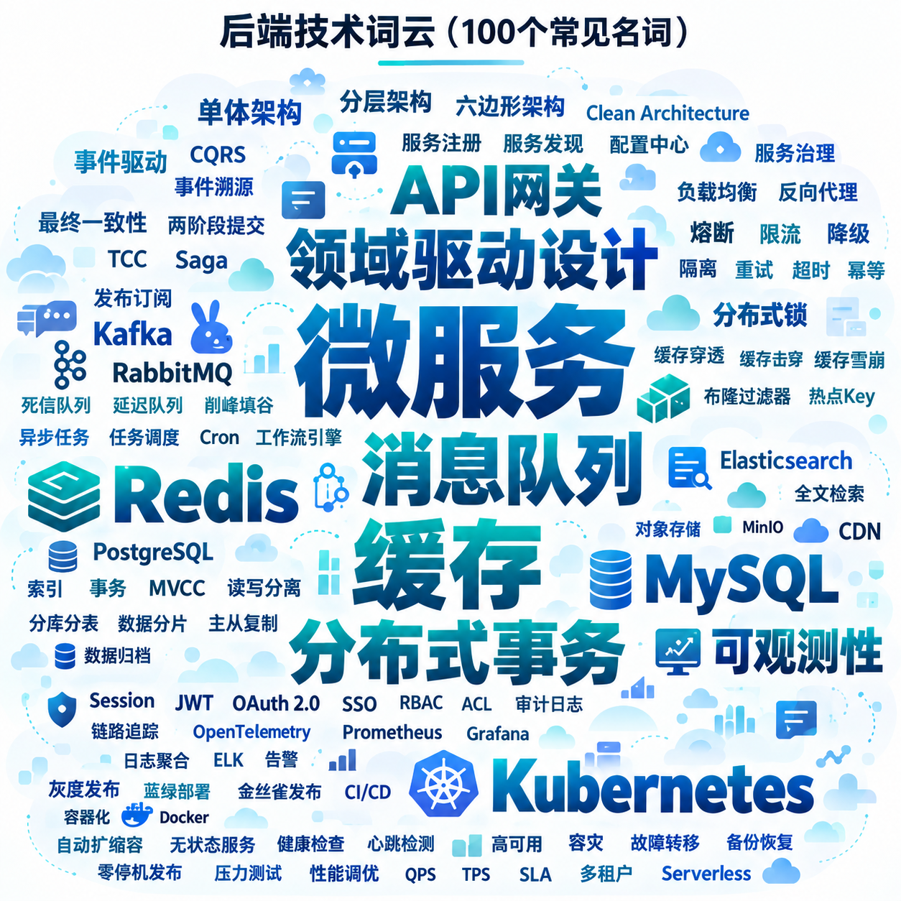

- 如果上述的所有名词你都能说出一点门道出来的话,那这部分你也不用看了.

## 运维
- 容器,Linux命令,计算机网络这些都算在里面了,毕竟运维的职责范围太广了

### 常规八股
#### 计算机网络
1. 从家里的计算机通过浏览器打开一个网页的完整流程是什么？请详细说明每一层的协议工作过程
   1. 先梳理一下五层模型,物理层,链路层,网络层,传输层,应用层,那么当我们访问某个网站的时候,流程如下:
   2. 如果本地没有存储该域名对应的ip地址,就要通过DNS协议去查询,DNS协议是从根域名开始逐级查询的,直到定位到你要查询的完整域名,并返回服务器的IP地址
   3. 找到IP地址后,我们计算机就可以封装数据包了,首先是通过socket接口封装TCP包,然后附加上IP地址,如果电脑连的是网线,那么就通过以太网连接到交换机,并不断跳转最终找到目标服务器;如果电脑是用的4G/WIFI,都是通过无线链路来进行传输的,最终还是传到交换机
   4. 目标服务器接收到请求后,进行拆分,确认请求内容合法并返回网页,然后交付到用户主机
2. 讲一下TCP的可靠交付,即三次握手/四次分手
   1. 网络环境是不可靠的,而TCP通过滑动窗口机制确保了可以通过重传和断点续传避免丢包,而如何确定有包丢失和是否重传呢,就是通过连接双方发送ACK和SYN报文来实现的.
   2. ...待补充
3. HTTP的头部有哪些内容
   1. 分为Response header(响应头),由服务器返回的详细参数,和Request header(请求头),用户对服务器的要求.
   2. ...待补充
4. 常用的status code有哪些?说一说你项目中用到的几个
5. select、poll、epoll分别的优缺点
6. HTTP1,1.1,2,3各自的基本内容?
7. CDN是什么，为什么用，怎么评价CDN的效果和性能
8. Websocket和Http长链接的区别,二者对服务器性能有什么影响
9. JWT原理?和Cookie的区别?
10. 如果有中间人抓包截取了JWT，作为劫持攻击该怎么办?能不能主动让JWT失效呢?
#### 操作系统
1. 线程有哪些状态,什么是死锁,如何恢复和避免
   1. 不同参考书的模型不一样,但常见的说法是有Ready,Running,Waiting,Terminated,New五种状态
   2. 多个线程,彼此请求对方持有的资源,导致死循环无法正常运行,必要条件是四个: 互斥(同一个资源只能给一个线程用),Hold and wait(占有并等待),无法强行释放(系统不能干扰),循环等待.
   3. 恢复的话有几种方法,最常用的就是重启,因为这样不用费脑子和降低性能,要么就只能强行终止部分进程从而破坏死锁.
   4. 防止死锁只要破坏上述的四个必要条件之一即可,如固定加锁顺序,或者一次性申请所有所需的资源,如果有一个资源拿不到,那么就全部不拿.
2. 32位的物理机能申请多少内存呢？那64位呢？
   1. 实际问的是虚拟寻址空间的概念,32位的寻址空间自然就是2的32次方Byte,对应4GB的大小,64位物理机同理
   2. 为什么是Byte呢,因为操作系统是按字节寻址的,即每个地址对应的是一个8位的数组
3. inode是什么，存放什么内容;
4. 硬链接和软连接是什么区别，使用场景上有什么区别
5. 你在终端执行 python app.py，程序正在运行。如果此时按下 Ctrl+C 和 Ctrl+Z，分别会发生什么？
   1. Ctrl+C是发送 SIGINT，请求中断,Python 通常抛出 KeyboardInterrupt，未捕获时退出
   2. Ctrl+Z是发送 SIGTSTP，暂停进程,程序暂停，仍然存在，终端回到命令提示符
#### 容器
1. k8s多个pod，怎么发现这个新的pod

#### Linux命令
### CI/CD
1. 你对CI/CD的基本了解?
### 高级
1. 为什么 RPC 使用 Protobuf
## 数据库/架构
- 说到架构一定会有数据库,说到数据库一定会有架构


### 常规八股
1. 解决hash冲突的方式有哪些？
   1. 链地址法: 弄一个桶或者链表把相同键的值放在一起
   2. 开放寻址法: 写一个数学公式,定义每次冲突后寻找的下一个插入位置,如果冲突则继续找下一个
   3. 直接扩容
2. 什么是IO多路复用(multiplexing)?Redis中相关的应用有哪些?
   1. 一个线程同时监听多个I/O连接,谁处理好了就处理谁,事实上,这个复用翻译的很烂,对比计算机网络中的全双工半双工概念来理解就明白了,就是单纯一对多的关系
   2. 而Redis的应用就是文件事件了,一个Redis线程通过文件事件调度器来监听所有的Socket连接,一旦处理好了就读取所需的文件,在等待处理完毕的数据发来之前不阻塞线程.
3. 传统的搜索引擎是怎么实现搜索的？
   1. 以最典型的TF-IDF为例,就是根据该关键词在所有文档中出现概率的log倒数乘以该关键词在单个文档中出现的概率来排序就行了
   2. 这是靠倒排索引(Inverse Index)实现的,即不是计算单个文档中出现的所有词,而是计算某个词在哪几个文档中出现过
4. Redis 的基础数据类型以及底层实现原理了解吗？
5. B+ 树执行增、删、查、改的时间复杂度分别是多少？
   1. 插入/删除/查找/修改都需要定位到节点,所以复杂度完全相同,如果是m叉树,有N个节点,就是O(logN).
6. 为什么 MySQL / InnoDB 使用 B+ 树作为索引结构，而不是其他数据结构？
7. redis缓存和数据库,在更新/删除的时候,优先动哪个,具体是如何处理的
8. 假如我不想用代码的层面去同步缓存和数据库，有什么解决方案
9. 如何理解Redis中的Lua脚本的原子性
### 分布式算法
1. 介绍一下Raft和Paxos的异同,以及如今常用的分布式算法
2. 一致性哈希解决了哪些问题
3. CAP是什么?抖音刷视频，按照CAP理论，考虑应该满足哪几个特性?
   1. C-Consistency,A-Availability,P-Partition tolerance,俗称为不可能三角,任何分布式数据存储最多只能提供以上三个保证中的两个
   2. 对于短视频业务,我们必须保证Avalability,毕竟要给用户提供内容,而也需要保证分区容错性,因为机房和网络有可能会出现故障,而这会影响用户的即时访问,至于一致性则不太必要,用户也不在乎自己的点赞有没有迅速同步到主数据库,只要UI上有反应就可以了.

### 消息队列
1. 你认识哪些消息队列?分别的优缺点是什么?
### 设计思维
设计思维我认为是最容易被忽视,却是非常重要的考察点

1. 了解哪些设计思想,实践中用过吗?
   1. SOLID: 5跳面向对象软件设计原则的缩写,具体表格见下方.
   2. DDD: Domain-Driven Design,核心思想是围绕业务领域建模，而不是围绕数据库建模
   3. OOD: Object-Oriented Design,对象、封装、继承、多态,基本也只能在Java中广泛使用了
   4. SoC: Separation of Concerns,将不同职责分离
   5. TDD: Test-Driven Development,先写测试，再实现代码
   6. BDD: Behavior-Driven Development,从业务行为描述系统


| 字母 | 原则                            | 中文         | 核心问题                               |
| ---- | ------------------------------- | ------------ | -------------------------------------- |
| S    | Single Responsibility Principle | 单一职责原则 | 一个类为什么会变化？                   |
| O    | Open/Closed Principle           | 开闭原则     | 新功能能否通过扩展实现，而少改旧代码？ |
| L    | Liskov Substitution Principle   | 里氏替换原则 | 子类能否真正替代父类？                 |
| I    | Interface Segregation Principle | 接口隔离原则 | 是否强迫调用者依赖不需要的方法？       |
| D    | Dependency Inversion Principle  | 依赖倒置原则 | 业务代码是否依赖具体实现？             |


2. 设计模式你了解哪些?
3. 服务架构了解哪些?SOA和MSA的区别知道吗?EDA有真实用过吗?
4. MVC和MVVM在如今的优缺点?
### 架构设计
1. 假设让你设计一个 12306 购票系统，你会怎么设计它的整体架构？
   1. 非常开放,但最考验水平.首先假设或者问面试官从而确定用户规模和流量情况.不过抢票系统的规模肯定很大啦
   2. 抢票的重点在于高并发,大量用户争抢稀缺票源时如何保证一致性和有序性.
   3. 说是说架构,但实际上就是问数据库怎么设计,缓存用什么数据库?很明显要用Redis+限流器,不然根本扛不住.当用户请求路由时,如果接收过相同的请求且票源状态没有改变,则直接返回缓存.
   4. 重点在于,我们需要保证用户请求是按照时间顺序来处理的,所以就要加上一层消息队列.
   5. 用户规模这么大,自然还要加一个数据库分片,根据用户id来分就可以.
   6. 所以总的架构就是,后端连消息队列,消息队列连接Redis集群,Redis集群再连到具体的数据库如Oracle

不过这只是最基础的想法,考虑到查询量和交易量的不成比例,所以查询服务要单独处理:

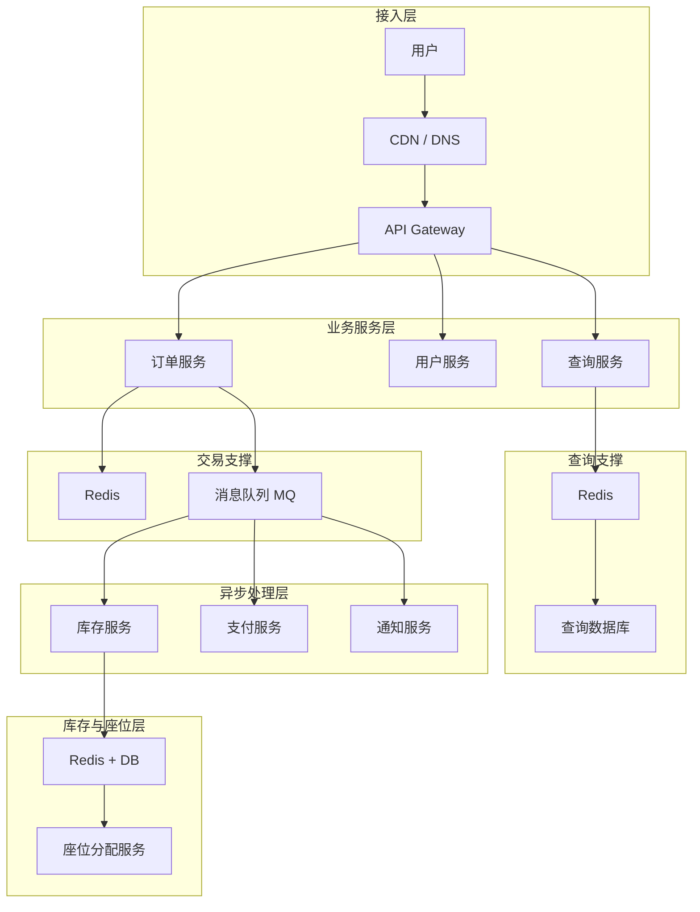

2. 在多节点的游戏服务器内如果需要为物品生成可以跨多节点识别的唯一 UUID，应该如何设计这个 UUID
   1. ...
3. Minecraft 这种游戏里可以把方块拼在一起，存储这些方块数据会带来很大的内存消耗，你可以用什么方法尽可能地减少（内存）消耗？
4. 如何设计一个扫码微信登录的系统？扫码之后，PC是怎么知道手机已经扫码的?如果多个同学同时打开微信客户端去扫码，又去各自用自己的手机扫，怎么知道具体哪个同学扫的是哪个码呢?
5. 假设系统中有数千万甚至上亿用户，每个用户都有一个不断变化的积分。现在需要实现一个实时排行榜，展示积分最高的前 100 名用户。请设计一个基于 Redis 的排行榜系统

### 手写SQL
1. 有一张表记录了玩家的所属省份和 PlayerID，请写一条 SQL 查询语句，统计每个省份的玩家数量
## 语言基础
### Golang
1. Golang 的默认参数传递方式以及哪些是引用传递？
   1. 最考验基础的一集,slice和map都是值传递的,没有引用传递,传递时是传递了一个复制的结构体数组,尽管指向数据存储区域的指针是一样的,但这只是单纯的复制传值而已.
   2. 所以在GO中,所有的参数都是值传递
### Python
1. Python多线程的几种实现方式?分别的适用场景是什么?
2. Python GC的基本原理
   1. 对于CPython来说,用到是引用计数,而循环引用则通过cyclic GC来追踪,通过可达性分析找到循环对象并回收

### C/CPP
1. C++的内存分区结构了解嘛,什么时候变量放在栈上,什么时候放在堆上?malloc 和 new 有什么区别？
   1. C++在运行时中,分为代码段(只读),数据段(全局和静态变量),堆(new分配)和栈(局部变量)
   2. 默认在栈上,除非用new和malloc分配.
   3. malloc返回的是void*,需要强制转换,没有构造函数,new返回具体类型的指针,并调用构造函数,内存安全.
2. 什么是虚函数?构造函数可以是虚函数吗?为什么多态时析构函数一般写成虚函数?
   1. 支持多态的成员函数,可以被子类覆盖
   2. 构造函数在对象创建时调用,而对象没创建时没有虚函数表,故不可能写成虚函数.
   3. 析构函数写成虚函数,那么就会先调用子类析构函数,再逐级调用基类析构函数,从而确保销毁所有资源.因为如果基类析构函数是 virtual，那么派生类析构函数会自动重写它。
## AI岗
### LLM相关
1. 请比较一下几种常见的 LLM 架构，例如 Encoder-Only, Decoder-Only, 和 Encoder-Decoder，并说明它们各自最擅长的任务类型。
2. 大模型的幻觉是怎么产生的？为什么会产生幻觉？
### Agent相关
1. 你做过知识库 / RAG，它的基本原理是什么？
2. 为什么用 RAG？现在上下文窗口这么大了，为什么不直接把原始文档全丢给 Agent 让它自己查？
3. 从原始文档到最终答案，切块、索引、存储、检索、排序，哪几步对效果影响最大？
4. 十篇以上文档，或者让它读一个很大的代码仓库，用 RAG 和让它自己 grep，不考虑 token 消耗的情况下，各有什么优劣？
5. 如果你的 Markdown 没有标题，怎么切？
6. 上下文超窗口，滑动窗口和动态摘要各自的坑。


# 面试要点
## 面试投递环节
### 简历编写
事实上,写简历是最能考验一个人的技术储备的环节,每当你摸不透自己的技术水平时,就去写个简历,立马就能对自己的无能而无地自容.

而写简历自然不可能用word去一个个敲,最好还是找个模板来直接复用就行了.
#### 简历模板

* [闻所未闻的动态简历](https://jirengu-inc.github.io/animating-resume/public/)

  * 这个模板让人耳目一新,但只适合前端工程师
* [可在线编辑的简历](https://visiky.github.io/resume/?template=template2&user=visiky)

  * 中规中矩,比较清晰,推荐使用
* [精美简历](https://github.com/salomonelli/best-resume-ever)

  * 需要专门去下载老版本的node才可以运行,根据issue和实测,至少大于18版本的node都不行
* [md格式简历](https://github.com/geekcompany/ResumeSample)

  * 没什么弯弯绕绕,也很好编辑
* [简历模板大集合](https://github.com/mmmlllnnn/ResumeCollection)

  * 如果都不满意,就来这里找适合自己的

写简历最难的地方就是找自己的优点了,我们需要通过一种实在的角度来夸自己,不过分包装,但要让自己显得很专业很厉害,需要一点语言上的基本功.

#### 简历之外

有时候,公司的简历提交网站上除了提交简历之外还要你填写其他的内容:
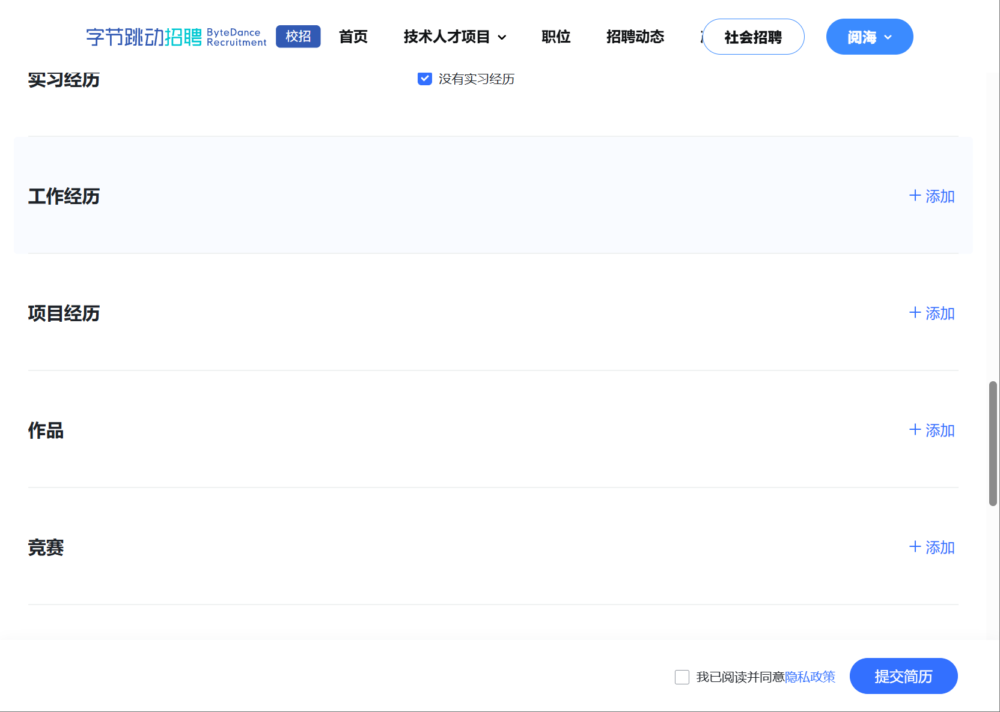

所以我们需要将简历上没写的一些不是很重要的补充信息填上去,帮助面试官加深印象.

### 内推码

在有了简历之后,我们就可以去对应公司的官网投递了,由于内地公司盛行内推码(真不知道最早是哪个**小可爱**想出来的),所以你需要先去小红书/微信上搜索对应公司的内推码,一般直接搜就会有最新的内推码了,直接用就可以.

* 当然有认识的学长学姐更好,但正常来说不会这么凑巧吧...

## 准备面试

不管怎样,投递了简历之后就要开始准备面试了,面试中的问题大致有四种:

1. 算法题
2. 技术题
   1. 通常会拷打你简历上自己写的项目,所以不要吹过头了
3. 生活相关的提问
   1. 拖时长用的
4. 反问环节
   1. 拖时长用的
## 陷阱-面评
需要注意的是,每一轮面试结束后，面试官不是只点“通过/不通过”，还会在公司招聘系统（ATS）里留下结构化评分和文字评价.

>面试官在评价你的简历的时候是可以看得到你投递了别的岗位的，也可以看到别的面试官对你的简历评价的，你仔细想想，本来一个面试官想给你面试机会的，但一看下面有个面试官的评价“资历平平，简历毫无亮点”，多多少少还是会受到影响。正确的做法应该是：选择与自己适配度的两三个岗位，数量不宜多，把最适合自己的优先投递。 

## 算法题

刷题是面试的必备环节,尽管这些算法你以后再也不会在项目中用到,但还是需要你背得滚瓜烂熟.

至于为什么要考算法题,我之前看到有个人说的很好: **企业不敢招连算法题都不会的人**.

这本质上是一场服从性测试,如果你面试前连算法都不愿意去刷的话,你又怎么愿意为了这个公司付出更大的努力呢.

而由于面试的算法题跟竞赛题比起来简直是小儿科,因此基本只要**一个月每天刷个10道题**就可以秒杀所有的面试题了.如果你不满足于刷题的话,可以去看洛谷的**深入浅出系列**,并跟着题单来刷,保证可以快速入门算法.

## 反问环节
* 可参考GitHub仓库: reverse-interview-zh

**"你有什么想问的吗?"**,这个问题基本是面试的收尾必备环节,到了这一步你的表现其实已经不大重要了,毕竟该暴露的都已经暴露了...所以情商不要太低就行,随便问点问题水过去,比如:

* 职责
    * 我的日常工作是什么？
    * 有给我设定的特定目标吗？
    * 团队里面初级和高级工程师的比例是多少？（有计划改变吗）
    * 入职培训 (onboarding) 会是什么样的？
* 技术
    * 公司常用的技术栈是什么？
    * 你们怎么测试代码？
* 团队
    * 团队内 / 团队间的交流通常是怎样的？
    * 当团队有压力并且在超负荷工作的时候怎么处理？
    * 如果有人注意到了在流程或者技术等其他方面又改进的地方，怎么办？
## 大杀器: AI面试(8/14)
在AI如此强大的当下,抛出自己要面试的岗位,AI就可以直接生成强相关的常见面试题,来拷打你的技术水平是否适合这个岗位,不得不说,效果很好!

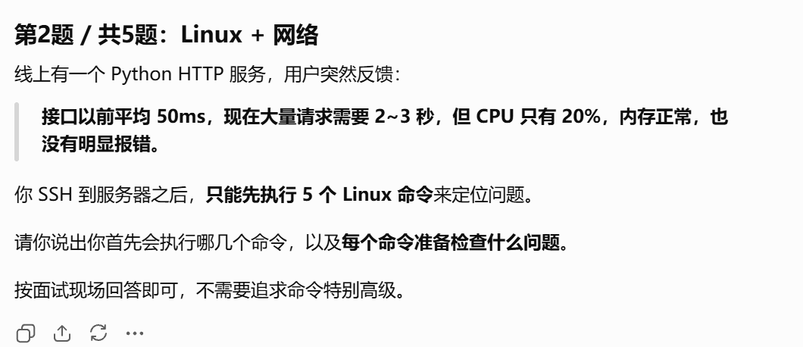


## 招聘要求分析
从几家公司的招聘要求中提取共性,从而得到稍微通用一点的招聘要求,话是这么说,每个面试官的个性都有所不同,就算考察范围相同,问的问题也可能完全不同,只能随机应变了.

### Tencent校招
1. [Agent开发](https://join.qq.com/post_detail.html?postid=1282707395466077184)
   1. 熟练掌握至少一门主流编程语言（Python/TypeScript/Go 等）
   2. 深入理解Agent原理与架构，包括 Planning、Memory、Tool Use、Reflection等核心机制
   3. 熟悉主流Agent开发框架（如 LangGraph、AutoGen、CrewAI、MetaGPT 等），有实际搭建经验
   4. 了解大模型基本原理，熟悉Prompt Engineering技巧，能设计高质量的系统提示词与工具描述
   5. 对AI Agent技术有强烈兴趣，关注行业动态，具备独立调研与技术选型能力
   6. 具备良好的系统思维和问题解决能力，能在复杂场景中设计可靠的Agent方案
   7. 已经是非常基础的要求了
2. [Agent全栈工程师/实习](https://join.qq.com/post_detail.html?postid=1282707398326592512)
   1. 熟练掌握主流前后端技术栈，具备扎实的计算机基础知识和全栈工程能力，能够完成需求分析、方案设计、开发交付及迭代优化的完整流程
   2. 了解大模型基本原理与推理部署方式，熟悉RAG技术、Agent原理（包括 Tool Use、Planning、Memory 等），有相关实践经验
   3. 具备系统设计能力，了解分布式系统、微服务架构、消息队列、缓存等后端核心技术；
   4. 这许愿吧,光第一条就能筛掉百分之九十九点九的应届生了,再加上第三条,基本就是最顶尖的要求了,必然有ssp的,至于我自己再修炼一年也远远够不上吧
3. [后台开发/实习](https://join.qq.com/post_detail.html?postid=1282707383965295616)
   1. 扎实的编程能力，熟练掌握C/C++/Java/Go等其中一门开发语言；
   2. TCP/UDP网络协议及相关编程、进程间通讯编程；专业软件知识，包括算法、操作系统、软件工程、设计模式、数据结构、数据库系统、网络安全等。
   3. 有一定了解的：Python、Shell等脚本语言；MySQL及SQL语言、编程；NoSQL, Key-value存储原理。
   4. 第二个要求看上去简单实际上非常难,说了是专业软件知识,那么一定需要相当深入,至少Unix网络编程要滚瓜烂熟
4. [推荐算法实习](https://join.qq.com/post_detail.html?postid=1211674462290972672)
   1. 扎实的编程能力和算法功底，熟练掌握Python/C++/Java等至少一种编程语言
   2. 扎实的机器学习/深度学习理论基础，熟练掌握Tensorflow/Pytorch等至少一种主流深度学习框架，了解 Hadoop/Spark/Flink等大数据平台工具的使用；
   3. 大数据加深度学习框架,似乎不是很难

### Tencent社招
1. 微信秒剪-大模型后端研发工程师
   1. 熟练掌握 C++、Go 等至少一种编程语言，具备扎实的数据结构、算法和系统设计基础；
   2. 了解 LLM、VLM、扩散模型或 Agent 等相关技术；至少具备一种模型的应用、推理部署或工程化落地经验；
   3. 具备后台服务开发经验，熟悉 MySQL、Redis、Pulsar/Kafka 等常用基础组件；
   4. 了解分布式系统、高并发服务、流式数据处理或模型服务架构，具备基本的性能分析和故障排查能力；
   5. 具备良好的工程素养，重视代码质量、自动化测试、可观测性和持续交付，能够熟练使用 AI Coding 工具提升研发效率；
   6. 不好意思,但我觉得要求甚至没有应届生高好不好
2. 微信小店-后台开发工程师-交易基础(商品方向)
   1. 熟悉C/C++编译类语言, 有2年或以上服务端开发经验；
   2. 有电商业务开发经验者优先；
   3. 有海量服务开发、网络通信优化、计算性能优化经验者优先；
   4. 有类OI/ACM-ICPC竞赛背景优先；
   5. 看得出来就业行情很不好了,最后一个是专门用来卡人的
3. 企业智能体(五年以上工作经验)
   - 计算机相关专业本科及以上学历，3 年以上全栈开发经验，主导过复杂系统的全生命周期研发；
   - 熟悉分布式系统设计，掌握微服务、容器化、CI/CD 等工程实践，有高并发、多租户或私有化交付场景的优化经验者优先；
   - 具备出色的技术方案规划能力，能输出符合 Clean Architecture / Domain-Driven Design 原则的设计文档；
   - 有 Agent 开发经验，熟悉 Agent 架构设计、Prompt 工程、RAG 应用、大模型推理服务化等 AI 工程化流程，具备智能体编排与工具链集成能力者优先；
   - 有 To B 产品、企业级 SaaS / PaaS /私有化部署交付相关经验者优先；
   - 有沙箱隔离与 Agent Runtime 相关架构经验，有容器沙箱、安全隔离执行环境、Runtime 生命周期管理等实践经验者优先；
   - 善用AI 提升生产力， 能高效驾驭AI Coding编程范式, 在 spec / context / harness 层面有方法论；
   - 用来看Agent岗的进化路径很合适呢
4. 微信支付-全栈开发工程师
   1. 本科及以上学历，计算机科学、软件工程、人工智能等相关专业，1年及以上互联网或金融科技行业研发经验；
   2. 熟练掌握Go、Python、Node.js等至少一门后台开发语言，并对相关框架原理有深入理解；
   3. 了解大模型相关技术生态，具备大模型应用落地（如Prompt Engineering、RAG、Agent开发）的实践经验或浓厚兴趣；
   4. 追求极致的系统稳定性和用户体验，具备良好的逻辑思维、风险意识和编码规范。善于沟通、主动思考，具备优秀的团队合作和抗压能力；
   5. 有AIOps、智能运维平台或大数据处理相关项目经验、熟悉业界主流的大模型推理优化及部署技术者优先。

实际来说,要求越少的岗位越不推荐,道理很明显啊,要求越少的话符合要求的人就越多,那你不就是一个可以被随时替代的存在吗.

### 字节校招
1. 大语言模型算法工程师（交互智能方向） - Seed大模型人才校招
   1. 2027届获得本科及以上学历，计算机、数学、统计等相关专业；
   2. 对Human-AI Interaction的前沿趋势有深刻洞察，具有好奇心与快速学习能力；拥有扎实的数学功底和机器学习理论基础；
   3. 卓越的工程落地能力，代码功底扎实，具备系统级思考与架构级问题解决能力；
   4. 坦诚清晰的沟通表达，能高效推进跨团队、跨职能的技术协作；
   5. 具备超大规模LLM的训练、RL的硬核实战经验；
   6. 在Interactive RL, Multi-Agent Systems, 或模型对齐（Alignment）领域有深入研究（在NeurIPS, ICLR, ACL, CHI等顶会有相关一作论文者优先）；
   7. 在博弈论（Game Theory）或机制设计（Mechanism Design）领域有系统性的学术积累；
   8. 有交互智能或生成式智能体（Generative Agents）方向的成功落地项目经历。
   9. 说是本科生以上啦,但不是博士生不太可能有这么NB吧
2. 大语言模型Agent算法工程师-Seed大模型人才校招
   1. 2027届获得本科及以上学历，计算机、数学、统计等相关专业；
   2. 熟悉NLP或者RL相关的算法和技术，在相关领域有过良好研究记录者优先；优秀的代码能力、数据结构和基础算法功底，熟练使用PyTorch/TensorFlow/JAX等任一深度学习框架；拥有扎实的数学功底和机器学习理论基础；
   3. 在大模型领域，主导过有影响力的项目或论文者优先，尤其是Agent相关者优先；
   4. 结论很明显了,字节这是真心在招人,愿意下功夫去招大模型基座方面的人才,做点真东西出来.
3. AI全栈开发工程师 - 豆包
   1. 2027届获得本科及以上学历，计算机、软件工程、人工智能等相关专业优先；
   2. 熟悉浏览器或桌面客户端基本原理；熟悉Vite、Webpack、pnpm等现代工程化工具，具备良好的代码质量、测试、性能和安全意识；
   3. 有自己独立完成的AI项目实践，能够调用模型能力解决真实问题，而不局限于Demo开发；
   4. 对AI技术保持好奇，善于使用AI编程工具提升研发效率，具备较强的学习能力、责任心和协作意识。
   5. 要求实际上比腾讯要低很多,所以可以认为依然是搞一些Demo开发而已,不是重要岗位
4. AI开发工程师 - 抖音研发中台
   1. 2027届获得本科及以上学历，计算机、软件工程等相关专业优先；
   2. 对AI技术有热情，熟悉大语言模型（LLM）的底层原理，有Prompt调优、微调（SFT/LoRA）、RAG系统搭建或Agent框架开发经验优先；
   3. 具备扎实的算法与数据结构基础，至少精通一门主流编程语言（如Python/Go/Java/C++），具备良好的工程编码习惯；
   4. 基本来说,没什么要求
5. 全栈开发工程师（生活服务-治理平台） - TikTok研发
   1. 具备良好的沟通协作能力、自驱力和学习能力，能够使用AI Coding工具端到端推进需求迭代，覆盖从需求理解、方案设计、代码实现、测试验证、Code Review和线上排障的AI Native的开发方式；具备良好的主人翁意识，能够主动识别问题并推动解决；
   2. 具备AI全栈思维，愿意借助AI能力完成从页面到接口的全链路开发，相信AI能够帮助抹平技术栈差异；具备根据工作和业务需要设计Agent Workflow的能力；
   3. 具备良好的业务理解和抽象能力，能够在复杂、信息不完整的场景中主动构造上下文、拆解问题并推动端到端闭环；重视工程质量，对可维护性、性能、稳定性、可观测性、测试及上线风险有系统性认识；
   4. 具备扎实的计算机基础知识（数据结构、算法、计算机网络、操作系统等），至少掌握一门编程语言；具备前端（JS/TS/Vue/React等）、客户端（Flutter/iOS/Android任一）、服务端（Golang/Python/Java任一）任一领域的开发经验，有全栈开发经验者优先；具备良好的接口设计、数据建模和系统设计能力。
   5. 第二个要求有点招笑了,很明显这个岗位有可能来自一个不是很懂技术的Head带的组,想必会比较push吧
6. 后端开发工程师（架构方向） - TikTok内容安全平台
   1. 热爱计算机科学和技术，精通至少一门编程语言，包括但不仅限于：Java、C、C++、PHP、Python、Go；
   2. 掌握扎实的计算机基础知识，深入理解数据结构、算法和操作系统知识；
   3. 有优秀的逻辑分析能力，能够对业务逻辑进行合理的抽象和拆分；
   4. 你越不提要求我越心慌
7. Agent开发工程师（泛架构） - TikTok研发
   1. 熟悉Python/Go/Java/C++中至少一种编程语言，具备扎实的工程开发能力；
   2. 熟悉LLM应用开发，有RAG、Agent、Prompt Engineering、Function Calling、Workflow编排等实践经验者优先；
   3. 具备较强的数据处理和分析能力，熟悉SQL，能从复杂业务数据中抽象问题并形成解决方案；
   4. 具备良好的系统设计能力，能够设计稳定、可扩展、可观测的AI应用服务；对基础设施资源管理、云计算、GPU资源、容量规划、成本优化等方向有经验或兴趣；
   5. 具备较强的业务理解能力和沟通协作能力，能够在不确定场景下推动问题闭环；具备主动学习能力，能快速跟进AI Agent相关技术发展，并转化为实际业务价值。
   6. 越看越爱,简直是冲着我来的,但可惜我的实力远远不够

其实可以说,字节的很多校招岗位都是单纯的耗材而已,并不是冲着真心培养人来的,尽管这对大公司来说是很合理的做法,但还是很寒心呢.唯一的破局之法就是撞入核心事业群的核心开发岗,但难度也确实很高.

一个简单的判断条件就是招聘要求了,招聘要求越详细,工作描述(JD)越清晰,那么这个岗位在一定程度上就越重要.

## 总结
在了解了可以面试哪些岗位之后,就可以根据自己想去的岗位来投递自己的意向公司了,但是参加面试之前总得对自己要面试的公司有个了解吧,因此下文介绍了一些常见的国内外互联网公司.

我们对于一家公司的调研主要分为以下四步:
1. 公司概况: 快速了解这家公司
2. 公司历史: 公司的发展历史
3. 主要产品: 该公司的优秀产品
4. 招聘情况: 内地应聘的条件和要求

其中1,2,3部分主要由AI从wiki总结生成,毕竟这种没太多乾坤的东西靠我自己来翻译还是太累了.

# 公司与岗位调研
## 基本情况

### 公司梯队
T0：

| 企业     | 核心业务                       | 2025年利润               |
| -------- | ------------------------------ | ------------------------ |
| 腾讯     | 微信、QQ、游戏、云计算         | 2,248.42亿元             |
| 阿里巴巴 | 淘宝、天猫、阿里云、国际电商   | 1,294.70亿元（2025财年） |
| 字节跳动 | 抖音、TikTok、豆包、今日头条   | 猜测约两千多亿元         |
| 拼多多   | 拼多多、Temu                   | 993.65亿元               |
| 美团     | 外卖、到店、本地生活、即时零售 | -233.55亿元              |
| 蚂蚁集团 | 支付宝、金融科技、蚂蚁数科     | 猜测约153亿元            |

T1：

| 企业   | 核心业务               | 2025年利润 |
| ------ | ---------------------- | ---------- |
| 京东   | 电商、物流、供应链     | 196亿元    |
| 百度   | 搜索、AI、云计算       | 56亿元     |
| 网易   | 游戏、音乐、邮箱、有道 | 338亿元    |
| 快手   | 短视频、直播、电商     | 186亿元    |
| 小红书 | 内容社区、社交电商     | \_         |
| 滴滴   | 网约车、出行服务       | 9.92亿元   |
| 携程   | 在线旅游、酒店、机票   | 333亿元    |

T2：

| 企业            | 核心业务           | 2025年利润 |
| --------------- | ------------------ | ---------- |
| 哔哩哔哩（B站） | 视频社区、直播     | 11.93亿元  |
| 米哈游          | 游戏、数字内容     | \_         |
| 得物            | 潮流电商           | \_         |
| 贝壳            | 房产交易、居住服务 | 29.94亿元  |
| BOSS直聘        | 在线招聘           | 26.90亿元  |
| 360             | 网络安全、搜索、AI | 2.63亿元   |
| 腾讯音乐        | QQ音乐、酷狗、酷我 | 110.60亿元 |
| 同程旅行        | 在线旅游           | 23.71亿元  |
| 唯品会          | 特卖电商           | 约72亿元   |
| 东方财富        | 互联网金融信息服务 | 120.85亿元 |
| 货拉拉          | 同城货运平台       | \_         |

T3：

| 企业       | 核心业务           | 2025年利润 |
| ---------- | ------------------ | ---------- |
| 新浪微博   | 社交媒体           | 4.49亿美元 |
| 搜狐       | 门户、视频、游戏   | 3.94亿美元 |
| 知乎       | 问答社区、内容服务 | -1.95亿元  |
| 爱奇艺     | 长视频、影视娱乐   | -2.06亿元  |
| 虎牙       | 游戏直播           | -1.13亿元  |
| 斗鱼       | 游戏直播           | -0.29亿元  |
| 汽车之家   | 汽车资讯、汽车服务 | 14.43亿元  |
| 喜马拉雅   | 在线音频           | \_         |
| 4399       | 网络游戏           | \_         |
| 三七互娱   | 游戏研发与发行     | 29.00亿元  |
| 莉莉丝游戏 | 游戏研发与发行     | \_         |
| 叠纸游戏   | 游戏研发与发行     | \_         |

T0和T1都可以被称为大厂,再往下就可算可不算了,看一下各自的2025经济状况:

| 排名 | 公司     | 2025年营收（人民币）      | 2025年利润（人民币）     |
| :--- | :------- | :------------------------ | :----------------------- |
| 1    | 字节跳动 | 约14,300亿元（媒体披露）  | 约2,825亿元（媒体披露）  |
| 2    | 腾讯     | 7,517.7亿元               | 2,248.42亿元             |
| 3    | 阿里巴巴 | 约10,167亿元              | 1,294.70亿元（2025财年） |
| 4    | 拼多多   | 约4,318亿元               | 993.65亿元               |
| 5    | 网易     | 1,126.26亿元              | 约338亿元                |
| 6    | 携程     | 约624亿元                 | 约333亿元                |
| 7    | 小红书   | 约420亿元（媒体估算）     | 约210亿元（媒体预测）    |
| 8    | 京东     | 13,090.85亿元             | 约196亿元                |
| 9    | 快手     | 约1,428亿元               | 约186亿元                |
| 10   | 蚂蚁集团 | 约1,800—1,930亿元（粗估） | 约153亿元（推算）        |
| 11   | 百度     | 约1,291亿元               | 约56亿元                 |
| 12   | 滴滴     | 约2,267亿元               | 约9.92亿元               |
| 13   | 美团     | 约3,648.5亿元             | -233.55亿元              |

#### T0公司
##### 腾讯（Tencent）

**企业文化**

腾讯在程序员群体中的传统印象是**“相对稳定、福利完善、技术积累深厚，但大公司病较明显”**。

- **工作氛围：** 相比字节、拼多多，腾讯通常被认为管理风格更温和，部分成熟业务团队工作节奏相对稳定。但“腾讯养老”的说法具有明显的调侃性质，视频号、游戏研发等团队同样可能存在高强度加班。
- **组织管理：** 事业群独立性强，部门之间存在较明显的资源壁垒。大型项目需要跨团队协调，流程较长，部分员工反映沟通成本较高、决策效率偏低。
- **技术环境：** 微信、QQ、游戏、云计算等业务拥有海量用户和复杂的基础设施，适合积累高并发、分布式系统、音视频等技术经验。不过，成熟业务中的部分岗位也可能长期负责维护、需求迭代。
- **职场现实：** 公司规模庞大、管理层级较多，晋升通常需要持续的业务贡献和组织认可。员工可能面临绩效竞争、晋升名额限制，以及团队调整带来的不确定性。

**晋升与考核**

1. **考核方式：** 采用绩效目标、业务贡献和能力评价相结合的方式。2022年起将原五档绩效简化为 Outstanding（突出）、Good（良好）、Underperform（待改进）三档，绩效影响奖金、调薪及晋升。晋升通常需要申请或提名，并通过专业能力评审。
2. **职级体系：** 采用专业、管理双通道。专业序列在2019年改革后采用4—17级，共14个等级，替代更早的T1—T6等旧体系。技术岗位大致可将4—5级理解为初级、6—8级为工程师及高级工程师、9—11级为骨干或专家、12—14级为高级专家、15—17级为资深专家及更高层次人才。
3. **培养体系：** 腾讯学堂提供新人培训、技术课程、专业交流和管理培训。设有技术周、内部专家分享，以及面向管理人才的专项培养项目。“活水计划”支持跨部门转岗，允许员工探索不同业务方向。

**薪酬与福利**

| 类别     | 主要待遇                                                             |
| -------- | -------------------------------------------------------------------- |
| 薪酬结构 | 固定薪资＋绩效奖金＋长期股权激励                                     |
| 住房支持 | 安居计划（符合条件的首套房免息借款）、易居计划（部分校招生租房补贴） |
| 医疗健康 | 年度体检、补充商业医疗保险、重大疾病保障                             |
| 家庭保障 | 配偶、子女和父母相关保险及就医支持                                   |
| 假期关怀 | 春节特别假、公益假及相关育儿假期等                                   |

---

##### 阿里巴巴（Alibaba）

**企业文化**

阿里在程序员社区中具有非常鲜明的文化标签：**“商业能力强、强调组织文化、管理体系复杂、绩效与晋升竞争激烈”**。

- **工作氛围：** 阿里长期重视组织文化、团队凝聚力和价值观考核。员工通常需要较强的业务理解、汇报表达与跨部门协调能力。程序员社区常用“阿里味”调侃其较浓厚的组织话语、汇报文化和管理风格。
- **组织管理：** 阿里以复杂的商业体系和频繁的组织调整著称。近年来集团经历多次业务重组，不同事业群的人事、绩效和职级制度逐渐产生差异。员工可能经历团队合并、业务转型、岗位调整等变化。
- **技术环境：** 电商、支付生态、云计算等业务积累了大型分布式系统、中间件、数据库及基础设施技术。不过，部分员工反映，在大型组织中，项目价值、业务影响力以及工作成果的可见度，对职业发展具有重要影响。
- **职场现实：** 阿里的职业发展与组织关系、绩效评价联系较紧密。技术能力之外，项目协调、成果展示和管理者认可同样重要。程序员社区对于“晋升答辩”“绩效竞争”“汇报成本”等现象有较多讨论。

**晋升与考核**

1. **考核方式：** 采用业务目标、绩效结果、价值观和多方评价结合的机制。传统上常见3.25、3.5、3.75等绩效分数。不同业务集团存在季度、半年度或年度评价机制，结果影响晋升、奖金和股票激励。
2. **职级体系：** 传统体系分为P（专业）与M（管理）序列：P4—P5一般对应初级工程师，P6为高级工程师，P7为技术专家，P8为高级专家，P9为资深专家，P10及以上属于更高级别的专家或组织领导岗位。
3. **培养体系：** 设有新人地图、师兄师姐带教、“百年阿里”培训，以及专门面向技术人员的线上学院、技术论坛和学习资源。内部还提供专业课程、管理培训和跨业务发展机会。

**薪酬与福利**

| 类别     | 主要待遇                               |
| -------- | -------------------------------------- |
| 薪酬结构 | 固定工资、绩效奖金及适用岗位的长期激励 |
| 特殊假期 | 陪伴假、长期服务假、路途假等           |
| 住房支持 | iHome置业计划                          |
| 健康保障 | 商业补充医疗保险、百万医疗险、年度体检 |
| 家庭关怀 | 子女商业保险、“康乃馨”父母体检计划     |
| 日常福利 | 餐饮补贴、节日礼物、周年关怀           |

---

##### 字节跳动（ByteDance）

**企业文化**

字节在程序员群体中的典型印象是**“高薪、高效率、扁平化、强绩效，同时工作压力较大”**。

- **工作氛围：** 字节长期强调直接沟通、快速决策和减少形式主义。很多团队使用飞书开展文档协作、目标管理和项目推进，信息传递速度快。但这也意味着员工可能面临频繁的即时沟通、快速反馈和较紧的交付周期。
- **组织管理：** 字节倾向于让年轻员工较早承担实际业务责任。部分团队层级相对扁平，对年龄和资历的依赖较低。然而，业务变化迅速、项目调整频繁，员工需要较强的适应能力。
- **技术环境：** 抖音、TikTok、推荐算法、广告系统及AI业务拥有庞大的数据规模和技术场景。工程师能够接触大规模在线服务、推荐系统、机器学习和AI基础设施，但不同业务线的技术含量差异明显。
- **职场现实：** 字节以绩效竞争和快速成长机会著称。员工社区经常讨论绩效评级、业务成果量化以及频繁的目标调整。部分员工认为评价方式较透明、优秀者容易获得激励，也有人反映长期绩效压力和高工作强度影响工作生活平衡。

**晋升与考核**

1. **考核方式：** 采用目标管理、业务结果、360度反馈及价值观评价。常见绩效等级包括M、M+、E、E+等。2025年调整后，晋升提名条件由此前连续两次M+放宽至一次M+。2026年进一步加强高绩效激励，并将价值观及领导力评价纳入综合绩效调节。
2. **职级体系：** 2026年1月起启用L1—L10十级体系，取代原来的1-1至5-2体系。原1-1和1-2合并为L1，并新增顶级职级L10。新职级在薪酬带宽和晋升空间上进行了调整，不能直接按照旧等级逐项对应。完整的新职级岗位能力标准尚未全部公开。
3. **培养体系：** 通过新人培训、导师带教、内部学习平台和业务线专项培训培养员工。强调在实际项目中学习，对优秀员工提供承担大型项目、跨团队协作及管理岗位的机会，培养过程具有较强的实践导向。

**薪酬与福利**

| 类别       | 主要待遇                                  |
| ---------- | ----------------------------------------- |
| 薪酬结构   | 固定工资＋绩效奖金＋适用岗位的期权/RSU    |
| 2025年调整 | 全年绩效奖金投入较上一周期增加35%         |
| 调薪预算   | 相关绩效周期调薪投入提升至上一周期的1.5倍 |
| 健康福利   | 年度体检、心理关怀、健康服务              |
| 员工培养   | 内部学习平台、专业技能与领导力培训        |

2026年起，相关高绩效半年激励采用25%现金、75%期权或RSU的发放结构。预算增长不等于全员等比例涨薪，股权也存在归属周期和流动性限制。

---

##### 拼多多（PDD Holdings）

**企业文化**

拼多多在程序员圈中的形象非常突出：**“薪资竞争力强、组织精简、执行效率高，但工时长、管理严格、工作与生活难以平衡”**。

- **工作氛围：** 拼多多长期以高强度工作著称。媒体调查及员工分享中多次出现“11—11—6”（上午11点至晚上11点，每周6天）的说法。实际情况因团队和业务线而异，但长工时确实是其雇主评价中最突出的争议之一。
- **组织管理：** 拼多多强调业务结果和执行效率。团队通常较精简，层级相对扁平，会议和非必要流程较少，员工需要直接承担业务责任。部分员工认为这种方式减少了无效沟通，也有人反映工作压力集中、个人自主空间有限。
- **技术环境：** 电商平台、推荐系统、搜索、交易和供应链业务具有较高的技术复杂度。但由于业务推进速度快，部分岗位更重视交付效率与线上结果，技术重构、长期架构优化可能需要服从业务优先级。
- **职场现实：** 财新等媒体曾报道拼多多实行高强度绩效筛选机制，员工淘汰与绩效结果联系紧密。程序员社区常将其视为愿意以较高劳动投入换取竞争性薪酬的平台。需要注意，这些调查反映特定时期及受访者的经历，不能据此断言每个团队都执行相同规则。

**晋升与考核**

1. **考核方式：** 历史媒体调查曾报道其使用“2—7—1”绩效分布，即约20%优秀、70%中等、10%较差，考核与调薪、岗位调整及人员去留相关。该规则的2026年实际执行范围与细节缺乏充分公开证据。
2. **职级体系：** 拼多多没有公开足以可靠重建的全集团统一职级表。对外讨论中常出现普通员工、小组长、二级主管、一级主管等岗位层次，但这属于组织职责的概括，不能当作经过确认的正式职级序列。具体晋升路径应以招聘岗位及内部制度为准。
3. **培养体系：** 校招官网明确提及导师带教、专业培训、创新项目实战及新人授权。部分岗位采取一对一资深员工指导、业务轮岗等方式。总体较重视在真实业务中快速积累经验。

**薪酬与福利**

| 类别     | 主要待遇                                     |
| -------- | -------------------------------------------- |
| 现金薪酬 | 校招材料强调具有市场竞争力的薪酬             |
| 股权激励 | 集团设有股份支付激励，具体授予对象和条件不同 |
| 日常福利 | 部分员工报告提供工作餐、餐饮配套等           |
| 人才培养 | 一对一导师带教及培训资源                     |
| 主要成本 | 长工时风险，需要核实具体部门安排             |

拼多多的竞争性薪酬需要与实际工作时长共同评价。长期股权激励还需要考虑归属条件、兑现方式和离职处理规则。

---

##### 美团（Meituan）

**企业文化**

美团在程序员社区的典型印象是**“业务驱动、执行力强、工作节奏快，组织管理务实但绩效压力明显”**。

- **工作氛围：** 美团高度重视业务效率、指标和实际结果。外卖、即时零售等业务竞争激烈，项目通常围绕增长、履约效率、成本控制等目标推进。员工需要理解业务逻辑，适应持续变化的需求。
- **组织管理：** 美团拥有复杂的线上线下业务体系，运营、产品、技术和商业团队联系紧密。程序员除了完成技术任务，还经常需要处理业务协调、紧急需求和线上问题。部分员工反映其管理方式具有较强的目标导向，工作成果与业务指标联系密切。
- **技术环境：** 美团的高并发交易、调度算法、配送路径优化、实时计算和分布式系统具有较高技术价值。对于希望深入后端架构、数据工程和复杂业务系统的程序员而言，相关核心团队提供了较丰富的技术场景。
- **职场现实：** 美团长期被程序员社区认为工作节奏较快，部分业务团队存在加班和较高绩效压力。成熟平台团队、新业务团队以及一线运营岗位的工作方式存在明显差异。

**晋升与考核**

1. **考核方式：** 美团2025年年报披露，销售、客服等岗位通常采用月度或季度评价，研发及职能岗位开展年度综合绩效评估，管理者接受年度360度评价。晋升综合考虑业务贡献、专业能力和领导力，并设有优秀人才快速晋升通道。
2. **职级体系：** 采用L序列职级，公开技术招聘及薪酬样本中常见L5—L10。大致可以理解为L5—L6覆盖成熟工程师及骨干岗位，L7—L8更多涉及技术专家、复杂项目负责人，L9—L10通常对应更高层次的技术专家或管理负责人。这些对应关系仅供理解；公司尚未完整公开全部职级的正式定义，不能用工作年限直接推算职级。
3. **培养体系：** 设有“萌芽校招生成长计划”、导师带教、内部学习平台和跨岗位发展机制。2025年公开招聘资料提及约5.8万门内部线上课程，并向校招生提供项目实践、轮岗及内部流动机会。

**薪酬与福利**

| 类别     | 主要待遇                                 |
| -------- | ---------------------------------------- |
| 薪酬结构 | 固定薪资＋绩效激励＋部分关键岗位股权激励 |
| 商业保险 | 意外险、补充医疗险                       |
| 特殊保障 | 爱心基金、重疾关怀、紧急援助             |
| 日常配套 | 主要办公场所的食堂、健身房、图书馆等     |
| 员工福利 | 自有产品优惠、节日礼物、家庭日           |
| 假期     | 带薪病假、育儿假及相关福利假期           |

---

##### 蚂蚁集团（Ant Group）

**企业文化**

蚂蚁集团在程序员社区的印象是**“技术基础较强、福利体系成熟、业务规则复杂、金融合规要求严格，同时保留一定的阿里式组织文化”**。

- **工作氛围：** 蚂蚁继承了阿里体系中的部分管理方式，包括绩效评价、技术专家路线和团队文化建设。但由于业务高度涉及支付交易、资金安全、风险控制及金融科技，开发流程往往更加重视安全、稳定和合规。
- **组织管理：** 相比纯内容平台，金融科技业务更依赖跨部门审查、风险管理和技术验证。部分技术人员需要面对较复杂的审批流程、风控要求和监管变化，这可能提高系统可靠性要求，也增加业务推进成本。
- **技术环境：** 支付宝及相关金融科技业务积累了分布式事务、数据库、高可用架构、信息安全、密码学和风控等技术经验。核心支付、数据库和基础设施团队通常具有较强的技术专业性。
- **职场现实：** 蚂蚁的员工待遇和保障在互联网行业具有一定吸引力，但金融科技行业的监管变化、组织重构和业务转型也给职业发展带来不确定性。核心技术团队、金融业务团队及创新业务团队的工作压力存在差异。

**晋升与考核**

1. **考核方式：** 结合业务成果、岗位能力、绩效评级及团队评价。传统绩效体系中常见3.25、3.5、3.5+、3.75等等级，绩效影响奖金、股权及晋升。高绩效员工可能获得更多激励，但具体晋升条件由内部岗位标准决定。
2. **职级体系：** 2023年推进职级细化改革，将原P5—P9拆分为更细的等级：P5对应10—11级、P6对应12—13级、P7对应14—15级、P8对应16—17级、P9对应18—19级。通常分别涉及初中级专业人员、高级工程师、技术专家、高级专家和资深专家等层次。具体岗位与等级的对应关系需要以改革后的内部标准为准。
3. **培养体系：** 通过新人培训、导师带教、专业技术课程、内部知识分享及岗位实践培养人才。重点技术方向包括支付、金融风控、安全、数据库和AI。集团还设有内部人才流动机制，帮助员工跨岗位积累经验。

**薪酬与福利**

| 类别       | 主要待遇或制度                    |
| ---------- | --------------------------------- |
| 17级及以下 | 原13薪并入每月基本工资            |
| 18级及以上 | 原13薪并入与绩效挂钩的年度奖金    |
| 股权激励   | 2025年4月起新授予绩效股按季度归属 |
| 健康福利   | 员工健康保障、互助基金            |
| 家庭关怀   | 补充保险、家属健康保障            |
| 特殊假期   | 每年5天带薪健康假                 |


##### 总结
T0大厂都有一个特点: 竞争激烈,只能拼了老命去干,才有晋升的空间.


#### T1公司
##### 京东（JD.com）

**企业文化**

京东在程序员群体中的典型印象是**“执行力强、重视业务结果、管理风格务实，但自上而下的管理色彩较浓”**。

- **工作氛围：** 京东具有比较鲜明的强执行文化。员工需要对交付结果、业务指标和工作效率负责。与腾讯、网易等企业相比，京东部分业务团队的管理风格更加直接，对任务完成时间、工作纪律和绩效结果要求较高。“京东兄弟文化”在社会上具有较高知名度，但员工对其真实体验存在分歧，特别是在组织调整和人员优化期间。
- **组织管理：** 京东强调成本、效率和履约能力，整体管理更接近大型零售与供应链企业。技术团队需要直接服务商业目标，业务部门的话语权较强。程序员社区经常讨论需求交付压力、部门协调成本以及管理层对业务结果的重视程度。
- **技术环境：** 京东的电商交易、仓储物流、供应链、金融科技和云计算业务，提供了复杂的分布式系统、高并发交易、库存管理及物流调度场景。核心基础设施团队具有较高技术含量，但普通业务研发岗位可能以需求开发、接口维护和业务系统迭代为主。
- **职场现实：** 京东的工作体验高度依赖事业群和直属管理者。京东零售、京东物流、京东科技的岗位性质与工作强度差别较大。2024—2025年的多轮薪酬调整提高了部分岗位的收入吸引力，但并不能说明全集团员工获得了相同涨幅。

**晋升与考核**

1. **考核方式：** 京东采用绩效目标设定、过程跟进、绩效评价和反馈应用相结合的机制，根据岗位设置季度、半年度或年度考核。重点评价个人及团队的业务成果、执行能力与价值观。晋升通常综合考虑绩效、岗位任职资格、团队需求和管理者推荐。
2. **职级体系：** 京东过去采用M（管理）、P（项目管理）、T（产品与技术）等序列，技术岗常见T4—T11，其中T4—T5对应一般工程师及高级工程师，T6—T7对应资深工程师、技术骨干和架构师，T8及以上逐步进入技术专家与高级技术负责人层次。**2024年11月底，京东宣布将原M、P、T、S主序列整合为新的P专业主序列。** 
3. **培养体系：** 京东设有较成熟的内部人才培养机制，包括新人培训、导师指导、专业技能课程、管理培训和跨岗位轮岗。“七上八下”人才机制强调大胆任用年轻管理者，管理岗位优先考虑内部人才；另有高潜人才计划、Backup继任者培养机制及国际人才发展项目。

**薪酬与福利**

| 类别     | 主要待遇                                                                       |
| -------- | ------------------------------------------------------------------------------ |
| 薪酬结构 | 固定工资＋绩效奖金＋年终奖金＋部分岗位长期激励                                 |
| 薪酬调整 | 2024年宣布京东零售及部分职能体系分阶段提升至20薪，适用范围和兑现情况因岗位而异 |
| 住房支持 | 安居计划，符合条件的员工可申请住房相关支持                                     |
| 医疗健康 | 年度体检、员工医疗保障、部分老员工专项医疗支持                                 |
| 家庭关怀 | 福利产假、陪护假、爱心救助基金                                                 |
| 日常福利 | 免费班车、福利补贴、员工福利券、节日礼物、司龄奖金                             |

---

##### 百度（Baidu）

**企业文化**

百度在程序员界长期具有**“技术底蕴深厚、工程师文化较强，但组织效率和商业化能力受到争议”**的典型形象。

- **工作氛围：** 百度早期以搜索算法、自然语言处理和机器学习技术著称，长期吸引大量技术人才。工程师社区对其搜索、推荐、深度学习框架和自动驾驶领域的技术积累评价较高。然而，随着商业化和AI业务发展，不同团队的技术导向与业务导向差异逐渐扩大。
- **组织管理：** 百度属于典型的老牌互联网企业，管理流程和组织结构相对成熟，但也受到层级较多、跨部门协作效率不足等批评。程序员社区经常讨论技术方案需要经过多层评审、项目决策周期较长，以及部分业务组织目标变化较频繁的问题。
- **技术环境：** 百度在搜索推荐、广告算法、自然语言处理、大模型、自动驾驶和AI基础设施领域仍拥有较丰富的技术资源。对于算法、机器学习与基础设施方向的工程师，部分核心团队具有较高的专业价值；普通业务开发岗位则未必能够接触这些核心技术。
- **职场现实：** 百度近年来持续进行AI转型。传统搜索、移动生态与新兴AI业务面临不同的发展前景。2025年媒体报道过涉及多个部门的人员调整，因此“老牌大厂相对稳定”的印象需要重新审视。百度的长期职业发展机会越来越依赖具体业务方向和AI技术转型进度。

**晋升与考核**

1. **考核方式：** 传统绩效管理综合考虑业务目标、个人贡献、专业能力和团队评价，考核结果影响奖金、调薪与晋升。**2026年职级改革进一步强调“专业力＋领导力”**，要求员工在专业贡献之外具备跨团队协作、推动项目和解决复杂问题的能力。具体评级分布与晋升名额尚未完整公开。
2. **职级体系：** 百度原先采用T（技术）、P（产品运营）、E（政企业务）、Band（职能）和M（管理）等序列，技术岗主要覆盖T3—T11。**2026年5月1日起，百度将中层管理者以下的专业和管理通道统一为5—12级数字体系。** 5级为初级员工，12级对应资深专家或高级管理者，6—11级覆盖逐步扩大的专业、项目及组织职责。
3. **培养体系：** 百度具有较成熟的技术培训与人才发展机制，包括技术专家分享、专项技术课程、管理培训和核心项目实践。AIDU计划重点培养AI领域顶尖技术人才，2026年升级后采用高管导师、技术指导人与业务指导人相结合的培养模式；管培生计划则侧重培养年轻管理者。

**薪酬与福利**

| 类别         | 主要待遇                                         |
| ------------ | ------------------------------------------------ |
| 薪酬结构     | 固定工资＋绩效奖金＋部分岗位股票激励             |
| 人才专项激励 | AIDU等顶尖AI人才计划设有独立薪酬方案             |
| 健康保障     | 员工医疗保障、健康关怀、部分岗位及地区的补充保障 |
| 日常配套     | 部分办公园区提供餐饮、健身和通勤配套             |
| 休假制度     | 法定带薪假期及适用岗位的其他假期福利             |
| 人才培养     | 技术培训、专家指导、AI人才计划和管理培训         |


---

##### 网易（NetEase）

**企业文化**

网易在程序员社区中常被称为“猪厂”，典型印象是**“福利较好、生活配套完善、产品与内容特色明显，但游戏业务绩效压力较大”**。

- **工作氛围：** 网易在行业中以食堂、办公园区和生活福利闻名，杭州等主要园区的餐饮及休闲设施受到不少员工好评。部分成熟业务团队的工作氛围相对宽松，但不能因此将网易简单理解为“养老厂”。
- **组织管理：** 网易旗下游戏、云音乐、有道、严选等业务具有较强独立性。尤其是网易游戏内部，不同工作室、项目组的管理方式和研发节奏存在很大差异。互联网程序员社区中经常出现对网易互娱、雷火等不同团队的比较。
- **技术环境：** 网易在游戏引擎、图形渲染、游戏服务器、音视频、推荐算法和在线服务领域具有较强技术积累。游戏业务能够提供复杂的实时交互和高并发场景，而云音乐、有道等业务则更接近常规互联网产品和数据平台研发。
- **职场现实：** 网易游戏业务具有较鲜明的项目制特点。热门项目可以带来较丰厚的奖金和成长机会，但研发周期、上线表现及商业成绩也会影响团队稳定性。部分员工反映，项目冲刺期加班强度明显增加，项目调整或停止运营可能伴随岗位变化。

**晋升与考核**

1. **考核方式：** 网易2025年ESG报告披露了覆盖目标设定、过程跟进和评估反馈的绩效管理机制。考核关注业务成果、个人能力及岗位贡献。游戏研发岗位还可能受到项目进度、产品质量和商业表现影响。具体评级制度和奖金计算方式由业务部门决定。
2. **职级体系：** 网易长期采用专业与管理双通道，业内公开资料常以P专业序列和M管理序列说明：P2-1至P2-3通常覆盖初级工程师，P3-1至P3-3对应工程师及高级工程师，P4-1至P4-3对应资深工程师或技术骨干，P5-1至P5-3对应技术专家，P6及以上逐步涉及研究员、高级专家和核心技术负责人。管理序列一般以M1—M5描述不同管理层次。
3. **培养体系：** 网易建立了新人培训、专业人才和管理者培养体系。2025年披露的项目包括校招生Mini项目实践、网易游戏《一代宗师》后备人才培养、MUST新任管理者训练营等。通过导师带教、项目实践和跨团队学习培养专业人员与管理人才。

**薪酬与福利**

| 类别     | 主要待遇                                         |
| -------- | ------------------------------------------------ |
| 薪酬结构 | 固定工资＋绩效奖金＋项目奖金＋适用岗位的股权激励 |
| 餐饮福利 | 部分主要园区提供免费工作餐、餐饮及休闲配套       |
| 健康保障 | 补充商业保险、年度体检、心理健康支持             |
| 家庭关怀 | 健康陪护假、家属就医协助、相关慰问福利           |
| 住房支持 | 部分员工可享住房借款或住宿支持                   |
| 生活福利 | 节日礼物、员工内购、园区运动设施、文化活动       |


---

##### 快手（Kuaishou）

**企业文化**

快手在互联网职场社区中的典型印象是**“业务导向强、重视结果和执行、技术场景丰富，近年来组织管理逐渐成熟”**。

- **工作氛围：** 快手早期具有浓厚的创业型文化，强调快速执行、用户理解和团队协作。随着公司规模扩大，其管理方式逐步转向制度化和精细化。与字节相比，外界有时认为快手的组织文化较为务实，但不同业务部门对绩效和交付速度的要求同样较高。
- **组织管理：** 快手在短视频、直播、电商及商业化方面持续投入，组织目标与业务增长指标联系紧密。员工需要适应产品快速迭代、数据反馈和市场竞争。部分程序员反映业务需求变化较快、会议与跨团队协调占用较多时间。
- **技术环境：** 快手拥有大规模推荐系统、实时音视频、直播技术、广告系统和电商交易基础设施。推荐算法、音视频编解码和高并发系统是其典型技术优势。近年来AI大模型和视频生成相关业务也成为重要技术方向。
- **职场现实：** 快手过去采用较明显的创业公司管理模式，随着业务成熟，逐步强化绩效管理和职级规范。2023年职级改革进一步明确人才发展与晋升机制。员工在职业发展中需要同时面对业务成果、专业能力和晋升评审的竞争。

**晋升与考核**

1. **考核方式：** 采用业务目标、个人绩效和岗位能力综合评价。2023年改革后更加重视持续绩优和实际贡献。晋升至E10及以下原则上保留一年两次晋升窗口，E11及以上调整为一年一次；连续绩优者有机会获得加速晋升。
2. **职级体系：** **2023年8月，快手将原专业K序列和管理M序列整合为E6—E15共10级。** E6通常对应新人或初级岗位，E7—E9主要覆盖工程师与业务骨干，E10—E12逐步对应资深工程师、技术专家或管理负责人，E13—E15属于更高层次的专家和管理岗位。
3. **培养体系：** 快手建立了新人、专业人才和管理者培养机制，依托“快手中学”提供内部课程。2025年开设课程4,767门，培训总时长超过116万小时。公司还强调从内部选拔基层管理人员，并为专业人才提供业务实践、培训和管理发展机会。

**薪酬与福利**

| 类别     | 主要待遇                                   |
| -------- | ------------------------------------------ |
| 薪酬结构 | 固定工资＋绩效奖金＋符合条件的股权激励     |
| 年终激励 | 依据个人绩效、业务表现及公司激励政策发放   |
| 健康保障 | 员工健康关怀、部分岗位及地区的补充医疗保障 |
| 生活配套 | 部分办公场所提供餐饮、休闲和运动配套       |
| 员工关怀 | 节日福利、团队活动及其他员工支持           |
| 人才培养 | 快手中学、专业课程、管理者培训             |

---

##### 小红书（Xiaohongshu）

**企业文化**

小红书在互联网求职群体中的典型形象是“年轻化、产品氛围浓厚、重视审美与用户体验，但业务节奏快、绩效与商业化压力逐渐增强”。

- **工作氛围：** 小红书的用户群体、产品形态和内容生态，使公司具有较鲜明的社区文化。相较传统电商企业，产品设计、内容理解、用户体验和社区氛围在日常工作中具有较高权重。员工文化活动与工作环境也具有一定年轻化特色。
- **组织管理：** 小红书长期强调扁平化、自驱动和员工自主承担责任。2024年取消传统专业职级，进一步压缩管理层级，减少论资排辈和多层审批。然而，扁平化也意味着部分岗位职责边界较宽，员工需要自行推动项目、协调资源并证明工作成果。
- **技术环境：** 小红书拥有推荐系统、搜索、广告、电商及内容社区技术场景。其推荐算法和搜索系统需要兼顾用户兴趣、社区内容质量及商业化需求。核心算法与基础设施团队具有一定技术挑战，普通业务研发岗位则更多面向产品迭代。
- **职场现实：** 小红书曾因“大小周”制度受到广泛讨论。**2025年5月1日起，公司取消隔周周六工作的安排**，部分员工原有加班工资因此减少。公司还取消新增员工竞业限制，并开放离职期权回购申请。近年来，小红书持续推进商业化与组织效率改革，绩效压力和人员调整成为求职者需要关注的问题。

**晋升与考核**

1. **考核方式：** 2024年改革后，小红书更加直接地将薪酬与工作难度、奖金与工作成果挂钩，强调实际业务贡献和个人能力。管理岗位采用任命制。具体绩效分档、考核周期及不同岗位的晋升评审条件未完整公开。
2. **职级体系：** 小红书原先采用R专业序列和L管理序列，其中R1—R8覆盖不同专业层次，L0—L4对应管理岗位。R5、R6、R7曾是较常见的骨干及负责人级别。**2024年8月16日起，公司取消R职级和L0管理层级，并对各级Leader实行任命制。** 
3. **培养体系：** 小红书建立了覆盖新人、专业骨干和管理者的培养机制。内部学习资源包括Builder School、AI技校、睿德书院及REDacademy。培养强调在真实业务项目中承担责任，同时提供技术、产品、社区运营和管理相关课程。

**薪酬与福利**

| 类别     | 主要待遇                                        |
| -------- | ----------------------------------------------- |
| 薪酬结构 | 固定工资＋绩效奖金＋符合条件的期权激励          |
| 股权政策 | 2025年起允许符合条件的离职员工申请期权回购      |
| 住房支持 | 部分员工享有租房补贴                            |
| 医疗健康 | 补充商业保险、年度体检                          |
| 假期福利 | 入职可享适用的带薪福利年假                      |
| 日常福利 | 团建基金、生日与周年福利、兴趣社团、周五Pet Day |

---

##### 滴滴（DiDi）

**企业文化**

滴滴在程序员群体中的典型印象是**“技术业务场景复杂、执行要求高、运营和安全导向鲜明，但业务调整与组织变化较多”**。

- **工作氛围：** 滴滴的业务高度依赖实时交易、运力调度和线下服务，因此具有较强的运营驱动特征。研发人员通常需要与产品、运营、风控和安全团队协作，工作成果经常与订单效率、系统稳定性和用户体验直接相关。
- **组织管理：** 滴滴的管理风格强调业务效率、数据指标和问题解决。部分员工认为核心项目能够提供较大的个人责任和技术成长空间，也有人反映跨部门协作复杂、紧急业务需求较多。公司近年来还持续发展国际业务，各地区业务模式和管理方式存在差异。
- **技术环境：** 滴滴在实时调度、地图导航、路径规划、供需预测、机器学习、实时计算和大规模分布式系统方面具有丰富实践。对于后端、算法和数据工程师而言，核心出行平台拥有较有价值的技术场景。
- **职场现实：** 滴滴过去经历过业务监管、应用下架及组织调整等重大事件，员工职业发展受外部政策和公司战略影响较为明显。近年来业务重心逐渐延伸至国际出行和相关服务，因此团队稳定性、业务投入及岗位成长机会需要分别判断。

**晋升与考核**

1. **考核方式：** 滴滴公开的可持续发展报告披露，其人才评价包括绩效考核、多维反馈、人才盘点和晋升评审。评价综合考虑员工业务成果、岗位能力以及合作方反馈。历史公开资料中曾出现S、A、B、C、D五档绩效体系，
2. **职级体系：** 滴滴技术岗位历史上采用D序列，常见D5—D12：D5为工程师，D6为高级工程师，D7为资深工程师，D8为专家工程师，D9为高级专家，D10为首席工程师，D11及以上对应更高层次的技术专家。公开员工经验普遍认为D7升D8是一个比较明显的晋升门槛。
3. **培养体系：** 滴滴建立了多通道发展、人才盘点和内部“活水”机制，为员工提供岗位调整与跨部门发展机会。培训体系包括新人融入、专业能力培养、管理者培训和关键人才发展项目。国际化业务还提供跨文化协作与全球业务实践机会。

**薪酬与福利**

| 类别     | 主要待遇                             |
| -------- | ------------------------------------ |
| 薪酬结构 | 固定工资＋绩效奖金＋部分岗位股权激励 |
| 健康保障 | 商业保险、年度体检、健康关怀         |
| 休假福利 | 带薪假期及适用的专项福利假           |
| 日常配套 | 部分办公场所提供健身、运动及休闲设施 |
| 员工活动 | 体育联赛、读书会、兴趣社团、家庭日   |
| 职业发展 | 内部活水、专业与管理发展通道         |

---

##### 携程（Trip.com Group）

**企业文化**

携程在互联网求职市场中的典型印象是**“业务成熟、商业模式清晰、福利与工作生活平衡受到关注，但技术成长和工作压力因部门差异明显”**。

- **工作氛围：** 携程相比短视频和电商平台，整体业务模式相对成熟，长期围绕酒店、机票、旅游服务及国际业务运营。部分员工认为其工作节奏较为可预测，技术团队更容易围绕稳定业务持续积累经验，但不能将其所有岗位归类为轻松岗位。
- **组织管理：** 携程近年来大力推进混合办公制度，并在员工福利与弹性工作方面形成比较鲜明的雇主形象。2025年9月起，部分符合条件的国内产研员工申请居家办公，不再需要直属主管事先审批。与多数强调现场协作的互联网企业相比，这是比较有代表性的管理差异。
- **技术环境：** 携程拥有大规模旅游搜索、酒店和航班库存、定价算法、国际支付、订单系统及推荐技术场景。核心研发需要处理高并发交易、全球化服务和复杂的旅游供应链，但普通业务开发岗位可能更侧重传统应用系统和运营需求。
- **职场现实：** 携程的旅游业务具有明显的季节性，春节、暑期及其他假日通常是业务高峰。部分技术和运营岗位可能面临节假日值班、突发订单问题和线上保障任务。混合办公政策改善了部分员工的通勤与生活安排，但不能等同于没有加班或完全自由办公。

**晋升与考核**

1. **考核方式：** 携程采用多维绩效评价机制，综合业务目标、个人贡献、岗位能力和团队评价，结果用于薪酬激励与人才晋升。研发岗位通常关注交付质量、系统稳定性、效率和技术能力；业务运营岗位则更侧重经营指标。完整的内部绩效分档和统一晋升条件未公开。
2. **职级体系：** 携程历史上采用T（技术）、M（市场）、P（业务）等不同岗位序列，公开求职资料通常将技术职级划分为T1—T10，其中T3—T4为常见工程师层次，T5—T6逐步进入骨干、资深工程师或小团队负责人层次，T7及以上通常对应更高级别专家或负责人。。
3. **培养体系：** 携程2025年可持续发展报告披露，公司建立覆盖新人、专业人才和管理者的分层培训体系。通过专业课程、业务实践、知识共享和领导力培训支持员工成长，同时结合多维绩效评价和人才发展计划推进内部人才培养。

**薪酬与福利**

| 类别     | 主要待遇                                                    |
| -------- | ----------------------------------------------------------- |
| 薪酬结构 | 固定薪资＋绩效奖金＋部分岗位股权激励                        |
| 混合办公 | 符合条件的岗位可申请每周部分时间居家办公                    |
| 生育补贴 | 符合条件的员工每生育一个子女，可连续五年领取补贴，合计5万元 |
| 育儿假期 | 2025年新增面向符合条件员工的每年3天带薪子女陪护假           |
| 健康保障 | 员工医疗健康服务、适用的补充保障与健康关怀                  |
| 日常福利 | 员工旅游相关福利、节日活动及其他办公生活支持                |


### 整体行情
大环境好不好,得看跟什么时候比,先拿几个龙头企业来看:

Tencent:
| Year | Revenue | Profit  |
| :--- | :------ | :------ |
| 2016 | 1519.38 | 410.95  |
| 2017 | 2377.6  | 715.1   |
| 2018 | 3126.94 | 787.19  |
| 2019 | 3772.89 | 933.1   |
| 2020 | 4820.64 | 1598.47 |
| 2021 | 5601.18 | 2248.22 |
| 2022 | 5545.52 | 1882.43 |
| 2023 | 6090.15 | 1152.16 |
| 2024 | 6602.57 | 1940.73 |
| 2025 | 7517.66 | 2248.42 |

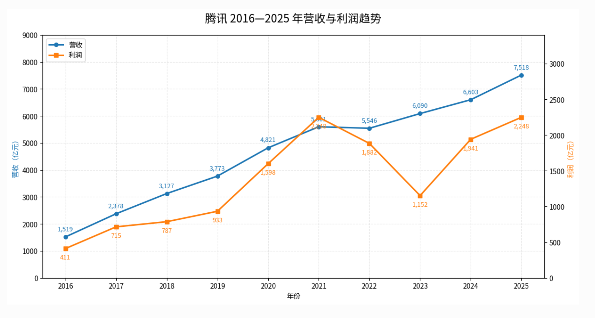


阿里:
| 财年 | 营业收入  | 归母净利润 |
| :--- | :-------- | :--------- |
| 2017 | 1,582.73  | 436.75     |
| 2018 | 2,502.66  | 639.85     |
| 2019 | 3,768.44  | 876.00     |
| 2020 | 5,097.11  | 1,492.63   |
| 2021 | 7,172.89  | 1,503.08   |
| 2022 | 8,530.62  | 619.59     |
| 2023 | 8,686.87  | 725.09     |
| 2024 | 9,411.68  | 797.41     |
| 2025 | 9,963.47  | 1,294.70   |
| 2026 | 10,236.70 | 1,059.04   |

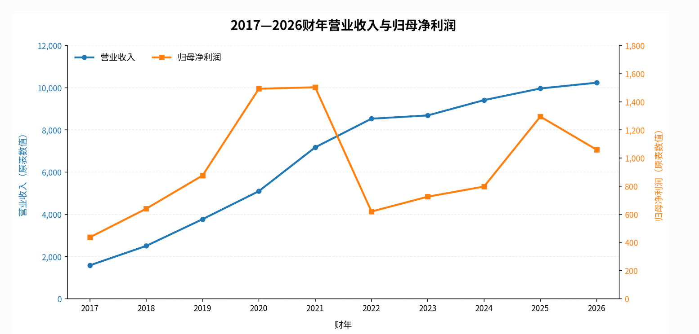

非常明显,疫情对国内市场的影响还是比较显著的,直到现在也没能彻底恢复过来,而国内的用户量也已经到了瓶颈期,这也是为什么最近几年各大公司都在积极寻找海外市场增长点的原因.

### 加班文化
- Tencent: WXG曾实行1065制度,但现在不清楚,不过工作节奏相对轻松,一般都有双休,工作日加班到八九点的部门也不少.不过相对其他企业来说确实已经很好了,所以也说腾讯养老
  - [基本体验](https://www.nowcoder.com/discuss/789814941619355648)
- 字节: 加班文化盛行,尽管2021年曾推行过1075制度,但真实情况就要惨烈不少了,九十点下班是比较常见的,项目紧张/上线时,整到凌晨也有可能;某些重要部门需要工作15个小时,周末也没有休息
  - [飞书体验](https://www.v2ex.com/t/1028575)
    - 组织和方向变动频繁。之前入职同事聚餐的时候我说我之前的工作基本都在一个组干，大家都好像很惊讶的样子，并且意味深长的说你以后就懂了。现在我懂大家的意思了。我这段短暂的 4 个月工作经历里，工作方向至少变动了 3 次，甚至在最后离职的时候都没有什么需要交接的内容。因为之前的产出都不需要了，就是这么神奇。
    - 没绷住
  - [基本体验](https://v2ex.com/t/1105087)
- 阿里: 一些部门如阿里云加班少,七八点下班比较正常,但部分部门特别是最近闹得很厉害的钉钉,是众所周知的push,而淘天集团和高德等据说是八九点下班.其实相对某些公司来说节奏是很不错的.
  - [阿里云体验](https://jishuzhan.net/article/1931161839559290882)
- 美团: 通常周末双休,工作日八九点下班,其实也勉强能看
  - [基本情况](https://www.nowcoder.com/discuss/815395805610696704?sourceSSR=enterprise)
- 拼多多: 11116可是没有多少人能够在第一次听说时绷住的,当然,给的钱相对于其他企业肯定多了,但要真算时薪的话,你会发现还要少上不少😅
  - [拼多多体验](https://www.nowcoder.com/feed/main/detail/668b5192fa9c428399734eebec3df0ba)
  - 牛客网上看到的pdd体验相关帖子下面一般都附有校招/内推链接,并把11116看的理所当然,而其他平台都找不到对pdd的具体评价,细品一下...
- 百度: 八九点?相关资料有点少,不过好歹也是曾经的Top1,也不看BAT曾经由谁打头的,想必情况不会太离谱
  - [对比](https://www.nowcoder.com/discuss/686665295796207616)


所以总的来看,除了个别企业外,大多数的加班时间勉强算是可控的,不至于特别离谱,苦中作乐,极乐往生😇
### 总结
只要不是实在没班上,都请尽量对自己的选择负责,再怎么心浮气躁,这家公司的产品效益怎样总要调研一下吧,这家公司的近年经济情况也要查一下吧,如果这家公司正好在下行期,那你急冲冲跑进去干嘛,不是冲着被裁嘛.

除非你认定了这公司在不久后就会雄起,或者又认为某家公司在不久后会达到瓶颈期,那就做一点与众不同的选择也无妨,但这是非常考量个人眼光的(实际上还是看运气).


## 国际企业
### Microsoft (微软)
- 多少人梦寐以求的头部外企啊
#### 公司概况
微软发迹于为早期的 Altair 8800 提供 BASIC 解释器，凭借 MS-DOS 和 Windows 确立了在个人电脑操作系统市场的垄断地位；其核心业务由 Windows 操作系统、Office 生产力套件、Azure 云平台以及 Xbox 游戏生态组成，通过收购 LinkedIn、Skype 和动视暴雪等企业实现多元化，目前是全球收入最高的软件公司。
- 操作系统市场的垄断地位是微软最可怕的地方

#### 公司历史

##### 1975—1980｜创立与早期发展

1975年，比尔·盖茨（Bill Gates）与保罗·艾伦（Paul Allen）创立微软，为 Altair 8800 开发 BASIC 解释器。公司早期主要经营编程语言，逐渐形成向计算机制造商授权软件的商业模式。

##### 1981—1999｜PC 操作系统与办公软件

1981年，微软为 IBM PC 提供 MS-DOS；1985年推出 Windows，1986年上市。随后凭借 Windows 3.0、Windows 95 和 Office 建立 PC 软件生态。1990年代进入互联网市场，推出 Internet Explorer，并因市场竞争行为面临反垄断诉讼。

##### 2000—2013｜企业软件与云计算起步

2000年，史蒂夫·鲍尔默（Steve Ballmer）接任 CEO。微软持续发展 Windows Server、SQL Server、Visual Studio 和 .NET，推出 Xbox（2001）、Bing（2009）、Windows Phone（2010）及 Surface（2012）。2010年 Windows Azure 正式商用，2011年推出 Office 365，开始向云计算与订阅服务转型。

##### 2014—2018｜云计算转型与开源生态

2014年，萨提亚·纳德拉（Satya Nadella）接任 CEO，重点发展 Azure、Office 365 和跨平台开发工具。微软逐渐拥抱 Linux、开源软件及容器技术，推出 Visual Studio Code（2015）和 WSL（2016），并先后收购 Mojang（2014）、LinkedIn（2016）和 GitHub（2018）。

##### 2019—至今｜人工智能与平台整合

2019年，微软开始与 OpenAI 建立战略投资和技术合作关系。此后收购 Nuance（2022）和 Activision Blizzard（2023），并推出 GitHub Copilot、Microsoft 365 Copilot 等 AI 产品。近年来重点发展 Azure AI、AI 基础设施、Copilot 智能体及企业 AI 开发平台。


#### 控股公司及子公司
- LinkedIn Corporation（领英）：2016年完成收购，经营职业社交、招聘、商业营销、LinkedIn Learning 等业务。
- GitHub：2018年完成收购，经营代码托管、开源协作、GitHub Actions、GitHub Copilot 等开发者服务。
- Mojang Studios：2014年被微软收购，以《Minecraft》（我的世界）及其衍生产品为核心。
- ZeniMax Media：2021年完成收购，拥有《The Elder Scrolls》《Fallout》《DOOM》等系列。
- Activision Blizzard, Inc.（动视暴雪）：2023年完成收购，涉及《Call of Duty》《Warcraft》《Diablo》《Candy Crush》等系列。
- Nuance Communications：2022年完成收购，主营语音识别、医疗文档自动化和行业 AI，其医疗业务已整合进入微软健康及生命科学云服务体系。


#### 主要产品

- **操作系统与办公软件**
  - **Windows**：Windows 11、Windows Server、Windows 365。
  - **Microsoft 365**：Word、Excel、PowerPoint、Outlook、Teams、OneDrive、SharePoint。

- **云计算与人工智能**
  - **Microsoft Azure**：云计算、数据库、容器服务及 AI 开发平台。
  - **Copilot 系列**：Microsoft Copilot、Microsoft 365 Copilot、GitHub Copilot、Copilot Studio。

- **软件开发与企业服务**
  - **开发工具**：Visual Studio、VS Code、.NET、GitHub、GitHub Actions。
  - **企业管理与数据分析**：Dynamics 365、SQL Server、Microsoft Fabric、Power BI、Power Platform。
  - **网络安全与 IT 管理**：Microsoft Defender、Entra、Intune、Purview、Sentinel。

- **个人设备与互联网服务**
  - **Surface**：Surface Pro、Surface Laptop 等计算设备。
  - **浏览器与搜索**：Microsoft Edge、Bing。
  - **职业社交**：LinkedIn、LinkedIn Learning。

- **游戏与数字娱乐**
  - **Xbox 平台**：Xbox 主机、Game Pass、Xbox Cloud Gaming。
  - **游戏内容**：Minecraft、Halo、Forza、Call of Duty、Warcraft、Diablo 等系列。


#### 招聘情况
- [招聘官网](https://apply.careers.microsoft.com/)
- 公众号: 微软招聘
  
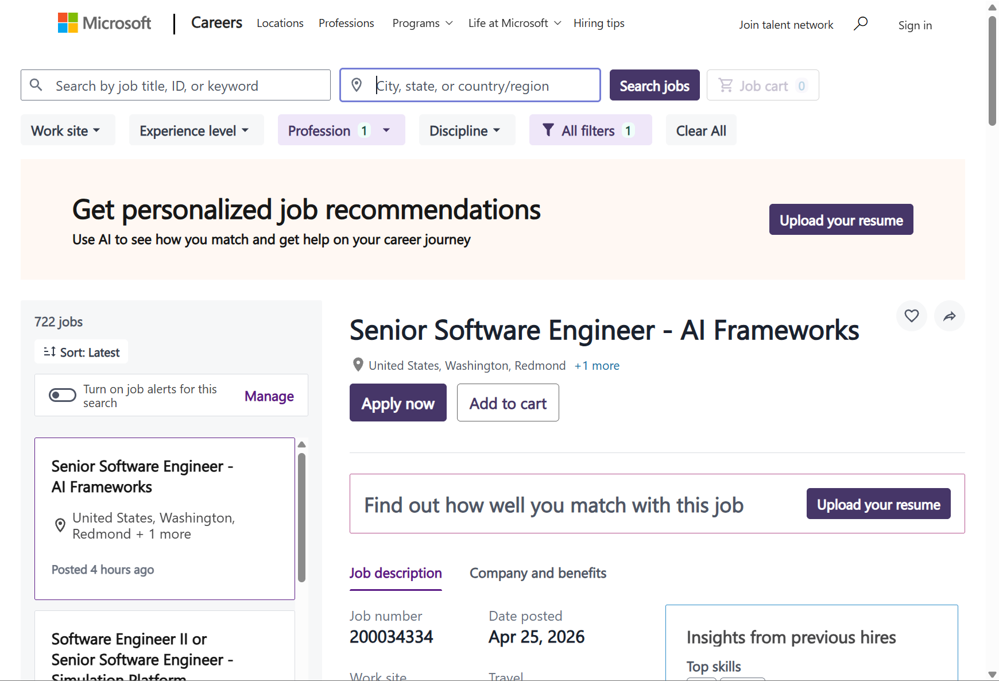
官网的岗位很多对吧,但如果你把地点更改一下的话:
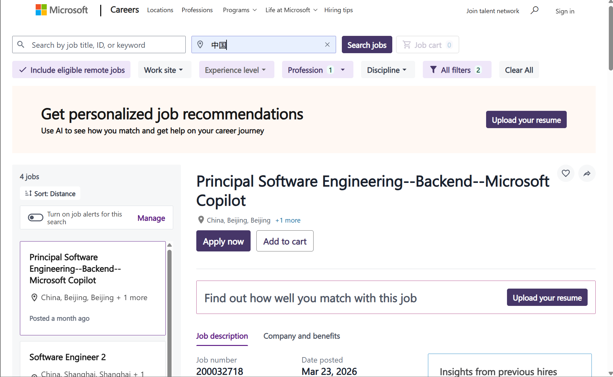
行了,都知道你不想在中国招人了.

##### 面经1
[链接](https://stdrc.cc/post/2022/01/30/microsoft-interview/)
尽管是22年的实习面经,但问题确实很简单,看得出来微软是不喜欢刁难实习生的...
##### 面经2
[链接](https://ddadaal.me/articles/2019-spring-ms-intern-interview-experiences/cn)
19年的实习面经,面试题也都不难
### Google (谷歌)
#### 公司概况
Google 由拉里·佩奇和谢尔盖·布林于 1998 年创立，凭借核心产品 Google 搜索确立了全球信息索引的统治地位，并于 2015 年重组为 Alphabet Inc. 的最大子公司。其业务版图深度覆盖在线广告、云计算（Google Cloud）、操作系统（Android、ChromeOS）、视频共享（YouTube）及消费电子（Pixel、Nest），并在量子计算、自动驾驶（Waymo）和人工智能（Gemini）等前沿领域处于领先。作为全球访问量最大的网站拥有者，Google 在搜索引擎、移动生态和生产力工具市场占据绝对优势，同时也面临着关于垄断、隐私及税务问题的持续监管与争议。
##### Google与Alphabet
Alphabet 是 Google 的母公司，两者于 2015 年通过企业架构重组确立了控股关系：Alphabet 作为顶层控股实体，将盈利核心 Google（含搜索、YouTube、Android）与风险高、投入大的“登月计划”子公司（如 Waymo 自动驾驶、Calico 生物技术）剥离。这一变革的历史缘由在于，当时的 Google 已从单一搜索工具扩张至机器人、生命科学等极度分散的领域，创始人拉里·佩奇希望通过这种“瘦身”结构提高财务透明度，使各业务在拥有独立 CEO 和预算的同时，能更灵活地追求长远创新，而不受核心搜索业务财务波动的束缚。

#### 公司历史

##### 1996—2000｜创立与搜索引擎商业化

拉里·佩奇（Larry Page）与谢尔盖·布林（Sergey Brin）在斯坦福大学开发 BackRub 搜索引擎，提出利用网页链接关系进行排序的 PageRank 算法。1998年正式创立 Google，2000年推出 AdWords 搜索广告系统，逐渐形成以搜索服务和互联网广告为核心的商业模式。

##### 2001—2007｜互联网服务生态扩张

2001年，埃里克·施密特（Eric Schmidt）接任 CEO。Google 相继推出 Google News、Gmail、Google Maps 和 Google Earth，2004年在纳斯达克上市。随后收购 Android（2005）、YouTube（2006），并于2007年宣布收购 DoubleClick，逐步拓展搜索、广告、视频和移动互联网业务。

##### 2008—2014｜移动互联网、云计算与人工智能

2008年推出 Chrome 浏览器、Android 商用平台及 Google App Engine，随后发展 ChromeOS、Google Play 和 Google Cloud。2011年拉里·佩奇重新担任 CEO。期间收购 Motorola Mobility（2012年完成，2014年出售手机业务）、Waze（2013）、Nest 和 DeepMind（2014），拓展移动设备、智能家居与人工智能业务。

##### 2015—2019｜Alphabet 重组与 AI 优先战略

2015年，Google 重组为 Alphabet 旗下子公司，桑达尔·皮查伊（Sundar Pichai）接任 Google CEO。集团将 Waymo 等前沿业务独立运营，Google 则重点发展云计算与人工智能。同期推出 TensorFlow（2015）、Google Assistant、Pixel 手机和 TPU 芯片（2016），AlphaGo 于2016年击败李世石。2019年，皮查伊兼任 Alphabet CEO。

##### 2020—至今｜生成式 AI 与云服务扩张

Google 先后完成对 Looker（2020）、Fitbit（2021）、Mandiant（2022）和 Wiz（2026）的收购，强化数据分析、智能硬件与云安全业务。2023年整合 DeepMind 与 Google Brain，成立 Google DeepMind，并推出 Bard 和 Gemini。2024年将 Bard 更名为 Gemini，随后持续将 AI 整合至搜索、Workspace、Android 和 Google Cloud，发展 Gemini 模型、AI Mode、智能体及 AI 开发工具。

#### 控股公司及子公司

- **Google 旗下主要业务**
  - **YouTube**（2006年收购）：视频分享、流媒体和内容创作者平台。
  - **Google DeepMind**（2014年收购 DeepMind，2023年整合）：Gemini、AlphaFold 等 AI 模型与前沿研究。
  - **Waze、Google Nest、Fitbit**：地图导航、智能家居与可穿戴设备。
  - **Looker、Mandiant、Wiz**：企业数据分析、网络安全及云安全服务。
  - **Intrinsic**（2026年并入 Google）：工业机器人软件与智能自动化。

- **Alphabet 旗下其他主要业务**
  - **Waymo**：自动驾驶技术与无人驾驶出租车。
  - **Wing**：无人机配送与物流自动化。
  - **Calico、Isomorphic Labs**：衰老与生命科学研究、AI 药物研发。
  - **X（Moonshot Factory）**：前沿技术研发与创新项目孵化。
  - **GV、CapitalG**：风险投资与成长型科技企业投资。

#### 主要产品

- **搜索、广告与互联网服务**
  - **Google Search**：Google Search、AI Mode、AI Overviews、Google Lens、Google News、Google Scholar。
  - **广告与营销**：Google Ads、AdSense、AdMob、Google Analytics。
  - **地图与生活服务**：Google Maps、Google Earth、Waze、Google Photos、Google Translate、Google Wallet。

- **操作系统、浏览器与硬件**
  - **操作系统**：Android、ChromeOS、Wear OS、Android TV。
  - **浏览器与应用生态**：Google Chrome、Chromium、Google Play。
  - **智能硬件**：Pixel 手机、Pixel Watch、Pixel Buds、Google Nest。

- **办公协作与云计算**
  - **Google Workspace**：Gmail、Drive、Docs、Sheets、Slides、Calendar、Meet。
  - **Google Cloud**：Compute Engine、GKE、Cloud Run、Cloud Storage、BigQuery、Vertex AI。
  - **企业安全**：Google Security Operations、Mandiant、Wiz。

- **人工智能与开发者工具**
  - **Gemini 系列**：Gemini、Gemini API、Gemini Enterprise、Gemma。
  - **AI 模型与应用**：AlphaFold、Veo、Imagen、NotebookLM、Google AI Studio、Google Flow。
  - **开发者生态**：Android Studio、Firebase、Flutter、TensorFlow、JAX、Google Colab、Kaggle。

- **视频与数字娱乐**
  - **YouTube 平台**：YouTube、YouTube Shorts、YouTube Premium、YouTube Music、YouTube TV。

- **Alphabet 前沿科技**
  - **自动驾驶与物流**：Waymo Driver、Waymo One、Wing。
  - **生命科学与机器人**：Isomorphic Labs、Calico、Intrinsic（现归 Google）。


#### 招聘情况
- [招聘官网](https://www.google.com/about/careers/applications/)
- 公众号: 谷歌招聘包打听

之所以内地很少看见有人应聘谷歌是因为它在内地的岗位确实少,而且产品人员招的比技术人员多...
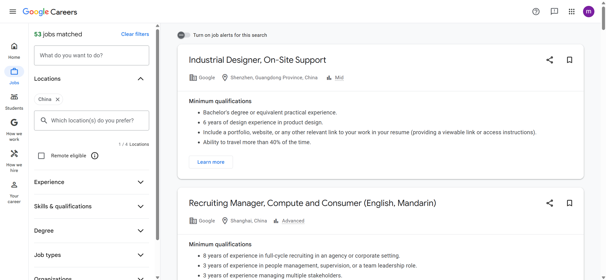
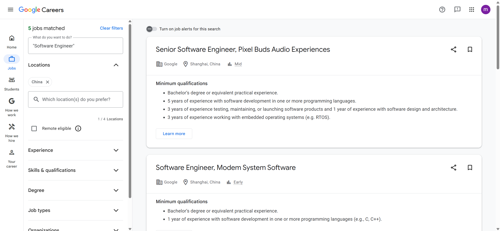

##### 面经1
[大牛的上岸分享](https://zhuanlan.zhihu.com/p/362736343)
### Apple (苹果)
#### 公司概况
Apple Inc. 由史蒂夫·乔布斯、斯蒂夫·沃兹尼亚克和罗纳德·韦恩于 1976 年创立，总部位于加州库比蒂诺。公司凭借 Apple II 和带图形界面的 Macintosh 推动了个人电脑的普及，在经历 90 年代的濒临破产后，通过收购 NeXT 迎回乔布斯，并凭借 iMac、iPod、iPhone 和 iPad 实现业务重组与盈利。核心产品涵盖 iPhone、Mac、iPad 等硬件及其配套的 iOS、macOS 系统和 Apple Music、iCloud 等服务，于 2025 年 10 月市值突破 4 万亿美元。

- 安静做好自己的产品,其他公司别来搭理我
#### 公司历史

##### 1976—1984｜创立与个人计算机发展

1976年，史蒂夫·乔布斯（Steve Jobs）、史蒂夫·沃兹尼亚克（Steve Wozniak）与罗纳德·韦恩（Ronald Wayne）创立 Apple Computer，推出 Apple I（1976）和 Apple II（1977）。1980年在纳斯达克上市，随后推出 Lisa（1983）和 Macintosh（1984），推动图形用户界面与鼠标操作在个人电脑领域的普及。

##### 1985—1996｜管理变动与市场竞争

1985年乔布斯离开苹果，创立 NeXT。苹果陆续推出 Macintosh II、PowerBook、Newton 等产品，并转向 PowerPC 处理器架构。但随着 IBM PC 兼容机和 Microsoft Windows 的普及，苹果市场份额下降，1990年代中后期陷入经营困境。

##### 1997—2006｜乔布斯回归与消费电子转型

1997年苹果收购 NeXT，乔布斯回归并重新领导公司，精简产品线。随后推出 iMac（1998）、Mac OS X、iPod 和 Apple Store（2001），以及 iTunes Music Store（2003）。2006年开始将 Mac 转向 Intel x86 处理器，逐步拓展数字音乐和消费电子业务。

##### 2007—2011｜iPhone 与移动互联网生态

2007年更名为 Apple Inc.，推出第一代 iPhone；2008年推出 App Store，建立移动应用生态；2010年推出 iPad，2011年推出 iCloud。苹果逐步形成硬件、操作系统、应用分发与云服务相结合的产品体系。2011年蒂姆·库克（Tim Cook）接任 CEO，同年乔布斯去世。

##### 2012—2019｜硬件扩张与服务业务增长

库克领导苹果强化全球供应链、自研芯片及服务业务。2014年收购 Beats，推出 Apple Pay 并发布 Apple Watch；2016年推出 AirPods，2017年发布 iPhone X。2019年推出 Apple TV+、Apple Arcade 和 Apple Card，逐渐形成智能设备、数字内容和订阅服务相结合的业务结构。

##### 2020—至今｜自研芯片、人工智能与空间计算

2020年推出 M1 芯片，推动 Mac 从 Intel 向 Apple Silicon 转型。2023年发布 Apple Vision Pro，2024年推出 Apple Intelligence，拓展空间计算与生成式 AI。此后收购 Pixelmator（2025）和 Q.ai（2026），推出 Apple Creator Studio、MacBook Neo 和折叠屏 iPhone Duo。2026年9月，约翰·特努斯（John Ternus）接任 CEO，库克转任董事会执行主席。

#### 控股公司及子公司

- **集团主体**
  - **Apple Inc.**：1976年成立，总部位于美国加利福尼亚州库比蒂诺，纳斯达克上市（AAPL）；旗下业务涵盖硬件、软件、数字服务及芯片研发。
  - **管理层**：CEO 为 John Ternus，董事会执行主席为 Tim Cook。

- **国际运营与区域子公司**
  - **国际运营与分销**：Apple Operations International、Apple Operations Limited、Apple Distribution International（爱尔兰）。
  - **区域经营实体**：Apple Asia、Apple India、Apple Japan、Apple Korea、Apple Canada、Apple Australia 及中国大陆相关经营公司。
  - **金融与其他业务**：Braeburn Capital（投资管理）、Apple Insurance Company（保险业务）、Apple Services Pte. Ltd.（数字服务相关实体）。

- **主要收购企业与整合业务**
  - **操作系统与芯片**：NeXT（1997，操作系统）、P.A. Semi（2008，处理器设计）、Intel 智能手机调制解调器业务（2019，通信芯片）。
  - **智能交互与传感技术**：Siri（2010，语音助手）、AuthenTec（2012，指纹识别）、PrimeSense（2013，三维感知）。
  - **音乐与内容服务**：Beats（2014，音频设备与音乐服务）、Shazam（2018，音乐识别）。
  - **专业软件与人工智能**：Pixelmator（2025，图像编辑）、Q.ai（2026，音频 AI）。

注：收购企业多数已整合至苹果内部业务体系，不代表其目前仍作为独立法律子公司运营。

#### 主要产品

- **个人计算设备**
  - **iPhone**：iPhone 17、iPhone 18 Pro、iPhone Air、iPhone Duo 等智能手机。
  - **Mac**：MacBook Neo、MacBook Air、MacBook Pro、iMac、Mac mini、Mac Studio。
  - **iPad**：iPad、iPad mini、iPad Air、iPad Pro。

- **智能穿戴与家居设备**
  - **Apple Watch**：Apple Watch SE、Series、Ultra 系列。
  - **音频设备**：AirPods、AirPods Pro、AirPods Max、Beats。
  - **空间计算与智能家居**：Apple Vision Pro、Apple TV 4K、HomePod、HomeView、Apple Home。

- **操作系统、芯片与人工智能**
  - **操作系统**：iOS、iPadOS、macOS、watchOS、tvOS、visionOS。
  - **Apple Silicon**：A 系列、M 系列处理器及 C 系列通信芯片。
  - **Apple Intelligence**：Siri AI、Writing Tools、Image Playground、Visual Intelligence。

- **办公软件与专业创作**
  - **办公与效率工具**：Pages、Numbers、Keynote、Freeform、Notes、Calendar。
  - **Apple Creator Studio**：Final Cut Pro、Logic Pro、Pixelmator Pro、Motion、Compressor、MainStage。
  - **开发者工具**：Xcode、Swift、SwiftUI、TestFlight、Metal、Core ML。

- **云服务与数字内容**
  - **云与账户服务**：iCloud、iCloud+、Apple Account、Find My、Apple Passwords。
  - **数字娱乐**：Apple Music、Apple TV、Apple Arcade、Apple Podcasts、Apple Books、Apple Fitness+。
  - **应用生态**：App Store、Apple Developer Program、Game Center。

- **互联网、支付与健康服务**
  - **互联网应用**：Safari、Apple Maps、Photos、FaceTime、Messages。
  - **支付与金融**：Apple Pay、Apple Wallet、Apple Card、Apple Cash。
  - **健康服务**：Apple Health、HealthKit、Apple Fitness。

- **企业服务与零售**
  - **企业与教育**：Apple Business Manager、Apple School Manager、AppleCare for Enterprise。
  - **零售与售后**：Apple Store、Apple Trade In、AppleCare+、Apple One。
#### 招聘情况
- [招聘官网](https://www.apple.com/careers/cn/)
- 公众号: Apple招聘

招聘岗位比起谷歌和微软都多上不少,但产品人员和硬件开发招的比较多,软件开发的岗位实际上也很少:

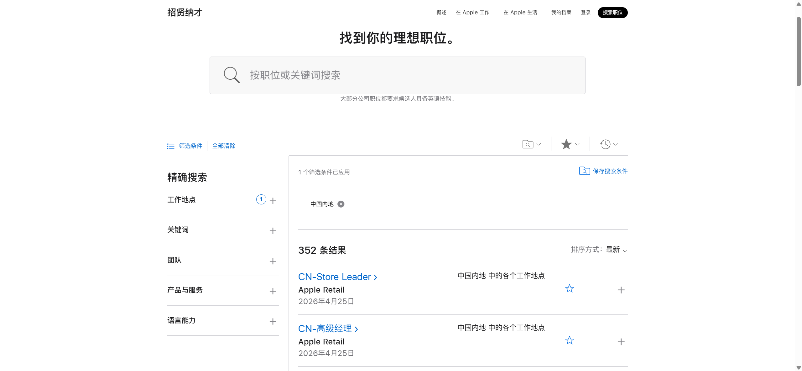
### Meta
不在内地招人,可直接跳过
#### 公司概况
Meta Platforms, Inc.（前身为 Facebook, Inc.）是一家总部位于加州门洛帕克的美国跨国科技巨头，与 Alphabet、亚马逊、苹果、微软及英伟达并称为美国六大科技巨头（Big Tech）。该公司由马克·扎克伯格于 2004 年创立，旗下拥有 Facebook、Instagram、WhatsApp、Messenger 和 Threads 等全球主流社交与通信平台，广告收入占其总营收的 97.8% 以上。2021 年，公司正式更名为 Meta，反映其转向构建以虚拟现实（VR）和增强现实（AR）技术为核心的“元宇宙”生态系统的战略布局。作为全球研发投入最高的公司之一，Meta 在 2023 年福布斯全球 2000 强中排名第 31 位。
#### 公司历史

##### 2004—2007｜创立与社交网络平台化

2004年，马克·扎克伯格（Mark Zuckerberg）与爱德华多·萨维林（Eduardo Saverin）等人在哈佛大学创立 TheFacebook，最初面向大学生提供社交服务。2005年更名为 Facebook，2006年推出 News Feed 并开放公众注册，2007年推出 Facebook Platform 和广告平台，逐渐建立以社交网络和精准广告为核心的商业模式。

##### 2008—2011｜全球扩张与移动社交

2008年，谢丽尔·桑德伯格（Sheryl Sandberg）出任首席运营官，推动广告商业化。Facebook 随后推出 Like 按钮（2009）、Messenger 和 Timeline（2011），2010年月活跃用户突破5亿，并持续扩展移动端应用与社交广告业务。

##### 2012—2014｜上市与社交平台扩张

2012年，Facebook 在纳斯达克上市，并以约10亿美元收购 Instagram。2014年又以约190亿美元收购 WhatsApp，同时收购 Oculus VR，形成 Facebook、Instagram、WhatsApp 和 Messenger 等社交产品组合，并开始布局虚拟现实领域。

##### 2015—2020｜视频社交与虚拟现实

Facebook 持续发展 Instagram Stories、Facebook Live、Marketplace 和 Reels 等产品，拓展短视频、社交电商与广告业务。2016年推出 Oculus Rift，2019年推出 Oculus Quest，2020年发布 Quest 2。同年收购 Giphy，并持续扩大 VR 研发投入，同时面临隐私保护和反垄断监管压力。

##### 2021—2023｜Meta 重组与元宇宙战略

2021年，Facebook, Inc. 更名为 Meta Platforms, Inc.，将虚拟现实、增强现实和元宇宙确立为重要发展方向。随后推出 Meta Quest Pro（2022）、Meta Quest 3（2023），并发展 Horizon 虚拟现实平台。2023年推出 Threads 和 Llama 大语言模型，开始强化生成式人工智能业务。

##### 2024—至今｜人工智能与智能可穿戴设备

2024年推出 Llama 3、Meta AI 和 Meta Quest 3S，持续发展 Ray-Ban Meta 智能眼镜。2025年发布 Llama 4、Meta AI 独立应用，投资 Scale AI 并组建 Meta Superintelligence Labs。随后推出 Muse 个人 AI 智能体、Muse Spark 和 Muse Wonder 模型，扩展 Ray-Ban、Oakley 智能眼镜产品，并于2026年发布计划2027年上市的 Meta VR Glasses。

#### 控股公司及子公司

- **集团主体**
  - **Meta Platforms, Inc.**：2004年创立，总部位于美国加利福尼亚州门洛帕克，纳斯达克上市（META），2021年由 Facebook, Inc. 更名。
  - **管理层与业务结构**：马克·扎克伯格（Mark Zuckerberg）担任董事长兼 CEO，集团主要分为 Family of Apps（社交与广告）和 Reality Labs（VR、AR 与智能硬件）两个报告分部。

- **主要社交平台**
  - **Instagram**（2012年收购）：图片、短视频、直播与社交内容平台。
  - **WhatsApp**（2014年收购）：即时通信、企业消息与商业服务。

- **虚拟现实与智能硬件**
  - **Oculus VR**（2014年收购）：虚拟现实设备与技术，现整合进入 Meta Reality Labs。
  - **Beat Games、Within**：VR 游戏及健身应用，代表产品为 Beat Saber、Supernatural。
  - **CTRL-labs、Luxexcel**：神经交互、肌电信号识别及智能眼镜光学技术。

- **人工智能与技术业务**
  - **Limitless**（2025年收购）：AI 语音记录与智能可穿戴技术。
  - **Mapillary**（2020年收购）：街景图像、道路识别和计算机视觉地图技术。

- **重要法律实体**
  - **美国实体**：Facebook Holdings、Facebook Procurement、Meta Payments、Instagram LLC、WhatsApp LLC。
  - **国际实体**：Meta Platforms Ireland Limited、FCL Tech Limited 等。

- **战略投资与合作**
  - **Scale AI**：AI 数据标注与模型评估企业，Meta 于2025年进行大规模战略投资，并引入其联合创始人 Alexandr Wang 领导 AI 研发。
  - **EssilorLuxottica**：Ray-Ban、Oakley 等眼镜品牌的所属集团，与 Meta 合作开发智能眼镜。

注：Scale AI、EssilorLuxottica 不属于 Meta 控股子公司；Giphy、Kustomer 和 Manus 等历史收购业务已出售、独立或剥离。部分被收购企业已整合进入内部部门，不再独立运营。

#### 主要产品

- **社交网络与即时通信**
  - **Facebook**：Feed、Stories、Reels、Groups、Marketplace、Dating、Forum。
  - **Instagram**：Stories、Reels、Direct、Live、Shopping、Edits。
  - **WhatsApp**：WhatsApp、WhatsApp Business、Business Platform、Cloud API。
  - **Messenger、Threads**：即时通信、视频通话、文本社交与公共讨论。

- **人工智能与智能体**
  - **Meta AI**：Meta AI App、Meta AI Studio、Imagine，以及社交应用内置 AI 助手。
  - **Muse 智能体**：Muse、Muse Secure VM、Muse Code，支持自主任务执行与 AI 编程。
  - **AI 模型**：Llama 系列、Muse Spark、Muse Wonder、Muse Wonder Full。
  - **模型与开发平台**：Meta Model API、Llama Stack、Meta AI Research。

- **虚拟现实与智能眼镜**
  - **Meta Quest**：Quest 3、Quest 3S，以及历史产品 Quest 2、Quest Pro。
  - **智能眼镜**：Ray-Ban Meta、Oakley Meta、Meta Ray-Ban Display、Meta Neural Band。
  - **下一代 VR 设备**：Meta VR Glasses（2026年发布，计划2027年上市）。
  - **研发技术**：Orion AR 眼镜原型、Aria Research Kit、EMG 神经交互技术。

- **虚拟现实软件与内容**
  - **Meta Horizon**：Horizon OS、Horizon Worlds、Horizon Store、Meta Quest Link。
  - **VR 游戏与应用**：Beat Saber、Supernatural、Asgard's Wrath、Population: One。

- **广告、商业与订阅服务**
  - **广告平台**：Meta Ads Manager、Meta Business Suite、Meta Pixel、Conversions API。
  - **社交电商**：Facebook Marketplace、Facebook Shops、Instagram Shopping、WhatsApp Business。
  - **创作者与订阅**：Meta Verified、Meta One、Instagram Subscriptions、Facebook Stars。
  - **账户与支付**：Meta Account、Accounts Center、Meta Pay。

- **开发者工具与技术基础设施**
  - **开源软件生态**：React、React Native、PyTorch、FAISS、RocksDB、GraphQL。
  - **AI 基础设施**：MTIA 自研 AI 芯片、AI Research SuperCluster（RSC）、大型 AI 数据中心。
### Amazon (亚马逊)
- 对于亚马逊退出中国市场一事我一直很遗憾
#### 公司概况
Amazon.com, Inc.（简称亚马逊）是一家总部位于华盛顿州西雅图的美国跨国科技巨头，业务涵盖电子商务、云计算、在线广告、数字流媒体及人工智能。公司由杰夫·贝佐斯于 1994 年创立，最初是一家在线书店，后演变为提供全品类商品的“万能商店”（The Everything Store）。作为“五大科技巨擘”（Big Tech）之一，亚马逊在多个领域占据全球领先地位：它是全球最大的在线零售商、智能音箱供应商和云计算服务商（通过 AWS）。
#### 公司历史

##### 1994—1999｜创立与互联网零售

1994年，杰夫·贝索斯（Jeff Bezos）创立 Amazon，1995年正式上线网上书店，1997年在纳斯达克上市。随后扩大音乐、影视等商品类别，并于1998年收购 IMDb，逐渐从在线书店发展为综合电子商务平台。

##### 2000—2006｜电商平台化与云计算起步

2000年，Amazon 发展第三方卖家平台 Marketplace，2001年实现首次季度盈利。2005年推出 Amazon Prime 会员服务，2006年推出 Amazon Web Services（AWS），发布 S3 对象存储和 EC2 云服务器，开始向企业提供云计算基础设施。

##### 2007—2013｜数字内容与物流自动化

2007年推出 Kindle 电子阅读器和 Amazon Fresh 生鲜配送服务，随后收购 Audible（2008）、Zappos（2009）和 Goodreads（2013），扩展数字内容与零售业务。2012年收购 Kiva Systems，将机器人技术引入仓储物流，同时持续扩大 AWS 的数据库和企业云服务。

##### 2014—2019｜智能硬件与多元化业务

2014年推出 Echo 智能音箱和 Alexa 语音助手，并收购 Twitch。随后收购 Annapurna Labs（2015），发展 AWS 自研芯片；2017年收购 Whole Foods Market，进入实体生鲜零售；2018年收购 Ring 和 PillPack，2019年收购 eero，并启动 Project Kuiper 卫星互联网项目。

##### 2020—2023｜业务扩张与生成式 AI

2020年收购自动驾驶企业 Zoox。2021年，安迪·贾西（Andy Jassy）接任 CEO，贝索斯转任执行董事长。随后收购 MGM（2022）和 One Medical（2023），拓展影视制作与医疗服务。2023年 AWS 推出 Amazon Bedrock 生成式 AI 平台，并与 Anthropic 建立战略投资及云计算合作关系。

##### 2024—至今｜人工智能与算力基础设施

2024年推出 Amazon Nova 自研 AI 模型，持续发展 Bedrock、Amazon Q 和 Trainium 芯片。2025年推出 Alexa+ 智能助手，Project Kuiper 开始正式部署卫星并更名为 Amazon Leo。2026年扩大与 Anthropic 的合作，并宣布向 OpenAI 投资500亿美元的计划，同时发展 AI 数据中心、自研芯片、卫星互联网和智能购物服务。

#### 控股公司及子公司

- **集团主体**
  - **Amazon.com, Inc.**：1994年成立，总部位于美国华盛顿州西雅图，纳斯达克上市（AMZN）。
  - **管理层与业务结构**：杰夫·贝索斯（Jeff Bezos）担任执行董事长，安迪·贾西（Andy Jassy）担任 CEO。集团主要分为北美业务、国际业务和 AWS 三个报告分部。

- **云计算与技术业务**
  - **Amazon Web Services（AWS）**：2006年推出，经营云计算、数据库、人工智能及企业技术服务。
  - **Annapurna Labs**（2015年收购）：半导体设计，参与 Graviton、Trainium 等 AWS 自研芯片研发。
  - **Amazon Robotics**（2012年收购 Kiva Systems）：仓储机器人与物流自动化。

- **零售与数字内容**
  - **Whole Foods Market**（2017年收购）：美国连锁生鲜超市。
  - **Zappos、Woot、AbeBooks**：鞋服零售、折扣电商与图书交易。
  - **Audible、Goodreads、IMDb**：有声读物、阅读社交与影视数据库。
  - **Twitch、Amazon MGM Studios**：游戏直播、影视制作与发行。

- **智能硬件与家庭服务**
  - **Ring、Blink**：智能门铃、家庭监控与安防设备。
  - **eero**：Mesh Wi-Fi 路由器和家庭网络服务。

- **医疗、交通与其他业务**
  - **PillPack、One Medical**：在线药房、处方药配送及初级医疗服务。
  - **Zoox**（2020年收购）：自动驾驶技术与 Robotaxi 出行服务。

- **重要法律实体**
  - **美国运营实体**：Amazon.com Services LLC、Amazon.com Sales, Inc.、Amazon US Services LLC。
  - **云计算与技术实体**：Amazon Web Services, Inc.、Amazon Data Services, Inc.、Amazon Technologies, Inc.。
  - **投资及其他实体**：Amazon.com NV Investment Holdings LLC、Day One Insurance, Inc.。

- **战略投资与合作**
  - **Anthropic**：Claude 大语言模型开发商，Amazon 的重要 AI 投资与 AWS 合作伙伴。
  - **OpenAI**：2026年宣布投资计划，并开展长期云计算与 AI 基础设施合作。
  - **Blue Origin**：贝索斯另外创立的航天企业，与 Amazon Leo 存在发射合作关系，不属于 Amazon 子公司。

注：Anthropic、OpenAI 不属于 Amazon 控股子公司；iRobot 收购计划已于2024年终止。

#### 主要产品

- **电子商务与零售**
  - **Amazon 购物平台**：Amazon.com、Amazon Marketplace、Amazon Shopping、Amazon Business。
  - **Prime 会员服务**：Amazon Prime、Prime Video、Prime Reading、Prime Gaming。
  - **卖家与物流服务**：Seller Central、Fulfillment by Amazon（FBA）、Amazon Global Selling。
  - **实体与生鲜零售**：Whole Foods Market、Amazon Fresh 在线配送。

- **AWS 云计算**
  - **计算与网络**：Amazon EC2、S3、VPC、CloudFront、Route 53。
  - **容器与无服务器**：AWS Lambda、Amazon ECS、Amazon EKS、AWS Fargate。
  - **数据库与分析**：Amazon RDS、Aurora、DynamoDB、Redshift、OpenSearch。
  - **安全与运维**：AWS IAM、CloudWatch、CloudTrail、GuardDuty、Security Hub。

- **人工智能与开发者工具**
  - **生成式 AI 平台**：Amazon Bedrock、Bedrock AgentCore、SageMaker。
  - **自研 AI 模型**：Amazon Nova 系列，包括语言、多模态及智能体模型。
  - **AI 助手与开发工具**：Amazon Q、Amazon Quick、Kiro、AWS CDK。
  - **自研计算芯片**：Graviton、Trainium、Inferentia、Nitro System。

- **智能硬件与家庭设备**
  - **Alexa 系列**：Alexa、Alexa+、Alexa for Shopping。
  - **Echo 系列**：Echo、Echo Dot、Echo Studio、Echo Show。
  - **Kindle 系列**：Kindle、Paperwhite、Colorsoft、Scribe。
  - **Fire 系列**：Fire 平板、Fire TV、Fire TV Stick。
  - **家庭安防与网络**：Ring、Blink、eero。

- **数字内容与娱乐**
  - **影视与音乐**：Prime Video、Amazon MGM Studios、Amazon Music、Audible。
  - **游戏与直播**：Twitch、Amazon Games、Amazon Luna。
  - **内容与阅读服务**：Kindle Store、IMDb、Goodreads。

- **广告、企业与物流服务**
  - **Amazon Ads**：Sponsored Products、Sponsored Brands、Amazon DSP。
  - **企业服务**：Amazon Business、Amazon Connect、Amazon WorkSpaces。
  - **物流与机器人**：Amazon Logistics、Amazon Air、Amazon Flex、Amazon Robotics、Prime Air。

- **医疗与前沿科技**
  - **医疗服务**：Amazon Pharmacy、One Medical、PillPack。
  - **卫星互联网**：Amazon Leo（原 Project Kuiper），包括 Leo Nano、Leo Pro、Leo Ultra。
  - **自动驾驶**：Zoox Robotaxi、Zoox 自动驾驶系统。
#### 招聘情况
- [招聘官网](https://www.amazon.jobs/zh)
- 公众号: 亚马逊招聘

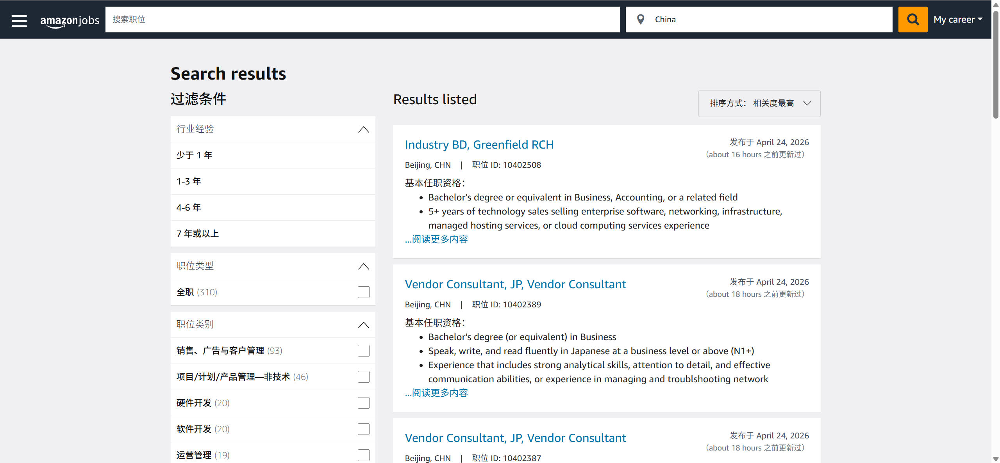

与Apple一样,管理岗位和产品岗位招的特别多,真正的软件开发岗位很少


### Intel (英特尔)
母校不是上交的可以直接跳过了
#### 公司概况
英特尔（Intel）是总部位于加州圣克拉拉的跨国科技巨头，由戈登·摩尔和罗伯特·诺伊斯于1968年创立，是硅谷崛起的核心基石。作为x86架构的奠基者，英特尔曾通过“Wintel”联盟长期统治个人电脑市场，目前仍是全球领先的半导体制造商，核心业务涵盖酷睿（Core）系列处理器、Arc显卡、芯片组及数据中心基础设施。尽管近年来面临AMD的激烈竞争及移动互联网转型的挑战，英特尔依然凭借其集设计与制造于一体的IDM模式，在PC和服务器芯片领域保持着显著的市场领先地位。

#### 公司历史

##### 1968—1980｜创立与微处理器诞生

1968年，罗伯特·诺伊斯（Robert Noyce）与戈登·摩尔（Gordon Moore）创立 Intel，安迪·格鲁夫（Andy Grove）随后加入。公司最初经营半导体存储器，1970年推出 Intel 1103 DRAM，1971年发布 Intel 4004 微处理器，随后推出 8008、8080、8086 和 8088，逐渐建立 x86 处理器架构的技术基础。

##### 1981—1992｜IBM PC 与 x86 架构崛起

1981年，IBM PC 采用 Intel 8088 处理器，推动 x86 架构进入个人电脑市场。随后推出 80286（1982）、80386（1985）和 80486（1989）。面对存储器市场竞争，Intel 于1980年代中期退出 DRAM 主营业务，转向微处理器。1987年格鲁夫接任 CEO，1991年推出 Intel Inside 品牌计划。

##### 1993—2005｜Pentium 时代与 PC 市场主导

1993年推出 Pentium 处理器，随后发展 Pentium II、III、4 等产品，并推出 Celeron（1998）、Xeon（1998）和 Centrino 移动平台（2003）。Intel 与 Microsoft 形成高度互补的 Wintel 生态，x86 逐渐成为 PC 市场主流，并开始发展超线程、多核心和64位处理器技术。

##### 2006—2014｜Core 架构与制造工艺发展

2006年推出 Core 2 Duo，2008年发布 Nehalem 架构，随后发展 Core i3、i5、i7 等处理器系列。2011年推出 Sandy Bridge，2012年将 Tri-Gate 三维晶体管引入22nm量产工艺，同时发展 Atom、Xeon 和 Thunderbolt 技术。但 Intel 在智能手机处理器市场未能取得与 PC 相当的竞争优势。

##### 2015—2020｜业务收购与先进制程竞争

2015年收购 FPGA 企业 Altera，2017年收购自动驾驶企业 Mobileye，2019年收购 AI 芯片企业 Habana Labs。同期推出 Core i9 和 Xe GPU 架构，但10nm制程研发与量产持续延迟，Intel 在先进制造工艺上逐渐落后于台积电，同时面临 AMD Zen 架构竞争。2020年苹果宣布 Mac 转向自研 Apple Silicon。

##### 2021—2024｜晶圆代工转型与 AI PC

2021年，帕特·基辛格（Pat Gelsinger）接任 CEO，提出 IDM 2.0 战略，扩大晶圆厂投资并发展 Intel Foundry。2022年推出 Arc 独立显卡，推动 Mobileye 上市；2023年推出 Core Ultra 处理器，引入芯粒设计与独立 NPU。2024年发布 Lunar Lake、Arrow Lake 和 Arc B 系列产品，但制造业务的高额投资和经营压力促使公司启动大规模重组，基辛格于同年离任。

##### 2025—至今｜业务重组与先进制程量产

2025年，陈立武（Lip-Bu Tan）接任 CEO，推动组织精简、业务调整与晶圆代工发展。同年出售 Altera 51%股权，并获得美国政府、NVIDIA 和软银等战略投资。2026年推出基于 Intel 18A 工艺的 Core Ultra Series 3（Panther Lake）和 Xeon 6+（Clearwater Forest），实现 RibbonFET 与 PowerVia 技术的商业化，同时拓展 Arc Pro 显卡、AI 基础设施、先进封装及物理 AI 业务。

#### 控股公司及子公司

- **集团主体**
  - **Intel Corporation**：1968年成立，总部位于美国加利福尼亚州圣克拉拉，纳斯达克上市（INTC）。
  - **管理层与业务结构**：陈立武（Lip-Bu Tan）担任 CEO，集团主要分为客户端计算与物理 AI（CCPG）、数据中心与人工智能（DCAI）、Intel Foundry 三个报告分部。

- **芯片设计与技术业务**
  - **Habana Labs**（2019年收购）：AI 加速器与 Gaudi 芯片技术，已整合进入数据中心业务。
  - **Movidius**（2016年收购）：计算机视觉与低功耗 AI 处理器技术。
  - **Barefoot Networks、eASIC、NetSpeed Systems**：可编程网络芯片、定制 ASIC 及片上互连技术。

- **自动驾驶与机器人**
  - **Mobileye**（2017年收购）：2022年独立上市，Intel 仍保持控股，主营辅助驾驶、自动驾驶芯片及系统。
  - **Mentee Robotics**（2026年由 Mobileye 收购）：人形机器人与物理 AI 技术。

- **半导体制造与投资**
  - **Intel Foundry**：晶圆制造、先进制程、芯片封装及代工服务。
  - **IMS Nanofabrication**：半导体光掩模制造设备，Intel 保持控股。
  - **Intel Capital**：半导体、人工智能及科技创业投资业务。
  - **Arizona SCIP、Ireland SCIP**：美国和爱尔兰晶圆厂相关投资安排，其中 Ireland SCIP 于2026年恢复 Intel 100%持股。

- **重要法律实体**
  - **美国实体**：Intel International、Intel Capital Corporation、Intel Overseas Funding Corporation、Intel Americas。
  - **国际实体**：Intel Corporation (UK)、Intel Electronics Ltd.（以色列）、Intel Japan、Intel China。
  - **制造实体**：Intel Products Chengdu、Intel Technology Malaysia、Intel Products Vietnam 等。

- **重要股权关系与历史业务**
  - **Altera**：2015年收购，2025年出售51%股权，目前 Intel 保留49%少数股权，不再控股。
  - **Solidigm、McAfee、Wind River**：历史收购业务，现已出售或独立。
  - **Intel NUC**：小型计算机产品线，2023年将相关业务授权并转移至 ASUS。
  - **NVIDIA、软银及美国政府**：2025年成为 Intel 重要投资者，其中 NVIDIA 同时与 Intel 开展 CPU、GPU 和 AI 基础设施技术合作。

#### 主要产品

- **个人电脑处理器**
  - **Intel Core Ultra**：Series 1（Meteor Lake）、Series 2（Lunar Lake、Arrow Lake）、Series 3（Panther Lake），覆盖 AI PC、轻薄笔记本和高性能计算。
  - **Intel Core**：Core i3、i5、i7、i9 及 Core 3、5、7，面向主流台式机和笔记本。
  - **低功耗处理器**：Intel Processor N 系列、Atom 系列，面向入门电脑与嵌入式设备。

- **服务器与工作站处理器**
  - **Intel Xeon**：Xeon Scalable、Xeon 6、Xeon 6+，面向服务器、云计算、数据库和 AI 基础设施。
  - **工作站处理器**：Xeon W 系列、Xeon 600，面向专业设计、工程计算与高性能工作站。

- **显卡与 AI 加速器**
  - **Intel Arc 消费级显卡**：Arc A、Arc B 系列，面向游戏、图形处理和本地 AI 推理。
  - **Intel Arc Pro**：Arc Pro A、B 系列，面向专业图形工作站与 AI 计算。
  - **集成图形与掌机芯片**：Intel Arc Graphics、Iris Xe、Arc G 系列。
  - **数据中心 AI 加速器**：Gaudi 系列、Data Center GPU Max、Flex 系列。

- **网络、通信与计算平台**
  - **网络芯片**：Intel Ethernet、IPU 系列，面向企业网络与数据中心。
  - **无线与高速接口**：Intel Wi-Fi 6/7、Killer Wi-Fi、Thunderbolt 4/5。
  - **芯片组**：Intel Z、B、H、W 系列主板芯片组。
  - **企业计算平台**：Intel vPro、Intel AMT、Intel Evo。

- **晶圆制造与先进封装**
  - **Intel Foundry**：Intel 7、Intel 4、Intel 3、Intel 18A、Intel 14A（研发中）等制造工艺。
  - **晶体管与供电技术**：FinFET、RibbonFET、PowerVia。
  - **先进封装**：Foveros、EMIB、Co-EMIB 等芯片堆叠和多芯粒互连技术。
  - **定制芯片服务**：ASIC 设计、定制硅芯片及晶圆代工。

- **软件开发与人工智能工具**
  - **AI 推理与部署**：OpenVINO、OpenVINO GenAI、Intel Neural Compressor。
  - **并行计算与开发**：oneAPI、DPC++、oneMKL、oneDNN。
  - **性能分析工具**：Intel VTune Profiler、Intel Advisor、Intel MPI。
  - **图形与媒体技术**：Intel XeSS、Intel Graphics Software、oneVPL。

- **硬件安全与计算加速**
  - **安全与虚拟化**：Intel SGX、TDX、VT-x、VT-d、AES-NI。
  - **计算加速技术**：AVX、AVX-512、AMX、DL Boost、QuickAssist Technology（QAT）。

- **自动驾驶与物理 AI**
  - **Mobileye**：EyeQ、SuperVision、Chauffeur、Drive、REM，面向辅助驾驶与自动驾驶。
  - **Mentee Robotics**：人形机器人与智能运动控制技术。
  - **边缘 AI**：Core Ultra、OpenVINO Physical AI，面向机器人和工业智能设备。
#### 招聘情况
- [招聘官网](https://jobs.intel.cn/intel/home/index#/index/about/icg)
- 服务号: 英特尔招聘在线

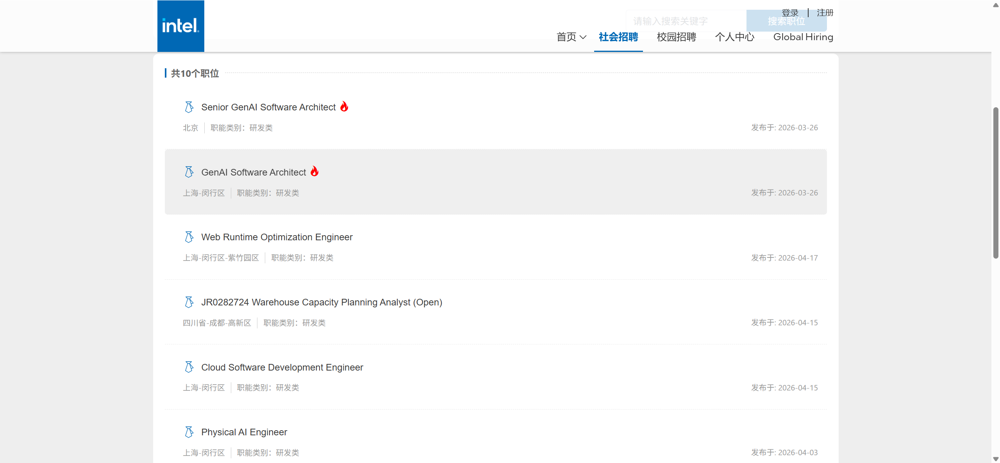
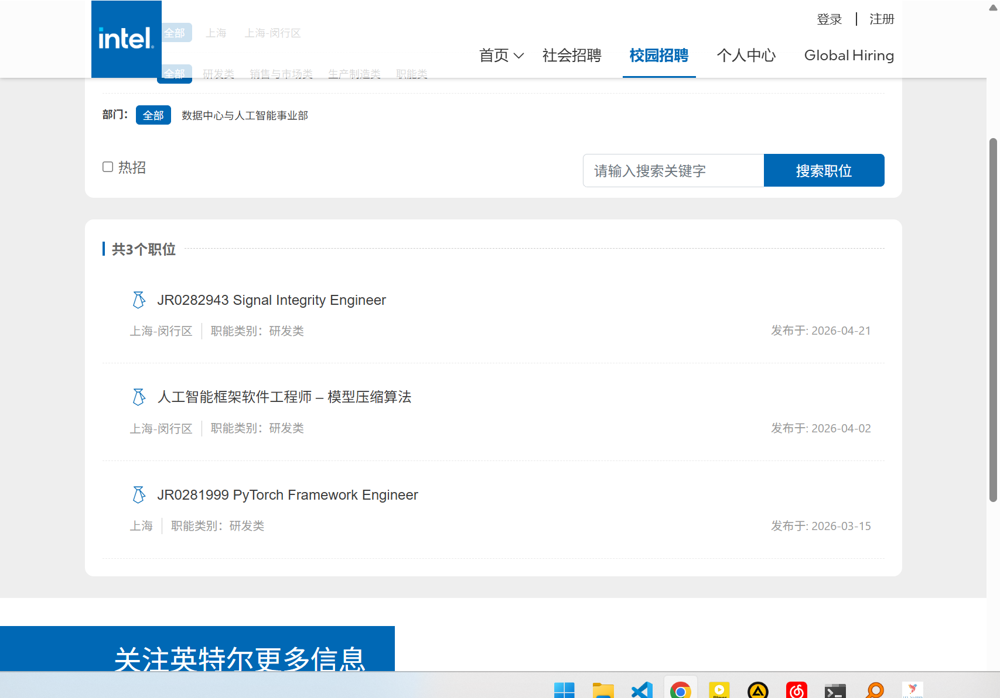

只在上海闵行区招聘AI岗位,目标院校是什么不用多说...

- 招聘岗位特别少,看的出来是不愿意在中国招人的那种,可以直接跳过

### Nvidia(英伟达)
入职能送我5090吗😃
#### 公司概况

NVIDIA 是一家全球领先的科技巨头，总部位于美国加利福尼亚州圣克拉拉。公司由黄仁勋、Chris Malachowsky 和 Curtis Priem 于 1993 年创立。其核心竞争力在于设计与研发**图形处理器 (GPU)**、**系统级芯片 (SoC)** 以及支撑高性能计算的 **CUDA** 软件架构。
#### 公司历史

##### 1993—1999｜创立与 GPU 诞生

1993年，黄仁勋（Jensen Huang）、克里斯·马拉科夫斯基（Chris Malachowsky）与柯蒂斯·普里姆（Curtis Priem）共同创立 NVIDIA，专注个人电脑图形加速技术。1995年推出 NV1，1997年发布 RIVA 128，1999年在纳斯达克上市，同年推出 GeForce 256，并推广 GPU（图形处理器）概念。

##### 2000—2006｜GeForce 扩张与 CUDA 平台

2000年收购 3dfx 的部分技术与资产，2001年为初代 Xbox 提供图形芯片，随后推出 GeForce 3、FX、6、7 等系列。2006年发布 GeForce 8 和 Tesla 架构，并推出 CUDA 并行计算平台，使 GPU 从图形渲染扩展到通用计算领域。

##### 2007—2015｜GPU 通用计算与深度学习

2007年推出 Tesla 计算加速器，2008年收购 AGEIA，整合 PhysX 物理模拟技术。随后推出 Fermi（2010）、Kepler（2012）和 Maxwell（2014）架构。2012年，AlexNet 利用 NVIDIA GPU 在 ImageNet 竞赛中取得突破，推动 GPU 在深度学习领域的应用，CUDA、cuDNN 等软件生态逐渐成熟。

##### 2016—2019｜AI 计算平台与 RTX 技术

2016年推出 Pascal 架构、Tesla P100 和 DGX-1 AI 超级计算机，2017年发布 Volta V100，引入 Tensor Core 张量核心。2018年推出 Turing 架构和 GeForce RTX 20 系列，将实时光线追踪与 DLSS 技术引入消费级显卡。2019年宣布收购 Mellanox，拓展数据中心高速网络业务。

##### 2020—2023｜数据中心与生成式 AI

2020年完成对 Mellanox 的收购，推出 Ampere 架构、A100 AI 加速器和 GeForce RTX 30 系列。2022年推出 Hopper H100 和 GeForce RTX 40 系列，收购 Bright Computing，并终止对 Arm 的收购计划。2023年生成式 AI 快速发展，推动 H100、CUDA、NVLink 和 DGX 等数据中心产品需求增长。

##### 2024—至今｜Blackwell、Rubin 与 AI 基础设施

2024年发布 Blackwell 架构、B200、GB200 及机架级 AI 计算系统，并收购 Run:ai、Deci 等企业。2025年推出 Blackwell Ultra、GeForce RTX 50 系列、DGX Spark，以及 Nemotron、Cosmos、Isaac GR00T 等 AI 模型与机器人技术。2026年发布 Vera Rubin 平台，整合新一代 CPU、GPU、网络与推理加速器，并宣布收购 Hugging Face，进一步扩展 AI 计算和开发者生态。

#### 控股公司及子公司

- **集团主体**
  - **NVIDIA Corporation**：1993年成立，总部位于美国加利福尼亚州圣克拉拉，纳斯达克上市（NVDA）。
  - **管理层与业务结构**：黄仁勋（Jensen Huang）担任创始人、总裁兼 CEO，集团主要分为计算与网络（Compute & Networking）和图形（Graphics）两个报告分部。

- **数据中心与网络技术**
  - **Mellanox Technologies**（2020年收购）：高性能网络芯片、InfiniBand、以太网及数据中心互连。
  - **Cumulus Networks、SwiftStack**（2020年收购）：数据中心网络软件与分布式存储技术。
  - **Bright Computing、Excelero**（2022年收购）：计算集群管理与高性能存储软件。

- **人工智能与云基础设施**
  - **OmniML、Deci AI**：模型压缩、推理优化和 AI 软件技术。
  - **Run:ai、SchedMD**：GPU 资源调度、Kubernetes 工作负载和 Slurm 集群管理。
  - **Lepton AI、Brev.dev**：GPU 云计算、模型部署和 AI 开发环境。
  - **Shoreline.io**：云基础设施自动化与运维。

- **图形计算与自动驾驶**
  - **AGEIA Technologies**（2008年收购）：PhysX 物理模拟与图形计算。
  - **DeepMap**（2021年收购）：高精度地图、定位及自动驾驶技术。
  - **3dfx Interactive**：2000年收购部分知识产权与资产，未持续运营其原有业务。

- **重要法律实体**
  - **Mellanox Technologies, Ltd.**：注册于以色列，负责高性能网络相关业务。
  - **NVIDIA International, Inc.**：注册于美国特拉华州，属于国际业务相关实体。
  - **NVIDIA Singapore Pte Ltd**：注册于新加坡，属于集团亚洲及国际运营体系。

- **战略投资与合作**
  - **Groq**：AI 推理芯片企业，与 NVIDIA 建立技术授权与研发合作，仍独立运营。
  - **CoreWeave、Intel、Marvell、Synopsys**：AI 云计算、半导体及软件领域的重要投资与技术合作伙伴。
  - **台积电（TSMC）**：主要先进芯片制造与封装供应商。
  - **Hugging Face**：2026年宣布收购，预计2027年完成交割，目前尚不属于已完成收购的子公司。

注：Arm 收购计划于2022年终止。上述战略合作企业均不属于 NVIDIA 控股子公司；部分已收购企业也已整合进入内部部门。

#### 主要产品

- **消费级与专业显卡**
  - **GeForce RTX**：RTX 20、30、40、50 系列桌面及笔记本显卡。
  - **RTX PRO**：Blackwell 专业显卡系列，面向图形工作站、工程设计和 AI 计算。
  - **游戏图形技术**：DLSS、光线追踪、NVIDIA Reflex、G-SYNC、RTX Remix。
  - **软件与云游戏**：NVIDIA App、NVIDIA Studio、NVIDIA Broadcast、GeForce NOW。

- **数据中心与 AI 计算硬件**
  - **AI GPU**：A100、H100、H200、B200、B300、Rubin 系列。
  - **CPU 与超级芯片**：Grace CPU、Vera CPU、GH200、GB200、GB300。
  - **AI 计算平台**：HGX、DGX、DGX SuperPOD、Vera Rubin NVL72、Groq 3 LPX。
  - **个人 AI 计算设备**：DGX Spark、DGX Station。
  - **云计算服务**：DGX Cloud、DGX Cloud Lepton。

- **AI 软件与基础模型**
  - **企业 AI 平台**：NVIDIA AI Enterprise、NIM、NeMo、AI Blueprints。
  - **模型推理与部署**：TensorRT、TensorRT-LLM、Triton Inference Server、NVIDIA Dynamo。
  - **AI 基础模型**：Nemotron、Cosmos、Isaac GR00T、Alpamayo、BioNeMo。

- **GPU 编程与开发工具**
  - **CUDA 计算平台**：CUDA Toolkit、CUDA C++、CUDA Python、CUDA-X。
  - **深度学习与计算库**：cuDNN、cuBLAS、NCCL、CUTLASS。
  - **数据科学与优化**：RAPIDS、cuDF、cuML、cuOpt。
  - **性能分析工具**：Nsight Systems、Nsight Compute。

- **数据中心网络与基础设施**
  - **高速互连**：NVLink、NVSwitch、NVLink Fusion。
  - **InfiniBand 与以太网**：Quantum、Spectrum、Spectrum-X、Cumulus Linux。
  - **网络适配器与 DPU**：ConnectX、BlueField、NVIDIA DOCA。
  - **集群管理**：Run:ai、Slurm、Bright Cluster Manager、NVIDIA Mission Control。

- **机器人、自动驾驶与工业计算**
  - **边缘 AI 硬件**：Jetson Nano、Jetson Orin、Jetson Thor。
  - **机器人开发**：NVIDIA Isaac、Isaac Sim、Isaac Lab、Isaac ROS。
  - **自动驾驶**：NVIDIA DRIVE、DRIVE AGX、DRIVE Hyperion、DriveOS。
  - **工业仿真与数字孪生**：NVIDIA Omniverse、Omniverse Kit、OpenUSD 技术生态。

- **专业计算与行业应用**
  - **图形渲染与虚拟化**：NVIDIA OptiX、RTX Renderer、NVIDIA vGPU。
  - **医疗与生命科学**：NVIDIA Clara、MONAI、BioNeMo、Parabricks。
  - **工业视觉与通信**：NVIDIA Metropolis、DeepStream、Holoscan、Aerial。
  - **科学与量子计算**：CUDA-Q、cuQuantum、Modulus。
#### 招聘情况
- [招聘官网](https://www.nvidia.cn/about-nvidia/careers/)
- 公众号: NVIDIA英伟达

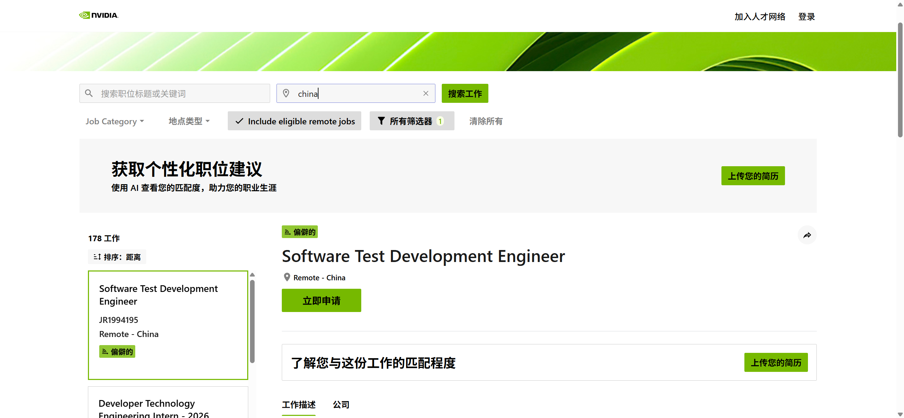
招聘岗位在外企里算多的了,建议优先考虑,但比较偏硬件

### Tesla (特斯拉)
尽管是汽车公司,但是还是有不少软件需求的...
#### 公司概况
特斯拉（Tesla, Inc.）总部位于德克萨斯州奥斯汀，是一家集汽车与清洁能源为一体的美国跨国公司。公司由马丁·艾伯哈德和马克·塔彭宁于 2003 年创立，随后由埃隆·马斯克领投并出任 CEO。特斯拉不仅通过 **Model S/3/X/Y** 等车型引领了全球纯电动汽车（BEV）市场，还涉足家用及电网级储能设备、太阳能产品。尽管在 2025 年底失去了全球最大电动汽车制造商的地位，但其市值多次突破 1 万亿美元，稳居全球市值最高车企。
##### 马斯克控股公司名列
这些企业并没有像其他巨头一样整合成一家公司,所以有必要在这里说一下:
* **Tesla (特斯拉)**：马斯克担任 CEO 且为第一大股东
* **SpaceX (太空探索技术公司)**：马斯克担任 CEO 兼首席技术官，拥有绝对控股权。这是目前全球估值最高的私有航天企业，旗下包含 **Starlink (星链)** 卫星互联网业务。
* **X (原 Twitter)**：马斯克于 2022 年全资收购并将其私有化。目前他拥有 100% 的决策权。
* **xAI**：马斯克于 2023 年创立的人工智能公司，旨在开发 **Grok** 等大模型，与 OpenAI 竞争。其计算资源常与 X 平台深度整合。
* **Neuralink**：脑机接口技术公司，马斯克为联合创始人及主要控股人，致力于实现人脑与计算机的直接连接。
* **The Boring Company (隧道挖掘公司)**：马斯克创立的地下交通基础设施公司，旨在通过超高速隧道解决城市拥堵。


#### 招聘情况
- 公众号: 特斯拉招聘

社会招聘在[官网](https://www.tesla.cn/careers),但校园招聘用的是[第三方平台](https://app.mokahr.com/campus-recruitment/tesla/),看不懂了.

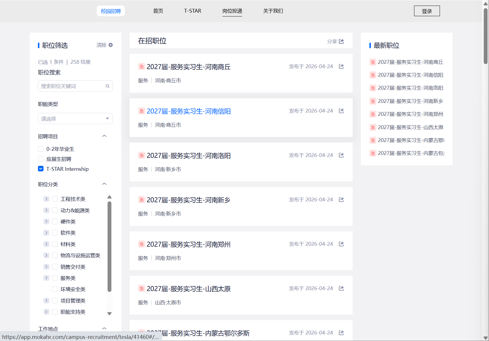


服务岗位很多,软件类的岗位还是很少的

### AMD 
岗位均偏硬件方向
#### 公司概况
AMD（Advanced Micro Devices,超威半导体）总部位于加州圣克拉拉，由杰里·桑德斯于 1969 年创立，是硅谷历史最悠久的半导体巨头之一。公司经历了从存储器生产到 x86 处理器授权制造，再到自研架构的战略演变，凭借 **Zen** 架构及 **Ryzen（锐龙）**、**EPYC（霄龙）** 系列处理器，AMD 在 2020 年代实现了史诗级逆袭：不仅在 2022 年市值首**次超越宿敌英特尔**，更在 2026 年初将其桌面 CPU 市场份额推至 36.4% 的历史新高，并在高利润的服务器营收份额中突破 41%。
#### 公司历史

##### 1969—1989｜创立与早期处理器发展

1969年，杰里·桑德斯（Jerry Sanders）等人创立 AMD（Advanced Micro Devices），最初从事逻辑芯片和半导体存储器业务。1972年首次公开发行股票，随后通过为 Intel 处理器提供兼容产品进入微处理器市场，并逐渐发展自主芯片设计能力。

##### 1990—2005｜Athlon 与 x86 处理器竞争

1991年推出 Am386，随后发布 K5、K6 和 Athlon（1999）处理器，与 Intel 展开 PC 处理器市场竞争。2003年推出 Opteron 和 Athlon 64，将 AMD64（x86-64）架构引入服务器和个人电脑市场，并于2005年推出双核心处理器，逐渐建立高性能 CPU 产品体系。

##### 2006—2013｜ATI 收购与业务重组

2006年以约54亿美元收购图形芯片企业 ATI Technologies，获得 Radeon 显卡技术，开始同时发展 CPU 和 GPU。2009年将晶圆制造业务分拆成立 GlobalFoundries，逐渐转型为无晶圆厂芯片设计企业。随后推出 Fusion APU（2011）和 Bulldozer 架构，并为 PlayStation 4、Xbox One 提供定制处理器，但同期面临 Intel 和 NVIDIA 的激烈竞争。

##### 2014—2020｜Zen 架构与 Ryzen 崛起

2014年，苏姿丰（Lisa Su）接任 CEO，推动 AMD 聚焦高性能 CPU、GPU 和半定制芯片。2017年推出基于 Zen 架构的 Ryzen 桌面处理器和 EPYC 服务器处理器，重新进入高性能计算市场。2019年推出 Zen 2、第三代 Ryzen 和第二代 EPYC，采用芯粒（Chiplet）设计，2020年发布 Zen 3、Ryzen 5000 和 Radeon RX 6000 系列。

##### 2021—2023｜数据中心扩张与自适应计算

2022年完成对 FPGA 企业 Xilinx 和数据中心网络芯片企业 Pensando 的收购，扩展可编程芯片、数据中心网络与嵌入式计算业务。同年推出 Zen 4 架构的 Ryzen 7000 和第四代 EPYC 处理器。2023年推出 Instinct MI300 系列 AI 加速器，并收购 Nod.ai、Mipsology 等 AI 软件企业，强化 ROCm 开发生态。

##### 2024—至今｜AI 加速计算与平台整合

2024年推出 Zen 5 架构、Ryzen 9000、Ryzen AI 300 和第五代 EPYC，收购 Silo AI，强化 AI 模型与软件研发。2025年发布 Radeon RX 9000、Instinct MI350，并收购 ZT Systems，保留系统设计业务、出售制造业务。2026年推出 Ryzen AI 400、第六代 EPYC、Instinct MI400 和 Helios 机架级 AI 计算平台，同时扩大与 OpenAI、Meta 等公司的 AI 基础设施合作。

#### 控股公司及子公司

- **集团主体**
  - **Advanced Micro Devices, Inc.（AMD）**：1969年成立，总部位于美国加利福尼亚州圣克拉拉，纳斯达克上市（AMD）。
  - **管理层与业务结构**：苏姿丰（Lisa Su）担任董事长兼 CEO，集团主要分为数据中心（Data Center）、客户端与游戏（Client and Gaming）、嵌入式（Embedded）三个报告分部。

- **图形处理与自适应计算**
  - **ATI Technologies**（2006年收购）：图形处理器与芯片组技术，Radeon 品牌由此发展。
  - **Xilinx（赛灵思）**（2022年收购）：FPGA、可编程 SoC 和自适应计算技术，旗下包括 Versal、Zynq、Kria 等产品系列。
  - **Pensando Systems**（2022年收购）：数据处理器（DPU）、智能网卡和数据中心网络加速技术。

- **人工智能与软件技术**
  - **Nod.ai、Mipsology**（2023年收购）：AI 编译器、模型优化与推理软件。
  - **Silo AI**（2024年收购）：芬兰人工智能企业，专注大语言模型和企业 AI 解决方案。
  - **Brium、MK1**（2025年收购）：AI 编译器、模型优化和高性能推理技术。

- **数据中心与网络基础设施**
  - **ZT Systems**（2025年收购）：数据中心服务器与机架级系统设计，制造业务随后出售给 Sanmina。
  - **Enosemi**（2025年收购）：硅光子、光互连及共封装光学技术。
  - **Solarflare Communications**：随 Xilinx 并入 AMD，涉及高速以太网与网络适配器技术。

- **重要法律实体**
  - **美国实体**：Xilinx, Inc.、Pensando Systems, Inc.、AMD Design, LLC、AMD Advanced Research, LLC。
  - **国际实体**：ATI Technologies ULC（加拿大）、AMD India、AMD Japan、Advanced Micro Devices China、Silo AI Oy（芬兰）等。

- **战略合作与历史业务**
  - **台积电（TSMC）**：AMD 先进 CPU、GPU 和 AI 芯片的重要晶圆代工合作伙伴。
  - **Microsoft、Sony**：游戏主机定制处理器的长期合作伙伴。
  - **OpenAI、Meta**：AI 加速器与数据中心基础设施的重要客户及战略合作伙伴。
  - **GlobalFoundries**：2009年由 AMD 晶圆制造业务分拆成立，现为独立上市公司，不属于 AMD 控股子公司。

注：AMD 已转型为以芯片设计为主的无晶圆厂半导体企业。部分被收购企业已整合进入内部研发部门，不再独立经营。

#### 主要产品

- **个人电脑处理器**
  - **Ryzen 桌面处理器**：Ryzen 5000、7000、8000、9000 系列，以及采用 3D V-Cache 技术的 Ryzen X3D 游戏处理器。
  - **Ryzen 移动处理器**：Ryzen 200、Ryzen AI 300、Ryzen AI 400、Ryzen AI Max 系列。
  - **专业工作站处理器**：Ryzen Threadripper、Threadripper PRO 9000 WX 系列。
  - **企业与掌机处理器**：Ryzen PRO、Ryzen Z1、Ryzen Z2 系列。

- **显卡与图形计算**
  - **Radeon RX 消费级显卡**：RX 6000、7000、9000 系列，面向游戏、图形渲染和本地 AI 计算。
  - **Radeon PRO 专业显卡**：Radeon PRO W 系列、Radeon AI PRO R9000 系列。
  - **集成图形**：Radeon 700M、800M、8050S、8060S 等核显系列。
  - **游戏图形技术**：AMD FSR、Fluid Motion Frames、FreeSync、HYPR-RX。

- **服务器与 AI 加速计算**
  - **EPYC 服务器处理器**：EPYC 9004（Genoa）、9005（Turin）、第六代 EPYC（Venice），面向云计算、数据库和企业服务器。
  - **Instinct AI 加速器**：MI200、MI300、MI325、MI350、MI400 系列，面向大模型训练与推理。
  - **机架级 AI 平台**：AMD Helios，整合 Instinct GPU、EPYC CPU 和高速网络的 AI 系统参考架构。
  - **数据中心网络**：Pensando DPU、Pollara AI NIC、Vulcano AI NIC。

- **FPGA 与嵌入式计算**
  - **FPGA 可编程芯片**：Spartan、Artix、Kintex、Virtex 系列。
  - **自适应 SoC**：Versal、Zynq 系列，面向工业控制、通信及边缘 AI。
  - **嵌入式计算平台**：Ryzen Embedded、EPYC Embedded、Ryzen AI Embedded。
  - **边缘计算模组**：Kria SOM、Alveo 加速卡。

- **人工智能与软件开发工具**
  - **ROCm 计算平台**：ROCm、ROCm.AI、HIP、MIOpen、rocBLAS、RCCL，提供 GPU 并行计算和 AI 开发支持。
  - **模型开发与优化**：Ryzen AI Software、Vitis AI、AMD Quark。
  - **FPGA 开发工具**：Vivado、Vitis、PetaLinux。
  - **显卡与系统管理**：AMD Software: Adrenalin Edition、Radeon PRO Software、Ryzen Master。

- **游戏主机与定制芯片**
  - **半定制 SoC**：为 Sony PlayStation、Microsoft Xbox 等游戏主机提供 CPU、GPU 和定制芯片设计。
  - **游戏与掌机平台**：Ryzen Z 系列、Radeon 图形技术及相关驱动软件。
  - **图形与处理器架构**：Zen、RDNA、CDNA、XDNA 等技术体系。
#### 招聘情况
- [招聘官网](https://careers.amd.com/careers-home/jobs)
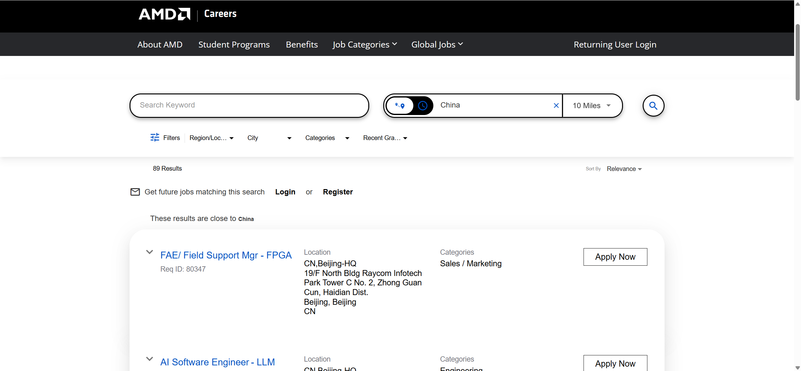

招的岗位也很多,但不少是面向AI模型和硬件架构的,难度很高.

### Cisco (思科)
岗位很少,可直接跳过
#### 公司概况
思科（Cisco Systems）总部位于加州圣何塞，由斯坦福大学两位计算机科学家于 1984 年创立，是全球联网技术与网络安全领域的绝对领导者。作为 LAN（局域网）多协议路由系统的先驱，思科在 2000 年互联网泡沫巅峰期曾一度超越微软成为全球市值最高的公司，目前市值约 3170 亿美元。公司业务深度覆盖核心网络硬件、网络安全、云计算、物联网（IoT）及人工智能，拥有 Webex、OpenDNS 等知名品牌.
#### 公司历史

##### 1984—1994｜创立与网络设备发展

1984年，伦纳德·博萨克（Leonard Bosack）与桑迪·勒纳（Sandy Lerner）创立 Cisco Systems，最初专注计算机网络互联技术。公司通过支持多种网络协议的路由器进入企业网络市场，1990年在纳斯达克上市。1993年收购 Crescendo Communications，开始拓展网络交换机业务，逐渐建立路由器与交换机产品体系。

##### 1995—2000｜互联网繁荣与网络设备扩张

1995年，约翰·钱伯斯（John Chambers）接任 CEO，推动 Cisco 通过技术研发与企业收购快速扩张。公司先后收购 StrataCom（1996）、Selsius Systems（1998）、Cerent（1999）等企业，拓展网络交换、IP 电话和光通信业务。随着互联网基础设施需求增长，Cisco 成为全球重要的企业网络和互联网设备供应商。

##### 2001—2009｜企业通信与数据中心业务

互联网泡沫破裂后，Cisco 继续发展企业路由、交换与网络安全业务。2003年收购 Linksys，2005年宣布收购 Scientific-Atlanta，2007年收购 WebEx，拓展家庭网络、数字视频和在线会议服务。2009年推出 Unified Computing System（UCS）服务器平台，开始将计算、网络和数据中心管理整合。

##### 2010—2015｜云管理网络与网络安全

2012年收购 Meraki，进入云管理网络市场；2013年收购 Sourcefire，强化网络安全业务；2015年收购 OpenDNS，发展云端 DNS 安全服务。同期推出 Application Centric Infrastructure（ACI）等软件定义网络技术。2015年，查克·罗宾斯（Chuck Robbins）接任 CEO，推动公司向软件、订阅和云服务转型。

##### 2016—2020｜软件服务与云网络转型

Cisco 陆续收购 AppDynamics（2017）、BroadSoft（2018）、Duo Security（2018）和 ThousandEyes（2020），扩展应用性能监控、企业通信、身份安全和网络可观测性业务。2019年推出 Silicon One 网络芯片架构，并发展 Cisco 8000 系列路由器，逐步建立网络硬件、云管理软件和安全服务相结合的产品体系。

##### 2021—2024｜网络安全与可观测性整合

2021年收购 Acacia Communications，强化高速光通信技术。随后发展 Cisco XDR、Secure Access 和 AI 网络管理功能。2024年以约280亿美元完成对 Splunk 的收购，并收购 Isovalent，将安全信息分析、系统可观测性、eBPF 和云原生网络技术纳入企业软件生态。

##### 2025—至今｜AI 网络与智能基础设施

2025年，Cisco 与 NVIDIA 扩大合作，推出 Secure AI Factory 架构，整合 AI 网络、GPU 计算和安全技术。2026年推出 Silicon One G300 网络芯片及相关交换系统，并发布 Cisco Cloud Control、AgenticOps 等智能运维平台，持续发展 AI 数据中心、高速网络互连、智能体安全及企业可观测性业务。

#### 控股公司及子公司

- **集团主体**
  - **Cisco Systems, Inc.**：1984年成立，总部位于美国加利福尼亚州圣何塞，纳斯达克上市（CSCO）。
  - **管理层与业务结构**：查克·罗宾斯（Chuck Robbins）担任董事长兼 CEO。主要产品业务包括网络（Networking）、安全（Security）、协作（Collaboration）和可观测性（Observability），财务报告另按美洲、欧洲中东非洲及亚太地区划分区域分部。

- **网络设备与基础设施**
  - **Meraki**（2012年收购）：云管理交换机、无线网络、路由及网络安全设备。
  - **Acacia Communications**（2021年收购）：高速光通信、相干光模块与光网络芯片。
  - **Viptela**（2017年收购）：软件定义广域网（SD-WAN）技术。

- **网络安全与身份管理**
  - **Sourcefire**（2013年收购）：入侵检测、防火墙和网络威胁防护。
  - **OpenDNS**（2015年收购）：DNS 安全及云端网络防护，技术发展为 Cisco Umbrella。
  - **Duo Security**（2018年收购）：多因素身份认证与零信任访问。
  - **Isovalent**（2024年收购）：eBPF、Cilium、Tetragon 等云原生网络和安全技术。
  - **Robust Intelligence**（2024年收购）：AI 模型安全与风险检测。

- **数据分析与可观测性**
  - **AppDynamics**（2017年收购）：应用性能监控及故障分析。
  - **ThousandEyes**（2020年收购）：互联网、云网络与用户体验监测。
  - **Splunk**（2024年收购）：机器数据分析、安全运营及系统可观测性。
  - **Accedian**（2023年收购）：网络性能监测与服务保障。

- **企业通信与协作**
  - **WebEx Communications**（2007年收购）：视频会议、企业协作及云通信服务。
  - **BroadSoft**（2018年收购）：企业云通信和统一通信技术。
  - **Slido**（2021年收购）：会议互动、在线投票与问答工具。

- **重要法律实体**
  - **美国实体**：Cisco Technology, Inc.、Cisco Systems Capital Corporation、Cisco WebEx LLC、Splunk LLC、Meraki LLC。
  - **国际实体**：Cisco Systems International B.V.（荷兰）、Cisco Systems International Sàrl（瑞士）、Cisco Systems (India)、Cisco Systems G.K.（日本）等。
  - **其他技术实体**：Mellanox 以外的网络业务相关实体，包括 Acacia Communications、AppDynamics、Duo Security 和 ThousandEyes 等集团子公司。

- **战略合作与历史业务**
  - **NVIDIA**：AI 数据中心、GPU 服务器、高速网络与 Secure AI Factory 的重要合作伙伴。
  - **Microsoft、AWS、Google Cloud**：云计算、网络连接、安全与企业应用领域的合作伙伴。
  - **Linksys**：2003年收购，2013年出售给 Belkin，目前不属于 Cisco。
  - **Scientific-Atlanta**：2006年完成收购，相关视频设备业务后来逐步重组或出售。

注：部分收购企业已整合进入 Cisco 内部业务部门，不再作为独立品牌经营；战略合作伙伴不属于控股子公司。

#### 主要产品

- **网络交换与路由设备**
  - **企业交换机**：Cisco Catalyst 9000 系列，面向园区网络、企业办公和局域网建设。
  - **数据中心交换机**：Cisco Nexus 9000、Nexus 3000 系列，面向数据中心、云计算及 AI 网络。
  - **路由器**：Cisco 8000、ASR、Catalyst 8000 系列，面向广域网、运营商和数据中心互联。
  - **工业网络设备**：Cisco Industrial Ethernet、Industrial Routers，面向工业物联网和边缘计算。

- **无线网络与云管理**
  - **无线网络**：Cisco Catalyst Wireless、无线接入点及控制器。
  - **Cisco Meraki**：Meraki MX、MS、MR、MV 系列，覆盖云管理路由、交换、无线及视频监控。
  - **网络管理平台**：Cisco Catalyst Center、Meraki Dashboard、Cisco Nexus Dashboard。
  - **软件定义网络**：Cisco SD-WAN、Cisco ACI、Cisco SD-Access。

- **网络安全与零信任**
  - **网络防护**：Cisco Secure Firewall、Cisco Hypershield、Cisco Umbrella。
  - **身份与访问安全**：Cisco Duo、Cisco Identity Services Engine（ISE）、Cisco Secure Access。
  - **威胁检测与响应**：Cisco XDR、Cisco Secure Endpoint、Cisco Talos。
  - **AI 安全**：Cisco AI Defense、Hybrid Mesh Firewall、智能体身份与访问安全技术。

- **数据中心与 AI 基础设施**
  - **服务器与计算平台**：Cisco UCS、UCS X-Series、Cisco Intersight。
  - **网络芯片与互连**：Cisco Silicon One、Silicon One G300、高速光模块。
  - **AI 基础设施**：Cisco Secure AI Factory with NVIDIA、Cisco AI POD、Cisco Unified Edge。
  - **数据中心架构**：Cisco Nexus One、Cisco AI Networking、Cisco Cloud Control。

- **可观测性与数据分析**
  - **Splunk 平台**：Splunk Enterprise、Splunk Cloud Platform、Splunk Enterprise Security。
  - **应用与基础设施监控**：Splunk Observability Cloud、AppDynamics。
  - **互联网与网络监测**：Cisco ThousandEyes、Accedian。
  - **智能运维**：Cisco AgenticOps、Cisco AI Canvas、Cisco Cloud Control。

- **企业通信与协作**
  - **Webex 协作平台**：Webex Meetings、Webex Calling、Webex Messaging、Webex Suite。
  - **企业客服与 AI**：Webex Contact Center、Webex AI Agent、Webex AI Assistant。
  - **会议与通信硬件**：Cisco Webex Board、Room、Desk、IP Phone 系列。
  - **会议互动工具**：Slido。

- **网络操作系统与开发工具**
  - **网络操作系统**：Cisco IOS、IOS XE、IOS XR、NX-OS。
  - **网络自动化与管理**：Cisco NSO、Cisco Modeling Labs、Cisco DevNet。
  - **云原生网络工具**：Cilium、Tetragon、eBPF 技术生态。
  - **开发者接口**：Cisco API、网络自动化 SDK、Terraform 与 Ansible 集成。

- **技术培训与企业服务**
  - **职业认证**：CCNA、CCNP、CCIE、DevNet Certifications。
  - **学习与实验工具**：Cisco Packet Tracer、Cisco Networking Academy、Cisco U.。
  - **企业技术服务**：Cisco Customer Experience、Cisco Support、Cisco CX Cloud、Cisco IQ。
#### 招聘情况
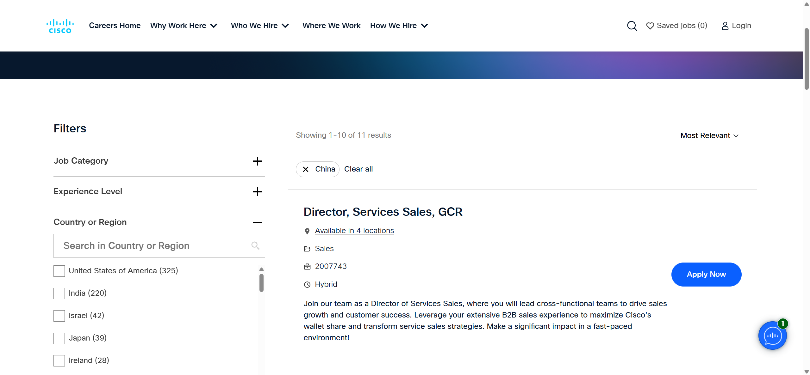
招人,但都是无关紧要的岗位.
### Airbnb (爱彼迎)
岗位很少,可直接跳过
#### 公司概况
Airbnb（爱彼迎）总部位于旧金山，由布莱恩·切斯基、乔·杰比亚和内森·布莱查奇克于 2008 年创立，是全球共享经济模式的开创者。作为一家轻资产的在线旅行租赁平台，它通过连接房东与房客，提供从气垫床到城堡的多样化住宿及当地体验服务，并从中抽取佣金。尽管经历了 2020 年疫情的冲击及 2022 年撤出中国本土房源市场的战略调整，Airbnb 目前仍是全球市值最高的旅游科技公司之一，市值超 1000 亿美元。
#### 公司历史
- [Wiki](https://en.wikipedia.org/wiki/Airbnb)

##### 2007–2009：从“气垫床”到“孵化器”
* **起源**：2007 年，乔·杰比亚和布莱恩·切斯基为了支付旧金山的房租，在公寓里放置了三张气垫床并提供早餐（Airbed and Breakfast）。2008 年，内森·布莱查奇克加入并担任 CTO，公司正式成立。
* **筹资奇招**：早期公司极度缺钱，创始人曾在 2008 年大选期间设计并销售定制款麦凯恩和奥巴马主题早餐麦片（Obama O's），赚取了 3 万美元的启动资金。
* **Y Combinator**：2009 年公司进入顶级孵化器 YC。在保罗·格雷厄姆的建议下，创始人飞往纽约亲自为房源拍摄高质量照片，这一举动成为公司业绩的转折点。

##### 2010–2019：共享经济的全球化
* **指数级增长**：2011 年，Airbnb 获得红杉资本注资，估值突破 10 亿美元，正式开启全球扩张。
* **体验业务**：2016 年推出 **Airbnb Experiences**（体验），将业务从单一的住宿扩展到由当地人领队的旅游活动。
* **中国市场**：2015 年正式进入中国，起名“爱彼迎”。

##### 2020–2026：疫情冲击、上市与业务重塑
* **裁员与转型**：2020 年初受疫情重创，营收暴跌 80%。布莱恩·切斯基随后宣布裁员 25% 并大幅削减非核心项目（如酒店和交通）。
* **IPO**：2020 年 12 月，Airbnb 在纳斯达克上市。尽管处于疫情中，其市值在首日即突破 1000 亿美元。
* **后疫情策略**：随着远程办公普及，Airbnb 转向推广“长租”和“非城市中心”房源。
* **退出中国本土市场**：2022 年 5 月，Airbnb 宣布停止中国本土房源的经营，保留跨境旅游业务（Outbound），将重心转回服务出境游的中国游客。
* **AI 整合 (2025-2026)**：2026 年，Airbnb 深度整合了 **Joule-like** 生成式 AI 系统，用户可以通过自然语言描述复杂的旅行方案（如“适合带狗、有恒温泳池且附近有酒庄的意式庄园”），AI 可实现端到端的筛选与预订。


#### 招聘情况
- [招聘官网](https://careers.airbnb.com/positions/?_where_you_work=china)

内地岗位很少:
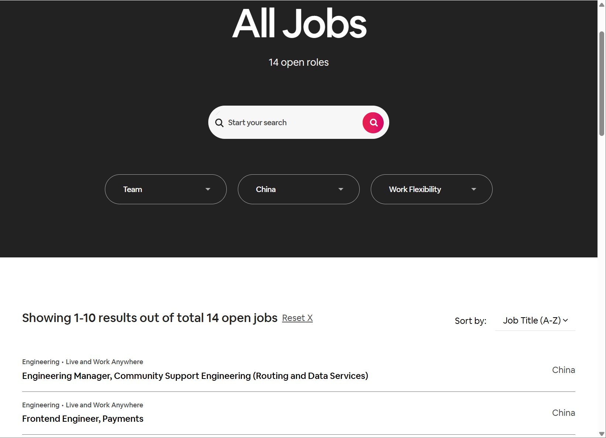
### SAP
#### 公司概况
SAP SE（思爱普）总部位于德国沃尔多夫，由五位前 IBM 工程师于 1972 年创立，是全球最大的企业管理软件（ERP）供应商。作为欧洲市值最高的科技公司及全球最大的非美软件企业，SAP 专注于开发能够处理企业核心业务流程（如财务、后勤、人力资源）的集成系统。从早期的 R/2、R/3 架构到如今基于内存计算技术的 **S/4HANA** 平台，SAP 的产品支撑着全球绝大多数大型企业的运作。其业务遍布 180 个国家，是德国 DAX 指数及欧洲蓝筹股的核心成分股，代表了企业级应用软件的工业标准。
#### 公司历史

##### 1972—1991｜创立与企业管理软件发展

1972年，迪特马尔·霍普（Dietmar Hopp）、哈索·普拉特纳（Hasso Plattner）等五名前 IBM 员工在德国创立 SAP，专注企业管理软件。1973年推出财务会计系统，随后发展为 SAP R/1；1979年推出 SAP R/2，将财务、采购、生产等企业业务整合至大型机平台。1988年在德国上市，逐步拓展国际市场。

##### 1992—2000｜R/3 架构与全球 ERP 市场扩张

1992年推出 SAP R/3，采用客户端、应用服务器和数据库三层架构，支持跨部门企业资源规划（ERP）。SAP R/3 逐渐成为大型企业的重要管理系统。1998年在纽约证券交易所上市，1999年推出 mySAP.com 战略，开始将 ERP 与互联网、电子商务及供应链管理结合。

##### 2001—2009｜企业应用套件与商业智能

2001年收购 TopTier，随后发展 SAP NetWeaver 企业应用集成平台。2004年推出 SAP ERP Central Component（ECC），形成 ERP、CRM、SCM 等企业应用体系。2008年收购 Business Objects，拓展商业智能和数据分析业务，并推出 Business One、Business ByDesign 等面向中小企业的管理软件。

##### 2010—2014｜HANA 数据库与云计算转型

2010年推出 SAP HANA 内存数据库，并收购 Sybase。随后收购 SuccessFactors、Ariba（2012）、Hybris（2013）、Fieldglass 和 Concur（2014），扩展云端人力资源、采购、电子商务及费用管理业务。2014年改制为 SAP SE，逐步向云计算与订阅服务转型。

##### 2015—2019｜S/4HANA 与云 ERP 生态

2015年推出 SAP S/4HANA，基于 HANA 数据库重构核心 ERP 系统，逐渐取代 SAP ECC。同期发展 SAP Cloud Platform、HANA Cloud 和 Fiori 用户界面。2018年收购 CallidusCloud 和 Qualtrics，扩展销售管理与客户体验业务，并持续完善云端企业应用体系。

##### 2020—2023｜云优先与企业数字化转型

2020年，克里斯蒂安·克莱因（Christian Klein）出任 CEO，推动云 ERP 和企业订阅服务发展。2021年推出 RISE with SAP，收购 Signavio 和 AppGyver；随后收购 Taulia（2022）、LeanIX（2023），并出售 Qualtrics 股权。同期发展 SAP Business Technology Platform（BTP）、SAP Datasphere 和生成式 AI 助手 Joule。

##### 2024—至今｜企业人工智能与数据平台

2024年收购 WalkMe，强化企业软件使用引导与自动化。2025年重新整合 SAP Business Suite，推出 SAP Business Data Cloud，并收购 SmartRecruiters。2026年完成对 Reltio、Dremio 和 Prior Labs 的收购，发展 Joule Work、Joule Agents、SAP Business AI Platform 等产品，重点拓展企业数据分析、业务智能体和流程自动化。

#### 控股公司及子公司

- **集团主体**
  - **SAP SE**：1972年成立，总部位于德国沃尔多夫，法兰克福证券交易所及纽约证券交易所上市（SAP）。
  - **管理层与业务结构**：克里斯蒂安·克莱因（Christian Klein）担任 CEO，集团主要包括应用、技术与支持（ATS）和核心服务（Core Services）两个报告分部。

- **企业管理与人力资源**
  - **SuccessFactors**（2012年收购）：云端人力资源、薪酬、绩效及人才管理。
  - **SmartRecruiters**（2025年收购）：AI 招聘管理与申请人追踪系统。
  - **Concur**（2014年收购）：企业差旅、费用报销和支出管理。
  - **Fieldglass**（2014年收购）：外部劳动力与外包服务管理。

- **采购、供应链与客户体验**
  - **Ariba**（2012年收购）：企业采购、供应商管理及采购网络。
  - **Taulia**（2022年收购控股股权）：供应链金融与营运资本管理。
  - **Hybris、CallidusCloud**：电子商务、客户关系和销售绩效管理技术。
  - **Emarsys**（2020年收购）：营销自动化，产品现更名为 SAP Engagement Cloud。

- **数据库、分析与人工智能**
  - **Business Objects**（2008年收购）：商业智能、报表和数据可视化。
  - **Sybase**（2010年收购）：数据库与企业数据管理技术。
  - **Reltio、Dremio**（2026年收购）：主数据管理与数据湖仓技术。
  - **Prior Labs**（2026年收购）：表格基础模型与结构化数据 AI 研究。

- **企业转型与开发技术**
  - **Signavio**（2021年收购）：业务流程管理与流程挖掘。
  - **LeanIX**（2023年收购）：企业架构管理与 IT 系统分析。
  - **WalkMe**（2024年收购）：数字化应用引导与软件使用自动化。
  - **AppGyver**（2021年收购）：无代码应用开发，相关技术整合进入 SAP Build。

- **重要法律实体**
  - **欧洲实体**：SAP Deutschland、SAP (UK)、SAP France、SAP (Schweiz) AG。
  - **美洲实体**：SAP America、SAP Industries、SAP National Security Services、Ariba、Concur。
  - **亚太实体**：SAP China、SAP India、SAP Japan、SAP Australia。

- **历史业务与战略合作**
  - **Qualtrics**：2018年收购，2023年出售全部股权，已不属于 SAP。
  - **Litmos**：原企业学习管理平台，2022年出售。
  - **Databricks**：企业数据分析与 AI 技术合作伙伴，并非 SAP 子公司。
  - **Microsoft、AWS、Google Cloud**：云基础设施及企业应用合作伙伴。

注：部分收购企业已整合进入 SAP 内部业务体系，不再作为独立品牌经营；战略合作伙伴不属于控股子公司。

#### 主要产品

- **企业资源规划（ERP）**
  - **SAP S/4HANA**：核心 ERP 平台，覆盖财务、采购、生产、库存和企业运营。
  - **SAP Cloud ERP**：Cloud ERP、Cloud ERP Private，提供不同云部署模式。
  - **中小企业 ERP**：SAP Business One、Business ByDesign。
  - **企业云转型**：RISE with SAP、SAP GROW。

- **财务、人力资源与采购**
  - **财务管理**：SAP S/4HANA Finance、Central Finance、Group Reporting、Treasury。
  - **人力资源**：SAP SuccessFactors、SmartRecruiters。
  - **采购与供应商管理**：SAP Ariba、SAP Business Network。
  - **费用与外部劳动力**：SAP Concur、Fieldglass、Taulia。

- **供应链、制造与企业资产**
  - **供应链规划**：SAP Integrated Business Planning（IBP）。
  - **生产制造**：SAP Digital Manufacturing、Production Planning。
  - **物流与仓储**：SAP Extended Warehouse Management（EWM）、Transportation Management（TM）。
  - **设备与资产管理**：SAP Enterprise Asset Management（EAM）、Asset Performance Management。

- **客户关系与电子商务**
  - **SAP Customer Experience**：客户体验与 CRM 产品体系。
  - **销售与客服**：SAP Sales Cloud、Service Cloud。
  - **电子商务**：SAP Commerce Cloud。
  - **智能营销**：SAP Engagement Cloud（原 Emarsys）。

- **云平台、数据库与数据分析**
  - **SAP Business Technology Platform（BTP）**：企业应用开发、系统集成、数据管理与 AI 平台。
  - **数据库**：SAP HANA、HANA Cloud、Adaptive Server Enterprise。
  - **企业数据云**：SAP Business Data Cloud、Datasphere、SAP Databricks、Dremio。
  - **商业智能**：SAP Analytics Cloud、BusinessObjects、BW/4HANA。

- **人工智能与智能体**
  - **Joule 智能助手**：Joule Work、Joule Agents、Joule Assistants、Joule Studio。
  - **企业 AI 平台**：SAP Business AI Platform、SAP AI Core、Generative AI Hub、AI Agent Hub。
  - **企业 AI 模型**：SAP-RPT-1、Prior Labs TabPFN，面向结构化业务数据分析与预测。

- **开发工具与系统集成**
  - **低代码与自动化**：SAP Build Apps、Build Process Automation、Build Code。
  - **系统集成**：SAP Integration Suite、API Management、Event Mesh。
  - **开发语言与框架**：ABAP、ABAP Cloud、SAPUI5、Fiori、CAP。
  - **开发与运维平台**：SAP Business Application Studio、SAP Cloud ALM。

- **企业转型与管理工具**
  - **业务流程管理**：SAP Signavio。
  - **企业架构管理**：SAP LeanIX。
  - **数字化应用引导**：SAP WalkMe。
  - **安全与身份管理**：SAP Identity Authentication、Identity Provisioning、GRC。

- **行业解决方案与企业服务**
  - **可持续发展**：SAP Sustainability Control Tower、Green Ledger。
  - **行业应用**：SAP for Automotive、Retail、Banking、Healthcare、Utilities。
  - **开发者与学习平台**：SAP Learning、SAP Community、SAP Developer Center、SAP Store。
#### 招聘情况
- [官网](https://jobs.sap.com/) 

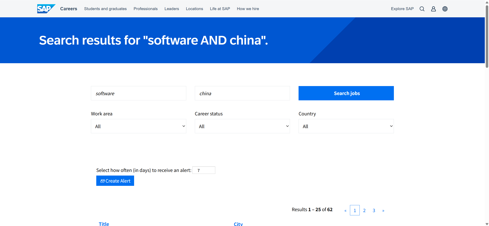

- 公众号: SAP招聘,会跳转到一个移动端网站
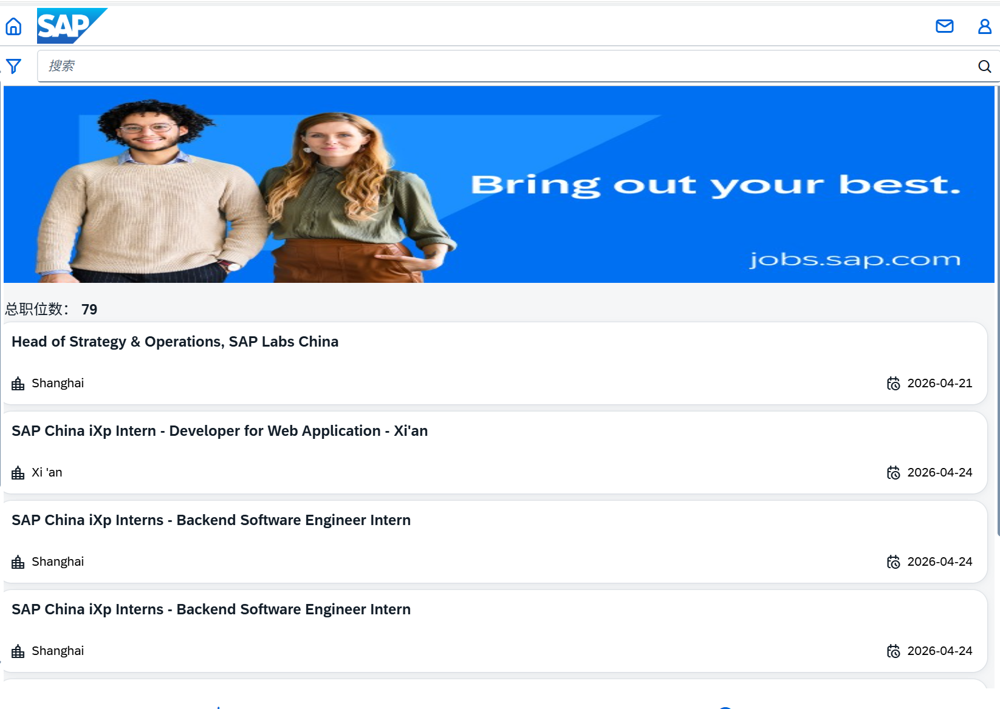

看着多,但软件岗位依然很少.


### Oracle (甲骨文)
直接跳过,不在中国招人
#### 公司概况
Oracle（甲骨文）总部位于德克萨斯州奥斯汀，由拉里·埃里森等人在 1977 年创立，是全球最大的数据库软件供应商及核心企业级软件巨头。作为全球市值排名前 20 的顶级科技公司，Oracle 以其核心的**关系型数据库（Oracle Database）**统治了金融、电信等关键行业数十年，并以此为基础构建了涵盖 ERP、HCM 和供应链管理（SCM）的完整企业应用生态。
#### 公司历史

##### 1977—1986｜创立与关系型数据库商业化

1977年，拉里·埃里森（Larry Ellison）、鲍勃·迈纳（Bob Miner）和埃德·奥茨（Ed Oates）共同创立 Software Development Laboratories（SDL），专注关系型数据库技术。1979年推出 Oracle V2，成为早期商业化 SQL 关系型数据库产品。1983年推出支持多种硬件平台的 Oracle Database V3，1986年在纳斯达克上市，逐渐建立企业数据库软件业务。

##### 1987—2000｜数据库扩张与企业应用发展

1987年，Oracle 成为全球主要数据库管理软件企业之一。1992年推出 Oracle7，随后发布 Oracle8（1997）和 Oracle8i（1999），扩展数据库的事务处理、对象关系及互联网应用能力。1995年开始推动互联网软件战略，2000年推出 Oracle E-Business Suite 11i，逐渐从数据库供应商发展为综合企业软件企业。

##### 2001—2010｜大型收购与软硬件整合

Oracle 先后收购 PeopleSoft（2005）、Siebel Systems（2006）、Hyperion（2007）和 BEA Systems（2008），扩展 ERP、CRM、商业智能和 Java 中间件业务。2010年以约74亿美元完成对 Sun Microsystems 的收购，获得 Java、MySQL、Solaris、SPARC 和服务器技术，开始形成数据库、企业应用、中间件与硬件相结合的产品体系。

##### 2011—2016｜云计算与企业应用转型

2011年推出 Fusion Cloud Applications，开始发展云端 ERP、HCM 和 CRM 应用。2013年推出 Oracle Database 12c，引入多租户数据库架构。2014年，萨弗拉·卡茨（Safra Catz）和马克·赫德（Mark Hurd）共同接任 CEO，埃里森转任董事长兼 CTO。2016年完成对 NetSuite 的约93亿美元收购，并持续发展 Oracle Cloud Infrastructure（OCI），扩大企业云服务业务。

##### 2017—2021｜OCI 与自治数据库

2018年推出 Oracle Autonomous Database 和第二代 Oracle Cloud Infrastructure（Gen 2 Cloud），强化数据库自动化及云计算基础设施。同期发展 Exadata Cloud、Oracle Cloud Applications 和混合云解决方案，并通过收购 Aconex、CrowdTwist 等企业拓展行业应用。2020年将公司总部迁至美国得克萨斯州奥斯汀，逐步扩大云数据中心与订阅服务业务。

##### 2022—2024｜医疗信息系统与多云数据库

2022年以约283亿美元完成对医疗信息系统企业 Cerner 的收购，整合为 Oracle Health，进入大型医疗 IT 市场。2023—2024年持续扩展 OCI AI 算力、GPU 集群和数据库服务，推出 Oracle Database 23ai，引入 AI Vector Search。同时与 Microsoft、Google Cloud、AWS 合作，将 Oracle 数据库服务扩展至其他云平台。

##### 2025—至今｜AI 数据库与云基础设施扩张

2025年，克莱·马戈伊克（Clay Magouyrk）与迈克·西西里亚（Mike Sicilia）接任联合 CEO，卡茨转任董事会执行副主席。同年推出 Oracle AI Database 26ai，发展 OCI AI 基础设施及 Fusion AI Agent Studio，并与 OpenAI 等企业扩大 AI 数据中心合作。2026年进一步发展多云数据库、Fusion Agentic Applications 和 Oracle Health AI 产品，强化云计算、数据库与企业智能体业务。

#### 控股公司及子公司

- **集团主体**
  - **Oracle Corporation（甲骨文公司）**：1977年成立，总部位于美国得克萨斯州奥斯汀，纽约证券交易所上市（ORCL）。
  - **管理层与业务结构**：拉里·埃里森（Larry Ellison）担任董事长兼 CTO，Clay Magouyrk 与 Mike Sicilia 担任联合 CEO。集团主要包括云与软件（Cloud and Software）、硬件（Hardware）和服务（Services）三个报告分部。

- **数据库与基础软件**
  - **Sun Microsystems**（2010年收购）：服务器、Java、MySQL、Solaris、SPARC 和 VirtualBox 技术，相关业务已整合进入 Oracle。
  - **BEA Systems**（2008年收购）：WebLogic、Tuxedo 等企业中间件技术。
  - **Sleepycat Software、Innobase**：嵌入式数据库与 InnoDB 存储引擎技术。

- **企业管理与云应用**
  - **PeopleSoft、JD Edwards**（2005年并入）：ERP、人力资源与企业管理软件。
  - **Siebel Systems**（2006年收购）：客户关系管理（CRM）软件。
  - **Hyperion**（2007年收购）：企业绩效管理、财务规划和商业智能。
  - **NetSuite**（2016年收购）：云端 ERP、CRM、电子商务及企业管理平台，保留独立产品品牌。

- **企业服务与行业软件**
  - **MICROS Systems**（2014年收购）：酒店、餐饮及零售业管理系统。
  - **Primavera、Aconex、Textura**：工程项目管理、建筑协作及合同支付平台。
  - **Eloqua、Responsys**：企业营销自动化与客户互动技术。
  - **Acme Packet**（2013年收购）：通信网络及会话边界控制技术。

- **医疗信息与生命科学**
  - **Cerner**（2022年收购）：电子健康记录（EHR）、医院信息系统及医疗数据管理，现属于 Oracle Health。
  - **Oracle Life Sciences**：临床研究、医疗数据分析及生命科学软件业务，整合 Oracle 原有及收购的相关技术。

- **重要法律实体**
  - **美国实体**：Oracle America, Inc.、Oracle Systems Corporation、Oracle International Corporation、OC Acquisition LLC。
  - **国际实体**：Oracle EMEA Holdings Limited（爱尔兰）、Oracle International Holdings Limited（百慕大）、Oracle Software (Schweiz) GmbH（瑞士）。
  - **其他实体**：Oracle Software Technology GmbH, US Branch 等。

- **重要投资与战略合作**
  - **OpenAI**：AI 基础设施与大型数据中心合作伙伴，使用 OCI 提供部分 AI 计算资源。
  - **Microsoft、AWS、Google Cloud**：多云数据库与云基础设施合作伙伴。
  - **NVIDIA、AMD**：GPU、AI 加速器和计算基础设施供应与合作伙伴。
  - **Ampere Computing**：ARM 服务器处理器企业，Oracle 曾持有重要股权，相关芯片业务权益于2026年出售。

注：上述部分收购企业已整合进入 Oracle 内部业务，不再独立运营；战略合作伙伴不属于 Oracle 控股子公司。

#### 主要产品

- **数据库与数据管理**
  - **Oracle AI Database**：Oracle Database 19c、23ai、26ai，覆盖关系型数据库、事务处理、向量搜索和 AI 数据管理。
  - **自治数据库**：Oracle Autonomous AI Database、Autonomous AI Lakehouse。
  - **其他数据库**：MySQL、MySQL HeatWave、Oracle NoSQL Database、Berkeley DB。
  - **数据库工具**：Oracle SQL Developer、Oracle Enterprise Manager、Oracle GoldenGate、Oracle Data Integrator。

- **OCI 云计算基础设施**
  - **计算与存储**：OCI Compute、GPU Compute、Object Storage、Block Volumes、File Storage。
  - **容器与无服务器计算**：Oracle Kubernetes Engine（OKE）、OCI Container Instances、OCI Functions。
  - **网络与安全**：OCI Virtual Cloud Network、Load Balancer、FastConnect、OCI IAM、Cloud Guard。
  - **多云与混合云**：Oracle Database@Azure、Database@AWS、Database@Google Cloud、Oracle Cloud@Customer。

- **企业管理与云应用**
  - **Oracle Fusion Cloud ERP**：财务、采购、项目管理与企业资源规划。
  - **Oracle Fusion Cloud HCM**：人力资源、招聘、薪酬和人才管理。
  - **Oracle Fusion Cloud SCM**：供应链、制造、库存、物流和采购管理。
  - **Oracle Fusion Cloud CX**：销售、营销、客户服务和电子商务。
  - **Oracle Fusion Cloud EPM**：企业绩效管理、预算规划和财务分析。

- **NetSuite 与传统企业软件**
  - **Oracle NetSuite**：NetSuite ERP、CRM、SuiteCommerce、SuitePeople、SuiteAnalytics。
  - **Oracle E-Business Suite**：企业资源规划、财务、采购和供应链管理。
  - **PeopleSoft、JD Edwards、Siebel CRM**：传统企业管理与客户关系软件。
  - **Oracle Hyperion、Essbase**：企业绩效管理、财务规划和多维数据分析。

- **人工智能与开发平台**
  - **OCI AI 服务**：OCI Generative AI、OCI Data Science、OCI AI Services。
  - **企业智能体**：Oracle AI Agent Studio、Fusion Agentic Applications、OCI Generative AI Agents。
  - **AI 数据处理**：Oracle AI Vector Search、Select AI、Autonomous AI Database。
  - **低代码与开发平台**：Oracle APEX、Oracle Visual Builder、Oracle Integration Cloud。

- **Java 与企业中间件**
  - **Java 开发平台**：Java SE、Oracle JDK、GraalVM。
  - **Java 中间件**：Oracle WebLogic Server、Oracle Coherence、Oracle Tuxedo。
  - **应用开发工具**：Oracle JDeveloper、SQL Developer、Oracle REST Data Services（ORDS）。
  - **系统集成**：Oracle SOA Suite、Oracle Integration Cloud、API Management。

- **服务器、存储与操作系统**
  - **数据库一体机**：Oracle Exadata、Exadata X11M、Exadata Cloud@Customer。
  - **服务器与存储**：Oracle SPARC Servers、Oracle ZFS Storage Appliance、Private Cloud Appliance。
  - **操作系统**：Oracle Linux、Oracle Solaris。
  - **虚拟化与管理**：Oracle VM VirtualBox、Oracle Linux Virtualization Manager。

- **医疗与行业解决方案**
  - **Oracle Health**：Oracle Health EHR、Clinical AI Agent、Health Data Intelligence。
  - **生命科学**：Oracle Life Sciences、临床试验及医疗研究数据平台。
  - **酒店与零售**：Oracle Hospitality OPERA Cloud、Oracle Simphony、Oracle Retail。
  - **建筑与工程**：Oracle Primavera、Aconex、Textura。
  - **通信与公用事业**：Oracle Communications、Oracle Utilities。

- **企业数据分析与技术服务**
  - **商业智能**：Oracle Analytics Cloud、Fusion Data Intelligence、Essbase。
  - **数据集成**：Oracle GoldenGate、Data Integration、OCI Data Flow。
  - **企业安全与运维**：Oracle Identity Management、OCI Monitoring、OCI Logging、Enterprise Manager。
  - **开发者与学习生态**：Oracle Developer、Oracle University、Oracle Learning Explorer、Oracle Cloud Marketplace。
#### 招聘情况
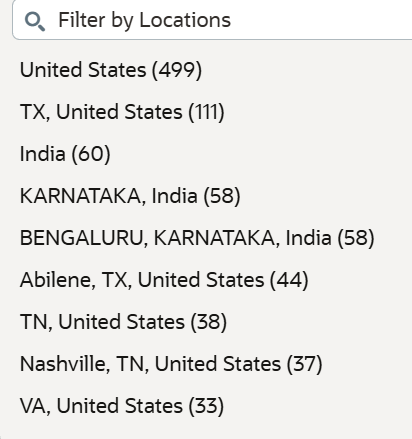

不在中国招人,印度人倒是招的挺多,就别看了.


## 内地企业
### 腾讯
#### 公司概况
腾讯是一家总部位于深圳的全球顶尖科技与投资控股公司，成立于1998年。它是全球最大的游戏发行商及领先的社交媒体巨头，运营着微信（WeChat）和QQ等国民级应用。业务横跨娱乐、人工智能、金融科技及云服务，通过对全球600多家企业的股权投资，构建了庞大的产业生态。
- 横跨多个领域的巨头

#### 事业部门
- [来源](https://join.qq.com/about.html)

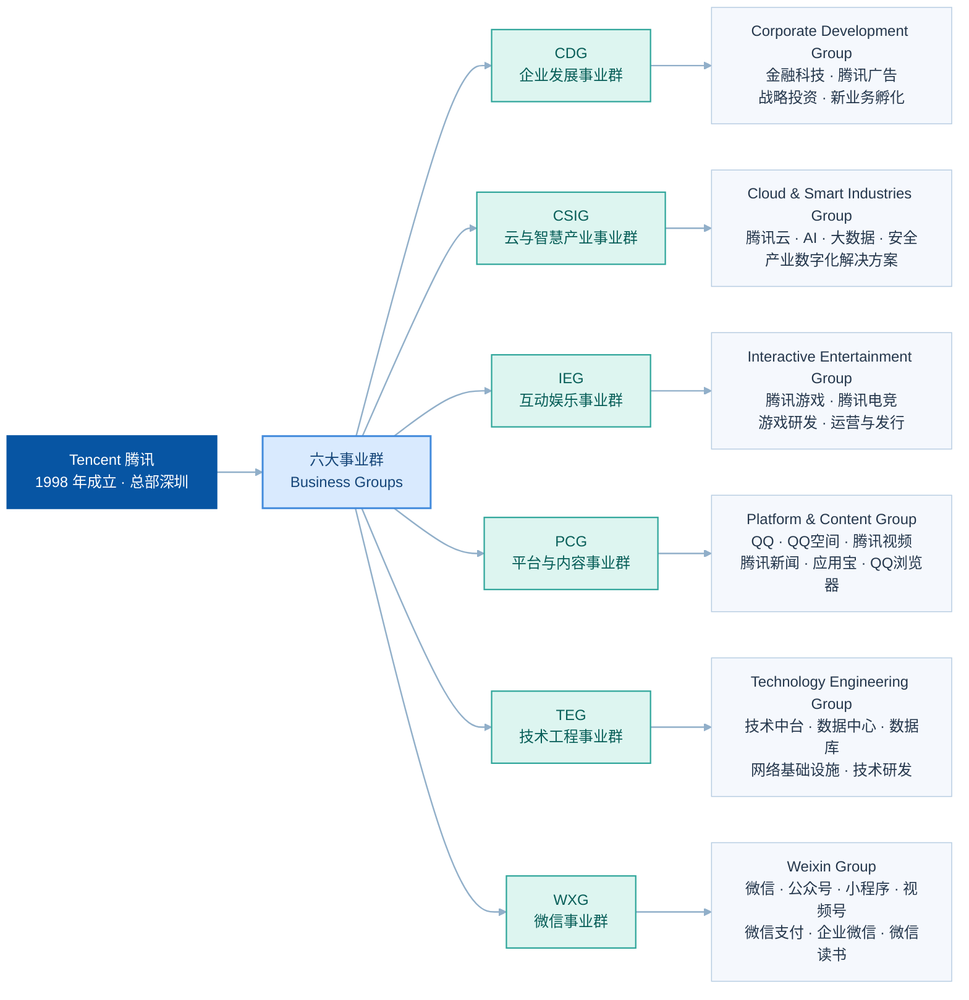

画成表格:

| 事业群                | 核心定位         | 主要负责领域                                   |
| :-------------------- | :--------------- | :--------------------------------------------- |
| **CDG** 企业发展      | 战略与商业化     | 金融科技、广告营销、战略投资、并购和新业务孵化 |
| **CSIG** 云与智慧产业 | 产业互联网       | 腾讯云、云计算、AI、安全及行业数字化           |
| **IEG** 互动娱乐      | 游戏与电竞       | 游戏研发、运营、发行和电子竞技                 |
| **PCG** 平台与内容    | 社交与数字内容   | QQ、视频、新闻、动漫、浏览器和应用平台         |
| **TEG** 技术工程      | 集团技术基础设施 | 数据中心、数据库、网络、技术中台和前沿技术     |
| **WXG** 微信          | 微信生态         | 微信、公众号、小程序、视频号、支付及微信读书   |

>WXG很明显应该放在PCG里吧,能够单开一个事业群出来就反映了该部门的强势和地位.


由于每个事业群内部的岗位种类很多,所以我们重点要关注核心岗位:
| 事业群                | 核心岗位或团队方向                                           |
| :-------------------- | :----------------------------------------------------------- |
| **WXG** 微信          | 微信基础架构、支付、小程序、视频号推荐、搜索                 |
| **CDG** 企业发展      | 腾讯广告、金融科技、支付后台、广告推荐与风控                 |
| **IEG** 互动娱乐      | 《王者荣耀》《和平精英》《三角洲行动》等成熟游戏的研发与后台 |
| **TEG** 技术工程      | AI Infra、混元大模型、数据库、分布式平台、基础架构           |
| **CSIG** 云与智慧产业 | 腾讯云核心基础设施、AI算力、数据库、云原生、AI产品           |
| **PCG** 平台与内容    | QQ核心通信、社交技术、推荐算法、视频平台基础技术             |

从2026年最新公开经营数据来看：

* **游戏、广告、微信生态**：具有成熟商业模式，是腾讯当前的重要收入和利润来源。
* **AI、大模型、算力基础设施**：属于重点投资方向，技术人才需求较强，但组织调整也十分频繁。
* **云计算与企业服务**：业务收入增长，竞争压力和商业化考核仍值得关注。
* **传统内容平台、非核心游戏项目**：已有业务缩减、工作室裁撤或人员调整的公开案例。

重点还是看个人选择,不过我还是很看好CSIG的,毕竟代表着云计算和Agent两大热潮,如果能够和政府部门对接好,那么未来几年是相当吃香的.


#### 公司历史

##### 1998—2003｜创立与即时通信业务

1998年，马化腾、张志东等五人在深圳创立腾讯（Tencent），1999年推出 OICQ，后更名为 QQ。2000年推出 QQ 会员和移动增值服务，2001年获得南非 MIH 集团投资。随后推出 QQ 游戏、QQ 邮箱和腾讯网，逐渐形成以即时通信和互联网增值服务为核心的业务体系。

##### 2004—2010｜上市与数字娱乐扩张

2004年，腾讯在香港联合交易所上市（0700.HK）。2005年推出 QQ 空间、QQ 音乐，并收购 Foxmail。此后发展《QQ 飞车》《地下城与勇士》《穿越火线》等游戏业务，同时扩展在线广告、数字内容与互联网服务，成为中国主要的网络游戏运营商之一。

##### 2011—2014｜微信崛起与移动互联网转型

2011年推出微信（Weixin），逐步发展朋友圈、公众号和移动支付等功能。同年收购 Riot Games 多数股权，2013年推出微信支付并正式开放腾讯云服务。2014年推出微信红包、理财通，投资京东、滴滴等企业，并参与发起成立微众银行，逐渐建立移动社交、游戏、支付和云计算生态。

##### 2015—2018｜数字内容与产业互联网布局

2015年成立腾讯影业，并完成对 Riot Games 的全资收购；2016年通过财团控股 Supercell，扩大海外游戏业务。2017年阅文集团在香港上市，2018年腾讯音乐在美国上市。同年腾讯调整组织架构，成立云与智慧产业事业群（CSIG）和平台与内容事业群（PCG），强化企业服务与产业互联网业务。

##### 2019—2022｜企业服务与全球游戏投资

腾讯持续发展腾讯云、企业微信、腾讯会议、腾讯文档等企业服务，并扩大海外游戏投资。2020年收购 Funcom，并通过乐游科技获得 Digital Extremes 等游戏工作室的控制权；2021年完成搜狗私有化收购。同期强化视频号、微信支付和金融科技业务，并在互联网平台监管环境变化下调整部分业务。

##### 2023—至今｜生成式 AI 与智能体发展

2023年推出腾讯混元大模型，开始将生成式 AI 整合进入腾讯云、办公和内容产品。2024年推出腾讯元宝，并发展混元多模态模型。2025年推出 CodeBuddy、ima 等 AI 工具，2026年进一步发布 WorkBuddy、QClaw、Hy3 和 Hy4 preview，持续发展 AI 编程、智能体及企业 AI 服务。同年腾讯音乐完成对喜马拉雅的收购。

#### 控股公司及子公司

- **集团主体**
  - **腾讯控股有限公司（Tencent Holdings Limited）**：1998年成立，总部位于中国深圳，注册地为开曼群岛，2004年在香港上市（0700.HK）。
  - **管理层与业务结构**：马化腾担任董事会主席兼 CEO，刘炽平担任总裁。主要业务包括增值服务、营销服务、金融科技及企业服务。
  - **重要股东**：Prosus / Naspers 通过 MIH 持有腾讯重要少数股权。

- **游戏开发与发行**
  - **Riot Games（拳头游戏）**：2011年取得多数股权，2015年全资控股，代表作品《英雄联盟》《无畏契约》。
  - **Supercell**：2016年取得控制权，代表作品《部落冲突》《皇室战争》《荒野乱斗》。
  - **Funcom、Grinding Gear Games、Digital Extremes**：代表作品《沙丘：觉醒》《流放之路》《星际战甲》。
  - **Klei Entertainment、Techland、Sharkmob**：海外 PC、主机及移动游戏研发。

- **数字内容与娱乐**
  - **腾讯音乐娱乐集团（TME）**：控股上市公司，旗下包括 QQ 音乐、酷狗音乐、酷我音乐、全民 K 歌、喜马拉雅。
  - **阅文集团（China Literature）**：控股上市公司，旗下包括起点中文网、QQ 阅读、WebNovel。
  - **新丽传媒**：阅文集团旗下影视制作公司。
  - **虎牙（HUYA）**：控股上市公司，主营游戏直播与电竞内容。

- **互联网与技术业务**
  - **搜狗（Sogou）**：2021年完成私有化收购，主要保留输入法及相关搜索、AI 技术业务。
  - **腾讯云**：集团云计算、企业软件及 AI 基础设施业务。
  - **腾讯内部工作室**：天美、光子、魔方、北极光、NExT Studios 等游戏研发组织。

- **重要法律实体**
  - **中国大陆实体**：深圳市腾讯计算机系统有限公司、腾讯科技（深圳）有限公司、深圳市世纪凯旋科技有限公司、腾讯云计算（北京）有限责任公司等。
  - **海外实体**：Riot Games, Inc.、Supercell Oy、Tencent Music Entertainment Group、China Literature Limited。
  - **组织架构**：微信事业群（WXG）、互动娱乐事业群（IEG）、云与智慧产业事业群（CSIG）、平台与内容事业群（PCG）、技术工程事业群（TEG）、企业发展事业群（CDG）。

- **战略投资与合作**
  - **Epic Games、Ubisoft**：游戏开发、发行和游戏引擎领域的重要参股企业。
  - **微众银行（WeBank）**：腾讯参与发起设立的独立持牌银行。
  - **快手、哔哩哔哩、Spotify**：数字内容及互联网领域的投资与合作企业。
  - **京东、美团、拼多多**：历史投资或战略合作企业，均不属于腾讯控股子公司。

注：中国大陆部分经营实体通过协议控制（VIE）方式纳入集团合并报表；战略参股企业与控股子公司应予以区分。

#### 主要产品

- **社交与即时通信**
  - **微信 / WeChat**：微信、朋友圈、公众号、视频号、小程序、小游戏、微信小店。
  - **QQ**：QQ、QQ 空间、QQ 邮箱、QQ 频道。

- **人工智能与开发工具**
  - **AI 助手与模型**：腾讯元宝、腾讯混元（Tencent Hy）、Hy3、Hy4。
  - **AI 智能体**：WorkBuddy、QClaw、ClawPro。
  - **AI 编程与知识管理**：CodeBuddy、ima。
  - **AI 开发平台**：腾讯云 TokenHub、智能体开发平台（ADP）。

- **游戏与电竞**
  - **国内游戏**：《王者荣耀》《和平精英》《三角洲行动》《暗区突围》《穿越火线》《地下城与勇士》《金铲铲之战》。
  - **海外游戏**：《英雄联盟》《无畏契约》《部落冲突》《皇室战争》《荒野乱斗》《流放之路》《星际战甲》《消逝的光芒》。
  - **发行与电竞**：腾讯游戏、WeGame、Level Infinite、腾讯电竞。

- **数字内容与娱乐**
  - **视频与资讯**：腾讯视频、WeTV、腾讯新闻、腾讯体育。
  - **音乐与音频**：QQ 音乐、酷狗音乐、酷我音乐、全民 K 歌、喜马拉雅。
  - **文学与影视**：阅文集团、起点读书、QQ 阅读、WebNovel、新丽传媒。

- **金融科技与商业服务**
  - **支付与金融**：微信支付、财付通、理财通、TenPay Global。
  - **广告营销**：腾讯广告、腾讯企点。
  - **社交商业**：微信小店、微信支付商户平台。

- **云计算与技术基础设施**
  - **计算与容器**：腾讯云 CVM、Lighthouse、TKE、SCF。
  - **数据库与存储**：TDSQL、TencentDB、COS、CBS。
  - **网络与安全**：VPC、CDN、EdgeOne、DNSPod、WAF。
  - **AI 与音视频**：腾讯云 GPU、VectorDB、TI-ONE、TRTC、腾讯云 IM。

- **企业办公与协作**
  - **企业办公**：企业微信、腾讯会议、腾讯文档、腾讯乐享。
  - **开发与运维**：CloudBase、微搭、CODING DevOps、腾讯蓝鲸。

- **互联网工具与行业应用**
  - **日常工具**：QQ 浏览器、搜狗输入法、应用宝、腾讯地图、腾讯电脑管家。
  - **行业解决方案**：腾讯智慧医疗、智慧教育、智慧零售、智慧出行。
  - **开源技术**：Tars、TDesign、ncnn、MMKV、TencentOS、Kona JDK。


#### 招聘情况
- [官网](https://careers.tencent.com/home.html)
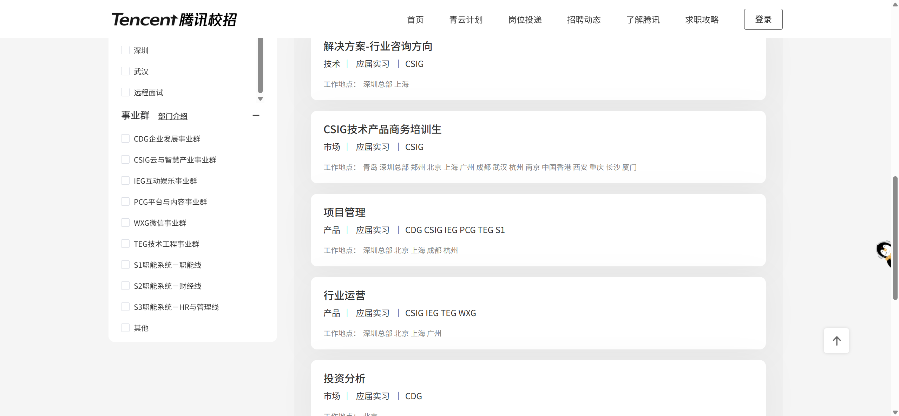

腾讯的业务很多,岗位也非常多,官网上的要求都比较简单,但实际应聘的时候都是会狠狠拷打你的:
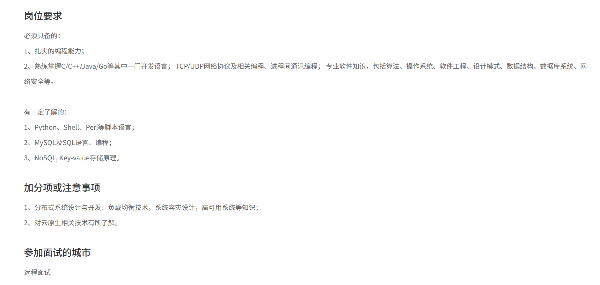

##### 面试流程一览
[腾讯面试流程](https://github.com/0voice/cpp_backend_awsome_blog/blob/main/%E3%80%90NO.82%E3%80%91%E8%80%97%E6%97%B61%E4%B8%AA%E6%9C%88%EF%BC%8C%E4%B8%87%E5%AD%97%E5%B9%B2%E8%B4%A7%EF%BC%8C%E8%AF%A6%E8%A7%A3%E8%85%BE%E8%AE%AF%E9%9D%A2%E8%AF%95%EF%BC%88T1-T9%EF%BC%89%E6%A0%B8%E5%BF%83%E6%8A%80%E6%9C%AF%E7%82%B9%EF%BC%8C%E9%9D%A2%E8%AF%95%E9%A2%98%E6%95%B4%E7%90%86.md)
##### 面经1
- [来源](https://www.nowcoder.com/feed/main/detail/f054aef412104109a1dfa85e273e6faf?sourceSSR=enterprise)

```md
## 项目深挖与常规问答


* **自我介绍**
* **核心项目介绍：** 挑一个花费时间最多、最重点的项目介绍，并罗列一两个难点。
* **后续追问：** 目前项目的访问量多大？（如实回答目前仅作个人和朋友测试使用）。

---

## 计算机基础与后端八股

### 操作系统与网络
* Python多进程解决OOM问题，为什么不用多线程？
* 进程和线程在操作系统层面的核心区别是什么？
* FastAPI 服务端延迟极低，客户端发起请求时，TCP 建立连接的过程是怎样的？
* 项目中实现在线推送为什么使用 WebSocket 而不用 HTTP 轮询？

### JVM 基础
* Java 程序运行时，JVM 内存分为哪几块？
* 堆里的对象是一定会被回收的吗？
* 引用类型会被回收吗？

### Redis
* 项目中的布隆过滤器、互斥锁、逻辑过期分别是解决什么问题的？
* 逻辑过期和物理过期的区别是什么？
* HyperLogLog、ZSet、Bitmap 的底层原理和适用场景是什么？
* 场景题：如何统计最近七天内每天都活跃的日活用户交集？

### 消息队列 (RabbitMQ)
* 如何保证消息百分之百入库？描述消息从生产到消费的完整可靠链路。
* 死信队列里面是怎么处理的？
* 怎么保证消息的幂等性？

### 数据库 (MySQL)
* 索引场景题：有用户表、签到表（自增ID，user_id，签到时间，状态），要查某个用户某个月的签到记录，怎么加索引？
* 如果不用 Redis，直接在 MySQL 层面避免高并发下的重复点赞，怎么设计？
* 如果并发量很大，使用乐观锁和悲观锁的区别？使用悲观锁有什么问题？

---

## 算法与代码手撕

* 实现 `O(1)` 时间复杂度的 LRU 缓存
* 合并 K 个升序链表

---

## AI 与大模型工程

* RAG（检索增强生成）的工作流分哪几步？
* RAG 知识库生成的步骤是什么？
* 向量检索时，怎么判断相似度？
* 你项目里的 Agent 架构是怎么设计的？

---

## 反问环节

* 如果有幸入职，主要会做哪些工作？难点在哪里？
* 腾讯内部对使用 AI 辅助编程的态度是什么？
* 对我今天的面试表现有什么评价或建议？
```
### 阿里巴巴
#### 公司概况
阿里巴巴是一家成立于1999年、总部位于杭州的全球性科技巨头，也是全球最大的电子商务与零售平台之一。其业务体系以淘宝、天猫为核心，覆盖了云计算、数字媒体、物流及金融科技（蚂蚁集团）等多元领域。2014年阿里巴巴在纽交所完成了当时全球规模最大的IPO。进入2026年，阿里通过“千问”大模型全面向AI驱动转型，旗下云智能与国际商业板块表现强劲，目前仍是全球最具价值的互联网公司之一。

#### 公司历史

##### 1999—2002｜创立与 B2B 电子商务

1999年，马云（Jack Ma）、蔡崇信（Joseph Tsai）等18人在杭州创立阿里巴巴（Alibaba），推出 Alibaba.com 和国内批发平台（后发展为1688），主要面向中小企业提供在线贸易服务。2000年获得软银等机构投资，2002年实现全年盈利，逐渐形成以企业会员、在线营销和电子商务为核心的商业模式。

##### 2003—2008｜淘宝、支付宝与电商生态

2003年推出淘宝网，进入个人消费电子商务市场，同年推出支付宝担保交易服务。2005年与雅虎达成战略投资交易，2007年推出阿里妈妈广告平台，旗下 B2B 业务在香港上市。2008年推出淘宝商城（后更名为天猫），逐渐建立综合零售、品牌电商、支付和数字营销体系。

##### 2009—2013｜云计算与物流网络

2009年成立阿里云，开始研发飞天分布式云计算系统，并首次举办“双11”购物活动。2010年推出全球速卖通（AliExpress），拓展跨境电商和移动购物。2011年支付宝业务重组，2013年成立菜鸟网络，发展电商物流基础设施。同年马云卸任 CEO，由陆兆禧接任。

##### 2014—2018｜集团上市与多元化扩张

2014年，阿里巴巴集团在纽约证券交易所上市（BABA），同年完成对高德地图和 UC 优视的收购。2015年取得阿里健康控制权，2016年收购优酷土豆并控股 Lazada，同时发展盒马鲜生。2017年成立达摩院，2018年收购饿了么、成立平头哥半导体，逐步扩展本地生活、数字娱乐和芯片业务。

##### 2019—2022｜香港上市与云计算发展

2019年在香港联合交易所上市（9988.HK），张勇接任董事会主席。随后发展阿里云、钉钉、菜鸟和盒马等业务，2020年取得高鑫零售控制权。2021年因平台“二选一”行为受到反垄断处罚，并调整经营规则。同期持续扩展跨境电商、云计算和企业数字化服务。

##### 2023—2024｜组织架构调整与 AI 战略

2023年宣布“1+6+N”组织变革，蔡崇信接任董事会主席，吴泳铭（Eddie Wu）接任 CEO，提出“用户为先、AI 驱动”战略。2024年撤回菜鸟上市申请，停止推进阿里云分拆上市，并将香港上市地位升级为主要上市。同期持续发展通义千问（Qwen）大模型和阿里云 AI 平台。

##### 2025—至今｜电商整合与全栈 AI

2025年完成高鑫零售和银泰商业出售，整合淘宝天猫、饿了么和飞猪等业务，推出淘宝闪购。同年发布 Qwen3 系列，扩大 AI 云基础设施投入。2026年进一步将业务整合为电商、AI 云与算力、AI 实验室与应用等板块，推出 QwenWork、Qwen3.8 和千问智能体产品，并发布真武 V900 AI 芯片，持续发展 AI 模型、云计算和企业自动化。

#### 控股公司及子公司

- **集团主体**
  - **阿里巴巴集团控股有限公司（Alibaba Group Holding Limited）**：1999年成立，总部位于中国杭州，注册地为开曼群岛，在纽约证券交易所（BABA）和香港联合交易所（9988.HK）上市。
  - **管理层与业务结构**：蔡崇信担任董事会主席，吴泳铭担任 CEO。集团主要分为阿里巴巴电商集团、AI 云与算力服务、AI 实验室与应用及其他业务。

- **中国电子商务与零售**
  - **淘宝、天猫、1688**：综合零售、品牌电商和企业批发平台。
  - **闲鱼**：二手商品与闲置交易平台。
  - **淘宝闪购（原饿了么）**：即时零售与本地配送。
  - **盒马（Freshippo）**：生鲜超市与线上线下一体化零售。
  - **飞猪（Fliggy）**：酒店、机票和在线旅游服务。

- **国际电子商务**
  - **Alibaba.com**：全球 B2B 批发贸易平台。
  - **AliExpress（速卖通）**：全球跨境零售平台。
  - **Lazada**：东南亚综合电商平台。
  - **Trendyol**：土耳其及周边市场电商平台。
  - **Daraz**：南亚电子商务平台。

- **云计算与半导体**
  - **阿里云（Alibaba Cloud）**：云计算、数据库、AI 基础设施及企业技术服务。
  - **平头哥半导体（T-Head）**：CPU、AI 加速器、RISC-V 处理器及数据中心芯片。
  - **达摩院（DAMO Academy）**：前沿技术与应用研究组织。

- **物流、办公与互联网服务**
  - **菜鸟网络（Cainiao）**：仓储、供应链及国际物流。
  - **钉钉（DingTalk）**：企业协作、组织管理及 AI 办公。
  - **高德地图（Amap）**：地图导航、本地生活及位置服务。
  - **UC 优视、夸克（Quark）**：浏览器、AI 搜索及信息服务。

- **数字娱乐与医疗健康**
  - **虎鲸文娱、优酷**：视频流媒体与影视内容。
  - **大麦娱乐**：香港上市的演艺票务与影视业务公司。
  - **阿里健康**：香港上市的医药零售及数字医疗企业。
  - **灵犀互娱**：游戏研发与发行。

- **重要法律实体**
  - **中国大陆实体**：淘宝（中国）软件有限公司、浙江天猫技术有限公司、阿里云计算有限公司、钉钉（中国）信息技术有限公司等。
  - **国际实体**：Taobao Holding Limited、Alibaba.com Limited、Cainiao Smart Logistics Network Limited、Lazada South East Asia Pte. Ltd. 等。
  - **股权结构**：集团通过直接控股、间接控股和协议控制实体（VIE）开展业务。

- **战略投资与历史业务**
  - **蚂蚁集团（Ant Group）**：阿里巴巴持股约33%的重要参股企业，旗下包括支付宝等金融科技业务，不属于控股子公司。
  - **高鑫零售、银泰商业**：原控股零售企业，已于2025—2026财年完成出售。
  - **软银、雅虎**：历史重要投资者，不属于阿里巴巴旗下企业。

#### 主要产品

- **电子商务与零售**
  - **国内零售**：淘宝、天猫、闲鱼、盒马、淘宝闪购、88VIP。
  - **批发与跨境电商**：1688、Alibaba.com、AliExpress、Lazada、Trendyol、Daraz。
  - **商家与广告服务**：阿里妈妈、万相台、淘宝联盟。

- **阿里云计算**
  - **计算与容器**：ECS、ACK、ACR、函数计算 FC。
  - **存储与数据库**：OSS、NAS、PolarDB、RDS、Tair、AnalyticDB。
  - **大数据与分析**：MaxCompute、DataWorks、Flink、Hologres、Quick BI。
  - **网络与安全**：VPC、SLB、CDN、WAF、云安全中心。

- **人工智能与智能体**
  - **通义千问模型**：Qwen、Qwen3、Qwen3.5、Qwen3.8、Qwen-VL、Qwen-Coder。
  - **多模态生成**：通义万相（Wan）、Qwen-Image、Qwen-Audio、Qwen-Omni。
  - **AI 助手与智能体**：千问 App、QwenWork、Qwen Intelligence。
  - **AI 开发平台**：阿里云百炼（Model Studio）、PAI、ModelScope（魔搭社区）。

- **芯片与 AI 基础设施**
  - **AI 加速器**：含光800、真武 M890、真武 V900。
  - **CPU 与处理器 IP**：倚天710、玄铁 RISC-V 系列。
  - **数据中心技术**：飞天（Apsara）、磐久服务器、AI 超节点、磐脉智能网卡。
  - **AI 智能硬件**：千问 AI 眼镜、Qwen Book、Qwen Clip、QwenNote。

- **企业办公与开发工具**
  - **钉钉**：钉钉文档、钉钉会议、钉钉宜搭、钉钉 AI。
  - **云开发与运维**：云效 DevOps、MSE、ARMS、API 网关。
  - **开源技术**：Dubbo、Nacos、RocketMQ、Sentinel、Arthas、Seata、Dragonwell。

- **物流、地图与互联网服务**
  - **菜鸟**：菜鸟国际、菜鸟驿站、菜鸟裹裹、菜鸟供应链。
  - **高德**：高德地图、高德打车、高德开放平台。
  - **夸克与 UC**：夸克 AI 搜索、夸克网盘、夸克扫描王、UC 浏览器。
  - **旅游出行**：飞猪旅行。

- **数字娱乐与医疗健康**
  - **视频与影视**：优酷、大麦娱乐。
  - **演艺票务**：大麦。
  - **游戏**：灵犀互娱、《三国志·战略版》。
  - **医疗健康**：阿里健康、阿里健康大药房、天猫健康。


#### 招聘情况
- 公众号: 阿里巴巴集团招聘
- [校园招聘](https://campus-talent.alibaba.com/)
- [社会招聘](https://talent-holding.alibaba.com/)


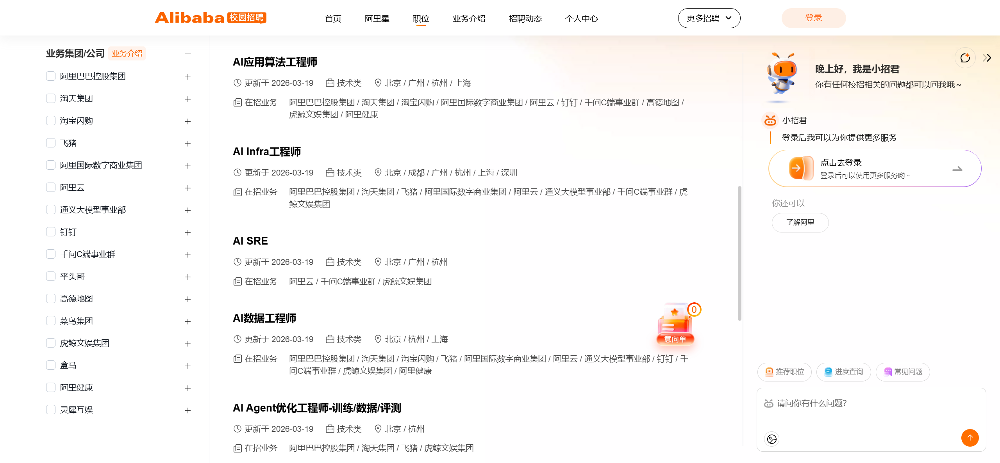

- 目前的趋势是全面拥抱AI,很多岗位都是算法和Agent.

需要注意的是,阿里很多岗位都是实习转正的,如果目标确定是阿里的话建议先投递暑期实习.

阿里的招聘要求说的都比腾讯清楚很多,能够让应聘者快速知道自己是不是这块料:
```md
职位要求
1.基础条件
● 计算机、软件工程、人工智能等相关专业优先。
2.专业能力
● AI编程工具重度玩家：Cursor、Claude code等AI编程工具重度或顶级玩家，具备极强的Prompt编写与调优能力，有过完整的项目级开发经验，理解如何让AI写出生产级代码。
● 大模型能力理解与掌握：理解主流LLM的能力与局限，能够清晰拆解任务并通过LLM或确定性逻辑兜底实现；熟悉主流大模型的应用范式(Context Engineering、Prompt Engineering、Agent、工具/函数调用等等)及主流Agent框架(如LangChain等)，具备大模型幻觉、Prompt注入等风险的工程化应对思路。
● 扎实的代码和工程能力：具备扎实的计算机基础知识，深入理解数据结构、算法、网络和操作系统等相关知识，能至少在一种主流编程语言（如 Java / Python / JS 等）上有深度的实践经验，掌握常见工程实践并具备优秀的Coding 能力，能够根据场景灵活选型并快速上手。
3.能力特质
● 学习能力： 具备快速啃透前沿论文（Paper）的能力，并能将理论知识转化为工程代码。
● 开放性与动手能力： 拒绝纸上谈兵，有自己独立完成的小项目（开源项目或个人 Demo），展现极客精神。
● 好奇心与想象力： 面对未知事物有独特的想法，具备敏锐的问题定义能力和坚韧的解决问题能力。
● 审美追求： 技术亦有审美，鼓励你提出能提出打动人心、简洁优雅的好想法。
● 高能动性： 具备强烈的自驱力，能够主动探索边界，而不是等待被分配任务。
加分项
● 有AI应用或Agent实际落地经验：包括不限于RAG系统、多智能体编排、结合MCP、Skill等的Agent项目，有可展示的项目/实习成果者优先。
● 开源贡献或技术影响力：在Github上有高质量AI项目、技术博客或社区影响力。
● 对AI Infra有基本理解：了解vLLM、Ollama等推理框架原理，理解延迟优化、KV cache优化、流式输出等工程全局视角。
● 在 CV（计算机视觉）或 NLP（自然语言处理）方向有扎实的理论基础，有实际业务场景模型训练(SFT、RL)等经验的优先。
```

##### 面经1
```md
### Java线程池的使用及工作原理

### 并发情况下线程安全的问题介绍一下

### HashMap是线程安全的吗

### ConcurrentHashMap原理，是如何实现线程安全的？

### ConcurrentHashMap的段是怎么划分的？ConcurrentHashMap的存储结构是怎样的？

### ConcurrentHashMap和HashMap存储数据的区别是什么？

### NIO和AIO分别是什么原理？

### 零拷贝介绍一下

### HTTPS加密通信的过程？

### MySQL四种隔离级别是什么？分别怎么实现的？

### 你的MySQL设置的隔离级别是什么？可重复读如何实现的？

### 两个字符串的最长连续相等字符串长度
```
### 蚂蚁集团
#### 公司概况
起源于淘宝网的第三方支付平台支付宝,于2014年独立,注册为浙江蚂蚁小微金融服务集团股份有限公司（简称蚂蚁金服）,于2020年6月更名为蚂蚁集团.在22年前后,阿里巴巴与蚂蚁集团之间关闭了转岗渠道,在行政上基本分离.

旗下有六大业务领域:
| 业务领域         | 主要产品或品牌                                 | 具体做什么                         |
| :--------------- | :--------------------------------------------- | :--------------------------------- |
| **数字支付**     | 支付宝、支付宝碰一下、商家收钱码               | 提供线上线下支付及收款服务         |
| **数字互联**     | 支付宝小程序、生活号、芝麻信用相关服务         | 为商家和消费者提供数字化生活服务   |
| **数字金融**     | 花呗、借呗、余额宝、蚂蚁财富、蚂蚁保、网商银行 | 消费信贷、企业贷款、财富管理、保险 |
| **数字医疗与AI** | 蚂蚁阿福、蚂蚁百灵大模型、灵光                 | AI健康服务、人工智能应用与模型研发 |
| **数字科技**     | 蚂蚁数科、蚂蚁链、OceanBase                    | 区块链、数据库、企业数字化技术     |
| **全球化业务**   | 蚂蚁国际、Alipay+、WorldFirst、Antom           | 国际支付、跨境收款、换汇与金融服务 |
#### 公司历史

##### 2004—2011｜支付宝创立与独立运营

2004年，阿里巴巴集团正式成立支付宝（Alipay），以担保交易解决淘宝买卖双方的支付信任问题。2009年推出移动端支付宝，2010年推出快捷支付，逐渐从电商支付扩展至移动支付和生活服务。2011年，支付宝完成与阿里巴巴集团的股权分离，并取得中国人民银行颁发的第三方支付牌照，开始独立运营。

##### 2012—2015｜数字金融业务扩张

2013年，支付宝联合天弘基金推出余额宝，进入互联网理财领域。2014年，支付宝母公司更名为蚂蚁金融服务集团（Ant Financial），推出花呗，并参与设立浙江网商银行。2015年，借呗、芝麻信用陆续推出，网商银行正式开业，逐步形成支付、消费信贷、小微金融、财富管理和保险服务相结合的业务体系。

##### 2016—2019｜金融科技与国际化发展

2016年推出蚂蚁森林，扩大支付宝生活服务与公益应用。2018年推出蚂蚁链区块链服务平台和相互宝，并通过跨境支付合作拓展海外市场。2019年收购英国跨境支付企业WorldFirst，阿里巴巴集团正式取得蚂蚁集团33%股权。同期发展支付宝国际支付网络、OceanBase分布式数据库及金融科技开放平台。

##### 2020—2021｜集团更名与金融业务调整

2020年，蚂蚁金服正式更名为蚂蚁集团（Ant Group），全称蚂蚁科技集团股份有限公司，并宣布支付宝数字生活开放平台战略。同年计划在上海科创板和香港联交所同步上市，11月上市被暂缓。2021年，重庆蚂蚁消费金融有限公司正式开业，集团推进金融业务整改，调整消费信贷、征信、资本管理及公司治理安排，同时扩大Alipay+跨境支付服务。

##### 2022—2023｜监管整改与公司治理改革

2022年，蚂蚁国际旗下ANEXT Bank在新加坡开业，并收购东南亚支付服务商2C2P；相互宝正式停止运营。2023年，蚂蚁集团完成主要股东表决权结构调整，马云不再拥有集团控制权，集团转为无实际控制人状态。同年金融管理部门对蚂蚁集团及旗下机构作出合计71.23亿元的行政处罚，相关金融业务逐步进入常态化监管阶段。

##### 2024—2025｜业务独立运营与人工智能布局

2024年，蚂蚁国际（Ant International）、蚂蚁数科（Ant Digital Technologies）和OceanBase调整为独立运营业务公司，支付宝推出“碰一下”支付，集团进一步扩大百灵大模型、AI金融和医疗健康业务。2025年，韩歆毅接任集团CEO，井贤栋继续担任董事长；集团收购好大夫在线，推出AI健康应用AQ（后更名为蚂蚁阿福）、灵光AI助手，并发展Ling、Ring、Ming大模型系列及灵波具身智能机器人业务。

##### 2026—至今｜AI智能体与国际金融业务扩展

2026年，支付宝推出“阿宝”AI生活智能体，扩大AI支付、智能体商业和生活服务开放平台。蚂蚁阿福升级AI健康管理服务，并推出面向医生的AQ for Doctor。集团持续研发百灵大模型、灵光AI应用及蚂蚁灵波LingBot具身智能模型，拓展机器人在零售、医疗等领域的应用。同年3月完成对香港耀才证券金融50.55%股权的收购，进一步进入香港证券经纪业务。

#### 控股公司及子公司

- **集团主体**
  - **蚂蚁科技集团股份有限公司（Ant Group Co., Ltd.）**：成立于2000年（前身为浙江阿里巴巴电子商务有限公司），2004年开始运营支付宝业务，总部位于浙江杭州，目前为非上市股份有限公司。
  - **管理层与业务结构**：井贤栋（Eric Jing）担任董事长，韩歆毅（Cyril Han）担任CEO。主要业务包括数字支付、数字金融、数字医疗、人工智能、数字科技和国际金融科技。
  - **主要股东**：杭州君瀚、杭州君澳、阿里巴巴集团及其他机构投资者。截至2026年3月，三者分别持股约32%、22%、33%，其余股东合计持股约13%；集团无单一控股股东或实际控制人。
  - **重要历史投资者**：全国社会保障基金理事会、中国人寿、新加坡政府投资公司（GIC）、淡马锡（Temasek）、加拿大养老金投资机构、华平投资、凯雷投资及泛大西洋资本等。

- **数字支付与生活服务**
  - **支付宝（Alipay）**：集团核心数字支付平台，提供移动支付、商家收款、转账及生活服务。
  - **支付宝数字服务体系**：支付宝小程序、生活号、商家数字化经营、支付宝开放平台及AI生活服务。
  - **芝麻信用（Zhima Credit）**：信用评估、信用服务及商业场景信用技术。

- **消费金融、银行与财富管理**
  - **重庆蚂蚁消费金融有限公司**：持牌消费金融机构，蚂蚁集团持股50%，运营花呗、借呗相关消费金融业务。
  - **浙江网商银行（MYbank）**：2015年开业的民营互联网银行，蚂蚁集团持股约30%，属于重要参股企业。
  - **天弘基金（Tianhong Asset Management）**：蚂蚁集团控股的公募基金管理公司，负责余额宝相关货币基金等产品的投资管理。
  - **蚂蚁财富、蚂蚁基金销售**：基金销售、财富管理平台及相关技术服务。
  - **蚂蚁保（Ant Insurance）**：保险产品代理、保险科技与数字保险服务。
  - **国泰财产保险（Cathay Insurance）**：蚂蚁集团控股的财产保险公司。
  - **耀才证券金融（Bright Smart Securities）**：香港上市证券经纪集团，2026年完成50.55%控股收购。

- **国际支付与金融科技**
  - **蚂蚁国际（Ant International）**：总部位于新加坡，自2024年实行独立运营，负责跨境支付、国际商户服务和金融科技业务。
  - **Alipay+**：全球电子钱包互联及跨境移动支付网络。
  - **Antom**：面向国际商家的支付受理及数字化经营服务。
  - **WorldFirst（万里汇）**：2019年收购，跨境收款、多币种账户及企业资金管理。
  - **2C2P**：2022年收购的东南亚支付技术和支付处理服务商。
  - **ANEXT Bank（星熠数字银行）**：新加坡持牌数字银行，面向中小微企业。
  - **Bettr**：面向企业和平台的嵌入式金融及融资科技服务。

- **人工智能与数字医疗**
  - **蚂蚁百灵（Ant Ling）**：集团基础大模型研发体系，包含Ling、Ring、Ming系列。
  - **蚂蚁阿福（AQ）**：AI健康管理与医疗服务平台。
  - **好大夫在线（Haodf）**：2025年完成收购的互联网医疗平台，提供医生咨询及医疗服务。
  - **灵光（LingGuang）**：通用AI助手、多模态生成及自然语言应用开发平台。
  - **蚂蚁灵波（Robbyant）**：具身智能公司，研发机器人基础模型、服务机器人及智能硬件。

- **数字科技与基础软件**
  - **蚂蚁数科（Ant Digital Technologies）**：独立运营的数字科技企业，业务涵盖区块链、可信数字技术及产业数字化。
  - **OceanBase**：独立运营的分布式数据库公司，面向金融、互联网和大型企业提供数据库产品。
  - **蚂蚁链（AntChain）**：区块链、可信数据协作与数字资产技术。
  - **SOFAStack、mPaaS**：分布式金融系统、移动应用开发及企业技术服务。

- **重要法律实体**
  - **中国大陆实体**：蚂蚁科技集团股份有限公司、支付宝（中国）网络技术有限公司、支付宝（杭州）数字服务技术有限公司、重庆蚂蚁消费金融有限公司、蚂蚁（杭州）基金销售有限公司、天弘基金管理有限公司。
  - **国际及香港实体**：Ant International、World First UK Limited、ANEXT Bank Pte. Ltd.、2C2P Pte. Ltd.、耀才证券金融集团有限公司。
  - **股权结构**：通过直接控股、境内外子公司及参股金融机构开展不同业务；蚂蚁国际、蚂蚁数科和OceanBase实行独立运营，独立运营与完全股权独立需要区分。

- **重要投资与历史业务**
  - **阿里巴巴集团（Alibaba Group）**：持有蚂蚁集团约33%股权，双方独立经营并保持支付及商业合作。
  - **薄荷健康（Boohee Health）**：2026年蚂蚁集团取得超过28%股权，为重要参股健康科技企业。
  - **相互宝（Xianghubao）**：2018年推出的网络互助项目，2022年正式停止运营。
  - **蚂蚁集团上市计划**：2020年拟于上海及香港上市，同年11月暂缓，此后未完成集团整体上市。

注：支付宝、百灵、灵光、蚂蚁链等属于产品品牌、研发组织或业务体系，不能全部视为独立法律子公司；网商银行和薄荷健康属于参股企业，耀才证券为控股企业，蚂蚁国际、蚂蚁数科和OceanBase的独立运营不等于完全脱离集团股权体系。

#### 主要产品

- **数字支付与生活服务**
  - **支付工具**：支付宝（Alipay）、支付宝扫一扫、付款码、收钱码、支付宝碰一下。
  - **商家服务**：支付宝开放平台、支付宝商家平台、支付宝小程序、生活号。
  - **生活服务**：生活缴费、出行服务、医疗挂号、政务服务、便民服务。
  - **AI生活服务**：支付宝阿宝、支付宝AI开放平台、智能体商业服务。
  - **信用与公益**：芝麻信用、芝麻分、芝麻工作证、蚂蚁森林、蚂蚁庄园。

- **消费金融与数字银行**
  - **消费信贷**：花呗、借呗。
  - **小微企业金融**：网商贷、网商银行企业金融服务。
  - **信用科技**：芝麻信用、风险评估及金融机构合作服务。
  - **数字银行**：网商银行（MYbank）、ANEXT Bank。

- **财富管理与保险**
  - **财富管理平台**：蚂蚁财富、余额宝。
  - **基金服务**：蚂蚁基金销售、天弘基金、基金投顾及资产配置服务。
  - **AI金融服务**：蚂小财（AI理财助手）。
  - **保险平台**：蚂蚁保、蚂蚁保AI保险服务。
  - **保险机构**：国泰财产保险、合作保险机构产品。
  - **证券经纪**：耀才证券金融的港股、美股等证券交易及相关金融服务。

- **人工智能与智能体**
  - **通用AI助手**：灵光（LingGuang）。
  - **语言模型**：蚂蚁百灵（Ant Ling）、Ling系列、Ling-1T、Ling-2.6。
  - **推理模型**：Ring系列、Ring-1T。
  - **多模态模型**：Ming系列。
  - **AI智能体平台**：蚂蚁百宝箱（Tbox）、AWorld。
  - **AI模型服务**：ZenMux、模型API及开发者工具。
  - **AI安全技术**：蚁天鉴、模型安全检测与防护服务。

- **数字医疗与AI健康**
  - **AI健康助手**：蚂蚁阿福（AQ）。
  - **医生服务**：好大夫在线、AQ for Doctor、AI医生智能体。
  - **医疗服务**：在线咨询、预约挂号、医疗报告解读、健康档案。
  - **医保服务**：医保码、医保支付及相关数字医疗服务。
  - **健康管理**：AI健康陪伴、慢病管理、科学减重及健康设备连接。

- **国际支付与跨境金融**
  - **跨境钱包互联**：Alipay+、Alipay+ Cross-Border。
  - **国际商户支付**：Antom、2C2P。
  - **跨境资金管理**：WorldFirst（万里汇）。
  - **企业融资科技**：Bettr。
  - **国际数字银行**：ANEXT Bank。
  - **商户数字化**：Alipay+ D-store、Alipay+ Rewards。

- **数据库、区块链与数字科技**
  - **分布式数据库**：OceanBase Database、OceanBase Cloud。
  - **区块链技术**：蚂蚁链（AntChain）、区块链BaaS服务。
  - **隐私计算**：隐语（SecretFlow）。
  - **分布式系统**：SOFAStack、SOFAJRaft。
  - **移动开发平台**：mPaaS。
  - **安全与身份认证**：蚁盾、ZOLOZ身份验证技术。
  - **产业数字化**：可信数据流通、供应链协作、RWA相关技术解决方案。

- **具身智能与机器人**
  - **具身智能研发**：蚂蚁灵波（Robbyant）。
  - **机器人基础模型**：LingBot、LingBot-VLA、LingBot-World。
  - **服务机器人**：Robbyant-R1、R-2等研发及应用产品。
  - **机器人应用**：智慧药房、零售分拣、医疗辅助、服务机器人。

- **开发者与开源生态**
  - **数据库开源**：OceanBase。
  - **隐私计算开源**：SecretFlow。
  - **分布式技术**：SOFAStack、SOFAJRaft。
  - **AI模型开源**：Ling、Ring、Ming系列及部分LingBot模型。
  - **开发者平台**：支付宝开放平台、蚂蚁百宝箱、OceanBase开发者生态。

#### 招聘情况
难度很高,所以你很少见到相关的面经,社招进去为好.


### 字节
#### 公司概况
字节跳动（ByteDance）是一家成立于2012年、总部位于北京的全球领先互联网技术巨头，由张一鸣、梁汝波等人创立。公司凭借TikTok和抖音（Douyin）重塑了全球短视频社交格局，同时拥有资讯平台今日头条（Toutiao）、视频剪辑工具剪映（CapCut）以及Lemon8等多元化产品矩阵，并在生成式人工智能领域积极布局。
#### 公司历史

##### 2012—2015｜创立与算法推荐平台

2012年，张一鸣、梁汝波等人在北京创立字节跳动（ByteDance），同年推出今日头条，利用机器学习和个性化推荐算法进行信息分发。2013年推出头条号内容创作平台，随后发展内涵段子等移动互联网产品，逐渐建立以内容推荐和信息流广告为核心的商业模式。

##### 2016—2018｜短视频崛起与国际化扩张

2016年推出抖音（Douyin），并发展西瓜视频、火山小视频等内容平台。2017年推出国际短视频应用 TikTok，同年收购 Musical.ly，2018年将两者合并。同期推出懂车帝、番茄小说等垂直内容产品，逐渐形成以抖音、今日头条和 TikTok 为核心的内容业务体系。

##### 2019—2021｜电商、企业服务与业务扩张

2019年推出飞书（Feishu）及海外版本 Lark，并成立朝夕光年（Nuverse）游戏业务。随后扩大抖音电商、直播、本地生活与 TikTok Shop。2021年正式发展火山引擎云服务，收购 PICO 和沐瞳科技，进入虚拟现实与游戏研发领域。同年张一鸣卸任 CEO，由梁汝波接任。

##### 2022—2023｜业务整合与生成式 AI

字节跳动逐渐形成抖音、TikTok、飞书、火山引擎、剪映、CapCut 和 PICO 等主要业务体系。2023年发展 Seed 大模型研发团队，推出豆包（Doubao）AI 助手及扣子（Coze）智能体开发平台，同时调整游戏和部分 VR 业务，将更多资源投入云计算与人工智能。

##### 2024—2025｜豆包大模型与 AI 产品化

2024年推出豆包大模型家族、即梦 AI（Jimeng AI），通过火山方舟提供模型 API 和企业 AI 服务。同年 TikTok 取得印尼电商平台 Tokopedia 的控制权。2025年推出 Seed 1.5、Seedance、Seedream 等模型，发展 TRAE AI 编程工具和智能硬件，并持续扩大 AI 算力基础设施投入。

##### 2026—至今｜AI 模型升级与组织整合

2026年1月完成 TikTok 美国业务股权重组，字节跳动保留新合资企业19.9%的股权。随后推出 Seed2.1、Seedance 2.5、Seedream 5.0 Pro 等模型。7月将飞书产品团队整合进入豆包业务，企业销售团队并入火山引擎相关组织，进一步加强 AI 助手、企业办公和云服务的整合。同年与 Savvy Games Group 签署沐瞳科技出售协议，继续调整游戏业务。

#### 控股公司及子公司

- **集团主体**
  - **字节跳动有限公司（ByteDance Ltd.）**：2012年成立，总部及主要管理中心位于中国北京，顶层控股主体注册于开曼群岛，目前为非上市公司。
  - **管理层与业务结构**：梁汝波（Liang Rubo）担任董事长兼 CEO，主要业务包括国内内容平台、TikTok、人工智能、云服务、企业协作和数字创作。
  - **重要投资者**：红杉资本相关基金、General Atlantic、Susquehanna International Group、KKR、Tiger Global 等。

- **社交媒体与电子商务**
  - **抖音集团（Douyin Group）**：抖音、今日头条、西瓜视频、番茄小说、红果短剧、抖音电商。
  - **TikTok**：国际短视频、直播及 TikTok Shop 电商业务。
  - **Tokopedia**（2024年取得控制权）：印度尼西亚电子商务平台。

- **人工智能与云计算**
  - **Seed**：字节跳动内部基础模型研发组织。
  - **豆包（Doubao）**：通用 AI 助手与企业 AI 产品体系。
  - **火山引擎（Volcano Engine）**：云计算、AI 模型服务及企业技术平台。
  - **BytePlus**：面向国际市场的 AI、数据与云计算服务。
  - **扣子（Coze）、TRAE**：AI 智能体开发与 AI 编程工具。

- **企业协作与数字创作**
  - **飞书（Feishu）/ Lark**：国内及国际企业办公协作平台。
  - **剪映（Jianying）/ CapCut**：国内及国际视频编辑与创作软件。
  - **即梦 AI（Jimeng AI / Dreamina）**：AI 图像、视频和多模态创作平台。

- **虚拟现实、游戏与医疗**
  - **PICO**（2021年收购）：VR、XR 设备与软件生态。
  - **朝夕光年（Nuverse）**：游戏研发与发行。
  - **小荷健康、美中宜和医疗**：互联网医疗及线下医疗服务。

- **重要法律实体**
  - **中国大陆实体**：北京字节跳动科技有限公司、抖音有限公司、北京抖音信息服务有限公司、北京火山引擎科技有限公司。
  - **国际实体**：ByteDance Ltd.、BytePlus Ltd.、TikTok Ltd.、Lark Technologies Ltd.、Pico Immersive Limited、Nuverse Co., Ltd.。
  - **股权结构**：通过直接控股、境外控股公司及协议控制实体（VIE）运营不同地区业务。

- **重要投资与历史业务**
  - **TikTok USDS Joint Venture**：2026年成立的美国合资企业，字节跳动持股19.9%，Oracle、Silver Lake、MGX 等为主要投资者。
  - **沐瞳科技（Moonton）**：2021年收购，2026年与 Savvy Games Group 签署出售协议。
  - **Musical.ly**：2017年收购，2018年并入 TikTok。
  - **懂车帝**：汽车资讯与交易平台，已进行独立公司化及融资调整。

注：Seed 等研发组织和部分产品品牌并非独立法律子公司；TikTok 美国合资企业不属于字节跳动多数控股企业。沐瞳科技的最终股权归属以交易交割为准。

#### 主要产品

- **短视频、社交与内容平台**
  - **国内内容**：抖音、今日头条、西瓜视频、番茄小说、番茄畅听、红果短剧。
  - **国际内容**：TikTok、TikTok LIVE、Lemon8。
  - **汽车服务**：懂车帝。

- **电子商务与广告营销**
  - **国内电商**：抖音商城、抖店、抖音电商、抖音生活服务。
  - **国际电商**：TikTok Shop、Tokopedia。
  - **广告平台**：巨量引擎、巨量千川、巨量星图、TikTok for Business。

- **人工智能与智能体**
  - **AI 助手**：豆包、Dola、豆包爱学、猫箱。
  - **语言模型**：Doubao Seed、Seed2.0、Seed2.1。
  - **多模态模型**：Seedance、Seedream、Seed Audio、SeedRealtime。
  - **AI 创作**：即梦 AI、Dreamina、海绵音乐。
  - **AI 开发工具**：扣子（Coze）、Coze Studio、TRAE。

- **视频、图像与数字创作**
  - **视频编辑**：剪映、剪映专业版、CapCut、CapCut Pro。
  - **图片与影像**：醒图、轻颜相机。
  - **商业创作**：即创 AI、CapCut Commerce Pro。

- **云计算与 AI 基础设施**
  - **云计算**：火山引擎 ECS、VKE、TOS、VPC、CDN。
  - **数据库与数据分析**：veDB、ByteHouse、DataLeap、DataSail。
  - **大模型服务**：火山方舟（Volcengine Ark）、ModelArk、AgentKit。
  - **国际企业服务**：BytePlus Recommend、BytePlus Data Intelligence、BytePlus RTC。

- **企业办公与协作**
  - **飞书（Feishu）**：飞书文档、飞书多维表格、飞书会议、飞书知识库、飞书项目。
  - **飞书 AI**：飞书 Aily、飞书妙搭、豆包工作。
  - **Lark**：Lark Messenger、Docs、Base、Meetings。

- **虚拟现实、游戏与智能硬件**
  - **PICO VR**：PICO 4、PICO 4 Ultra、PICO OS、PICO Store。
  - **游戏业务**：朝夕光年（Nuverse）及相关游戏研发、发行产品。
  - **AI 硬件**：豆包手机助手、Ola Friend AI 耳机。

- **医疗与开发者生态**
  - **医疗健康**：小荷健康、小荷医典、美中宜和医疗。
  - **开源技术**：CloudWeGo、Kitex、Hertz、Monolith。
  - **开发者平台**：火山引擎开放平台、Volcengine SDK。

#### 招聘情况
- [招聘官网](https://jobs.bytedance.com/)
- 公众号: 字节跳动招聘,实质上还是跳转到招聘官网

由于字节的业务增长迅速,人才缺口是头部企业中最旺盛的,光是上海的实习岗就有1800个:
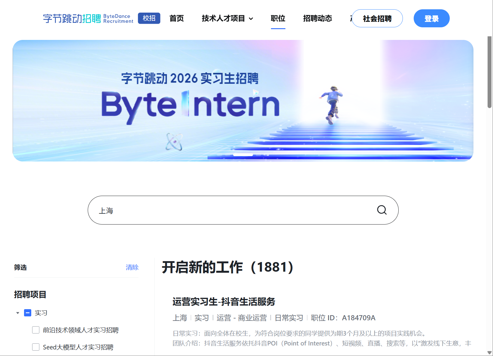

### 美团
#### 公司概况
美团（Meituan）是一家成立于2010年、总部位于北京的领先生活服务电子商务平台，由王兴创立。公司通过美团、大众点评及境外品牌 KeeTa，构建了涵盖外卖配送、到店餐饮、酒店旅游及即时零售的全方位业务矩阵。截至2024年底，美团年度交易用户已突破7.7亿，年活跃商家达1450万，是全球最大的本地生活服务平台之一，并于2018年在香港联交所成功上市。

- 专注于生活领域

#### 公司历史

##### 2010—2012｜创立与团购业务发展

2010年，王兴（Wang Xing）、穆荣均等人在北京创立美团（Meituan），同年3月上线美团网，最初以本地餐饮和生活服务团购为主要业务。公司在中国互联网“千团大战”中逐渐扩大市场份额，2011年推出移动客户端，2012年开始拓展电影票、酒店预订等业务。

##### 2013—2015｜外卖业务与大众点评合并

2013年推出美团外卖，建立餐饮外卖与即时配送业务，并继续发展酒店、旅游和电影票务平台。2015年10月，美团与大众点评正式合并，成立美团点评，整合团购、商家评价、餐饮外卖和本地生活服务，逐渐形成覆盖消费者与线下商户的综合服务平台。

##### 2016—2018｜本地生活生态与集团上市

2016年收购第三方支付企业钱袋宝，扩大金融科技与商家服务业务。2017年推出美团打车，并拓展生鲜零售和餐饮供应链服务。2018年收购摩拜单车，进入共享出行市场，同年9月在香港联合交易所上市（3690.HK），逐渐形成外卖、到店、酒旅、出行及商家服务相结合的业务体系。

##### 2019—2022｜即时零售与科技零售转型

2019年推出美团买菜，扩大即时配送和生鲜零售业务。2020年推出美团优选，进入社区团购市场，同时发展快驴进货、餐饮 SaaS 和无人配送技术。2021年提出“零售+科技”战略，强化即时零售、配送网络与科技研发。2022年进一步发展美团闪购、数字化商家服务及无人机配送业务。

##### 2023—2024｜国际化与核心业务整合

2023年推出国际外卖品牌 Keeta，首先进入中国香港市场，随后将美团买菜升级为小象超市。2024年进一步整合到店、到家和平台业务，成立核心本地商业板块，由王莆中担任 CEO。同年 Keeta 进入沙特阿拉伯市场，美团继续扩大即时零售、海外配送及无人配送技术投入。

##### 2025—至今｜即时零售、国际化与人工智能

2025年推出快乐猴折扣超市，收缩美团优选社区团购业务，并加大美团闪购、小象超市及 Keeta 的投入，Keeta 进一步拓展中东与巴西市场。同年推出 LongCat 大模型及相关 AI 应用。2026年发布 LongCat 2.0，升级 AI 助手“小团”，推出 CatPaw 商家智能体平台，并宣布收购叮咚买菜中国业务，继续发展即时零售、无人配送和 AI 技术。

#### 控股公司及子公司

- **集团主体**
  - **美团（Meituan）**：2010年成立，总部位于中国北京，注册地为开曼群岛，2018年在香港联合交易所上市（3690.HK）。
  - **管理层与业务结构**：王兴担任创始人、董事长兼 CEO，集团主要分为核心本地商业（Core Local Commerce）和新业务（New Initiatives）两个报告分部。

- **本地生活与即时配送**
  - **大众点评（Dianping）**：2015年与美团合并，主营商户评价、餐饮推荐和本地生活服务。
  - **美团外卖、美团闪购**：餐饮外卖、即时零售及配送平台。
  - **小象超市**：美团自营生鲜与日用品即时零售业务。
  - **快驴进货**：面向餐饮商户的食材采购与供应链平台。
  - **快乐猴**：美团旗下线下折扣超市业务。

- **出行与国际业务**
  - **摩拜单车（Mobike）**：2018年收购，后整合为美团单车。
  - **Keeta**：2023年推出的国际外卖及即时配送品牌，业务覆盖香港、中东及巴西等市场。
  - **美团无人车、美团无人机**：集团内部自动配送与低空物流研发业务。

- **支付与商家服务**
  - **钱袋宝**（2016年收购）：第三方支付企业，属于美团金融科技业务。
  - **美团餐饮系统**：餐饮收银、门店管理与商家数字化服务。
  - **美团金服**：支付、商家融资及相关金融科技业务。

- **重要法律实体**
  - **中国大陆实体**：北京三快在线科技有限公司、北京三快云计算有限公司、上海三快科技有限公司、上海汉涛信息咨询有限公司、北京钱袋宝支付技术有限公司等。
  - **经营架构**：通过直接控股、间接控股及协议控制实体（VIE）开展中国大陆和国际业务。

- **战略投资与历史业务**
  - **猫眼娱乐（Maoyan Entertainment）**：由美团电影票业务发展而来，现为独立上市企业，美团持有少数股权，不属于控股子公司。
  - **叮咚买菜（Dingdong）**：2026年2月宣布拟收购其中国业务，交易截至2026年10月仍待完成，尚不能列为已控股子公司。
  - **美团优选**：2020年推出的社区团购业务，2025年大幅收缩并停止主要区域运营。
  - **腾讯**：美团的重要历史股东与业务合作伙伴，不属于美团控股企业。

注：美团内部业务品牌与独立法律子公司有所区别；部分中国大陆经营实体通过协议控制结构纳入集团合并报表。

#### 主要产品

- **本地生活与消费服务**
  - **综合平台**：美团、美团 App、大众点评。
  - **餐饮与生活服务**：美团团购、美团美食、美团休闲娱乐、美团丽人。
  - **酒店与旅游**：美团酒店、美团民宿、美团门票、美团旅行。

- **外卖与即时零售**
  - **餐饮配送**：美团外卖、美团跑腿、拼好饭。
  - **即时零售**：美团闪购、美团买药、小象超市。
  - **线下零售**：快乐猴。
  - **餐饮供应链**：快驴进货。

- **出行与国际业务**
  - **交通出行**：美团单车、美团打车。
  - **海外即时配送**：Keeta。

- **人工智能与智能体**
  - **基础模型**：LongCat、LongCat 2.0。
  - **AI 助手**：美团小团、小美、小团健康管家。
  - **商家智能体**：CatPaw。
  - **AI 开发与研究**：LongCat 开放模型、VitaBench。

- **商家与企业服务**
  - **商家经营**：美团开店宝、美团餐饮系统、美团零售系统。
  - **行业软件**：美团酒店系统、美团客满满。
  - **支付与金融**：美团支付、钱袋宝、美团生意贷。
  - **企业服务**：美团企业版。

- **物流与智能硬件**
  - **即时配送**：美团配送。
  - **无人配送**：美团无人车、美团无人机。
  - **智能机器人**：美团小黄蜂配送机器人。
  - **商家硬件**：智能收银设备、外卖出餐宝。

- **技术与开发者生态**
  - **基础技术**：美团大数据平台、推荐系统、调度系统。
  - **开源软件**：Leaf、CAT、MTrace、OCTO。
  - **技术平台**：美团技术团队、美团开放平台。


#### 招聘情况
- [招聘官网](https://zhaopin.meituan.com/web/home)
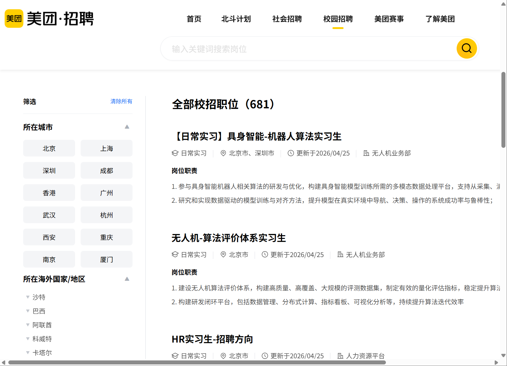

招聘情况也很多,但是AI/算法岗位占比很高,超过一半了.
### 京东
#### 公司概况
京东（JD.com）是一家成立于1998年、总部位于北京的中国最大零售商，由刘强东创立。公司自2004年转型线上零售以来，凭借自建物流体系和B2C自营模式，发展成为与天猫比肩的电商巨头，2024年营收超过1588亿美元，位列财富世界500强前列。其业务版图涵盖零售、物流、科技、健康、工业及国际商业等多个领域，以正品保障和极速配送为核心竞争力。
- 主打电商平台
#### 公司历史

##### 1998—2004｜创立与电子商务起步

1998年，刘强东（Richard Liu）在北京中关村创立京东的前身，最初经营光磁产品及电子设备零售。2004年正式上线京东多媒体网，开始从线下门店转向互联网零售，并于2005年全面停止线下零售业务，逐渐形成以3C数码产品自营销售为核心的商业模式。

##### 2005—2013｜自建物流与综合电商

2007年，京东开始建设自营仓储物流体系，并逐步从3C数码扩展至家电、图书和日用百货。2010年推出第三方商家开放平台，2013年将网站域名升级为 JD.com，并发展京东金融、京东物流及京东云等业务，逐渐建立商品自营、平台交易和仓储配送相结合的电商体系。

##### 2014—2018｜集团上市与技术业务扩张

2014年，京东在美国纳斯达克上市（JD），并与腾讯建立战略合作关系。2016年与沃尔玛达成合作，拓展零售与供应链业务。2017年京东物流开始独立运营，并对外开放物流服务。同期发展京东金融、京东云和京东工业等业务，逐步从零售企业扩展至供应链技术与服务领域。

##### 2019—2021｜集团化与独立业务上市

2019年京东健康开始独立运营，并发展京东零售、京东物流、京东科技等业务体系。2020年京东集团在香港联合交易所二次上市（9618.HK），同年京东健康在香港上市。2021年京东物流在香港上市，进一步形成零售、物流、医疗健康和科技服务并行发展的业务结构。

##### 2022—2024｜供应链整合与即时零售

2022年徐雷接任 CEO，京东物流取得德邦股份的控制权，扩大快递、快运及综合物流业务。2023年许冉（Sandy Xu）接任京东集团 CEO，集团继续发展京东到家、京东秒送、京东云和京东工业。同期强化即时零售、实体家电零售、供应链技术和企业采购业务。

##### 2025—至今｜即时配送、人工智能与国际化

2025年推出京东外卖，并完成达达集团私有化收购，整合即时零售与配送业务。同年京东工业在香港上市，京东云推出 JoyAI 大模型及相关智能体产品。2026年正式在欧洲推出 Joybuy 电商平台和 JoyExpress 配送服务，并发展 JoyInside 智能硬件、自动配送和 AI 供应链技术。同期推进对德国零售集团 CECONOMY 的收购计划，进一步拓展国际零售与物流业务。

#### 控股公司及子公司

- **集团主体**
  - **京东集团（JD.com, Inc.）**：1998年起步，总部位于中国北京，注册地为开曼群岛，在纳斯达克（JD）和香港联合交易所（9618.HK）上市。
  - **管理层与业务结构**：刘强东担任创始人兼董事会主席，许冉（Sandy Xu）担任 CEO。集团主要分为京东零售（JD Retail）、京东物流（JD Logistics）和新业务（New Businesses）三个报告分部。

- **电子商务与零售**
  - **京东零售（JD Retail）**：京东商城、京东自营、京东 PLUS、京东国际等业务。
  - **京喜（Jingxi）**：面向价格敏感型消费市场的零售业务。
  - **七鲜（7FRESH）**：生鲜超市与食品零售业务。
  - **京东 MALL、京东电器**：线下家电及数码产品零售。
  - **京东外卖、京东秒送**：餐饮外卖与即时零售服务。

- **物流与供应链**
  - **京东物流（JD Logistics）**：2021年在香港上市（2618.HK），主营仓储、快递、快运及供应链物流。
  - **德邦快递（Deppon）**：2022年由京东物流取得控制权，2026年从上海证券交易所退市。
  - **达达集团（Dada）**：2025年完成私有化，整合达达快送、京东到家及相关即时配送业务。
  - **京东产发（JD Property）**：物流仓储基础设施及产业园区投资运营。

- **医疗健康与工业服务**
  - **京东健康（JD Health）**：2020年在香港上市（6618.HK），经营医药零售、互联网医疗及健康服务。
  - **京东工业（JD Industrials）**：2025年在香港上市（7618.HK），经营工业品采购与数字化供应链服务。
  - **京东企业业务**：企业采购、供应链管理及企业客户服务。

- **云计算与金融科技**
  - **京东科技（JD Technology）**：数字科技、金融科技及企业技术服务。
  - **京东云（JD Cloud）**：云计算、数据库、AI 基础设施及企业软件服务，属于京东科技业务体系。
  - **京东支付、京东白条**：京东科技及相关合作机构提供的支付与金融服务。

- **国际业务与战略投资**
  - **Joybuy**：京东旗下欧洲零售电商平台。
  - **JoyExpress**：京东物流旗下欧洲配送服务。
  - **CECONOMY**：德国 MediaMarkt、Saturn 电子零售品牌的母公司，2025年京东提出收购要约，截至2026年10月交易仍待完成。
  - **腾讯、沃尔玛**：京东的重要历史股东与战略合作伙伴。

- **重要法律实体**
  - **中国大陆实体**：北京京东世纪贸易有限公司、北京京东世纪信息技术有限公司等。
  - **境外控股实体**：JD.com, Inc.、JD Logistics, Inc.、JD Health International Inc.、JD Industrials, Inc.。
  - **集团架构**：通过直接控股、间接控股和协议控制实体（VIE）开展不同业务。

注：京东集团截至2025年底持有京东科技约54.9%的经济权益，但仅拥有约23.3%的表决权，京东科技仍由刘强东控制，不能简单视为京东集团的控股子公司。CECONOMY 收购尚未完成。

#### 主要产品

- **电子商务与零售**
  - **综合电商**：京东商城、京东 App、京东自营、京东 PLUS。
  - **即时零售**：京东秒送、京东外卖、七鲜。
  - **下沉与国际零售**：京喜、京东国际、Joybuy。
  - **线下零售**：京东 MALL、京东电器、京东之家。

- **物流与供应链**
  - **快递与快运**：京东快递、德邦快递、达达快送。
  - **仓储与供应链**：京东供应链物流、京东冷链、京东国际物流。
  - **海外配送**：JoyExpress。
  - **智能物流**：京东亚洲一号、狼族自动化仓储、京东无人配送车。

- **医疗健康与工业服务**
  - **京东健康**：京东大药房、京东互联网医院、京东健康 App。
  - **医疗 AI**：京医千询、AI 京医、京东卓医。
  - **京东工业**：京东工业品、京东工品汇、太璞供应链平台。
  - **企业采购**：京东企业购、京东慧采。

- **云计算与人工智能**
  - **京东云**：云主机、云数据库、对象存储、容器服务。
  - **AI 模型与平台**：JoyAI、JoyBuilder、JoyAgent。
  - **AI 助手与数字人**：京东言犀、JoyAI 数字人、JoyInside。
  - **AI 开发工具**：JoyCode、京东云 AI 开发平台。

- **金融科技与企业服务**
  - **支付与消费金融**：京东支付、京东白条、京东金条。
  - **企业金融与技术**：京东科技、京东供应链金融。
  - **商家服务**：京东商家后台、京麦、京准通。
  - **企业技术服务**：京东云、京东企业业务。

- **数字生活与本地服务**
  - **生活服务**：京东旅行、京东家政、京东洗衣、京东养车。
  - **二手与回收**：京东拍拍、京东回收。
  - **汽车服务**：京东汽车、京东养车。
  - **会员与内容**：京东 PLUS、京东读书。

- **开发者与开源生态**
  - **技术基础设施**：京东云 SDK、京东云 API。
  - **AI 开发**：JoyAgent、JoyBuilder、JoyAI。
  - **开源技术**：JDChain、Taro、NutUI 等历史或现有开源项目。
#### 招聘情况
- [招聘官网](https://zhaopin.jd.com/home)

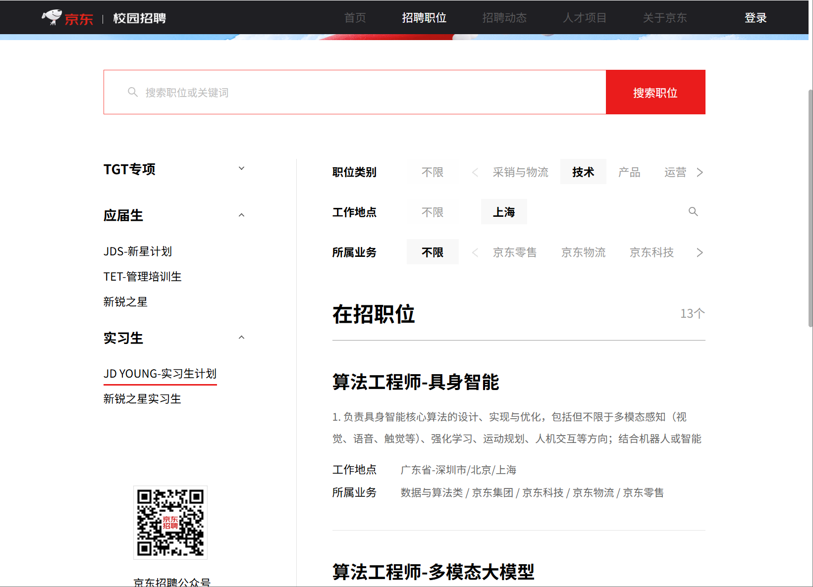

需求比起前面的公司骤减,并且全面拥抱AI.
### 网易
#### 公司概况
网易是一家成立于1997年、总部位于杭州的领先互联网技术公司，由丁磊创立。作为全球顶尖的游戏开发商，其核心支柱为《梦幻西游》等自研游戏及暴雪游戏的中国代理，同时深度布局网易云音乐、网易有道（在线教育）和网易邮箱等多元化服务。凭借2023年达146亿美元的营收规模，网易在深耕国内内容社区的同时，正通过在全球建立工作室加速向国际化游戏市场转型。

- 核心业务是游戏
#### 公司历史

##### 1997—2000｜创立与互联网门户发展

1997年，丁磊（William Ding）在广州创立网易（NetEase），最初从事互联网软件与技术服务。1998年推出网易门户网站和免费电子邮箱服务，随后发展网络新闻、广告及互联网增值业务。2000年6月在美国纳斯达克上市（NTES），成为中国早期上市的互联网企业之一。

##### 2001—2006｜网络游戏与在线教育起步

2001年成立网易游戏事业部，推出《大话西游》系列，2004年推出《梦幻西游》，逐渐建立自主研发的网络游戏业务。同期与暴雪娱乐（Blizzard Entertainment）等国际游戏企业建立合作关系。2006年成立网易有道（Youdao），推出有道搜索和词典服务，开始拓展在线教育与智能学习领域。

##### 2007—2013｜游戏扩张与移动互联网转型

网易持续发展《梦幻西游》《大话西游》《天下》《倩女幽魂》等游戏产品，2008年与暴雪建立《星际争霸Ⅱ》《魔兽世界》等游戏的中国大陆运营合作。2013年推出网易云音乐，并开始发展移动游戏，逐渐形成网络游戏、数字音乐、门户资讯和在线教育并行的业务结构。

##### 2014—2019｜手游发展与业务多元化

2015年推出《梦幻西游》手游，随后发布《阴阳师》（2016）、《荒野行动》（2017）、《第五人格》（2018）等产品，扩大移动游戏和海外市场业务。2015年推出网易考拉跨境电商，2016年推出网易严选。2019年将网易考拉出售给阿里巴巴，同年网易有道在纽约证券交易所上市。

##### 2020—2023｜集团上市与全球游戏布局

2020年，网易在香港联合交易所上市（9999.HK），2021年推出《永劫无间》，同年网易云音乐在香港上市。2022年收购法国游戏开发商 Quantic Dream，扩大海外主机游戏研发。2023年推出《逆水寒》手游、《巅峰极速》等游戏，同时网易有道推出“子曰”教育大模型，开始拓展生成式 AI 应用。

##### 2024—至今｜全球游戏与人工智能发展

2024年推出《燕云十六声》《漫威争锋》《七日世界》等跨平台游戏，并与暴雪恢复中国大陆游戏运营合作。2025—2026年继续拓展全球 PC、主机和移动游戏市场，发展《遗忘之海》等新作，同时推动网易有道子曰大模型、AI 学习产品及网易伏羲人工智能技术。同期调整部分海外游戏工作室，将资源集中于核心游戏研发与人工智能业务。

#### 控股公司及子公司

- **集团主体**
  - **网易公司（NetEase, Inc.）**：1997年成立于广州，主要业务中心位于中国杭州，注册地为开曼群岛，在纳斯达克（NTES）和香港联合交易所（9999.HK）上市。
  - **管理层与业务结构**：丁磊担任创始人、CEO 兼董事，集团主要分为游戏及相关增值服务、有道、网易云音乐、创新业务及其他四个报告分部。

- **游戏开发与发行**
  - **网易游戏（NetEase Games）**：集团核心游戏研发与发行体系。
  - **网易互娱、雷火事业群**：国内游戏研发与运营组织，负责《梦幻西游》《阴阳师》《逆水寒》等系列产品。
  - **Quantic Dream**（2022年收购）：法国游戏开发商，代表作品《底特律：化身为人》《暴雨》。
  - **海外游戏研发团队**：围绕 PC、主机与跨平台游戏开展研发和发行。

- **在线教育与人工智能**
  - **网易有道（Youdao, Inc.）**：2019年在纽约证券交易所上市（DAO），网易保持控股，主营在线学习、AI 翻译和教育智能硬件。
  - **网易伏羲（NetEase Fuxi）**：网易内部人工智能研发与应用业务，涉及游戏 AI、智能体和工业机器人。

- **数字音乐与消费服务**
  - **网易云音乐（Cloud Village Inc.）**：2021年在香港上市（9899.HK），网易保持控股，主营音乐流媒体、音乐社区和数字内容。
  - **网易严选（NetEase Yanxuan）**：网易旗下品质消费电商品牌。
  - **网易传媒**：网易新闻、网易门户及相关广告业务。

- **重要法律实体**
  - **中国大陆子公司**：广州博冠信息科技有限公司、网易（杭州）网络有限公司等。
  - **协议控制实体（VIE）**：广州网易计算机系统有限公司、杭州网易雷火科技有限公司等。
  - **境外实体**：Hong Kong NetEase Interactive Entertainment Limited、Youdao, Inc.、Cloud Village Inc. 等。

- **战略合作与历史业务**
  - **暴雪娱乐（Blizzard Entertainment）**：游戏代理与运营合作伙伴，旗下《魔兽世界》《炉石传说》等在中国大陆由网易合作运营。
  - **Microsoft Gaming**：2024年与网易、暴雪开展游戏运营及跨平台合作。
  - **网易考拉（Kaola）**：2015年推出，2019年出售给阿里巴巴。
  - **Grasshopper Manufacture**：2021年由网易收购，2026年10月恢复独立，不再属于网易旗下工作室。

注：网易游戏、网易伏羲等属于内部业务或研发组织，并非全部为独立法律子公司。中国大陆部分业务通过协议控制（VIE）结构纳入集团财务报表。

#### 主要产品

- **PC、主机与移动游戏**
  - **经典网络游戏**：《梦幻西游》《大话西游2》《天下3》《新倩女幽魂》《逆水寒》。
  - **移动游戏**：《梦幻西游》手游、《阴阳师》《率土之滨》《第五人格》《明日之后》《蛋仔派对》。
  - **跨平台与全球游戏**：《永劫无间》《燕云十六声》《漫威争锋》《七日世界》《遗忘之海》。
  - **代理及合作游戏**：《我的世界》《魔兽世界》《炉石传说》《守望先锋》《暗黑破坏神：不朽》。

- **人工智能与开发技术**
  - **网易伏羲**：网易有灵智能体、有灵天工、有灵众包。
  - **工业智能与机器人**：网易灵动、灵掘、灵载。
  - **教育 AI 模型**：有道子曰（Confucius）系列。

- **在线教育与学习工具**
  - **词典与翻译**：网易有道词典、有道翻译、有道智云。
  - **AI 学习应用**：Hi Echo、有道小P、有道宝库、有道龙虾。
  - **学习平台**：有道精品课、网易云课堂、中国大学 MOOC。
  - **学习硬件**：有道词典笔、有道听力宝。

- **数字音乐与内容娱乐**
  - **音乐平台**：网易云音乐、网易云音乐黑胶 VIP。
  - **音乐创作**：网易音乐人、LOOK 直播。
  - **音乐社区**：网易云音乐播客及音乐内容社区。

- **互联网与信息服务**
  - **新闻资讯**：网易新闻、网易门户、网易公开课。
  - **电子邮箱**：163 邮箱、126 邮箱、yeah.net 邮箱、网易邮箱大师。
  - **企业通信**：网易企业邮箱。

- **电商与生活服务**
  - **网易严选**：网易严选 App、严选家居、宠物用品及其他自有品牌商品。
  - **消费服务**：网易支付及相关互联网增值服务。


#### 招聘情况
- [招聘官网](https://game.campus.163.com/position)
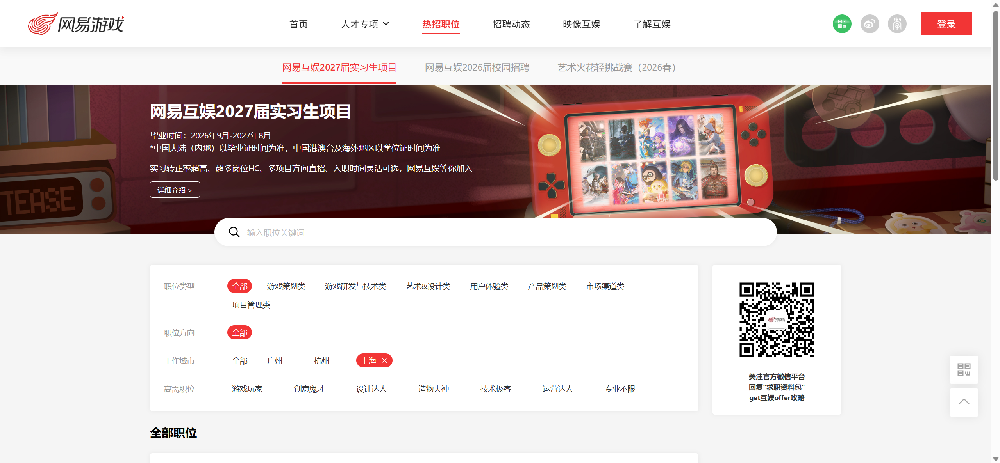
岗位很少,均为游戏相关,想去的话注意校招的时候抓紧投递
### 百度
#### 公司概况
百度（Baidu）是一家成立于2000年、总部位于北京的全球领先人工智能及互联网服务巨头，由李彦宏和徐勇创立。作为中国搜索引擎市场的统治者，百度不仅拥有百度搜索、百度百科、爱奇艺及百度贴吧等核心互联网产品，更转型为拥有全栈AI技术实力的科技公司，业务涵盖自动驾驶（Apollo）、智能硬件（小度）及云计算基础设施。作为首家入选纳斯达克100指数的中国企业.


>曾经的头部企业,由于战略走向问题逐渐衰落,如今抱牢着人工智能和智能驾驶慢慢恢复生机,但是既然有这么多战略失误,而且方向都向智能驾驶靠拢了,所以建议放到第二梯队.
#### 公司历史

##### 2000—2005｜创立与搜索引擎发展

2000年，李彦宏（Robin Li）与徐勇（Eric Xu）在北京创立百度（Baidu），最初专注中文搜索引擎技术。2001年推出独立搜索服务，随后推出竞价排名广告，逐渐建立以搜索和在线营销为核心的商业模式。2003年推出百度贴吧，2005年在美国纳斯达克上市（BIDU）。

##### 2006—2012｜互联网服务与移动业务扩张

2006年推出百度百科，随后发展百度知道、百度地图、百度文库等产品，逐渐形成搜索、知识、地图和在线广告业务体系。2010年开始大规模投入人工智能技术，同年爱奇艺成立，百度于2012年取得其控制权，并持续向移动互联网市场扩张。

##### 2013—2016｜移动互联网与人工智能布局

2013年收购91无线，拓展移动应用分发业务，并成立深度学习研究院。2014年完成对糯米网的收购，发展本地生活服务。同期推出百度手机助手、百度信息流等产品，并发展百度智能云、PaddlePaddle（飞桨）深度学习框架及智能语音技术，逐步从搜索业务延伸至云计算和人工智能。

##### 2017—2020｜自动驾驶与 AI 平台发展

2017年推出 Apollo 自动驾驶开放平台和 DuerOS 智能语音系统，发展小度智能硬件。同年将百度外卖出售给饿了么。2018年爱奇艺在纳斯达克上市，百度金融业务分拆为度小满金融。随后推出昆仑 AI 芯片、飞桨开发平台，并发展百度智能云与自动驾驶业务。

##### 2021—2023｜集团上市与生成式人工智能

2021年百度在香港联合交易所第二上市（9888.HK），同年推出 Apollo Go 萝卜快跑商业化出行服务，并扩大昆仑芯和智能云业务。2022年发布第六代无人驾驶汽车 Apollo RT6。2023年推出文心一言（ERNIE Bot）及文心大模型相关服务，推动搜索、云计算和办公产品的生成式 AI 转型。

##### 2024—至今｜AI 云与自动驾驶商业化

2024年发布文心大模型4.0 Turbo，加快萝卜快跑无人驾驶运营。2025年推出文心4.5、X1及文心5.0，升级飞桨3.0，并发展千帆大模型平台、秒哒和 GenFlow 智能体产品。2026年昆仑芯申请在香港独立上市，萝卜快跑与 Uber 等企业扩大国际合作，百度在香港转为双重主要上市，继续拓展 AI 基础设施与企业应用。

#### 控股公司及子公司

- **集团主体**
  - **百度集团股份有限公司（Baidu, Inc.）**：2000年成立，总部位于中国北京，注册地为开曼群岛，在纳斯达克（BIDU）和香港联合交易所（9888.HK）上市。
  - **管理层与业务结构**：李彦宏担任联合创始人、董事长兼 CEO。集团主要包括百度一般性业务（Baidu General Business）和爱奇艺（iQIYI）两个报告分部。

- **搜索与移动互联网**
  - **百度搜索**：集团核心搜索引擎及信息服务业务。
  - **百度移动生态**：百度 App、百度贴吧、百度百科、百度知道、百家号等。
  - **百度营销**：搜索广告、信息流广告和 AI 营销服务。

- **人工智能与云计算**
  - **百度智能云（Baidu AI Cloud）**：云计算、AI 基础设施和企业技术服务。
  - **文心大模型（ERNIE）**：百度基础模型与生成式人工智能业务。
  - **飞桨（PaddlePaddle）**：百度自主研发的深度学习框架。
  - **昆仑芯（Kunlunxin）**：百度控股的 AI 芯片企业，2026年申请在香港独立上市，上市计划尚未完成。

- **智能驾驶与智能硬件**
  - **百度 Apollo**：自动驾驶与智能汽车技术业务。
  - **萝卜快跑（Apollo Go）**：无人驾驶出行服务。
  - **小度科技（Xiaodu）**：智能音箱、智能屏及相关 AI 硬件业务。

- **数字娱乐与内容**
  - **爱奇艺（iQIYI, Inc.）**：2012年百度取得控制权，2018年在纳斯达克上市（IQ），目前仍纳入百度合并财务报表。
  - **百度文库、百度网盘**：文档、知识管理及云存储业务。
  - **百度好看视频**：短视频与数字内容平台。

- **重要法律实体**
  - **中国大陆实体**：百度在线网络技术（北京）有限公司、北京百度网讯科技有限公司、百度（中国）有限公司、百度时代网络技术（北京）有限公司。
  - **控股上市及技术实体**：iQIYI, Inc.、昆仑芯（北京）科技有限公司等。
  - **股权架构**：集团通过全资子公司、控股子公司及协议控制实体（VIE）开展业务。

- **历史业务与战略合作**
  - **度小满金融（Du Xiaoman）**：原百度金融业务，2018年出售多数股权并独立运营，不属于百度现有控股业务。
  - **百度外卖**：2017年出售给饿了么。
  - **91无线、百度糯米**：历史收购及本地生活业务，相关产品已逐步整合或退出。
  - **Uber、Lyft**：萝卜快跑国际自动驾驶合作伙伴。
  - **吉利汽车**：智能汽车领域的历史合作伙伴，吉利集团本身不属于百度。

注：百度内部业务品牌不等同于独立法律子公司；昆仑芯的拟上市计划与已经完成上市应予区分。

#### 主要产品

- **搜索与互联网服务**
  - **搜索与资讯**：百度搜索、百度 App、百度信息流、百家号。
  - **知识与社区**：百度百科、百度知道、百度贴吧、百度经验。
  - **地图与出行**：百度地图。
  - **网络工具**：百度浏览器（历史产品）、百度输入法、百度翻译。

- **人工智能与智能体**
  - **文心大模型**：ERNIE、ERNIE 4.5、ERNIE X1、ERNIE 5.0。
  - **AI 助手**：文心一言、文小言。
  - **智能体与 AI 应用**：秒哒（Miaoda）、GenFlow、百度数字员工。
  - **AI 开发框架**：飞桨（PaddlePaddle）、ERNIEKit。

- **云计算与 AI 基础设施**
  - **百度智能云**：云服务器、对象存储、云数据库、容器引擎。
  - **大模型平台**：千帆大模型平台（Qianfan）。
  - **数据与 AI 开发**：百度智能云 AI 开发平台、大数据与数据分析服务。
  - **AI 芯片**：百度昆仑芯系列。

- **自动驾驶与智能汽车**
  - **无人驾驶出行**：萝卜快跑（Apollo Go）、Apollo RT6。
  - **自动驾驶技术**：百度 Apollo、Apollo 自动驾驶开放平台。
  - **智能汽车软件**：Apollo 智能驾驶、CarLife+。
  - **智慧交通**：百度 ACE 智能交通。

- **智能硬件与办公应用**
  - **小度智能设备**：小度智能音箱、小度智能屏、小度学习机。
  - **智能语音系统**：DuerOS。
  - **知识与办公**：百度文库、百度网盘、GenFlow。

- **数字娱乐与内容平台**
  - **视频与影视**：爱奇艺、爱奇艺极速版、爱奇艺国际版。
  - **短视频**：好看视频。
  - **网络文学**：纵横中文网等历史内容业务。

- **广告营销与企业服务**
  - **广告平台**：百度营销、百度推广、百度联盟。
  - **AI 营销**：百度数字人、慧播星、AI 营销智能体。
  - **企业云服务**：百度智能云、千帆大模型平台。
#### AI总结的战略失误
百度在互联网时代的战略失误，常被外界总结为“错过了一个时代”或“在关键路口反复横跳”。其核心症结在于过早建立的搜索霸权带来的路径依赖，导致在多次行业重塑中落后。

以下是百度公认的四大战略失误：

##### 1. 错过移动互联网的“入口门票”
* **失误点：** 百度在移动化转型上极其迟钝。当阿里巴巴布局手机淘宝、腾讯孵化微信时，百度仍寄希望于通过“手机百度”浏览器承载一切。
* **后果：** 移动时代形成了“App孤岛”，搜索不再是唯一入口。百度直到 2013 年才斥资 19 亿美元收购 91 无线，试图通过应用商店补票。但这被公认为一次昂贵的失败，因为随后 App Store 和各手机厂商自带商店迅速封死了第三方商店的空间。

##### 2. O2O 战略的摇摆与收缩
* **失误点：** 2015 年，李彦宏曾高调宣布“拿 200 亿砸向 O2O（百度外卖、糯米）”，试图将搜索与生活服务闭环。
* **后果：** 在与美团、饿了么的烧钱大战中，百度由于内部资源整合不力及战略耐性不足，最终在 2017 年前后全面退缩，卖掉外卖业务。这导致百度失去了继搜索之后最真实的用户消费场景和支付数据。

##### 3. 短视频与内容生态的缺位
* **失误点：** 百度拥有强大的技术基因，却缺乏产品经理基因。在短视频爆发前夕，百度并未利用其搜索带来的巨大流量孵化出类似抖音、快手的短视频应用。
* **后果：** 当用户的信息获取习惯从“搜文字”转向“看短视频”时，百度流量遭到字节跳动等对手的结构性打击。虽然百度后来补齐了好看视频和百家号，但已无法撼动已成型的市场格局。

##### 4. “医疗广告”对品牌护城河的侵蚀
* **失误点：** 过度依赖医疗竞价排名带来的高利润。2016 年的“魏则西事件”成为百度的品牌分水岭。
* **后果：** 这次危机不仅导致了严格的监管处罚，更重创了公众对百度的信任。这种品牌负资产使得百度在后来的产品推广中（如 AI、自动驾驶）背负了极高的心理信任成本。

---

##### 总结
百度的技术基因使其在 AI 领域领先（如 2017 年起全力押注 Apollo 和大模型），但**产品化能力的缺失**和**对核心营收（广告）的过度依赖**，使其在过去十年中不断面临“赢了技术、输了场景”的尴尬局面。

直到 2024-2025 年，随着萝卜快跑（Robotaxi）和文心大模型（ERNIE）在 B 端与 C 端的落地，百度才算真正找到了摆脱“搜索路径依赖”的第二增长曲线。


#### 招聘情况
##### 面经1
```md
## 题目

> **题目来源**：https://www.nowcoder.com/feed/main/detail/d39aabc0debd4dba810b4b9671d54348

**1.基础题**

- 有几种网络 Io 模型？
- 异步网络模型在什么场景下你了解有应用过？（回答了线程相关的场景）
- 除了用线程完成，还有什么操作可以完成异步操作？
- 同步阻塞和同步非阻塞在Java层面怎么实现？（说前面网络io模型答得挺顺畅，具体实现细节还需要提升一下）
- 描述一下一次完整的 Http 请求
- 知道的长连接有几种实现方式？
- 一个 Http 请求包含哪几部分内容？

**2.代码题**

- 设计一个 HashSet（完全不会）

**3.场景题**

- 1T 的数据怎么加载到 200M 的内存中，并且找到两行一样的数据？
- Java 打开 1T 文件，第一部操作做什么？
- 用代码打开一个文件和用鼠标打开一个文件有什么区别？
```

### 腾讯音乐
#### 公司概况
>2016年7月，拥有酷狗音乐、酷我音乐的中国音乐集团（原海洋音乐集团）宣布与腾讯集团旗下数字音乐业务进行合并，合并后QQ音乐、酷狗音乐、酷我音乐等产品和品牌将继续保持独立发展。2017年，中国音乐集团正式更名为腾讯音乐娱乐集团,并于2025年收购喜马拉雅.

## 公司历史

#### 2003—2015｜在线音乐平台的创立与发展

2003年，腾讯 QQ 推出在线音乐服务，2005年正式上线 QQ音乐。与此同时，酷狗音乐于2004年推出，酷我音乐于2005年成立，逐渐形成中国早期在线音乐市场的主要竞争平台。2012年酷狗推出繁星直播（后更名为酷狗直播），2013年中国音乐集团（CMC）收购酷我音乐，2014年进一步收购酷狗音乐。同年腾讯推出全民K歌，进入在线K歌和音乐社交市场，为后续音乐平台整合奠定基础。

#### 2016—2018｜腾讯音乐集团成立与美国上市

2016年7月，腾讯将旗下 QQ音乐业务与中国音乐集团整合，成立腾讯音乐娱乐集团（Tencent Music Entertainment Group，TME），形成 QQ音乐、酷狗音乐、酷我音乐和全民K歌四大核心产品体系。2017年推出腾讯音乐人计划，收购爱听卓乐，并与 Spotify 达成战略股权互换协议。2018年与索尼音乐合作成立电子音乐厂牌 Liquid State，华纳音乐和索尼音乐成为集团投资者。同年12月，腾讯音乐在纽约证券交易所上市（NYSE：TME）。

#### 2019—2021｜付费音乐、直播与长音频扩张

2019年举办首届腾讯音乐娱乐盛典（TMEA），进一步发展音乐版权运营和艺人服务。2020年推出 TME live 腾讯音乐超现场及酷我畅听，正式推进长音频业务。2021年收购懒人听书100%股权，将有声书、广播剧及知识音频纳入集团业务体系。同年调整管理层与组织架构，成立内容业务线，确立内容与平台“一体两翼”发展战略，并成立天琴实验室，发展音视频处理及人工智能技术。

#### 2022—2023｜香港二次上市与会员业务增长

2022年9月，腾讯音乐以介绍上市方式在香港联合交易所挂牌（1698.HK），实现纽约、香港双重主要上市。同年推出一站式音乐制作服务平台“启明星”，并与 Billboard 公告牌开展战略合作。2023年，集团在线音乐付费用户突破1亿，举办首届浪潮音乐大赏，持续发展数字专辑、音乐会员、原创音乐制作及版权发行，逐渐形成以付费订阅为核心的在线音乐商业模式。

#### 2024—2025｜超级会员、音乐IP与国际化合作

2024年，腾讯音乐超级会员数量突破1000万，举办首届 QQ音乐超级巅峰之夜，持续扩大高品质音频、数字音乐会员及线下演出业务。2025年超级会员数量突破2000万，推出首届 TIMA 国际音乐大赏及 TME 中国音乐影响力峰会。同年，腾讯音乐收购韩国 SM Entertainment 约9.38%的股份，深化 K-pop 音乐发行、艺人合作与演出业务，并于6月宣布收购喜马拉雅，进一步布局长音频市场。集团同期扩大 AI 音乐制作、艺人周边商品及音乐 IP 商业化业务。

#### 2026—至今｜收购喜马拉雅与音乐音频生态整合

2026年5月18日，腾讯音乐正式完成对喜马拉雅（Ximalaya）100%股权的收购，使其成为集团全资子公司，将业务扩展至播客、有声书、知识内容及综合音频服务。此次交易获得中国市场监管总局附加限制性条件批准。集团同步整合 QQ音乐、酷狗音乐、酷我音乐、全民K歌、懒人听书和喜马拉雅，推进音乐与长音频会员、数字内容和版权资源协同发展。2026年第二季度，集团收入达到89.3亿元人民币，继续扩大线下演唱会、艺人周边、音乐 IP 运营及人工智能创作业务。

## 控股公司及子公司

\- 集团主体

- 腾讯音乐娱乐集团（Tencent Music Entertainment Group）：2016年7月成立，总部位于中国深圳，注册地为开曼群岛，2018年在纽约证券交易所上市（TME），2022年在香港联合交易所上市（1698.HK）。
- 母公司与控股关系：腾讯控股（Tencent Holdings）为集团控股股东。截至2026年3月31日，腾讯及其相关权益合计控制约93.6%的投票权，通过不同投票权股份维持集团控制权。
- 管理层与业务结构：彭迦信（Cussion Pang）担任执行董事长，梁柱（Ross Liang）担任 CEO。主要业务包括在线音乐与音频服务、音乐社交娱乐、内容制作和版权运营。
- 收入来源：音乐及音频会员订阅、广告营销、演唱会及艺人周边销售、数字专辑、音乐版权服务，以及在线K歌、直播等社交娱乐服务。

\- 在线音乐与社交娱乐业务

- QQ音乐：集团核心在线音乐平台，提供音乐播放、会员订阅、数字专辑、音乐社区等服务。
- 酷狗音乐、酷我音乐：核心在线音乐平台，拥有各自的用户群体与业务团队。
- 全民K歌（WeSing）：在线K歌、音乐社交及互动娱乐业务。
- 酷狗直播、酷我直播：音乐直播、主播互动和虚拟礼物等社交娱乐服务。
- 波点音乐、酷狗概念版：面向不同用户群体的音乐产品。

\- 长音频与播客业务

- 喜马拉雅（Ximalaya）：2026年5月完成100%股权收购，成为集团全资子公司，主要经营播客、有声书、知识音频及广播剧。
- 懒人听书（Lazy Audio）：2021年完成收购的长音频平台，提供有声书、广播剧、儿童音频及知识内容。
- 长音频业务线：负责长音频内容开发、版权运营、创作者服务及多平台分发。

\- 音乐内容制作与版权业务

- 腾讯音乐人：原创音乐人扶持、音乐发行、作品推广及版权管理服务。
- TME内容业务线：负责音乐版权引入、原创内容制作、艺人合作、音乐发行及内容商业化。
- 爱听卓乐（Ultimate Music）：2017年收购的企业音乐服务品牌，主要提供商用音乐授权、车载音乐及智能设备音乐服务。
- TME live、TMEA：音乐演出、演唱会及音乐盛典业务。
- TME音乐云、曲易买：音乐全球发行、版权授权及商业音乐服务。

\- 国际业务与战略投资

- JOOX、WeSing国际版：集团相关海外音乐与在线K歌产品，面向部分亚洲及其他海外市场。
- SM Entertainment：2025年收购约9.38%股份的韩国娱乐公司，双方开展音乐发行、艺人 IP、演出及内容合作；属于少数股权投资，不是控股子公司。
- Spotify：2017年与腾讯音乐达成股权互换及战略合作，双方存在股权和业务合作关系，Spotify 不属于腾讯音乐子公司。
- Liquid State：2018年与索尼音乐共同成立的电子音乐厂牌，属于合作项目。

\- 重要法律实体

- 境外控股实体：Tencent Music Entertainment Group、Tencent Music Entertainment Hong Kong Limited。
- 主要境内子公司：Tencent Music (Beijing) Co., Ltd.、Yeelion Online Network Technology (Beijing) Co., Ltd.、Tencent Music Entertainment Technology (Shenzhen) Co., Ltd.、Guangzhou Shiyinlian Software Technology Co., Ltd.。
- 协议控制实体（VIE）：广州酷狗计算机科技有限公司（Guangzhou Kugou Computer Technology Co., Ltd.）、北京酷我科技有限公司（Beijing Kuwo Technology Co., Ltd.）。
- VIE下属企业：Tencent Music Entertainment (Shenzhen) Co., Ltd.、Shenzhen Lanren Online Technology Co., Ltd.。
- 2026年新增重要控股企业：Ximalaya Inc.（喜马拉雅控股），收购完成后成为全资子公司。

## 主要产品

\- 在线音乐与流媒体

- 核心音乐平台：QQ音乐、酷狗音乐、酷我音乐。
- 其他音乐产品：波点音乐、酷狗概念版。
- 海外音乐平台：JOOX。
- 会员与数字音乐服务：QQ音乐会员、酷狗音乐会员、酷我音乐会员、超级会员（SVIP）、数字专辑。

\- 音乐社交与直播

- 在线K歌：全民K歌、WeSing、酷狗唱唱。
- 音乐直播：酷狗直播、酷我直播。
- 音乐社区：5sing原创音乐基地、鱼声。
- 互动娱乐：全民K歌合唱、在线歌房及音乐社交功能。

\- 长音频与知识内容

- 综合音频平台：喜马拉雅。
- 有声阅读：懒人听书。
- 音频内容：有声书、广播剧、播客、儿童故事、知识付费及相声评书。
- 创作者服务：声播平台。

\- 音乐制作与原创内容

- 原创音乐平台：腾讯音乐人。
- 音乐制作工具：启明星一站式音乐制作服务平台。
- 音乐内容制作：制作家工作室、新鲜制造工作室、哆咪嗦工作室。
- 音乐版权与发行：TME音乐云、曲易买。
- 企业音乐服务：爱听卓乐。

\- 人工智能与音频技术

- AI音乐生成：启明星·AI作歌、琴韵及琴乐音乐大模型。
- AI演唱与修音：酷狗 AIK、AI歌声、智能修音。
- 音频技术：酷狗蝰蛇音效、银河音效、臻品音质。
- 技术研发平台：天琴实验室、阿波罗声音实验室。
- 智能音乐体验：AI播放器、智能推荐、个性化歌单及音乐场景识别。

\- 音乐演出与IP商业化

- 在线及线下演出：TME live 腾讯音乐超现场。
- 音乐盛典：TMEA腾讯音乐娱乐盛典、TIMA国际音乐大赏。
- 音乐评选：浪潮音乐大赏、腾讯音乐由你榜、腾讯音乐浪潮榜。
- 线下商业化：演唱会、艺人周边商品、音乐 IP 授权和粉丝活动。

\- 商业服务与行业生态

- 企业音乐授权：爱听卓乐、曲易买。
- 音乐数字发行：TME音乐云。
- 车载音乐服务：酷我车载音乐、爱听卓乐车载音乐解决方案。
- 音乐人服务：腾讯音乐人平W台、作品发行、版权管理与数据服务。
- 广告营销：QQ音乐、酷狗音乐、酷我音乐等平台的品牌广告及音乐内容营销。
- 音乐教育：腾讯音乐学堂、腾讯音乐艺术计划。


### 快手
#### 公司概况
快手科技（Kuaishou Technology）是一家成立于2011年、总部位于北京海淀区的中国上市科技公司（由宿华和程一笑创立）。公司主要通过同名短视频 App、社交网络及视频特效编辑工具提供服务，是中国领先的短视频与直播平台之一。在海外市场，该应用以 **Kwai** 之名运营，而在印度、巴基斯坦及印度尼西亚等地区则被称为 **Snack Video**。目前，快手已在香港联交所上市，且包含部分国有股份。

#### 公司历史

##### 2011—2015｜创立与短视频社区发展

2011年，程一笑（Cheng Yixiao）推出 GIF 快手，最初是一款动图制作与分享工具。2012年开始向短视频社区转型，2013年宿华（Su Hua）加入团队，担任 CEO，并引入个性化推荐算法。此后快手逐渐形成以短视频创作、内容推荐和用户互动为核心的业务模式。

##### 2016—2018｜直播与电子商务扩张

2016年推出直播功能，逐步建立虚拟礼物打赏等商业模式。2017年成为全球主要的直播平台之一，2018年开始发展直播电商，并全资收购弹幕视频网站 AcFun（A站）。同期扩大在线广告业务，逐渐形成短视频、直播、电商和数字营销相结合的平台体系。

##### 2019—2021｜商业化发展与集团上市

2019年推出快手极速版，并加快直播电商、在线营销和海外业务发展。2020年成为央视春晚独家互动合作伙伴，进一步扩大用户规模。2021年2月在香港联合交易所上市（1024.HK），同年10月程一笑接任 CEO，宿华继续担任董事长。

##### 2022—2023｜电商、本地生活与海外业务

2022年，快手持续发展快手电商、磁力引擎、快聘和本地生活服务，扩大直播带货及商家服务体系。2023年进一步拓展快手商城、快手理想家等业务，并通过 Kwai、SnackVideo 发展海外短视频市场。同年10月，程一笑接任董事长，兼任 CEO，快手实现集团年度盈利。

##### 2024—2025｜可灵 AI 与生成式人工智能

2024年推出可灵 AI（Kling AI）视频生成大模型和可图（Kolors）图像生成模型，开始发展面向全球用户的生成式 AI 产品。2025年推出可灵2.0系列，强化视频生成、图像编辑和多模态创作，并将 AI 技术应用于广告、电商、内容推荐及数字人服务。

##### 2026—至今｜AI 视频生成与商业化发展

2026年推出可灵3.0及3.0 Turbo系列，并于10月正式发布 Kling 4.0，进一步提升视频生成与专业影像制作能力。同期发展 Keye-VL 多模态模型、AgentX 推荐智能体等技术，持续扩展可灵 AI 的商业化业务以及海外内容平台。

#### 控股公司及子公司

- **集团主体**
  - **快手科技（Kuaishou Technology）**：2011年创立，总部位于中国北京，注册地为开曼群岛，2021年在香港联合交易所上市（1024.HK）。
  - **管理层与业务结构**：程一笑担任联合创始人、董事长兼 CEO，宿华担任联合创始人及执行董事。集团主要分为国内业务和海外业务两个经营分部。
  - **收入来源**：线上营销服务、直播及其他服务（主要包括电商和可灵 AI）。

- **国内内容与电商业务**
  - **快手、快手极速版**：集团核心短视频及直播平台。
  - **快手电商、快手商城**：直播电商、线上零售及商家服务。
  - **快手本地生活、快聘、快手理想家**：本地消费、招聘及房产服务。
  - **快手星芒短剧**：短剧内容制作与发行。

- **国际业务**
  - **Kwai**：面向巴西、拉丁美洲等市场的短视频与直播平台。
  - **SnackVideo**：面向印度尼西亚等市场的短视频平台。
  - **Kwai for Business**：海外广告与商业营销业务。

- **人工智能与创作业务**
  - **可灵 AI（Kling AI）**：集团生成式视频和图像创作业务。
  - **快影、一甜相机、回森**：视频剪辑、图像拍摄及音乐社交产品。
  - **快意（KwaiYii）、可图（Kolors）**：语言及图像生成模型技术。

- **收购企业与数字内容**
  - **AcFun（A站）**：2018年全资收购的弹幕视频网站，保持独立品牌。
  - **广州弹幕网络科技有限公司**：AcFun 相关经营实体，通过北京快手科技有限公司纳入集团控制体系。

- **重要法律实体**
  - **境外控股实体**：Kuaishou Technology、Fortune Ever Global Limited。
  - **直接控股的境内实体**：北京达佳互联信息技术有限公司、北京快手广告有限公司、淮安快手快联信息技术有限公司。
  - **协议控制实体（VIE）**：北京华艺汇龙网络科技有限公司、北京快手科技有限公司、成都快购科技有限公司。

- **战略投资与合作**
  - **腾讯**：快手的重要战略股东之一，双方在游戏、内容及互联网服务领域开展合作。
  - **宿华、程一笑**：联合创始人，通过不同投票权股份参与集团治理。
  - **其他投资者**：五源资本、红杉资本相关基金、DCM 等历史投资机构。

注：快手电商、可灵 AI、磁力引擎等属于集团内部业务或产品品牌，不等同于独立法律子公司；部分境内经营实体通过协议控制（VIE）纳入合并报表。

#### 主要产品

- **短视频与内容社区**
  - **国内平台**：快手、快手极速版。
  - **海外平台**：Kwai、Kwai Lite、SnackVideo。
  - **弹幕视频**：AcFun（A站）。

- **直播与数字娱乐**
  - **直播服务**：快手直播、快手直播伴侣。
  - **短剧内容**：快手星芒短剧、喜番免费短剧。
  - **音乐社交**：回森。

- **电子商务与本地服务**
  - **电商平台**：快手电商、快手商城、快手小店。
  - **商家服务**：快手小店商家后台、快手电商服务平台。
  - **本地生活**：快手本地生活、快聘、快手理想家。

- **人工智能与生成式创作**
  - **AI 视频生成**：可灵 AI、Kling 3.0、Kling 4.0。
  - **AI 图像生成**：可图（Kolors）、Kling Image。
  - **语言与多模态模型**：快意（KwaiYii）、Keye-VL。
  - **智能推荐技术**：AgentX、推荐大模型。

- **视频与图片创作**
  - **视频编辑**：快影。
  - **图片拍摄**：一甜相机。
  - **AI 影像创作**：可灵 AI。

- **广告营销与商业服务**
  - **营销平台**：磁力引擎、磁力智投、磁力金牛。
  - **达人与内容营销**：磁力聚星、磁力开创。
  - **商家 AI 工具**：女娲数字人、磁力方舟。
  - **国际广告**：Kwai for Business。

- **开发者与技术平台**
  - **AI 开发服务**：可灵 AI API、Kling MCP、Kling CLI。
  - **技术平台**：快手 AI 开放平台、快手开放平台。
  - **模型与开源生态**：Kolors、KwaiYii、Keye-VL。

### 米哈游
#### 公司概况
米哈游（miHoYo）是一家长安成立于 2012 年、总部位于上海的全球领先电子游戏开发商。公司以开发《原神》、《崩坏》系列、《未定事件簿》及《绝区零》等高产值、全球化运作的抽卡类（Gacha）游戏闻名，业务范围涵盖动画、小说、漫画、音乐及周边产品。凭借《原神》获得的巨大全球成功，公司于 2022 年在新加坡设立全球发行品牌 **HoYoverse**（其运营实体为 Cognosphere），负责中国大陆以外市场的全球化内容制作与发行，目前在蒙特利尔、洛杉矶、东京及首尔设有办事处。
>The letters "H" and "Y" in **miHoYo**'s name are derived from the names of two of the three founders, Cai Haoyu and Luo Yuhao. 
The letter "O" was then added because famous companies like Facebook, Google and Microsoft contain that letter. 
Since the combination "HoYo" was already registered, the prefix "mi" was prepended to the name. The prefix "mi" **was inspired by the VOCALOID software Hatsune Miku**, who was chosen due to her widespread popularity among the otaku community. 

- 这名字到底是怎么想出来的...

#### 公司历史

##### 2011—2014｜创立与《崩坏》系列起步

2011年，蔡浩宇、刘伟、罗宇皓等上海交通大学学生组成米哈游（miHoYo）创业团队，推出独立游戏《FlyMe2theMoon》。2012年正式成立上海米哈游网络科技有限公司，并推出《崩坏学园》。2014年发布《崩坏学园2》，逐渐建立以原创游戏和二次元文化为核心的业务体系。

##### 2015—2019｜《崩坏3》与游戏研发扩张

2016年推出3D动作游戏《崩坏3》，逐步进入海外游戏市场，并扩大角色建模、动画渲染和游戏引擎技术研发。2018年推出米游社玩家社区，发展原创游戏IP、音乐、动画和周边业务。同期启动《原神》等新项目研发。

##### 2020—2021｜《原神》与全球化发展

2020年推出《未定事件簿》，同年9月全球发行开放世界游戏《原神》，覆盖移动端、PC和主机平台，推动米哈游国际业务快速扩张。2021年进一步发展海外发行、跨平台游戏及全球用户社区，在新加坡等地布局国际业务。

##### 2022—2023｜HoYoverse 与《星穹铁道》

2022年推出国际品牌 HoYoverse，通过新加坡发行主体 Cognosphere 拓展全球游戏与数字娱乐业务。2023年4月推出《崩坏：星穹铁道》，继续扩大多平台游戏市场。同年刘伟接任米哈游董事长，蔡浩宇将更多精力投入前沿技术与新项目研发。

##### 2024—至今｜新游戏与技术研发

2024年7月推出动作游戏《绝区零》，进一步完善多类型游戏产品体系。2025—2026年公布《崩坏：因缘精灵》《星布谷地》《源初之结》等新项目，持续投入人工智能、游戏渲染和云游戏技术。其中《星布谷地》计划于2026年冬季公测。

#### 控股公司及子公司

- **集团主体**
  - **上海米哈游网络科技股份有限公司（miHoYo）**：2012年正式注册成立，总部位于中国上海，为非上市股份有限公司。
  - **管理层与股权**：刘伟担任董事长及总裁，蔡浩宇、刘伟、罗宇皓为主要创始人。蔡浩宇为重要股东。
  - **业务结构**：主要涵盖游戏研发与运营、国际发行、原创IP、数字内容及技术研发。

- **国内游戏研发与运营**
  - **上海米哈游天命科技有限公司**：游戏研发与运营，《原神》国内开发运营主体之一。
  - **上海米哈游影铁科技有限公司**：集团游戏相关研发与运营实体。
  - **上海米哈游阿尔戈科技有限公司**：集团技术研发与游戏业务实体。
  - **上海米哈游璃月科技有限公司**：集团游戏相关经营实体。
  - **上海时间结科技有限公司**：集团旗下全资子公司。

- **国际发行与海外业务**
  - **Cognosphere Pte. Ltd.**：2021年成立于新加坡，负责 HoYoverse 品牌下的国际游戏发行。
  - **株式会社COGNOSPHERE**：日本地区游戏运营与市场业务。
  - **HoYoverse**：2022年推出的全球发行与数字娱乐品牌，并非独立上市控股集团。
  - **海外团队**：分布于新加坡、美国、加拿大、日本及韩国等地区。

- **音乐、社区与原创IP**
  - **HOYO-MiX**：米哈游内部音乐制作团队，负责原创游戏音乐。
  - **米游社、HoYoLAB**：国内及国际玩家社区。
  - **原创IP业务**：游戏动画、漫画、音乐、角色周边及线下活动。

- **技术研发与战略投资**
  - **研发方向**：游戏引擎、卡通渲染、人工智能、云游戏及交互技术。
  - **投资业务**：通过集团及相关投资主体参与游戏、科技与内容产业投资。

注：米哈游为非上市公司，未像上市集团一样定期披露完整合并子公司及财务报表。上述法律实体为公开资料可核实的代表性企业；HoYoverse、HOYO-MiX 等属于品牌或内部组织，不应全部视作独立子公司。

#### 主要产品

- **主要游戏**
  - **《崩坏》系列**：《崩坏学园》《崩坏学园2》《崩坏3》《崩坏：星穹铁道》。
  - **其他代表作品**：《原神》《未定事件簿》《绝区零》。
  - **早期作品**：《FlyMe2theMoon》。

- **已公布的新游戏**
  - **《崩坏：因缘精灵》**（Honkai: Nexus Anima）：精灵养成与策略游戏，尚未正式发行。
  - **《星布谷地》**（Petit Planet）：生活模拟游戏，计划于2026年冬季公测。
  - **《源初之结》**（NODUSFALL）：多人合作奇幻动作游戏，尚未正式发行。

- **游戏平台与玩家社区**
  - **游戏启动器**：米哈游启动器、HoYoPlay。
  - **玩家社区**：米游社、HoYoLAB。
  - **云游戏**：云·原神、云·星穹铁道。

- **数字内容与衍生产品**
  - **原创音乐**：HOYO-MiX、游戏原声音乐专辑。
  - **虚拟角色与桌面应用**：人工桌面、鹿鸣（Lumi）、N0va Desktop。
  - **游戏衍生内容**：动画、漫画、角色周边及官方线下活动。
#### 招聘情况


### 滴滴
#### 公司概况
滴滴出行（DiDi）是一家成立于2012年、总部位于北京的全球领先移动出行科技公司，由程维创立。公司通过整合原滴滴打车与快的打车，并于2016年收购优步中国（Uber China），确立了在中国共享出行市场的统治地位，业务涵盖网约车、出租车、单车、汽车服务及自动驾驶等。尽管在2021年纽交所上市后经历了严峻的网络安全审查、退市及巨额罚款，滴滴于2023年初恢复新用户注册并重回正常运营，目前正持续深耕国内市场并积极拓展拉美等海外业务。
- 负责打车业务,中国uber
#### 公司历史

##### 2012—2014｜创立与移动打车服务

2012年，程维（Cheng Wei）在北京创立小桔科技，同年9月推出嘀嘀打车，最初提供出租车在线预约服务。2013年获得腾讯等机构投资，并通过与微信支付合作扩大用户规模。2014年更名为滴滴打车，推出专车业务，逐渐发展为移动互联网出行平台。

##### 2015—2017｜滴滴快的合并与出行平台扩张

2015年2月，滴滴与快的打车合并，同年9月正式更名为滴滴出行（DiDi Chuxing），并推出快车、顺风车、代驾等业务。2016年收购优步中国（Uber China），进一步扩大国内网约车市场。同期开始投资自动驾驶技术，并逐步进入国际市场。

##### 2018—2020｜国际化与多元出行业务

2018年收购巴西网约车平台99，进入拉丁美洲市场，并推出青桔单车、小桔能源等业务。同年发生顺风车重大安全事件，相关服务下线整改。2019年成立独立运营的滴滴自动驾驶公司，2020年推出花小猪打车、滴滴货运，并与比亚迪合作推出专为网约车设计的电动车D1。

##### 2021—2023｜上市、退市与业务调整

2021年6月，滴滴在纽约证券交易所上市（DIDI），随后受到网络安全审查。2022年6月从纽交所退市，同年7月因数据安全与个人信息保护违法行为被处以80.26亿元人民币罚款。2023年1月恢复新用户注册，同年将部分智能汽车业务出售给小鹏汽车，并继续发展自动驾驶、国际出行和本地生活服务。

##### 2024—至今｜全球化与自动驾驶发展

2024年，滴滴继续扩大巴西、墨西哥等国际市场，并与广汽埃安成立自动驾驶合资企业，合作开发Robotaxi。2025年重启巴西99Food外卖业务，扩大出行、外卖和金融服务的协同。2026年推出新一代Robotaxi R2，在北京、广州部分区域开展无人载客测试，国际业务进一步扩展至拉美、亚太和非洲的14个国家和地区。

#### 控股公司及子公司

- **集团主体**
  - **滴滴全球股份有限公司（DiDi Global Inc.）**：2012年创立，总部位于中国北京，顶层控股公司注册于开曼群岛。
  - **管理层与上市情况**：程维担任创始人、董事长兼CEO；柳青担任联合创始人、首席人才官及永久合伙人。公司2021年在纽约上市，2022年退市，目前美国存托凭证在场外市场交易（DIDIY）。
  - **业务结构**：主要分为中国出行（China Mobility）、国际业务（International）和其他业务（Other Initiatives）三个报告分部。

- **中国出行与网约车**
  - **滴滴出行**：集团核心出行平台，涵盖网约车、出租车、专车、顺风车和代驾。
  - **花小猪打车**：集团旗下独立品牌网约车平台。
  - **滴滴企业版**：企业用车及差旅出行服务。
  - **快的打车、优步中国**：分别于2015年和2016年并入滴滴，相关业务已整合。

- **国际出行与本地生活**
  - **99（99 Tecnologia）**：2018年收购的巴西移动出行平台。
  - **99Food**：巴西外卖及即时配送业务。
  - **99Pay**：巴西数字支付和金融服务。
  - **DiDi International**：墨西哥等国际市场的网约车、外卖及相关服务。

- **共享出行与汽车服务**
  - **青桔（DiDi Bike）**：共享单车与电动自行车业务。
  - **滴滴货运（DiDi Freight）**：同城货运和物流服务。
  - **小桔能源**：新能源汽车充电、加油等能源服务。
  - **小桔车服**：汽车租赁、车辆服务及相关业务。

- **人工智能与自动驾驶**
  - **滴滴自动驾驶（DiDi Autonomous Driving）**：2019年独立发展，专注L4级自动驾驶与Robotaxi。
  - **安滴科技**：滴滴自动驾驶与广汽埃安合作成立的合资企业，负责Robotaxi车型研发及量产。
  - **滴滴研究院**：集团内部人工智能、出行调度和交通技术研发组织。

- **重要法律实体**
  - **中国大陆实体**：北京小桔科技集团有限公司、滴滴出行科技有限公司、滴滴出行（北京）网络平台技术有限公司、杭州青奇科技有限公司、北京小桔能源科技有限公司等。
  - **海外实体**：DiDi Global Inc.、99 Tecnologia Ltda.、99Pay Instituição de Pagamento S.A.、99 Food Ltda.、DiDi Mobility México 等。
  - **经营架构**：通过直接控股、间接控股和协议控制实体（VIE）开展业务。

- **战略投资与合作**
  - **腾讯、阿里巴巴、软银**：滴滴的重要历史投资者。
  - **比亚迪**：合作开发网约车专用电动车D1。
  - **广汽埃安**：Robotaxi研发与量产合作伙伴。
  - **小鹏汽车**：2023年收购滴滴部分智能汽车研发资产。
  - **Uber**：曾与滴滴进行股权和业务交易，Uber集团本身不属于滴滴。

注：滴滴出行、青桔、小桔能源等主要为业务品牌，不应全部视为独立法律子公司；广汽埃安、比亚迪等为合作伙伴。

#### 主要产品

- **网约车与出行服务**
  - **综合出行**：滴滴出行、滴滴快车、滴滴专车、滴滴出租车。
  - **其他出行**：滴滴顺风车、滴滴代驾、滴滴拼车、滴滴包车。
  - **独立平台**：花小猪打车。

- **国际出行与本地生活**
  - **国际网约车**：DiDi、99、99Moto。
  - **国际外卖**：DiDi Food、99Food。
  - **国际支付**：99Pay。
  - **即时零售**：99 Compras。

- **共享出行与物流**
  - **共享两轮车**：青桔单车、青桔电单车。
  - **同城物流**：滴滴货运、滴滴快送。
  - **司机服务**：滴滴车主、滴滴货运司机。

- **汽车与能源服务**
  - **新能源汽车服务**：小桔充电、小桔加油。
  - **车辆租赁与管理**：小桔车服。
  - **专用电动车**：比亚迪D1。

- **人工智能与自动驾驶**
  - **Robotaxi**：滴滴自动驾驶、Robotaxi R2。
  - **核心技术**：L4自动驾驶系统、智能调度、路径规划与供需预测。

- **企业与金融服务**
  - **企业出行**：滴滴企业版。
  - **汽车金融与保险**：滴滴金融及相关持牌机构服务。
  - **支付与数字金融**：99Pay、DiDi Pay。


#### 招聘情况
### 华为
#### 公司概况
华为（Huawei）是一家成立于1987年、总部位于深圳的全球通信技术巨头，由任正非创立。公司业务涵盖电信网络基础设施、智能终端、云服务、智能汽车解决方案及光伏产品，是全球最大的电信设备制造商。尽管近年来面临严峻的美国制裁与国际准入限制，华为通过剥离荣耀品牌、自主研发鸿蒙系统（HarmonyOS）及麒麟芯片实现战略突围，2025年起重回中国智能手机市场前列。
- 真正的国家队,基岩后台,横跨手机,汽车,通信,芯片等硬件领域

#### 公司历史

##### 1987—1995｜创立与通信设备研发

1987年，任正非（Ren Zhengfei）在深圳创立华为，最初从事用户交换机代理销售。1989年开始自主研发程控交换机，1994年推出C&C08数字程控交换机，逐渐进入通信设备制造领域，并建立自主研发与企业客户销售体系。

##### 1996—2003｜国际化与电信设备扩张

1996年进入国际通信设备市场，随后推出GSM无线通信、光传输和数据通信产品。2000年前后持续扩大海外业务，逐渐发展为综合电信设备供应商。2003年成立手机业务部门，开始从运营商通信设备向消费终端拓展。

##### 2004—2012｜智能终端与全球通信市场

2004年成立海思半导体，发展自主芯片设计。2005年海外销售收入首次超过国内，随后扩大3G、4G网络设备及企业ICT业务。2011年成立华为云相关业务，2012年推出Ascend P1等智能手机，并发展Mate系列，逐步建立通信设备、企业IT和消费电子产品体系。

##### 2013—2018｜智能手机与云计算扩张

2013年推出荣耀手机品牌，随后发展Mate、P、nova等产品系列，并扩大全球智能手机市场。2015年推出OceanStor等企业存储产品，2017年正式成立云业务部门，强化公有云和企业数字化服务。2018年推出麒麟980芯片，并加快5G网络设备及人工智能研发。

##### 2019—2021｜技术限制与业务调整

2019年，华为被美国列入实体清单，随后面临进一步的芯片及技术供应限制。同年发布HarmonyOS（鸿蒙操作系统），推出5G商用产品，并发展昇腾AI处理器和鲲鹏服务器计算生态。2020年出售荣耀品牌，2021年剥离超聚变x86服务器业务，同时扩大数字能源、智能汽车解决方案及鸿蒙生态投入。

##### 2022—2024｜鸿蒙生态与智能汽车发展

2022年推出HarmonyOS 3，继续发展华为云、昇腾AI、数字能源和智能汽车业务。2023年发布Mate 60系列，扩大鸿蒙智行汽车合作。2024年推出Pura 70、Mate 70和HarmonyOS NEXT，成立引望智能技术有限公司，进一步整合智能驾驶、智能座舱及汽车零部件业务。

##### 2025—至今｜AI算力与全场景鸿蒙

2025年，华为推出Mate 80系列、昇腾384超节点及鸿蒙电脑，推动HarmonyOS 5、HarmonyOS 6生态发展。2026年进一步推出昇腾950超节点、Mate 90、Pura 90和HarmonyOS 7，并扩大华为云智能体平台及AI基础设施业务。根据2025年年报，集团全年收入达到8,809亿元人民币。

#### 控股公司及子公司

- **集团主体**
  - **华为投资控股有限公司（Huawei Investment & Holding Co., Ltd.）**：1987年创立，总部位于中国深圳，为非上市民营企业。
  - **股权结构**：由公司工会和任正非持股，通过员工持股计划实施股权安排。2025年底任正非持有约0.59%的股本。
  - **管理层**：梁华担任董事长，任正非担任CEO；徐直军、胡厚崑、孟晚舟等参与轮值董事长制度。2026年10月至2027年3月由徐直军当值。
  - **业务结构**：主要包括ICT基础设施、终端、云计算、数字能源和智能汽车解决方案。

- **通信设备与企业ICT**
  - **华为技术有限公司（Huawei Technologies）**：集团核心通信技术及ICT业务实体。
  - **运营商业务**：无线通信、光网络、数据通信及核心网。
  - **企业业务**：企业网络、数据存储、计算设备和行业数字化。

- **消费电子与智能终端**
  - **华为终端有限公司（Huawei Device）**：智能手机、电脑、平板、穿戴设备及智能家居。
  - **华为终端（东莞）有限公司**：终端研发及相关经营业务。
  - **华为消费者业务体系**：Huawei Mate、Pura、nova、MateBook、MatePad等产品品牌。

- **半导体与智能计算**
  - **深圳市海思半导体有限公司（HiSilicon）**：2004年成立，负责芯片与半导体技术研发。
  - **昇腾计算业务**：AI处理器、Atlas计算设备及CANN软件生态。
  - **鲲鹏计算业务**：服务器处理器、TaiShan服务器及相关软件生态。

- **云计算与数字能源**
  - **华为云计算技术有限公司（Huawei Cloud）**：公有云、数据库、AI平台与企业数字化服务。
  - **华为数字能源技术有限公司（Huawei Digital Power）**：智能光伏、储能、充电网络和数据中心能源。

- **智能汽车与投资业务**
  - **引望智能技术有限公司（Yinwang）**：2024年成立，华为目前持股80%，阿维塔与赛力斯各持股10%，经营智能汽车零部件及解决方案。
  - **哈勃科技投资有限公司（Hubble Technology Investment）**：华为旗下科技产业投资实体。
  - **鸿蒙智行（HIMA）**：华为与汽车制造商合作的汽车业务生态及品牌体系，并非独立汽车制造子公司。

- **历史业务与战略合作**
  - **荣耀（HONOR）**：2013年推出，2020年出售，现为独立企业。
  - **超聚变（xFusion）**：原华为x86服务器业务，2021年完成剥离，现独立经营。
  - **赛力斯、奇瑞、北汽、江淮、上汽**：鸿蒙智行合作车企，不属于华为控股子公司。
  - **阿维塔、广汽等**：智能驾驶及汽车技术合作伙伴。

注：华为为非上市集团，公开年报未逐一披露全部法律子公司。海思、华为云、终端等为主要业务实体；昇腾、鲲鹏、鸿蒙智行等属于产品体系或业务品牌。

#### 主要产品

- **智能手机与消费终端**
  - **智能手机**：Mate、Mate X、Mate XT、Pura、nova、畅享系列。
  - **笔记本电脑**：MateBook、MateBook X、MateBook Pro、MateBook Fold。
  - **平板电脑**：MatePad、MatePad Pro、MatePad Air。
  - **智能穿戴**：WATCH、WATCH GT、WATCH FIT、WATCH Ultimate、FreeBuds、FreeClip。
  - **智能家居**：华为智慧屏、华为路由、华为智能门锁、Sound音箱。

- **通信网络与企业ICT**
  - **无线通信**：5G、5G-A、基站及核心网设备。
  - **企业网络**：CloudEngine、NetEngine、AirEngine、HiSecEngine。
  - **光通信**：OptiX、FTTR、OceanStor Pacific相关存储互联方案。
  - **企业存储**：OceanStor、OceanStor Dorado。
  - **服务器与计算**：TaiShan、Atlas、FusionCube。

- **半导体与AI算力**
  - **移动处理器**：麒麟（Kirin）系列。
  - **AI处理器**：昇腾（Ascend）系列。
  - **服务器处理器**：鲲鹏（Kunpeng）系列。
  - **AI计算系统**：Atlas、Atlas 900、昇腾384超节点、昇腾950超节点。
  - **芯片与开发工具**：海思芯片、CANN、MindSpore。

- **云计算与人工智能**
  - **云计算**：华为云ECS、CCE、OBS、EVS。
  - **数据库与数据平台**：GaussDB、TaurusDB、MRS、DataArts。
  - **AI模型与开发**：盘古大模型、ModelArts、MaaS。
  - **AI智能体**：智果AgentArts、openJiuwen、AgentSphere。
  - **开发工具**：CodeArts、华为云开发者空间。

- **操作系统与软件生态**
  - **操作系统**：HarmonyOS、HarmonyOS NEXT、HarmonyOS 7、openEuler、openGauss。
  - **鸿蒙应用与服务**：小艺、华为应用市场、华为浏览器、华为钱包。
  - **办公与云服务**：华为云空间、华为笔记、华为阅读、华为音乐、华为视频。
  - **开发平台**：DevEco Studio、ArkTS、ArkUI、HMS Core。

- **数字能源与电力电子**
  - **智能光伏**：FusionSolar、SUN2000。
  - **储能系统**：LUNA2000。
  - **充电网络**：FusionCharge、华为超充。
  - **数据中心能源**：FusionModule、UPS、智能供配电系统。

- **智能汽车解决方案**
  - **智能驾驶**：华为乾崑智驾（ADS）。
  - **智能座舱**：鸿蒙座舱、HUAWEI HiCar。
  - **汽车技术**：乾崑车控、乾崑车云、乾崑车载光。
  - **鸿蒙智行合作品牌**：问界、智界、享界、尊界、尚界。

- **开发者与产业生态**
  - **昇腾生态**：CANN、MindSpore、MindIE。
  - **鲲鹏生态**：鲲鹏BoostKit、鲲鹏DevKit。
  - **鸿蒙开发**：HarmonyOS SDK、DevEco Studio、ArkTS。
  - **开源项目**：OpenHarmony、openEuler、openGauss、openJiuwen。


#### 招聘情况
- [招聘官网](https://career.huawei.com/cn)

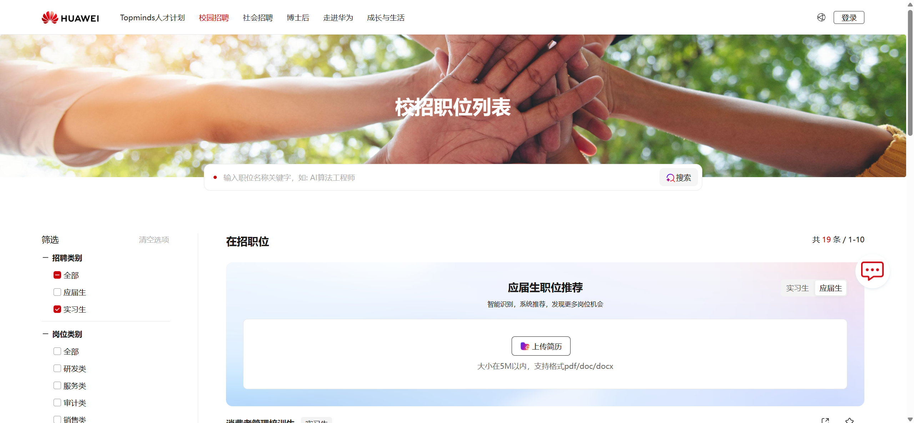
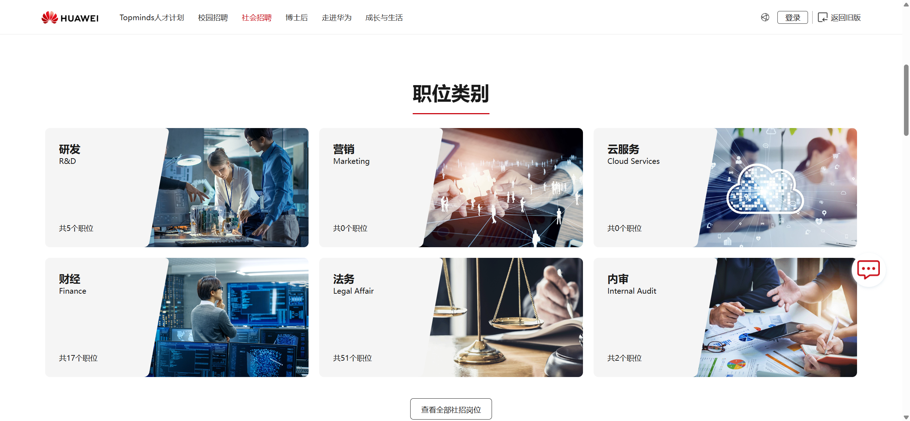

社会招聘的技术岗位基本为零...看得出来是很不缺人了,待遇真的好到大家都不愿意跳槽吗😃
### 小米

#### 公司概况
小米（Xiaomi）是一家成立于2010年、总部位于北京的全球顶尖科技巨头，由雷军及其合伙人创立。公司以智能手机、互联网物联网（IoT）平台及电动汽车为核心业务，凭借高性价比策略和独特的粉丝文化迅速崛起，2025年已稳居全球第三大智能手机厂商，并成为《财富》世界500强中最年轻的企业。通过自研的澎湃 OS（HyperOS）及庞大的生态链系统，小米构建了涵盖家电、穿戴设备及智能出行的全方位科技生态。

- 手机和汽车厂商,计算机的只招ML和硬件领域的,同样放在第二梯队
#### 公司历史

##### 2010—2013｜创立与智能手机起步

2010年，雷军（Lei Jun）、林斌（Lin Bin）等人在北京创立小米（Xiaomi），同年推出基于 Android 的 MIUI 操作系统。2011年发布第一代小米手机，采用互联网直销模式进入智能手机市场。2013年推出红米手机和小米电视，开始从智能手机向消费电子领域扩张。

##### 2014—2018｜全球化与智能硬件生态

2014年，小米进入印度等海外市场，并扩大智能手机和智能硬件业务。随后发展小米手环、小米空气净化器、智能电视及米家智能家居产品，逐步建立IoT生态。2017年扩大线下小米之家零售网络，2018年7月在香港联合交易所上市（1810.HK）。

##### 2019—2020｜品牌独立与高端化转型

2019年，Redmi正式升级为独立运营的产品品牌，小米开始推进高端智能手机战略。同年进入《财富》世界500强。2020年推出小米10系列，扩大高端手机市场，并继续发展POCO、Redmi、米家和国际化智能硬件业务。

##### 2021—2022｜新能源汽车与核心技术布局

2021年，小米宣布进入智能电动汽车行业，计划未来十年投入100亿美元，并成立汽车业务主体。同年完成对紫米（ZMI）和自动驾驶企业深动科技（DeepMotion）的收购。2022年与徕卡建立影像技术合作关系，进一步发展高端手机、芯片设计和智能汽车研发。

##### 2023—2024｜澎湃OS与小米汽车上市

2023年发布小米澎湃OS（Xiaomi HyperOS），提出“人车家全生态”战略，并于年底正式发布首款汽车SU7。2024年3月小米SU7上市交付，同年推出SU7 Ultra原型车，进一步发展汽车制造、智能驾驶和跨设备互联技术。

##### 2025—至今｜汽车扩张与AI技术发展

2025年推出SU7 Ultra、YU7等汽车产品，以及自研手机处理器玄戒O1，发布MiMo大模型。2026年推出小米18 Pro系列、澎湃OS 4测试版本及澎程（SkyNomad）增程式SUV系列，并升级MiMo大模型体系，持续扩大智能汽车、智能家电、半导体和人工智能业务。

#### 控股公司及子公司

- **集团主体**
  - **小米集团（Xiaomi Corporation）**：2010年成立，总部位于中国北京，注册地为开曼群岛，2018年在香港联合交易所上市（1810.HK）。
  - **管理层与业务结构**：雷军担任创始人、董事长兼CEO，林斌担任副董事长，卢伟冰担任集团总裁。
  - **主要业务**：手机×AIoT，以及智能电动汽车、AI及其他创新业务两个报告分部。

- **智能手机与消费电子**
  - **小米通讯技术有限公司**：智能手机、智能硬件销售及客户服务。
  - **北京小米移动软件有限公司**：操作系统、软件及硬件研发。
  - **北京小米电子产品有限公司**：智能硬件业务。
  - **Xiaomi、REDMI、POCO**：集团智能手机及消费电子品牌，均非独立上市子公司。

- **智能家居与新零售**
  - **米家（MIJIA）**：小米旗下智能家居品牌。
  - **小米之家商业有限公司**：线下零售与品牌门店运营。
  - **紫米（ZMI）**：2021年完成全资收购，主要涉及移动电源、充电设备和消费电子配件。
  - **小米有品**：集团生活消费品及电商平台。

- **智能汽车与自动驾驶**
  - **小米汽车有限公司**：智能电动汽车研发、制造及相关业务。
  - **小米汽车科技有限公司**：智能汽车技术与研发业务，纳入集团协议控制体系。
  - **小米景明科技有限公司**：智能汽车相关经营实体。
  - **DeepMotion（深动科技）**：2021年收购的自动驾驶技术企业。

- **互联网服务与投资**
  - **小米互联网业务**：应用分发、广告、游戏、数字内容和互联网增值服务。
  - **天津金星创业投资有限公司**：集团投资业务相关实体。
  - **湖北小米长江产业基金**：半导体、智能制造等科技产业投资平台。
  - **小米财务相关实体**：集团投资控股及相关财务管理业务。

- **重要法律实体**
  - **中国大陆实体**：小米通讯技术有限公司、北京小米移动软件有限公司、小米之家商业有限公司、小米汽车科技有限公司等。
  - **国际实体**：Xiaomi H.K. Limited、Xiaomi Technology India、Xiaomi Technologies Singapore、Xiaomi Technology Netherlands等。
  - **经营架构**：集团通过直接控股、间接控股及协议控制实体（VIE）开展业务。

- **生态链投资与战略合作**
  - **石头科技（Roborock）**：智能清洁设备企业，小米生态链历史投资对象，独立上市经营。
  - **华米科技（Zepp Health）**：智能穿戴设备企业，独立上市经营。
  - **九号公司（Segway-Ninebot）**：智能短交通和机器人企业，独立上市经营。
  - **云米科技、智米科技、Yeelight**：智能家居领域的生态链合作企业。
  - **徕卡（Leica）**：手机影像技术战略合作伙伴。
  - **金山软件、金山办公、金山云**：与雷军存在重要股权或管理关系，但不属于小米集团控股子公司。

注：小米生态链企业不等同于小米控股子公司；REDMI、POCO、米家属于集团品牌，不能按独立公司理解。

#### 主要产品

- **智能手机**
  - **小米数字系列**：Xiaomi 15、17、18 Pro系列。
  - **高端与折叠屏**：Xiaomi Ultra、MIX Fold、MIX Flip系列。
  - **REDMI**：K系列、Note系列、Turbo系列、数字系列。
  - **POCO**：F系列、X系列、M系列。

- **电脑与平板**
  - **笔记本电脑**：Xiaomi Book、Redmi Book系列。
  - **平板电脑**：Xiaomi Pad、Redmi Pad系列。
  - **显示设备**：小米显示器、REDMI显示器、游戏显示器。

- **智能汽车**
  - **纯电轿车**：小米SU7、SU7 Ultra。
  - **纯电SUV**：小米YU7。
  - **增程式SUV**：小米澎程（SkyNomad）N70、N90系列。
  - **汽车技术**：小米超级电机、超级电池、Xiaomi HAD辅助驾驶系统。

- **智能家居与IoT**
  - **电视与影音**：小米电视、REDMI电视、小米音箱。
  - **智能家电**：米家空调、冰箱、洗衣机、扫地机器人、空气净化器。
  - **智能穿戴**：Xiaomi Watch、REDMI Watch、小米手环、REDMI Buds。
  - **家居设备**：小米路由器、米家摄像机、智能门锁、智能照明。

- **芯片与人工智能**
  - **自研处理器**：玄戒O1、玄戒T1。
  - **电源管理芯片**：澎湃P系列、G系列。
  - **AI大模型**：MiMo、MiMo-V2系列。
  - **AI助手**：超级小爱（Super XiaoAI）、MiMo AI。

- **操作系统与互联网服务**
  - **操作系统**：MIUI、Xiaomi HyperOS。
  - **智能家居平台**：米家App、Xiaomi Home。
  - **互联网服务**：小米应用商店、小米浏览器、小米云服务、小米音乐。
  - **社区与应用**：小米社区、小米主题商店、小米游戏中心。

- **零售与生态产品**
  - **零售平台**：小米商城、小米之家、小米有品。
  - **充电与配件**：小米移动电源、GaN充电器、无线充电器。
  - **生活消费品**：米家电饭煲、净水器、电动牙刷、智能厨房电器。

#### 招聘情况

### 得物
#### 公司概况
得物（Poizon）是一家成立于2015年、总部位于上海的全球领先潮流网购社区，由杨冰创立（原虎扑联合创始人）。公司最初作为潮流资讯社区起步，后通过首创“先鉴别，后发货”的购物流程，解决了球鞋及奢侈品行业的真伪痛点，确立了其在中国年轻人潮流消费市场的领导地位。业务涵盖球鞋、服装、美妆、数码以及二手交易等。
#### 公司历史

##### 2015—2016｜创立与潮流社区起步

2015年，杨冰依托虎扑体育的球鞋爱好者社区资源，在上海创立“毒”（得物前身），同年成立上海识装信息科技有限公司。平台最初提供球鞋资讯、商品鉴别和潮流社区服务，逐渐形成以球鞋文化、用户交流和专业鉴别为核心的业务模式。

##### 2017—2019｜潮流电商与鉴别服务发展

2017年上线电商交易功能，建立“先鉴别，后发货”的交易模式。2018年开始拓展潮服、箱包、手表、配饰、数码和潮玩等商品品类，并获得红杉资本、高榕资本、DST Global等机构投资。2019年发展商品3D展示技术，并推出闲置交易平台“95分”，逐步形成潮流电商与内容社区相结合的业务体系。

##### 2020—2021｜品牌升级与综合电商扩张

2020年1月，毒App正式更名为“得物”（Dewu），继续发展潮流商品交易、鉴别和社区服务。同年推出AR虚拟试穿，并与中国质量检验协会合作推动鞋类鉴别标准建设。2021年进一步扩大商品品类和品牌商家规模，并完成对“95分”运营公司的全资收购，进入二手潮流商品交易市场。

##### 2022—2024｜品质电商与鉴别技术升级

2022年，得物与中国检验认证集团相关机构深化合作，强化商品鉴别技术。2023年建成专业鉴别实验室，并取得CNAS、CMA相关资质。2024年继续发展AI辅助鉴别、商品研究、供应链履约和品牌商家服务，业务范围逐渐从球鞋潮品扩展至服饰、美妆、数码、家居等消费领域。

##### 2025—至今｜综合消费平台与国际化发展

2025年，得物进一步扩大品牌商家规模，发展服饰、美妆、数码3C及户外运动等品类，并以POIZON品牌拓展海外市场，包括俄罗斯等地区。2026年继续推进商品鉴别技术、AI应用、商家服务和品质消费社区建设，逐步从潮流球鞋交易平台发展为综合品质消费平台。

#### 控股公司及子公司

- **集团主体**
  - **上海得物信息集团有限公司（Shanghai Dewu Information Group）**：2015年成立，原名上海识装信息科技有限公司，总部位于中国上海，为非上市企业。
  - **创始人与管理层**：杨冰（Yang Bing）为创始人兼CEO。
  - **业务结构**：主要包括电商交易、商品鉴别、潮流社区、商家服务及国际业务。

- **电子商务与社区业务**
  - **得物App（Dewu）**：集团核心电商与生活方式社区平台。
  - **POIZON**：得物面向国际市场的潮流商品交易品牌。
  - **得物商家平台**：企业及个人商家入驻、商品管理和交易服务。
  - **得物社区**：潮流资讯、内容创作与用户互动业务。

- **二手交易与金融服务**
  - **上海置潮信息科技有限公司**：2021年由得物运营公司取得100%股权，经营二手潮流商品交易平台“95分”。
  - **上海佳物信息科技有限责任公司**：得物关联企业，提供佳物分期等金融服务。

- **商品鉴别与供应链**
  - **商品鉴别业务**：商品查验、真伪鉴别、质量检测与商品研究。
  - **供应链业务**：仓储管理、商品履约及物流配送。
  - **睹煜（上海）信息服务有限公司**：得物平台披露的第三方鉴别服务合作商，不应直接认定为控股子公司。

- **重要股东与投资机构**
  - **杨冰**：创始人及重要股东。
  - **虎扑体育**：得物早期孵化方及股东。
  - **红杉资本、高榕资本、DST Global等**：历史融资参与机构。

注：得物尚未公开上市，完整集团股权架构及合并子公司名单未全面披露。内部业务、关联企业与第三方合作商应予以区分。

#### 主要产品

- **电子商务与交易平台**
  - **国内电商**：得物App、得物商城。
  - **国际电商**：POIZON。
  - **二手交易**：95分App。

- **商品品类**
  - **时尚消费**：运动鞋、潮流服饰、箱包、手表、配饰。
  - **其他消费品**：美妆个护、数码3C、潮玩、户外运动、家居用品。

- **鉴别与商品技术**
  - **商品鉴别**：得物查验鉴别、AI辅助鉴别。
  - **商品展示**：3D商品展示、AR虚拟试穿。
  - **商品研究**：鉴别实验室、商品研究中心。

- **潮流社区与内容服务**
  - **社区平台**：得物社区、得物内容创作平台。
  - **创作者服务**：得物创作者中心、MCN管理平台。

- **商家与供应链服务**
  - **商家工具**：得物商家版、得物商家后台、得物开放平台。
  - **供应链服务**：得物配、萤石集成服务。

- **消费金融与相关服务**
  - **分期服务**：佳物分期。
  - **其他服务**：佳物借钱及合作金融机构服务。

#### 招聘情况

##### 面经1
```md
## 题目

> 题目来源：https://www.nowcoder.com/discuss/525371909735792640

**（1）八股：**

- 生产场景下什么时候用 ArrayList ，什么时候用 LinkedList
- 创建线程的方式
- 为什么 volatile 能保证多线程可见
- 在并发量特别高的情况下是使用 synchronized 还是 ReentrantLock
- 说一下 ConcurrentHashMap 中并发安全的实现
- 你说高并发下 ReentrantLock 性能比 synchronized 高，那为什么 ConcurrentHashMap 在 JDK 1.7 中要用 ReentrantLock，而 ConcurrentHashMap 在 JDK 1.8 要用 Synchronized
- 有哪些并发安全的实现方式（简单讲了下 JUC）

**（2）场景题：**

- 不用 ThreadLocal 你会想用什么方式存用户信息
- 有千万级数据，如何判断一个整数是否存在（布隆过滤器）
- 如何理解：布隆过滤器说某个元素存在，则大概率在。布隆过滤器说某个元素不在，则一定不在
- 千万级数据用布隆过滤器初始化的时候 redis 太慢了，有没有什么好方法（RDB 的 bgsave）
- 多线程间如何传值（volatile修饰共享变量、阻塞队列、ThreadLocal）
- 如何设计登陆黑名单

**（3）手撕：面试官说看我笔试AK了，就不出手撕了**
```
### 拼多多

#### 公司概况
拼多多（Pinduoduo）是拼多多控股（PDD Holdings）旗下的核心电商平台，由黄峥于2015年在上海创立。通过开创性的“拼购”社交电商模式和对下沉市场及农产品供应链的深耕，拼多多在阿里与京东的垄断中迅速崛起，并在2020年成为中国用户规模最大的电商平台。2023年公司更名为拼多多控股，并将法律总部迁至爱尔兰都柏林，同时推出全球化平台 **Temu**。截至2026年初，凭借“C2M”模式和全球化的半托管策略，PDD Holdings 已成为全球利润率最高的零售实体之一，2025年营收突破617亿美元，其现金储备甚至一度超越阿里巴巴。

#### 公司历史

##### 2015—2016｜创立与社交拼团电商

2015年，黄峥（Colin Huang）及创业团队在上海创立拼多多（Pinduoduo），同年9月正式推出拼多多平台，通过社交分享、多人拼单和低价商品进入电子商务市场。2016年与生鲜拼团平台“拼好货”合并，整合供应链与平台运营业务，逐渐形成以社交拼团和第三方商家交易为核心的商业模式。

##### 2017—2019｜用户增长与集团上市

2017年拼多多用户规模突破2亿，逐步扩大服饰、家电、日用品及农产品等商品品类。2018年7月在美国纳斯达克上市（PDD），同年推出多多果园等互动购物功能。2019年推出“百亿补贴”，进一步扩大品牌商品和消费电子业务，全年商品交易总额（GMV）突破1万亿元人民币。

##### 2020—2021｜社区团购与农业供应链

2020年，黄峥卸任CEO，由陈磊（Lei Chen）接任。同年推出多多买菜，进入社区团购及生鲜供应链市场，并发展多多钱包支付服务。2021年黄峥卸任董事长，陈磊接任；公司设立“百亿农研”专项，进一步投入农产品流通、农业科技及供应链建设。

##### 2022—2023｜Temu 与国际化扩张

2022年9月推出跨境电商平台 Temu，首先进入美国市场，随后拓展欧洲、亚洲及其他地区。2023年2月，上市主体由 Pinduoduo Inc. 更名为 PDD Holdings Inc.（拼多多控股），主要管理办公地点设于爱尔兰都柏林。同年赵佳臻（Jiazhen Zhao）出任联席CEO，集团形成拼多多与 Temu 两大核心电商平台。

##### 2024—至今｜全球电商与供应链升级

2024年，Temu 继续扩大海外市场，并发展本地商家入驻和本地履约业务。2025年集团推出“千亿扶持”等商家支持计划，加大供应链、商品质量及平台治理投入。同年12月，陈磊与赵佳臻共同担任联席董事长兼联席CEO。2026年继续发展国内电商、跨境零售及供应链业务，并推进平台治理和商家生态建设。

#### 控股公司及子公司

- **集团主体**
  - **PDD Holdings Inc.（拼多多控股）**：2015年成立，注册于开曼群岛，主要管理办公地点位于爱尔兰都柏林及中国上海，2018年在纳斯达克上市（PDD）。
  - **创始人与管理层**：黄峥为创始人，陈磊、赵佳臻担任联席董事长兼联席CEO。
  - **核心业务**：拼多多中国电商平台与 Temu 国际电商平台。

- **中国电子商务**
  - **拼多多（Pinduoduo）**：集团核心国内综合电商平台。
  - **多多买菜（Duo Duo Grocery）**：2020年推出的社区团购与生鲜零售业务。
  - **农产品电商**：集团农业供应链、农产品直销及相关商家服务业务。

- **国际电子商务**
  - **Temu**：2022年推出的国际综合零售电商平台。
  - **Whaleco Technology Limited**：注册于爱尔兰，集团国际电商业务的重要法律实体。
  - **Whaleco Inc.**：注册于美国特拉华州，集团国际电商业务的重要法律实体。

- **中国大陆主要法律实体**
  - **杭州微米网络科技有限公司**：集团在中国大陆的重要全资子公司。
  - **拼多多（上海）网络科技有限公司**：集团国内电商相关经营实体。
  - **上海禹璨信息技术有限公司**：集团国内业务相关经营实体。
  - **杭州埃米网络科技有限公司**：集团协议控制实体（VIE）。
  - **上海寻梦信息技术有限公司**：杭州埃米旗下公司，拼多多核心运营实体之一。

- **国际控股与投资实体**
  - **HongKong Walnut Street Limited**：注册于中国香港，集团重要控股公司。
  - **Radiance Sea Group Limited**：注册于开曼群岛，集团境外控股实体。
  - **Radiance Sea Investment Limited**：注册于英属维尔京群岛，集团投资控股实体。
  - **Elementary Innovation Pte. Ltd.**：注册于新加坡，集团境外业务实体。

- **历史业务与关联关系**
  - **拼好货（Pinhaohuo）**：2015年推出的生鲜拼团平台，2016年与拼多多合并。
  - **付费通（Shanghai Fu Fei Tong）**：多多钱包的支付服务提供方，与拼多多管理层存在股权关联，但不属于PDD Holdings合并报表中的主要子公司。
  - **腾讯**：拼多多的重要历史投资者及支付、技术合作伙伴，不属于集团旗下企业。

注：集团通过直接控股、间接控股与协议控制实体（VIE）开展业务。拼多多、Temu、多多买菜等属于业务平台或品牌，并非全部为独立法律子公司。

#### 主要产品

- **中国电子商务**
  - **综合电商**：拼多多、拼多多App。
  - **优惠与互动购物**：百亿补贴、多人拼单、多多果园。
  - **社区团购**：多多买菜。

- **国际电子商务**
  - **海外零售**：Temu、Temu App。
  - **国际商家服务**：Temu Seller Center。

- **商家与营销服务**
  - **国内商家工具**：拼多多商家版、拼多多商家后台。
  - **广告与推广**：多多进宝、平台营销推广工具。
  - **国际商家工具**：Temu 商家中心。

- **支付与供应链服务**
  - **支付服务**：多多钱包。
  - **农业与供应链**：农地云拼、多多买菜供应链。
  - **国际履约**：Temu 跨境及本地履约服务。


## 总结

### 巨头分析
一步领先,步步领先,上述企业中的巨头很早就在市场的对应领域上建立了统治地位,并且屹立十年/二十年/三十年不倒,可想而知,不发生什么特别离谱的事情的话,这些巨头将会持续存在下去,并将业务越做越大,不断蚕食和合并初创公司和小型企业,就像韩国的三星那样垄断了多个特定区域/领域的市场.

而这些巨头也有自己的本钱:
1. 高投入的科研机构
2. 顶尖人才的聚集
3. 庞大的产业帝国
4. 不必打广告就人尽皆知的名气

一家初创公司如果不是瞄准某个特别刁钻的痛点,如果没有大量资金的投入,如果没有完美的运营方式,是不太可能与这些巨头抗衡的,只能在角落瑟瑟发抖.
### 内地公司分析
内地的互联网公司起步普遍比外企晚了二十年以上,比得过外企反而是不正常的.

组织架构上也都比较稚嫩,历史底蕴也不深,很多公司的领导人至今都没变过,技术积累也不多,产业链也不够庞大,不少还保留着暴发户的气质,有点强盗/小偷风范.

由于政府的支持和内地的特殊环境,内地企业能够轻松抵御巨头的外来影响,统治本土市场,但想要向外推广通常都是举步维艰的.

