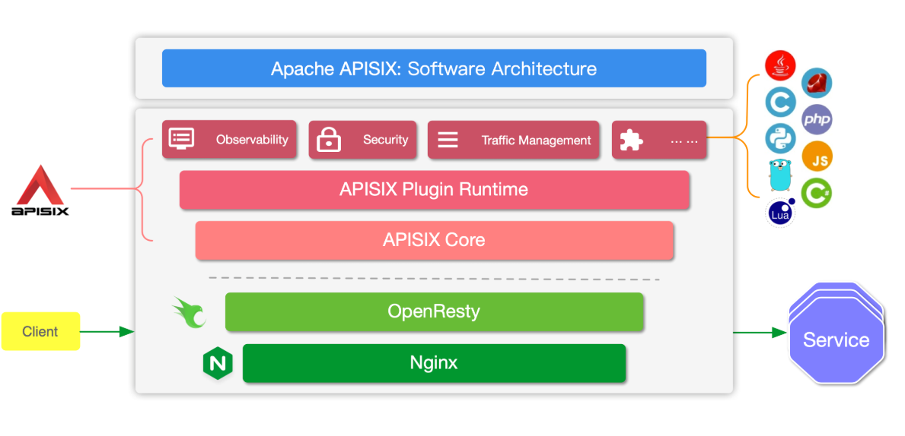

最近十年的新潮技术层出不穷,但总不能看到一个就发一次文章,所以就单独列一个笔记来记录了.主要收集是那些日常开发都不太可能听过的工具和平台
## Agent相关
### Inspect AI
#### 介绍
一个用于评测大语言模型和 AI Agent 的开源框架，由英国 AI Security Institute（AISI） 和 Meridian Labs 开发

测评代码:
```bash
pip install openai
export OPENAI_API_KEY=your-openai-api-key
inspect eval simpleqa.py --model openai/gpt-4o
```
测评Deepseek:
```bash
pip install inspect-ai openai

export DEEPSEEK_API_KEY=你的key

inspect eval arc.py --model deepseek/deepseek-flash
```

当然,最值得推敲的地方就是测评自己写的Agent了,而且可测评的指标很多,是一个相当不错的Agent测试框架.

### DeepEval

## 架构相关
### Temporal
#### 背景
大约 2000 年代中期，Amazon 正在从大型单体系统逐渐走向大量分布式服务。

Maxim Fateev 当时负责 Amazon 的消息基础设施，其中部分工作后来成为 Amazon SQS 的基础；之后他又参与和领导了 Amazon Simple Workflow Service（SWF） 的开发


有一个问题就是,微服务设计下无法简单的保存前几个服务执行状态,例如支付已经完成了，绝对不能再扣一次钱.

所以**业务流程的执行状态必须被可靠地保存下来**,这也就是Durable Execution（持久化执行）,目标是解决这个问题: `怎么让“代码的业务处理”获得数据库一样的持久性？`

Cadence 可以认为是 Temporal 最直接的前身。Maxim Fateev 和 Samar Abbas两人在 2015 年左右共同创建 Cadence；Cadence 在 Uber 内部三年内发展到超过 100 个使用场景，并于 2017 年开源.

2019 年，Maxim Fateev 和 Samar Abbas 离开 Uber，成立了 Temporal。Temporal 最初直接 fork 自 Cadence，之后逐渐独立发展


### AsyncAPI
#### 背景
尽管普通的微服务可以用OpenAPI解决,但对于消息队列等异步系统来说,一直都没有一个可靠的框架,而AsyncAPI就是基于此问题提出的,它不绑定某一种消息队列.于21年的时候称为了Linux Foundation项目,并开始逐渐成熟

一个示例如下:
```yml
asyncapi: 3.0.0

info:
  title: Order Event API
  version: 1.0.0

servers:
  production:
    host: kafka.example.com:9092
    protocol: kafka

channels:
  orderCreated:
    address: order.created

    messages:
      OrderCreated:
        payload:
          type: object

          properties:
            orderId:
              type: string

            userId:
              type: string

            amount:
              type: number

          required:
            - orderId
            - userId
            - amount

operations:
  publishOrderCreated:
    action: send
    channel:
      $ref: "#/channels/orderCreated"
```

### Apache APISIX
Apache APISIX 是 Apache 软件基金会下的顶级项目，由 API7.ai 开发并捐赠。它是一个具有动态、实时、高性能等特点的云原生 API 网关.它构建于 NGINX + ngx_lua 的技术基础之上，充分利用了 LuaJIT 所提供的强大性能


### Apache Iceberg
Apache Iceberg 是一种面向大规模分析数据的开放表格式（Open Table Format），最初由 Netflix 于 2017 年左右开发，2018 年捐赠给 Apache 软件基金会，2020 年成为 Apache 顶级项目

它主要解决的问题是：当海量数据存储在 HDFS、Amazon S3 等分布式存储系统中时，如何像操作数据库表一样，可靠、高效地管理这些数据？


## 构建和测试

### Testcontainers
Testcontainers 是一个基于 Docker 的开源集成测试工具，诞生于 2015 年，最初面向 Java 生态，随后扩展到 Python、Go、Node.js、.NET 等语言。

它的核心思想是：在自动化测试中，通过代码临时启动真正的数据库、消息队列等外部服务，完成测试后自动销毁。

如此一来,我们就不需要单独执行prestart脚本来启动测试容器了,而是直接运行pytest测试即可,怎么说呢,偶尔可以用用,毕竟真执行测试还是要启动真实数据库的:
```py
# conftest.py

import pytest
from testcontainers.postgres import PostgresContainer

@pytest.fixture(scope="session")
def postgres():
    with PostgresContainer("postgres:16") as container:
        yield container
```

