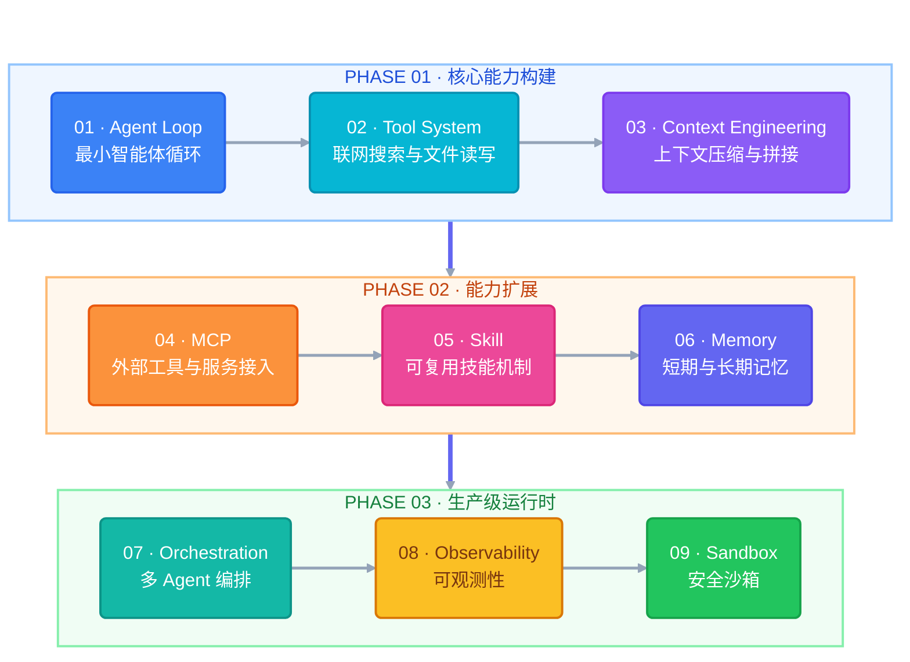
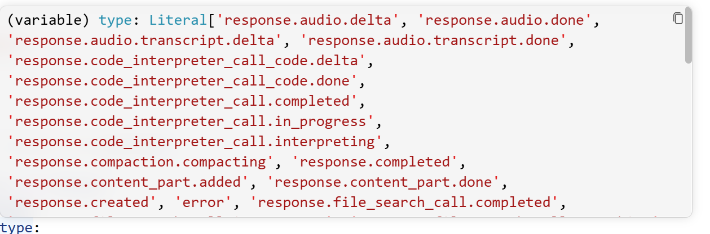
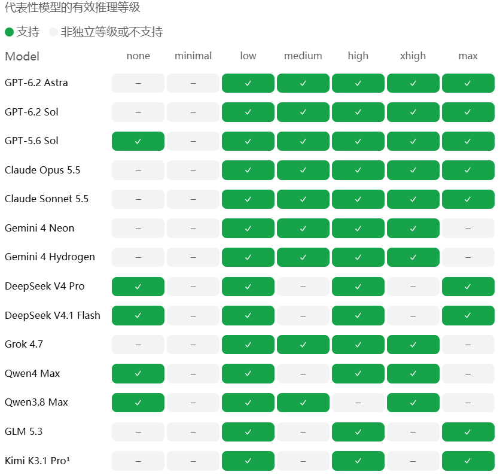

## ch0: Harness学习

### 必备知识
- [Harness Engineering](https://arxiv.org/html/2609.00006)
- [深入理解AI Agent](https://github.com/bojieli/ai-agent-book)

只要看完上面这两部资料,我敢说你就已经站在了Harness研发的最前沿了(至于能不能动手做那就是另一回事了).

除了在线文章外,Manning的`Build an AI Agent`也是重点推荐的,唯一的缺点在于篇幅过短,压缩过狠,所以读起来会不太连贯.

### 汇总
当我们在说Harness时,我们实际上指的是:
1. 文件处理与编辑
   1. pdf和图片的视觉识别
   2. csv表格,编程文本的结构化处理
   3. pptx,docx的编辑与美化
   4. grep和glob搜寻特定文件和段落
2. 上下文工程
   1. 提供上下文压缩和上下文隔离(如工具调用结果的过滤)
   2. 上下文的编排与结构化处理(如动态注入提示词)
3. Skill和Memory
   1. 加载外部和自定义Skill,注入到用户提示词中
   2. 支持局部记忆点(如任务目标完成情况)和长期记忆(如用户习惯)
4. Agent Loop和多Agent编排
   1. 使用ReAct等模型来编排单Agent
   2. 使用拓扑模型来编排多Agent
5. MCP和A2A
   1. 接入外部MCP工具,支持与其他Agent联动
   2. 统一不同厂商的API接口
6. 安全与沙箱
   1. 使用多层安全机制拦截Agent的危险操作
   2. 使用沙箱来隔离文件操作
7. 可观测性
   1. 通过图形和终端能够查看Agent的实时运行轨迹

不过嘛,所有常见的Harness既不用LangChain等Agent框架,也不用RAG实现检索.

理由也比较简单,本地RAG过于笨重,若是用轻量小模型效果又不够好;Agent框架的话,只要你实际开发过,你就会发现,每个框架里,总有那么几个地方是你觉得不太顺手,想要自己重写的.
### 我们的目标
采用不断重构不断重写的实践方法,大致的轨迹如下:



在其中,可能穿插Event Sourcing,并发锁控制和分层架构等比较艰深的技术,也会适当引入外部python库.

## ch1: 最小Agent Loop
### 预先准备
首先,我们整理一个最小的uv导入脚本,确保覆盖到我们Agent的基本需求:

| 开发阶段               | Python 库                   | 用途                              |
| :--------------------- | :-------------------------- | :-------------------------------- |
| **01 · Agent Loop**    | openai                      | OpenAI 及兼容 API                 |
|                        | anthropic                   | Claude API                        |
|                        | google-genai                | Gemini API                        |
|                        | pydantic                    | 消息、工具参数与状态建模          |
|                        | pydantic-settings           | 环境变量与配置管理                |
|                        | tenacity                    | 重试与退避                        |
| **02 · Tool System**   | httpx                       | 异步 HTTP 请求                    |
|                        | tavily-python               | 联网搜索                          |
|                        | trafilatura                 | 网页正文提取                      |
|                        | beautifulsoup4              | HTML 解析                         |
|                        | pymupdf                     | PDF 解析与页面渲染                |
|                        | pillow                      | 图片处理                          |
|                        | python-docx                 | Word 文件读写                     |
|                        | python-pptx                 | PowerPoint 文件读写               |
|                        | openpyxl                    | Excel 文件读写                    |
|                        | pandas                      | CSV 与结构化数据处理              |
| **03 · Context**       | tiktoken                    | OpenAI 模型 Token 计数            |
| **04 · MCP**           | mcp                         | 官方 MCP Python SDK               |
| **05 · Skill**         | pyyaml                      | 解析 SKILL.md 的 YAML Frontmatter |
| **06 · Memory**        | aiosqlite                   | 异步 SQLite 持久化                |
| **07 · 多 Agent**      | 无额外依赖                  | 使用原生 asyncio                  |
| **08 · Observability** | structlog                   | 结构化日志                        |
|                        | opentelemetry-api           | 可观测性接口                      |
|                        | opentelemetry-sdk           | Trace、Span、Metrics              |
|                        | opentelemetry-exporter-otlp | 遥测数据导出                      |
| **09 · Sandbox**       | docker                      | 管理 Docker 隔离执行环境          |
| **交互界面**           | typer                       | CLI 命令系统                      |
|                        | rich                        | 终端美化与实时渲染                |
|                        | prompt-toolkit              | 交互输入、补全与历史记录          |

自然,我们先少导入一点,免得过于离谱了:
```bash
uv add openai pydantic pydantic-settings httpx tiktoken trafilatura  pymupdf pillow python-docx python-pptx openpyxl pandas mcp
```
dev部分也适当导入一点:
```bash
uv add --dev pytest pytest-cov ruff mypy
```
接着,明确我们是使用Responses API,基本来说,对于不同模型,我们只要修改base_url,api_key和model名字即可.
### 调用llm
最基础的版本如下:
```py
from openai import OpenAI
from openai.types import ReasoningEffort
from openai.types.responses import ResponseInputParam


def build_model(
    *,
    api_key: str,
    url: str,
    model_name: str,
    instructions: str,
    input: ResponseInputParam,
    effort: ReasoningEffort = "none",
):
    client = OpenAI(api_key=api_key, base_url=url)
    
    return client.responses.create(
        model=model_name,
        instructions=instructions,
        input=input,
        stream=True,
        reasoning={"effort": effort},
    )
```
问题还是很明显的,我们每次调用时都要显式声明这些参数,但问题是大多数时候只传入input就够了,一个简单的解决方案就是通过`__call__`方法来实现类的魔法调用:

如此一来,我们调用时就只要这么写:
```py
model = Model(
    api_key="...",
    url="...",
    model_name="...",
    instructions="You are a helpful assistant.",
)

stream = model("Hello")
```


>如果上述代码中你的类型注释报错,别担心,你不是一个人,尽管我们自己知道`self.effort`是`ReasoningEffort`类型,奈何解析器有一点点小bug,非要我们显式注明后才能正常运作:
```py
class Model:
    def __init__(
        self,
        *,
        api_key: str,
        url: str,
        model_name: str,
        instructions: str,
        effort: ReasoningEffort = "none",
    ):
        self.client = OpenAI(
            api_key=api_key,
            base_url=url,
        )
        self.model_name = model_name
        self.instructions = instructions
        self.effort: ReasoningEffort = effort

    def __call__(
        self,
        input: ResponseInputParam,
    ) -> Stream[ResponseStreamEvent]:

        return self.client.responses.create(
            model=self.model_name,
            instructions=self.instructions,
            input=input,
            stream=True,
            reasoning={"effort": self.effort},
        )
```
- 只能说不太理解

之后嘛,就是实际编写循环了.

### 编写循环
如果我们看一下stream中event支持的type,会发现多到吓死人:


好在,我们现在没有任何额外机制和异常处理,所以大致匹配流式输出,完成输出两种情况即可:
```py
def mini_loop() -> None:
    model = Model(
        api_key="...",
        url="...",
        model_name="...",
        instructions="You are a helpful assistant.",
    )

    while True:
        user_input = input("User: ")

        if user_input == "q":
            break

        print("Assistant: ", end="", flush=True)

        with model(user_input) as stream:
            for event in stream:
                match event.type:
                    case "response.output_text.delta":
                        print(event.delta, end="", flush=True)

                    case "response.completed":
                        print()
                        break


    model.client.close()
```

现在,只要填入api_key,url,model_name后,这个循环就可以正确运行和退出了.
## ch2: 读取LLM环境变量和简易对话历史
### settings
自然,还是自动读取显得更帅气一点,因此我们编写一个`config.py`:
```py
from openai.types import ReasoningEffort

from pydantic_settings import BaseSettings, SettingsConfigDict


class Settings(BaseSettings):
    model_config = SettingsConfigDict(
        env_file=".env",
        env_file_encoding="utf-8",
        extra="ignore",
    )

    llm_api_key: str
    llm_base_url: str
    llm_model: str
    effort: ReasoningEffort = "none"


settings = Settings()  # type: ignore
```
>为了开发方便起见,目前都是硬编码的,可能到最终有了前端以后,会将model改为前端注入的形式.
### thinking启用
目前,Responses API支持以下七种取值:
```py
ReasoningEffort = Literal[
    "none",
    "minimal",
    "low",
    "medium",
    "high",
    "xhigh",
    "max",
]
```
即便是OpenAI官方,GPT6以上的模型也都不支持最低档的`none`和`minimal`,而是支持后面五档(Codex中额外有一个Ultra,只能说是提速,但thinking能力还是max档位).

而DeepSeek只支持四种档位:`none`,`low`,`high`和`max`.

claude原生的Messages API对应的thinking字段和openai一样,也是后五种档位.

为了不出错起见,开`low`和`high`是一定没有问题的,所以也暂定我们的thinking只支持这两种档位,免得开发起来调试麻烦.



开了thinking之后,thinking字段是在API里独立输出的,所以我们需要独立提取,不能与output_text混在一起:


