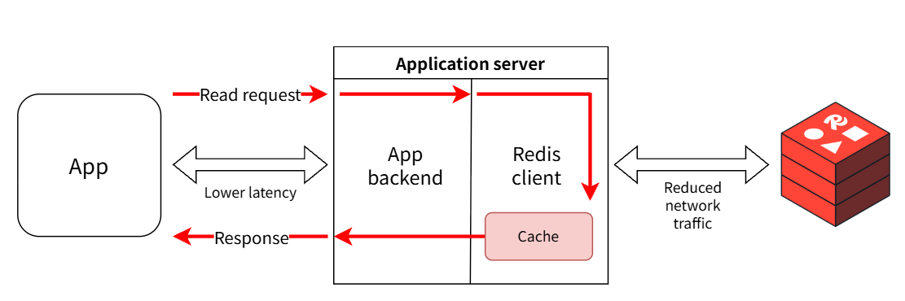

>[!NOTE]
>
>目标: 结合WebSocket的FastAPI+Postgres+SQLModel+Redis+Kafka+Kubernetes+Prometheus+Grafana+pytest,做一个即时通讯(Instant Messaging)软件出来,前端采用普通的Zustand+React+TanStack Query(根据情况考虑是否用AI写前端).

## ch0: 前言
1. 为什么做这个项目?
   1. 锻炼学习自己,有很多我不熟悉的领域,最多看过相关的书籍,但没有深入实践过
2. 你跟其他IM软件的区别?
   1. 比较独特,至少Github上没找到技术栈选型完全一样的项目(即使是一些AI项目也只是部分重合)
## ch1: redis-py学习
### 初印象
docker启动redis:
```bash
docker run -d --name redis -p 6379:6379 redis:8-alpine
```

使用redis-cli与刚刚启动的redis交互:
```bash
docker exec -it redis redis-cli
```
若出现`127.0.0.1:6379>`交互提示则说明Redis运行正常

使用uv启用python示例项目:
```python
import redis

r = redis.Redis(host="localhost", port=6379, decode_responses=True)

r.set("bike:1", "Process 134")
print(r.get("bike:1"))
```

运行后成功打印值`Process 134`.


- 连接到Redis的另一个方式则是使用DSN的url格式:
```python
r = redis.from_url("redis://default:<password>@<host>:<port>")
```

存取字符串:
```python
r.set('foo', 'bar')
# True
r.get('foo')
# bar
```

存储dict:
```py
r.hset(
    "user:123",
    mapping={
        "name": "john",
        "age": 29,
        "company": "Redis",
    },
)

print(r.hget("user:123", "name"))
print(r.hgetall("user:123"))
```

关闭连接:
```py
r.close()
```
### 基础知识
#### 连接方式
redis.Redis初始化方法默认使用`localhost:6379`,且使用数据库0,所以我们只需要配置`decode_responses=True`即可,写成`r=redis.Redis(decode_responses=True)`即可,如果不配置的话,则会默认返回字节格式(bytes),可读性是一方面,数据处理上影响就大了.
#### 异步配置
Redis支持Async配置:
```py
import redis.asyncio as redis
import asyncio


async def basic_example():
    r = redis.Redis(host="localhost", port=6379, decode_responses=True)
    await r.set("foo", "bar")
    value = await r.get("foo")
    print(value)
    # bar
    await r.aclose()


asyncio.run(basic_example())
```
更推荐的写法是使用`async with`来自动关闭连接:
```py
async def context_example():
    async with redis.Redis(
        host='localhost', port=6379, decode_responses=True
    ) as r:
        await r.set('foo', 'bar')
        value = await r.get('foo')
        print(value)
        # bar

asyncio.run(context_example())
```
都开异步了,自然需要支持连接池,否则开了个寂寞:
```py
async def shared_client_example():
    # Create one client at startup. It owns its own internal pool,
    # which is sized by max_connections.
    r = redis.Redis(
        host='localhost', port=6379, decode_responses=True,
        max_connections=10,
    )
    try:
        # Share `r` across every request and task for the app's lifetime.
        await r.set('foo', 'bar')
        value = await r.get('foo')
        print(value)
        # bar
    finally:
        # Close the client at shutdown to release pooled connections.
        await r.aclose()

asyncio.run(shared_client_example())
```

Redis的事务管理长这样:
```py
async def pipeline_example():
    async with redis.Redis(
        host='localhost', port=6379, decode_responses=True
    ) as r:
        async with r.pipeline(transaction=True) as pipe:
            pipe.set('a', '1')
            pipe.set('b', '2')
            pipe.get('a')
            pipe.get('b')
            results = await pipe.execute()
            print(results)
            # [True, True, '1', '2']

asyncio.run(pipeline_example())
```

### 进阶知识

#### Client-side caching
这里的客户端指的是连接数据库的后端,无论是字符串的值,还是hash表的值,都可以在第一次存取后缓存在客户端中,从而极大地降低延迟


配置方法如下:
```py
import redis
from redis.cache import CacheConfig

r = redis.Redis(
    protocol=3,
    cache_config=CacheConfig(),
    decode_responses=True
)

r.set("city", "New York")
cityNameAttempt1 = r.get("city")    # Retrieved from Redis server and cached
cityNameAttempt2 = r.get("city")    # Retrieved from cache
```


## ch2: 小型项目学习
>当我们想要从零开始搭建一个新领域项目时,往往是无从下手的,原因很简单,你见都没见过相关代码,怎么可能突然就会写了呢,所以,我们需要先找一下相关的领域项目,学习前人的设计经验.

- [仓库](https://github.com/notarious2/fastapi-chat)

技术栈选型:
* FastAPI, Websockets, Pydantic 2
* Postgres (asyncpg), async Redis (PubSub and Cache)
* SQLAlchemy 2

技术选型是非常对我胃口的,现在来具体分析一下.

一般来说,看一个python后端项目,我倾向于先看`main.py`,再看models,再看api,再看crud,最后看测试和配置,让我们按照这个流程来走一遍.
### main.py
```py
import logging

import redis.asyncio as aioredis
import sentry_sdk
from fastapi import FastAPI
from fastapi.middleware.cors import CORSMiddleware
from fastapi.staticfiles import StaticFiles
from fastapi_limiter import FastAPILimiter
from fastapi_pagination import add_pagination
from sqladmin import Admin

from src.admin.admin import admin_models
from src.admin.authentication_backend import authentication_backend
from src.config import LOGGING_CONFIG, settings
from src.database import engine, redis_pool
from src.routers import routers


logger = logging.getLogger(__name__)


app = FastAPI()
app.mount("/static", StaticFiles(directory="src/static"), name="static")

admin = Admin(app, engine, authentication_backend=authentication_backend)

for router in routers:
    app.include_router(router)


allowed_origins = settings.ALLOWED_ORIGINS.split(",")


app.add_middleware(
    CORSMiddleware,
    allow_origins=allowed_origins,
    allow_credentials=True,
    allow_methods=["*"],
    allow_headers=["*"],
)

add_pagination(app)


@app.on_event("startup")
async def startup():
    logger.info("Application is started")
    redis = aioredis.Redis(connection_pool=redis_pool)
    await FastAPILimiter.init(redis)


# Error displayed on shutdown (will be fixed in later versions): https://github.com/python/cpython/issues/109538
@app.on_event("shutdown")
async def shutdown_event():
    logger.info("Application is closed")


# register admin models
for model in admin_models:
    admin.add_view(model)
```
看到了好几个没见过的库和fastapi方法:
1. `app.mount("/static")`: 挂载静态文件,从`static`路由访问,如`src/static/logo.png`对应`http://localhost:8000/static/logo.png`
   1. 不过只要有前端的话,这个方法就没必要用了
2. `from sqladmin import Admin`: 在FastAPI项目中快速创建一个Web管理后台,支持CRUD,直接通过ORM和session创建,绕过Service层
   1. 顶多用到小项目中,这完全是代码架构的破坏利器
3. `from fastapi_limiter import FastAPILimiter`: fastapi限流器,毕竟官方不支持限流,所以只好用第三方库了
   1. 不过现在这库的api改了,所以原代码中的写法也需要改
4. `@app.on_event("startup")`: `on_event`方法已经启用,现在统一用lifespan了.lifespan是fastapi应用的生命周期管理器,负责应用启动和关闭时需要执行的操作,基本用法如下:

```py
from contextlib import asynccontextmanager
from fastapi import FastAPI


@asynccontextmanager
async def lifespan(app: FastAPI):
    # 应用启动时执行
    print("Application starting...")

    yield

    # 应用关闭时执行
    print("Application shutting down...")


app = FastAPI(lifespan=lifespan)
```

这非常适合于需要显式关闭数据库连接的情况:
```py
@asynccontextmanager
async def lifespan(app: FastAPI):
    # Startup
    redis = Redis.from_url(REDIS_URL)
    app.state.redis = redis

    try:
        await redis.ping()
        yield
    finally:
        # Shutdown
        await redis.aclose()
        await engine.dispose()
```

### models.py

```py
import enum
import uuid
from datetime import datetime
from typing import Any, List

from sqlalchemy import Boolean, Column, DateTime, Enum, ForeignKey, Index, String, Table
from sqlalchemy.dialects.postgresql import JSONB, UUID
from sqlalchemy.orm import Mapped, mapped_column, relationship

from src.database import BaseModel, RemoveBaseFieldsMixin, metadata


class ChatType(enum.Enum):
    DIRECT = "direct"
    GROUP = "group"


chat_participant = Table(
    "chat_participant",
    metadata,
    Column("user_id", ForeignKey("user.id"), primary_key=True),
    Column("chat_id", ForeignKey("chat.id"), primary_key=True),
)


class User(BaseModel):
    __tablename__ = "user"

    id: Mapped[int] = mapped_column(primary_key=True, autoincrement=True)
    guid: Mapped[uuid.UUID] = mapped_column(UUID(as_uuid=True), unique=True, default=uuid.uuid4)
    password: Mapped[str] = mapped_column(String(128))
    username: Mapped[str] = mapped_column(String(150), unique=True)
    first_name: Mapped[str] = mapped_column(String(150), default="")
    last_name: Mapped[str] = mapped_column(String(150), default="")
    email: Mapped[str] = mapped_column(String(254), unique=True)
    last_login: Mapped[datetime] = mapped_column(DateTime(timezone=True), nullable=True)
    is_superuser: Mapped[bool] = mapped_column(Boolean, default=False)
    user_image: Mapped[str] = mapped_column(String(1048), nullable=True)
    settings: Mapped[dict[str, Any]] = mapped_column(JSONB, server_default="{}")
    is_deleted: Mapped[bool] = mapped_column(Boolean, default=False)  # redefine is_deleted column for index

    chats: Mapped[List["Chat"]] = relationship(secondary=chat_participant, back_populates="users")
    messages: Mapped[List["Message"]] = relationship(back_populates="user")
    read_statuses: Mapped[List["ReadStatus"]] = relationship(back_populates="user")

    def __str__(self):
        return f"{self.username}"

    # Indexes

    __table_args__ = (
        Index("idx_user_on_email_username", "email", "username", postgresql_concurrently=True),
        Index(
            "idx_user_partial_on_email_not_deleted",
            "email",
            "is_deleted",
            postgresql_concurrently=True,
            postgresql_where=(is_deleted.is_(False)),
        ),
    )


class Chat(BaseModel):
    __tablename__ = "chat"

    id: Mapped[int] = mapped_column(primary_key=True, autoincrement=True)
    guid: Mapped[uuid.UUID] = mapped_column(UUID(as_uuid=True), default=uuid.uuid4)
    chat_type: Mapped[str] = mapped_column(Enum(ChatType, inherit_schema=True))

    users: Mapped[List["User"]] = relationship(secondary=chat_participant, back_populates="chats")
    messages: Mapped[List["Message"]] = relationship(back_populates="chat", cascade="all,delete")
    read_statuses: Mapped[List["ReadStatus"]] = relationship(back_populates="chat", cascade="all,delete")

    def __str__(self):
        return f"{self.chat_type.value.title()} {self.guid}"

    __table_args__ = (
        Index("idx_chat_on_is_deleted_chat_type", "is_deleted", "chat_type", postgresql_concurrently=True),
        Index("idx_chat_on_guid", "guid", postgresql_concurrently=True),
    )


class MessageType(enum.Enum):
    TEXT = "text"
    FILE = "file"


class Message(BaseModel):
    __tablename__ = "message"

    id: Mapped[int] = mapped_column(primary_key=True, autoincrement=True)
    guid: Mapped[uuid.UUID] = mapped_column(UUID(as_uuid=True), default=uuid.uuid4)
    message_type: Mapped[str] = mapped_column(Enum(MessageType, inherit_schema=True), default=MessageType.TEXT)
    content: Mapped[str] = mapped_column(String(5000))
    user_id: Mapped[int] = mapped_column(ForeignKey("user.id"))
    chat_id: Mapped[int] = mapped_column(ForeignKey("chat.id"))

    file_name: Mapped[str] = mapped_column(String(50), nullable=True)
    file_path: Mapped[str] = mapped_column(String(1000), nullable=True)

    chat: Mapped["Chat"] = relationship(back_populates="messages")
    user: Mapped["User"] = relationship(back_populates="messages")

    def __str__(self):
        return f"{self.content}"

    __table_args__ = (
        Index("idx_message_on_chat_id", "chat_id", postgresql_concurrently=True),
        Index("idx_message_on_user_id", "user_id", postgresql_concurrently=True),
        Index("idx_message_on_user_id_chat_id", "chat_id", "user_id", postgresql_concurrently=True),
    )


class ReadStatus(RemoveBaseFieldsMixin, BaseModel):
    __tablename__ = "read_status"

    id: Mapped[int] = mapped_column(primary_key=True, autoincrement=True)
    last_read_message_id: Mapped[int] = mapped_column(nullable=True)
    user_id: Mapped[int] = mapped_column(ForeignKey("user.id"))
    chat_id: Mapped[int] = mapped_column(ForeignKey("chat.id"))

    # to display unread messages for a user in different chats
    chat: Mapped["Chat"] = relationship(back_populates="read_statuses")
    user: Mapped["User"] = relationship(back_populates="read_statuses")

    def __str__(self):
        return f"User: {self.user_id}, Message: {self.last_read_message_id}"

    __table_args__ = (
        Index("idx_read_status_on_chat_id", "chat_id", postgresql_concurrently=True),
        Index("idx_read_status_on_user_id", "user_id", postgresql_concurrently=True),
    )
```
>用sqlalchemy写的,我看着不太习惯,但由于老项目都是用的它,所以还是勉强自己看下去.

有以下要点:
1. 数据库同时设置id和guid,guid用于对外暴露,而id用于数据库索引,从而保证应用不会暴露数据库的细节
2. 总计是有User,Chat,Message,ReadStatus四张表,非常符合一个标准的聊天系统设计
3. 第四张表的设计很合理,记录的是单次对话中每个用户读到的最后一条消息,从而避免所有消息都要加上已读/未读统计(这很容易引发大批量更新,数据库吃不消).

### routers
有一下几个router:
```py
from src.authentication.router import auth_router
from src.chat.router import chat_router
from src.contact.router import contact_router
from src.registration.router import account_router
from src.settings.router import settings_router
from src.websocket.router import websocket_router
```
即:
* `src.authentication`
* `src.chat`: 核心
* `src.contact`
* `src.registration`
* `src.settings`: 过于简单,跳过
* `src.websocket`: 核心


尽管是个人设计,但还是把这些router都包装到一个文件夹里更好.

整体设计是每个路由都有一个专门的service(即crud)和schema,但就这个项目的规模来看,其实不太有必要,毕竟只在文件里放一个函数还是有点别扭的.
#### authentication
1. 用户填写表单后签发access_token和refresh_token,并通过`set_cookie`方法显式指明浏览器用cookie保存两个token:
```py

@auth_router.post(
    "/login/",
    dependencies=[
        Depends(RateLimiter(times=50, hours=24)),  # keep lower of result on top
        Depends(RateLimiter(times=10, minutes=1)),
    ],
    summary="Create access and refresh tokens for a user",
)
async def login(
    response: Response,
    background_tasks: BackgroundTasks,
    db_session: AsyncSession = Depends(get_async_session),
    form_data: OAuth2PasswordRequestForm = Depends(),
):
    login_identifier, password = form_data.username.lower(), form_data.password
    user: User | None = await authenticate_user(
        db_session=db_session, login_identifier=login_identifier, password=password
    )

    if not user:
        raise HTTPException(
            status_code=status.HTTP_400_BAD_REQUEST,
            detail="Incorrect email/username or password",
        )

    # create token based on login identifier instead of static username/email
    access_token: str = create_access_token(login_identifier)
    refresh_token: str = create_refresh_token(login_identifier)

    response.set_cookie(
        key="access_token",
        value=access_token,
        httponly=True,
        samesite="none",
        secure=True,
    )
    response.set_cookie(
        key="refresh_token",
        value=refresh_token,
        httponly=True,
        samesite="none",
        secure=True,
    )

    # update last login date
    background_tasks.add_task(update_user_last_login, db_session, user=user)

    login_response = UserLoginResponseSchema.model_validate(user)
    return login_response
```
2. 用户通过Google登录后同样签发token,如果用户已经存在则更新登录时间,如果不存在则根据用户邮箱创建用户(这也是很多网站Google登录免注册的基本原理)
```py
@auth_router.post(
    "/google-login/",
    dependencies=[
        Depends(RateLimiter(times=50, hours=24)),  # keep lower of result on top
        Depends(RateLimiter(times=10, minutes=1)),
    ],
    summary="Login with Google oauth2",
)
async def login_with_google(
    response: Response,
    google_login_schema: GoogleLoginSchema,
    background_tasks: BackgroundTasks,
    db_session: AsyncSession = Depends(get_async_session),
):
    google_access_token: str = google_login_schema.access_token
    user_info: dict[str, str] | None = await verify_google_token(google_access_token)

    if not user_info:
        raise HTTPException(
            status_code=status.HTTP_401_UNAUTHORIZED,
            detail="Could not verify Google credentials",
        )

    # email field is case insensitive, db holds only lower case representation
    email: str = user_info.get("email", "").lower()
    if not email:
        HTTPException(
            status_code=status.HTTP_401_UNAUTHORIZED, detail="Email was not provided"
        )

    if not (user := await get_user_by_email(db_session, email=email)):
        user: User = await create_user_from_google_credentials(db_session, **user_info)

    else:
        # update last login for existing user
        background_tasks.add_task(update_user_last_login, db_session, user=user)

    access_token: str = create_access_token(email)
    refresh_token: str = create_refresh_token(email)

    # Send access and refresh tokens in HTTP only cookies
    response.set_cookie(
        key="access_token",
        value=access_token,
        httponly=True,
        samesite="none",
        secure=True,
    )
    response.set_cookie(
        key="refresh_token",
        value=refresh_token,
        httponly=True,
        samesite="none",
        secure=True,
    )

    login_response = UserLoginResponseSchema.model_validate(user)
    return login_response
```
3. 根据refresh_token来获取新的access_token,并重新设置cookie
4. 用户自己logout,移除两种cookie


#### contact
```py
@contact_router.get("/users/", summary="Get all users")
async def get_contacts_view(
    db_session: AsyncSession = Depends(get_async_session),
    current_user: User = Depends(get_current_user),
    cache: aioredis.Redis = Depends(get_cache),
    cache_enabled: bool = Depends(get_cache_setting),
):
    cache_key = f"{current_user.guid}_all_users"

    if cache_enabled:
        # return cached users list if key exists
        if cached_all_users := await cache.get(cache_key):
            logging.info("Cache: Users")
            return json.loads(cached_all_users)

    users: list[User] = await get_all_users(db_session, current_user=current_user)

    response = GetUsersResponseSchema.model_validate(users, from_attributes=True)

    if cache_enabled:
        await cache.set(cache_key, response.model_dump_json(), ex=settings.REDIS_CACHE_EXPIRATION_SECONDS)

    return response
```
这里的缓存需要重点理解:
1. 第一次是没有缓存的,所以在获取用户列表后,需要特定指明`cache.set`,并指明缓存过期时间
2. 之后读取用户时,如果缓存没有失效,那么就读取缓存
3. 不过由于没有设置缓存更新,所以即便用户列表有更新,我们仍然读到老数据,这就会是一个重大的设计失误.除非我们在其他地方设置了缓存更新,而这个项目也的确是这么设计的.


#### registration
```py
@account_router.post("/register/", summary="Register user")
async def register_user(
    background_tasks: BackgroundTasks,
    db_session: AsyncSession = Depends(get_async_session),
    cache: aioredis.Redis = Depends(get_cache),
    user_schema: UserRegisterSchema = Depends(UserRegisterSchema),
):
    # check if user with username or email already exists
    if await get_user_by_email_or_username(db_session, email=user_schema.email, username=user_schema.username):
        raise HTTPException(
            status_code=status.HTTP_409_CONFLICT, detail="User with provided credentials already exists"
        )

    try:
        user: User = await create_user(db_session, user_schema=user_schema)
        # background_task is executed after the response is sent to the client.
        # this allows to save an image without affecting the user experience.
        if uploaded_image := user_schema.uploaded_image:
            image_saver = ImageSaver(db_session, user=user)
            background_tasks.add_task(image_saver.save_user_image, user, uploaded_image)

    except Exception as excinfo:
        raise HTTPException(status_code=status.HTTP_400_BAD_REQUEST, detail=f"{excinfo}")
    else:
        # clear cache for all users
        await clear_cache_for_all_users(cache)
        return "User has been successfully created"
```

- 每次新用户注册时就撤销所有缓存

#### chat
核心文件,看一下路由设计:
```py
@chat_router.post("/chat/direct/", summary="Create a direct chat", response_model=DisplayDirectChatSchema)
async def create_direct_chat_view(
    create_direct_chat_schema: CreateDirectChatSchema,
    db_session: AsyncSession = Depends(get_async_session),
    current_user: User = Depends(get_current_user),
):
    # check if another user (recipient) exists
    recipient_user_guid = create_direct_chat_schema.recipient_user_guid
    recipient_user: User | None = await get_user_by_guid(db_session, user_guid=recipient_user_guid)

    # TODO: must check that recipient user is not the same as initiator
    if not recipient_user:
        raise HTTPException(
            status_code=status.HTTP_404_NOT_FOUND,
            detail=f"There is no recipient user with provided guid [{recipient_user_guid}]",
        )

    if await direct_chat_exists(db_session, current_user=current_user, recipient_user=recipient_user):
        raise HTTPException(
            status_code=status.HTTP_409_CONFLICT, detail=f"Chat with recipient user exists [{recipient_user_guid}]"
        )

    # Check if the data is already in the cache
    chat: Chat = await create_direct_chat(db_session, initiator_user=current_user, recipient_user=recipient_user)

    return chat


@chat_router.get("/chat/{chat_guid}/messages/", summary="Get user's chat messages")
async def get_user_messages_in_chat(
    chat_guid: UUID,
    size: Annotated[int | None, Query(gt=0, lt=200)] = 20,
    db_session: AsyncSession = Depends(get_async_session),
    current_user: User = Depends(get_current_user),
    cache: aioredis.Redis = Depends(get_cache),
    cache_enabled: bool = Depends(get_cache_setting),
):
    chat: Chat | None = await get_chat_by_guid(db_session, chat_guid=chat_guid)

    if not chat:
        raise HTTPException(status_code=status.HTTP_404_NOT_FOUND, detail="Chat with provided guid does not exist")

    # determine the number of unread messages
    unread_messages_count: int = await get_unread_messages_count(db_session, user_id=current_user.id, chat=chat)

    # get larger of provided messages size or unread messages
    size: int = max(size, unread_messages_count)

    # determine cache key
    cache_key: str = f"messages_{chat_guid}_{size}"

    if cache_enabled:
        # return cached chat messages if key exists
        if cached_chat_messages := await cache.get(cache_key):
            logger.info("Cache: Messages")
            return json.loads(cached_chat_messages)

    if current_user not in chat.users:
        raise HTTPException(status_code=status.HTTP_409_CONFLICT, detail="You don't have access to this chat")

    messages, has_more_messages, last_read_message = await get_chat_messages(
        db_session, user_id=current_user.id, chat=chat, size=size
    )
    response = GetMessagesSchema(
        messages=messages,
        has_more_messages=has_more_messages,
    )
    if last_read_message:
        response.last_read_message = last_read_message

    if cache_enabled:
        # Store the chat in the cache with a TTL
        await cache.set(cache_key, response.model_dump_json(), ex=settings.REDIS_CACHE_EXPIRATION_SECONDS)

    return response


# TODO: when to clear the cache?
@chat_router.get("/chats/direct/", summary="Get user's direct chats")
async def get_user_chats_view(
    db_session: AsyncSession = Depends(get_async_session),
    current_user: User = Depends(get_current_user),
    cache: aioredis.Redis = Depends(get_cache),
    cache_enabled: bool = Depends(get_cache_setting),
):
    # return cached direct chats if key exists
    cache_key = f"direct_chats_{current_user.guid}"
    if cached_direct_chats := await cache.get(cache_key):
        logger.info("Cache: Chats")
        return json.loads(cached_direct_chats)

    chats: list[Chat] = await get_user_direct_chats(db_session, current_user=current_user)

    chats_with_new_messages_count: list[GetDirectChatSchema] = await get_new_messages_per_chat(
        db_session, chats, current_user
    )

    # calculate total unread messages count for all user's chats
    total_unread_messages_count = sum(direct_chat.new_messages_count for direct_chat in chats_with_new_messages_count)

    response = GetDirectChatsSchema(
        chats=chats_with_new_messages_count, total_unread_messages_count=total_unread_messages_count
    )

    if cache_enabled:
        # Store response in the cache with a TTL
        await cache.set(cache_key, response.model_dump_json(), ex=settings.REDIS_CACHE_EXPIRATION_SECONDS)

    return response


@chat_router.delete("/chats/direct/{chat_guid}/", summary="Delete user's chat", status_code=status.HTTP_204_NO_CONTENT)
async def delete_direct_chat_view(
    chat_guid: UUID,
    db_session: AsyncSession = Depends(get_async_session),
    current_user: User = Depends(get_current_user),
    cache: aioredis.Redis = Depends(get_cache),
    cache_enabled: bool = Depends(get_cache_setting),
):
    chat: Chat | None = await get_chat_by_guid(db_session, chat_guid=chat_guid)

    if not chat or current_user not in chat.users:
        raise HTTPException(status_code=status.HTTP_404_NOT_FOUND, detail="Chat with provided guid is not found")

    await db_session.delete(chat)
    await db_session.commit()

    if cache_enabled:
        for user in chat.users:
            await clear_cache_for_get_direct_chats(cache=cache, user=user)


@chat_router.get(
    "/chat/{chat_guid}/messages/old/{message_guid}/",
    summary="Get user's historical chat messages",
)
async def get_older_messages(
    chat_guid: UUID,
    message_guid: UUID,
    limit: Annotated[int | None, Query(gt=0, lt=200)] = 10,
    db_session: AsyncSession = Depends(get_async_session),
    current_user: User = Depends(get_current_user),
):
    chat: Chat | None = await get_chat_by_guid(db_session, chat_guid=chat_guid)

    if not chat:
        raise HTTPException(status_code=status.HTTP_404_NOT_FOUND, detail="Chat with provided guid is not found")

    if current_user not in chat.users:
        raise HTTPException(status_code=status.HTTP_409_CONFLICT, detail="You don't have access to this chat")

    message: Message | None = await get_active_message_by_guid_and_chat(
        db_session, chat_id=chat.id, message_guid=message_guid
    )

    if not message:
        raise HTTPException(status_code=status.HTTP_404_NOT_FOUND, detail="Message with provided guid is not found")

    old_messages, has_more_messages = await get_older_chat_messages(
        db_session, chat=chat, user_id=current_user.id, created_at=message.created_at, limit=limit
    )
    return GetOldMessagesSchema(messages=old_messages, has_more_messages=has_more_messages)
```

1. post:`/chat/direct/`
   1. 首先是获取私聊对象用户
   2. 然后检查该私聊是否已经存在
   3. 创建私聊,更新对话成员和阅读状态
   4. 最后直接返回整个数据库表就不对了,最好专门再写一个schema
2. get:`/chat/{chat_guid}/messages/`
   1. 首先是根据uuid获取对话
   2. 接着是统计未读消息,如果未读消息有几千几万条,那显然不能也照样返回计数,这有两种方法处理,原样取回所有消息后用最大限额截断计数,或者原样取回所有消息后不截断
   3. 获取对话消息的函数非常有意思,我们来全面剖析一下:

```py
async def get_chat_messages(
    db_session: AsyncSession, *, user_id: int, chat: Chat, size: int
) -> tuple[list[Chat], bool, Message | None]:
    query = (
        select(Message)
        .where(and_(Message.chat_id == chat.id, Message.is_deleted.is_(False)))
        .order_by(Message.created_at.desc())
        .limit(size + 1)
        .options(selectinload(Message.user), selectinload(Message.chat))
    )
    result = await db_session.execute(query)
    messages: list[Message] = result.scalars().all()
    # check if there are more messages
    has_more_messages = len(messages) > size
    messages = messages[:size]

    # assuming only two read statuses
    # Initialize variables to prevent NameError
    my_last_read_message_id = None
    other_user_last_read_message_id = None

    # Loop through chat.read_statuses and assign the read message IDs
    for read_status in chat.read_statuses:
        if read_status.user_id != user_id:
            other_user_last_read_message_id = read_status.last_read_message_id
        else:
            my_last_read_message_id = read_status.last_read_message_id

    # If no value is assigned, you could choose to set a default value
    # or handle this case accordingly (e.g., using a placeholder)
    if my_last_read_message_id is None:
        my_last_read_message_id = 0  # Or some other default value

    if other_user_last_read_message_id is None:
        other_user_last_read_message_id = 0  # Or some other default value

    # Retrieve the last read message for the other user
    last_read_message = await db_session.get(Message, other_user_last_read_message_id)

    # Construct GetMessageSchema list
    get_message_schemas = [
        GetMessageSchema(
            message_guid=message.guid,
            content=message.content,
            created_at=message.created_at,
            chat_guid=message.chat.guid,
            user_guid=message.user.guid,
            is_read=message.id
            <= (other_user_last_read_message_id if message.user.id == user_id else my_last_read_message_id),
        )
        for message in messages
    ]

    return get_message_schemas, has_more_messages, last_read_message
```

这里最巧妙的一个设计就是`.limit(size + 1)`,如果是我亲手写出来的,那我做梦都能笑醒.

原理如下:
1. 故意获取比size大一的消息列表
2. 如果发现这个消息列表的长度>size,也就是为size+1,说明之后还有消息
3. 但这次我们只需要返回size大小的消息即可,并标记之后还有消息要读取

你看,我们只需要多查一条数据,就能得到这么多隐含信息,实在是太天才了.

另一个重点在于这是一个私聊对话,因为需要判断已读状态(毕竟群聊的话也就无从谈起已读了),所以需要区分自己的已读消息和对方的未读消息,原代码的列表表达式实在是太难懂了,拆分出来是这样的:

```py
for message in messages:
    is_my_message = message.user_id == user_id

    if is_my_message:
        # 自己发的消息：判断对方是否已读
        is_read = message.id <= other_user_last_read_message_id
    else:
        # 对方发的消息：判断自己是否已读
        is_read = message.id <= my_last_read_message_id
```
3. get:`chats/direct/`
   1. 获取该用户所有的对话列表
   2. 获取每个对话的该用户未读消息
   3. 合并成response并缓存
   4. 问题在于,如果这么操作,即便有上百个未读对话,只要用户读了其中一个对话,那么就需要清除缓存,这还不如不设置缓存,更何况代码中根本就没考虑清除缓存的问题
4. delete:`/chats/direct/{chat_guid}/`
   1. 单方面删除对话,比较糟糕的设计,但如果是即时聊天,貌似也还说的过去
5. get:`/chat/{chat_guid}/messages/old/{message_guid}/`
   1. 获取历史消息,属于冗余设计
### websocket设计
#### 背景
首先要搞懂一个问题,即时聊天(IM)是做什么的,IM一般有三个能力:
1. 实时消息传递
2. 离线消息处理(服务端保存消息,用户上线后推送消息)
3. 双向交互(不需要另一方允许)

如微信,QQ,Telegram都属于典型的IM软件.而这些软件中最重要的设计就是消息模型,其中最常用的就是Redis的Pub/Sub(发布/订阅)机制

P2P没什么好说的,但对于常见的群聊来说,发消息的人需要确保能够将消息发送到其他群友的手机上,那么就可以借助Redis的Channel模型,Redis的Channel与Go不太一样,可以由一个发布者注册Channel,并由多个订阅者接收该Channel.

而我们之所以需要加入Websocket,是为了解决实时问题,Channel不会将数据持久化,相当于即用即毁,但单次HTTP连接只能做到提取消息并存储到某个地方,只有Websocket才能做到一边提取消息一边发送消息,实现双方即时的交互.
#### router设计
```py
@websocket_router.websocket("/ws/")
async def websocket_endpoint(
    websocket: WebSocket,
    current_user: User = Depends(get_current_user),
    db_session: AsyncSession = Depends(get_async_session),
    cache: aioredis.Redis = Depends(get_cache),
    cache_enabled: bool = Depends(get_cache_setting),
):
    await socket_manager.connect_socket(websocket=websocket)

    # add user's socket connection {user_guid: {ws1, ws2}}
    await socket_manager.add_user_socket_connection(str(current_user.guid), websocket)

    # Update the user's status in Redis with a new TTL
    await mark_user_as_online(cache=cache, current_user=current_user)
    # get all users direct chats and subscribe to each
    # guid/id key-value pair to easily get chat_id based on chat_guid later
    if chats := await get_user_active_direct_chats(
        db_session, current_user=current_user
    ):
        # subscribe this websocket instance to all Redis PubSub channels
        for chat_guid in chats:
            await socket_manager.add_user_to_chat(chat_guid, websocket)
    else:
        chats = dict()

    # task for sending status messages, not dependent on cache_enabled
    user_status_task = asyncio.create_task(
        check_user_statuses(cache, socket_manager, current_user, chats)
    )

    try:
        while True:
            try:
                incoming_message = await websocket.receive_json()
                await ratelimit(websocket)

                message_type = incoming_message.get("type")
                if not message_type:
                    await socket_manager.send_error(
                        "You should provide message type", websocket
                    )
                    continue

                handler = socket_manager.handlers.get(message_type)

                if not handler:
                    logger.error(f"No handler [{message_type}] exists")
                    await socket_manager.send_error(
                        f"Type: {message_type} was not found", websocket
                    )
                    continue

                await handler(
                    websocket=websocket,
                    db_session=db_session,
                    cache=cache,
                    incoming_message=incoming_message,
                    chats=chats,
                    current_user=current_user,
                    cache_enabled=cache_enabled,
                )

            except (JSONDecodeError, AttributeError) as excinfo:
                logger.exception(f"Websocket error, detail: {excinfo}")
                await socket_manager.send_error("Wrong message format", websocket)
                continue
            except ValueError as excinfo:
                logger.exception(f"Websocket error, detail: {excinfo}")
                await socket_manager.send_error(
                    "Could not validate incoming message", websocket
                )

    except WebSocketDisconnect:
        logging.info("Websocket is disconnected")
        # unsubscribe user websocket connection from all chats
        if chats:
            for chat_guid in chats:
                await socket_manager.remove_user_from_chat(chat_guid, websocket)
                await mark_user_as_offline(
                    cache=cache,
                    socket_manager=socket_manager,
                    current_user=current_user,
                    chat_guid=chat_guid,
                )
            await socket_manager.pubsub_client.disconnect()

        user_status_task.cancel()
        await socket_manager.remove_user_guid_to_websocket(
            user_guid=str(current_user.guid), websocket=websocket
        )
```

鉴于这部分的耦合实在太严重了,所以代码非常难理解,让我们先看一下一个小项目:

- [仓库](https://github.com/leonh/redis-streams-fastapi-chat)

里面的核心router是这样的:
```py
@app.websocket("/ws")
async def websocket_endpoint(
    websocket: WebSocket, chat_info: dict = Depends(chat_info_vars)
):
    # print('request.hostname', websocket.url.hostname)
    tenant_id = ":".join([websocket.url.hostname.replace(".", "_"), chat_info["room"]])
    cvar_tenant.set(tenant_id)
    cvar_chat_info.set(chat_info)

    # check the user is allowed into the chat room
    verified = await verify_user_for_room(chat_info)
    # open connection
    await websocket.accept()
    if not verified:

        print("failed verification")
        print(chat_info)
        await websocket.close()
    else:

        # spin up coro's for inbound and outbound communication over the socket
        await asyncio.gather(
            ws_recieve(websocket, chat_info), ws_send(websocket, chat_info)
        )


@app.websocket("/ws/moderator")
async def websocket_moderator_endpoint(
    websocket: WebSocket, chat_info: dict = Depends(chat_info_vars)
):
    # check the user is allowed into the chat room
    # verified = await verify_user_for_room(chat_info)
    # open connection

    if not chat_info["username"] == "moderator":
        print("failed verification")
        await websocket.close()
        return

    await websocket.accept()
    # spin up coro's for inbound and outbound communication over the socket
    await asyncio.gather(ws_send_moderator(websocket, chat_info))
```

会发现同样非常难以理解,这我想并非维护者不会写,只是牵扯到redis和websocket后,代码就会自然变得复杂起来,因此,我计划在自己的项目中,先加redis,再加websocket,确保websocket能够尽可能承担更少的职责.


## ch3: TDD实践-user部分
当我试图一开始就按照分层架构来编写代码时,我发现根本就无从下手,原因在于分层架构是一个相当抽象的设计,缺乏经验的我脑海里尚不能一下子解析这么多依赖.

接着我想到,要不试试TDD呢,根据小步更改,小步重构的方式来构建代码,确保这次尽量没有任何bug.

### 第一个测试
在tests文件夹下新建一个`test_begin.py`,编写最小测试用例:
```py
def test_fastapi_start():
    pass
```

- 一开始我想着要不要写一个conftest.py,后来想到既然连功能都还没开始搭建,又有什么必要先写fixture呢.

我们现在有两个东西要学习:
1. 如何在测试中检查fastapi是否启动
   1. 通过TestClient
2. 如何启动fastapi
   1. app实例化后,写一个健康检查路由

首先是实现测试:
```py
from fastapi.testclient import TestClient

from app.main import app


def test_fastapi_start():
    with TestClient(app) as client:
        response = client.get("/health")
    assert response == "ok"
```
然后实现`main.py`:
```py
from fastapi import FastAPI

app = FastAPI()


@app.get("/health")
def health_check() -> str:
    return "ok"
```

接着在根目录运行测试:
```bash
uv run python -m pytest 
```
- `-m`表示以python模块方式运行,会将当前工作目录加入了sys.path中,避免因为找不到要用的模块而报错.

测试报错了,看一下原因:
```bash
E       AssertionError: assert <Response [200 OK]> == 'ok'
```

换句话说fastapi返回的是一个Response对象,而不是字符串,那么我们修改测试如下:
```py
from fastapi.testclient import TestClient

from app.main import app


def test_fastapi_start():
    with TestClient(app) as client:
        response = client.get("/health")
    assert response.json() == "ok"
```
修改后测试通过.


### 第二个测试
考虑一下我们首先要实现哪些用户相关路由:
1. GET
   1. `/users`: 管理员获取注册用户列表
   2. `/users/me`: 用户获取自己主页信息
   3. `/users/me/friends`: 用户获取联系人列表
2. POST
   1. `/users`: 新用户注册
   2. `/users/me/friends`: 加好友
3. PATCH
   1. `/users/me`: 用户更新自己的主页
4. DELETE
   1. `/users/me`:用户注销
   2. `/users/me/friends`: 用户删除好友


先不管有没有实现,测试写了再说:
```py
def test_get_routers():
    with TestClient(app) as client:
        response1 = client.get("/users")
        response2 = client.get("/users/me")
        response3 = client.get("/users/me/friends")

    assert response1.json() == "get1"
    assert response2.json() == "get2"
    assert response3.json() == "get3"


def test_post_routers():
    with TestClient(app) as client:
        response1 = client.post("/users")
        response2 = client.post("/users/me/friends")

    assert response1.json() == "post1"
    assert response2.json() == "post2"


def test_patch_routers():
    with TestClient(app) as client:
        response = client.patch("/users/me")

    assert response.json() == "patch"


def test_delete_routers():
    with TestClient(app) as client:
        response1 = client.delete("/users/me")
        response2 = client.delete("/users/me/friends")

    assert response1.json() == "delete1"
    assert response2.json() == "delete2"
```

非常非常非常明显的是,写这么多TestClient实在是太累了,因此我们这里可以写第一个fixture了,把TestClient包装起来:
```py
@pytest.fixture(scope="function")
def client():
    with TestClient(app) as client:
        yield client
```
- 之所以用yield,是因为我们要保证client要在我们调用时还能持续生效,而在调用结束后能够自动执行yield之后的部分(也就是终止with函数,清理资源).

于是,测试代码可以初步简化成这个样子:
```py
def test_get_routers(client: TestClient):
    response1 = client.get("/users")
    response2 = client.get("/users/me")
    response3 = client.get("/users/me/friends")

    assert response1.json() == "get1"
    assert response2.json() == "get2"
    assert response3.json() == "get3"


def test_post_routers(client: TestClient):
    response1 = client.post("/users")
    response2 = client.post("/users/me/friends")

    assert response1.json() == "post1"
    assert response2.json() == "post2"


def test_patch_routers(client: TestClient):
    response = client.patch("/users/me")

    assert response.json() == "patch"


def test_delete_routers(client: TestClient):
    response1 = client.delete("/users/me")
    response2 = client.delete("/users/me/friends")

    assert response1.json() == "delete1"
    assert response2.json() == "delete2"

```

尽管要写这么多路由和json还是很累,但目前还能接受,等到后面再改进.最重要的是先让测试通过.

首先是在`users.py`中填写占位符:
```py
from fastapi import APIRouter

router = APIRouter(prefix="/users", tags=["users"])


@router.get("")
def get_users_list():
    return "get1"


@router.get("/me")
def get_user_profile():
    return "get2"


@router.get("/me/friends")
def get_friends():
    return "get3"


@router.post("")
def create_user():
    return "post1"


@router.post("/me/friends")
def add_friend():
    return "post2"


@router.patch("/me")
def update_user_profile():
    return "patch"


@router.delete("/me")
def delete_user():
    return "delete1"


@router.delete("/me/friends")
def delete_friend():
    return "delete2"
```

接着在api文件夹的main.py中导入router:
```py
from app.api.routers import users
from fastapi import APIRouter

router = APIRouter()
router.include_router(users.router)
```
最终在main.py中启用router:
```py
from fastapi import FastAPI
from app.api.main import router

app = FastAPI()
app.include_router(router)


@app.get("/health")
def health_check() -> str:
    return "ok"
```

运行测试:
```bash
uv run python -m pytest -v
```
- 全部通过 

### 第三个测试: 启用数据库
鉴于我们的数据都要存在数据库中,所以越早引入数据库就能越早发现配置上或者代码上的错误,那么现在的问题就有三个:
1. 如何测试数据库已经启动
2. 如何启动数据库
3. 测试的时候是否有必要启动开发数据库

#### 第一个问题
一般来说,通过compose来启动数据库是最好的,测试和启动一并完成,配置又简单:
```yml
services:
  db:
    image: postgres:17-alpine
    ports:
      - "127.0.0.1:5432:5432"

    environment:
      POSTGRES_USER: ${POSTGRES_USER}
      POSTGRES_PASSWORD: ${POSTGRES_PASSWORD}
      POSTGRES_DB: ${POSTGRES_DB}

    volumes:
      - postgres_data:/var/lib/postgresql/data

    healthcheck:
      test: ["CMD-SHELL", "pg_isready -U $${POSTGRES_USER} -d $${POSTGRES_DB}"]
      interval: 5s
      timeout: 3s
      retries: 10
      start_period: 10s

volumes:
  postgres_data:
```
问题也是很明显的,每次测试时我们都要显式运行一遍docker,但有时候我们就想在测试时一键启动,不想多走这一步,那也是有方法的

第一个方法是引入Testcontainers库:
```bash
pip install "testcontainers[postgres]" "psycopg[binary]" sqlmodel pytest
```
然后作为fixture启用即可:
```py

import pytest
from sqlalchemy import text
from testcontainers.postgres import PostgresContainer

from app.db import create_db_engine

@pytest.fixture(scope="session")
def db_engine():
    with PostgresContainer(
        "postgres:17-alpine",
        driver="psycopg",
    ) as postgres:
        engine = create_db_engine(
            postgres.get_connection_url()
        )

        try:
            yield engine
        finally:
            engine.dispose()

def test_db_connection(db_engine):
    with db_engine.connect() as conn:
        result = conn.execute(text("SELECT 1"))
        assert result.scalar_one() == 1

def test_postgres_version(db_engine):
    with db_engine.connect() as conn:
        version = conn.execute(
            text("SELECT version()")
        ).scalar_one()

    assert version.startswith("PostgreSQL")
```

如此一来,在本次测试中Testcontainer就会启动一个独立的Postgres容器,并在测试结束后销毁容器.

但问题很简单,Testcontainers还是依赖Docker Engine,所以这样还是要启动Docker Desktop,只不过现在的生产数据库和测试数据库隔离开了而已.

另外一个方案就是,用pytest直接调用docker compose,不过嘛,都这样了你还用的生产数据库,那还不如直接显式启动呢.

所以,第一个问题的答案是,**不需要写测试**,直接由docker compose管理,毕竟既然在测试,那么你的开发环境和部署环境就一定是分开的,所以不会有任何影响,至少不会有正常人能够做出来部署环境下运行测试的行为.

#### 第二个问题
考虑到创建数据库只要给一个DSN即可,那么我们直接在.env中给出,并通过config读取:

```env
# DB
POSTGRES_SERVER=localhost
POSTGRES_PORT=5432
POSTGRES_DB=app
POSTGRES_USER=postgres
POSTGRES_PASSWORD=123456
```

然后在compose中写明:
```yml
services:
  db:
    image: postgres:18-alpine
    ports:
      - "127.0.0.1:5432:5432"
    env_file:
      - .env
    volumes:
      - postgres_data:/var/lib/postgresql
    healthcheck:
      test: ["CMD-SHELL", "pg_isready -U $${POSTGRES_USER} -d $${POSTGRES_DB}"]
      interval: 5s
      timeout: 3s
      retries: 10
      start_period: 10s

volumes:
  postgres_data:
```
其中，只有 `POSTGRES_DB`、`POSTGRES_USER`、`POSTGRES_PASSWORD` 三个变量会被识别，分别用于初始化数据库名称、初始化数据库用户、初始化数据库密码。

之后则是创建一个settings.py:
```py
from pydantic_settings import (
    BaseSettings,
    SettingsConfigDict,
)

from pydantic import (
    computed_field,
    PostgresDsn,
)


class Settings(BaseSettings):
    model_config = SettingsConfigDict(
        env_file="../.env",
        env_file_encoding="utf-8",
        extra="ignore",
    )

    POSTGRES_SERVER: str = "localhost"
    POSTGRES_PORT: int = 5432
    POSTGRES_DB: str
    POSTGRES_USER: str
    POSTGRES_PASSWORD: str

    @computed_field
    @property
    def DSN(self) -> PostgresDsn:
        return PostgresDsn.build(
            scheme="postgresql+psycopg",
            username=self.POSTGRES_USER,
            password=self.POSTGRES_PASSWORD,
            host=self.POSTGRES_SERVER,
            port=self.POSTGRES_PORT,
            path=self.POSTGRES_DB,
        )


settings = Settings()  # type: ignore
```

获取连接:
```py
from collections.abc import Generator
from typing import Annotated
from fastapi import Depends
from sqlmodel import Session

from app.core.db import engine


def get_db() -> Generator[Session]:
    with Session(engine) as session:
        yield session


SessionDep = Annotated[Session, Depends(get_db)]
```

接下来就是创建`db.py`,用于实际构建engine和初始化建表了:
```py
from app.core.settings import settings
from sqlmodel import create_engine

engine = create_engine(str(settings.DSN))


def init_db() -> None:
    # import app.models
    from sqlmodel import SQLModel

    SQLModel.metadata.create_all(engine)
```
- 鉴于我们还没写models,所以先注释掉.

鉴于数据库初始化还需要一个单独的脚本文件,所以放在app根目录的`db_init.py`里比较好:
```py
from app.core.db import init_db

if __name__ == "__main__":
    init_db()
```

现在,我们在第一次测试前,只需要通过init_db实现数据库初始化即可:
```py
from collections.abc import Generator
import pytest
from fastapi.testclient import TestClient
from sqlmodel import Session

from app.core.db import init_db, engine
from app.main import app


@pytest.fixture(scope="function")
def client() -> Generator[TestClient]:
    with TestClient(app) as client:
        yield client


@pytest.fixture(scope="session")
def db() -> Generator[Session]:
    init_db()
    with Session(engine) as session:
        yield session
```
如此一来,我们每次测试时以db为fixture,即可测试crud效果.但是数据库的健康检查就不用做了,因为compose已经检查过了.
#### 第三个问题
最后一个问题在于,尽管之前说只用一个数据库就够了,但认真想一想,我们需不需要考虑弄一个独立的内存数据库来进行测试呢,

换句话说,引入sqlite这样的数据库是否合理.如果用的是sqlmodel,那么用两种数据库的效果是一样的,如果有不适配的地方,那我们也不太可能专门针对sqlite进行适配.

所以,我们就直接用原数据库来测试即可,不用考虑那么多了.

如此一来,我们一开始考量建立的`test_db.py`也就可以直接删除了,因为根本不需要单独测试嘛.换句话说,这次测试还是通过了,因为docker帮我们承担了测试的职责.


### 第四个测试: 建表
鉴于之前有过领域模型和SQLModel转换的惨痛教训,我决定以后的中型项目在service层和repo层就只用SQLModel表了,只要api层用的全是Schema,那么代码还是看上去很美丽的.
#### 用户表格设计
现在先让我们想想,我们这个IM项目的用户表格是怎样的:
1. User类
   1. 需要有用户名和邮箱(没错,我打算之后引入邮箱)
   2. 需要有hash密码,由用户登录和注册时输入的密码转换过来
   3. 用户注册的时间戳,方便用户回顾自己的账号历史
   4. 朋友列表,用关系实现
2. Admin类
   1. 本来想着管理员只要有用户名和邮箱即可,但管理也应该可以建群讨论,所以直接继承用户类即可,不单独建表,换句话说,我们在User下面加一个`is_admin`字段即可

SQLModel一个不太方便的地方在于,没有可以自动加上时间戳的函数,所以我们还要自己配置,最终实现的User类版本如下:
```py
from pydantic import EmailStr
from sqlmodel import SQLModel, Field
from datetime import datetime, timezone


def utc_now() -> datetime:
    return datetime.now(timezone.utc)


class User(SQLModel, table=True):
    __tablename__: str = "users"
    id: int = Field(default=None, primary_key=True)
    name: str = Field(
        min_length=1,
        max_length=50,
    )
    email: EmailStr | None = Field(default=None, max_length=255)
    hashed_password: str
    created_at: datetime = Field(
        default_factory=utc_now,
        nullable=False,
    )
    is_admin: bool = Field(default=False)
```
对于关系来说,其实有点小复杂,首先不能单方面交好友,总要对面同意吧,应该有三种状态:

| 状态     | 含义           |
| :------- | :------------- |
| pending  | 等待对方接受   |
| accepted | 已经成为好友   |
| rejected | 好友请求被拒绝 |

然后嘛,朋友关系不需要主键,而是用发送请求的用户id和接受请求的用户id构成主键即可.

最终设计如下:
```py
class Friendship(SQLModel, table=True):
    __tablename__: str = "friendships"
    __table_args__ = (
        CheckConstraint(
            "user_id != friend_id",
            name="ck_no_self_friendship",
        ),
        CheckConstraint(
            "status IN ('pending', 'accepted', 'rejected')",
            name="ck_friendship_status",
        ),
    )
    user_id: int = Field(
        foreign_key="users.id",
        primary_key=True,
    )
    friend_id: int = Field(
        foreign_key="users.id",
        primary_key=True,
    )
    status: str = Field(default="pending")


from typing import Literal

FriendshipStatus = Literal[
    "pending",
    "accepted",
    "rejected",
]
```
- 这个设计可以说是最简了吧.

#### 测试设计
重写`init_db`如下:
```py
from app.core.settings import settings
from sqlmodel import create_engine

engine = create_engine(str(settings.DSN))


def init_db() -> None:
    import app.models.users
    from sqlmodel import SQLModel

    SQLModel.metadata.create_all(engine)
```
那么fixture也要改一改,因为这次是真的会建表,所以也要在测试结束后删除表:
```py
@pytest.fixture(scope="session")
def db() -> Generator[Session]:
    with Session(engine) as session:
        init_db()
        yield session
        SQLModel.metadata.drop_all(engine)
```
接下来是编写实际的models测试文件`test_users.py`:
```py
from sqlmodel import Session

from app.models.users import Friendship, User


def test_user_default_values() -> None:
    user = User(name="Tom", email="test@example.com", hashed_password="test")

    assert user.is_admin is False
    assert user.created_at is not None
    assert user.created_at.tzinfo is not None


def test_user_creation(db: Session) -> None:
    user = User(name="test", email="tom@example.com", hashed_password="test")
    db.add(user)
    db.commit()
    db.refresh(user)

    assert user.id is not None
    assert user.name == "test"
    assert user.email == "tom@example.com"
    assert user.hashed_password == "test"


def test_friendship_creation(db: Session) -> None:
    user1 = User(name="Tom", email="tom@example.com", hashed_password="test")
    user2 = User(name="Jack", email="jack@example.com", hashed_password="test")

    db.add(user1)
    db.add(user2)
    db.commit()
    db.refresh(user1)
    db.refresh(user2)

    friendship = Friendship(
        user_id=user1.id,
        friend_id=user2.id,
    )
    db.add(friendship)
    db.commit()

    assert friendship.status == "pending"
```

运行测试,完美通过.
### 第五个测试: repo层
对照API设计,我们考虑一下需要支持哪些CRUD:
1. GET
   1. `/users`: 管理员获取注册用户列表
      1. get_users_list
   2. `/users/me`: 用户获取自己主页信息
      1. get_user_profile
   3. `/users/me/friends`: 用户获取联系人列表
      1. get_user_friends
2. POST
   1. `/users`: 新用户注册
      1. create_user
   2. `/users/me/friends`: 加好友
      1. add_friend
3. PATCH
   1. `/users/me`: 用户更新自己的主页
      1. update_user_profile
4. DELETE
   1. `/users/me`:用户注销
      1. delete_user
   2. `/users/me/friends`: 用户删除好友
      1. delete_friend
#### 测试初步设计
考虑到分层设计,而且以后会加很多repo,我们先做一个repo的基类:
```py
from abc import ABC
from sqlmodel import Session


class BaseRepo(ABC):
    def __init__(self, session: Session) -> None:
        self._session = session
```
然后实现一个UserRepo的占位类:
```py
from app.repo.base import BaseRepo


class UserRepo(BaseRepo):
    def get_users_list(): ...
    def get_user_profile(): ...
    def get_user_friends(): ...
    def create_user(): ...
    def add_friend(): ...
    def update_user_profile(): ...
    def delete_user(): ...
    def delete_friend(): ...
```
接下来就是先在fixture里写一个组装了:
```py
@pytest.fixture(scope="session")
def userrepo(db: Session) -> UserRepo:
    return UserRepo(db)
```

之后每次调用userrepo时,直接声明参数即可.
##### 用户工厂
考虑到每个测试函数都写一遍用户初始化,还要照着填`test@example`实在是太麻烦了,所以我们加一个用户初始化函数:
```py
def create_default_user(
    userrepo: UserRepo,
    name: str = "Mike",
    email: str = "test@example.com",
    hashed_password: str = "test",
    is_admin: bool = False,
) -> User:
    user = userrepo.create_user(
        name=name,
        email=email,
        hashed_password=hashed_password,
        is_admin=is_admin,
    )
    return user
```


#### Repo实现
- 这次我不打算先写异常了,反过来,是在写测试的时候发现某些问题代码中没有检查到,这样才会引入异常.

>考虑到用户验证和管理员创建的情况,我们有必要额外引入一个`get_user_by_email`函数,原来的`get_user_profile`则更名为`get_user_by_id`.

前三个函数写起来还是比较顺利的:
```py
class UserRepo(BaseRepo):
    def get_users_list(self, offset: int, limit: int) -> list[User]:
        statement = (
            select(User)
            .order_by(
                desc(User.created_at),
                desc(User.id),
            )
            .offset(offset)
            .limit(limit)
        )
        users = self._session.exec(statement).all()
        return list(users)

    def get_user_by_id(self, user_id: int) -> User | None:
        user = self._session.get(User, user_id)
        return user

    def get_user_by_email(self, email: str) -> User | None:
        statement = select(User).where(User.email == email)
        user = self._session.exec(statement).first()
        return user
```
但是对于选取朋友,我们之前的考虑还是不够周全,有两个问题:
1. 朋友应该怎么排序,按照名称?还是创建时间?
   1. 正常情况下,是用创建时间来排的,所以我们要加一个`created_at`字段
2. 获取朋友列表需要哪些信息?
   1. 如果单纯拿之前的Friendship,会发现我们只能知道朋友的id,而要获取朋友的具体信息如name和邮箱,就得再过一遍`get_user_by_id`,而且是每个朋友都要过一遍,这显然有问题,那么我们就要在函数设计上下心思了

这个时候我们就会感受到ORM的局限性了,如果使用join,那么我们就要过滤掉hashed_password字段,查询就会变得冗长,如果使用关系隐式加载,那么就会让Model变得冗长.

看一下初步实现的长代码:
```py
    def get_user_friends(self, user_id: int) -> list[Friendship]:
        statement = (
            select(Friendship, User.id, User.name, User.email)
            .join(
                User,
                or_(
                    and_(
                        Friendship.user_id == user_id,
                        User.id == Friendship.friend_id,
                    ),
                    and_(
                        Friendship.friend_id == user_id,
                        User.id == Friendship.user_id,
                    ),
                ),
            )
            .order_by(desc(Friendship.created_at))
        )
        lists = self._session.exec(statement).all()
        return list(lists)
```
>中间的处理逻辑非常有趣,如果查询用户是好友发起人,那么就查询好友接受人的信息,如果查询用户是好友接受人,那么就查询好友发起人的信息.

现在的问题在于,我们最终得到的list既不是Friendship,也不是User,需要用一个专门的数据类来封装,考虑到传统,我们将其作为DTO置于repo层内:
```py
from datetime import datetime

from pydantic import BaseModel


class FriendShipDTO(BaseModel):
    friend_id: int
    name: str
    email: str
    status: str
    created_at: datetime

```

最终的函数如下:
```py
    def get_user_friends(self, user_id: int) -> list[FriendShipDTO]:
        statement = (
            select(Friendship, User.id, User.name, User.email)
            .join(
                User,
                or_(
                    and_(
                        Friendship.user_id == user_id,
                        User.id == Friendship.friend_id,
                    ),
                    and_(
                        Friendship.friend_id == user_id,
                        User.id == Friendship.user_id,
                    ),
                ),
            )
            .order_by(desc(Friendship.created_at))
        )

        rows = self._session.exec(statement).all()
        return [
            FriendShipDTO(
                friend_id=friend_id,
                name=name,
                email=email,
                status=friendship.status,
                created_at=friendship.created_at,
            )
            for friendship, friend_id, name, email in rows
        ]
```

就创建用户而言,我以前是把验证已有用户的权限交给service,而hash密码的权限交给repo,如今看来,更合理的设计应该是把验证用户权限和hash密码全都交给上层service.

如此一来,crud的时候就完全不用管会不会有报错,而是一股脑把责任丢给service即可.

先创建一个DTO:
```py
class UserCreateDTO(BaseModel):
    name: str
    email: str
    hashed_password: str
```

然后编写crud,commit职责交给uow:
```py
    def create_user(self, userdto: UserCreateDTO) -> User:
        user = User(
            name=userdto.name,
            email=userdto.email,
            hashed_password=userdto.hashed_password,
        )
        self._session.add(user)
        self._session.flush()
        return user
```

>我写的时候在想一个问题,创建用户需不需要返回用户数据呢,毕竟可见的数据都由用户在前端输入了,而不可见的数据也不应该返回.虽然创建token可以将用户id作为payload,但用邮箱来作为加密数据又是否可以,只要私钥不泄露,不是也很好吗.
>
>最终又想到,如果用户换了邮箱,或者说这个token被其他人提取出了邮箱信息,那也确实是一个问题,所以还是返回用户id比较好.


写的时候发现漏了一个friendship_handler,即用来处理好友请求,而原来的friendship_list也没有考虑好友状态,所以需要重新设计一下.

在models下新建一个`datas.py`:
```py
from enum import StrEnum


class FriendshipStatus(StrEnum):
    PENDING = "pending"
    ACCEPTED = "accepted"
    REJECTED = "rejected"
    DROPPED = "dropped"
```
其中,`dropped`表示曾经是好友,后来被某一方删除了.


现在就要考虑一下原来的`get_user_friends`了,是应该将已接受和待接收的两种朋友关系分开处理呢,还是一次性完成,就我目前来看,一次性完成就行了,只除掉拒绝和删除掉的好友即可.

>不想看到已经拒绝掉和删除掉的好友,我认为是比较合理的.

前端在用户刷新时一次性获取两种好友,并分别展示,在处理完好友请求后直接跳入对话界面,并在后台更新好友列表.

因此更新函数如下:
```py
    def get_user_friends(self, user_id: int) -> list[FriendShipDTO]:
        statement = (
            select(Friendship, User.id, User.name, User.email)
            .join(
                User,
                or_(
                    and_(
                        Friendship.user_id == user_id,
                        User.id == Friendship.friend_id,
                    ),
                    and_(
                        Friendship.friend_id == user_id,
                        User.id == Friendship.user_id,
                    ),
                ),
            )
++            .where(
                or_(Friendship.status == FriendshipStatus.ACCEPTED),
                (Friendship.status == FriendshipStatus.PENDING),
            )
            .order_by(desc(Friendship.created_at))
        )

        rows = self._session.exec(statement).all()
        return [
            FriendShipDTO(
                friend_id=friend_id,
                name=name,
                email=email,
                status=friendship.status,
                created_at=friendship.created_at,
            )
            for friendship, friend_id, name, email in rows
        ]
```

添加好友的函数如下:
```py
def add_friend(self, frienddto: FriendHandlerDTO) -> None:
        friendship = Friendship(
            user_id=frienddto.user_id,
            friend_id=frienddto.friend_id,
            status=FriendshipStatus.PENDING,
        )
        self._session.add(friendship)
```
本来想着这个应该返回点什么的,但考虑了一会后发现,啥也不返回也没有任何问题,毕竟只要后端返回了204,那么前端就能体会到隐含信息: 用户发送了好友请求,从而做出相应的页面变化.

至于接收好友请求,操作上也是同理的,但是获取好友这个操作,我们之前并没有实现,考虑到之后的删除好友也要获取一次,不如包装成函数比较好:
```py
    def get_friendship(self,frienddto:FriendHandlerDTO)->Friendship|None:
        statement = select(Friendship).where(
                    Friendship.user_id == frienddto.friend_id,
                    Friendship.friend_id == frienddto.user_id,
                )
        friendship=self._session.exec(statement).first()
        return friendship
```

那么,我们实际的加好友操作就可以简易到惊人了:
```py
    def accept_friend(self, friend: Friendship) -> None:
        friend.status = FriendshipStatus.ACCEPTED
```

>写到这里,我发现更新用户主页这个功能目前还用不上,所以果断删了,等到后面支持什么换邮箱,换头像的时候再加回来.

接着是删除用户和删除好友:
```py
    def delete_user(self, user: User) -> None:
        self._session.delete(user)

    def delete_friend(self, friend: Friendship) -> None:
        self._session.delete(friend)
```

#### 完成测试
注意到我们之前的fixture中,db产出的session是会话级的,也就是说从测试启动一直到测试结束,我们用的是同一个数据库,所以,必须确保测试数据足够随机,否则就会导致测试彼此污染.

先创建一个`utils`文件夹,然后写入:
**utils.py**
```py
import random
import string


def random_lower_string() -> str:
    return "".join(random.choices(string.ascii_lowercase, k=32))


def random_email() -> str:
    return f"{random_lower_string()}@{random_lower_string()}.com"
```
#### ADR: 中断测试,重构模型
在写user相关的测试时,我很快就发现原来的models设计有问题,friendship不能揭示好友请求是从哪一边发起的,从而导致service层必须了解repo层的底层设计,而且写测试时也会导致彼此耦合.

>尽管我在编写的时候就考虑到了两边同时发起好友请求的情况,不过实际生产中是不可能出现的吧,真这么心有灵犀那赶紧去领证吧.

鉴于我没这方面的经验,所以问了一下AI,有两种方案我比较感兴趣:
1. 按照用户ID的大小固定存储顺序,然后增加一个request_id字段记录谁发起了申请
2. 将好友关系和好友请求拆分成两张表,管理上会相对复杂一点,但是对于现在来说,确实没必要.

重构以后models长这样:
```py
class Friendship(SQLModel, table=True):
    __tablename__: str = "friendships"

    __table_args__ = (
        CheckConstraint(
            "user_low_id < user_high_id",
            name="ck_friendship_order",
        ),
        CheckConstraint(
            "requested_by_id IN (user_low_id, user_high_id)",
            name="ck_friendship_requester",
        ),
        CheckConstraint(
            "status IN ('pending', 'accepted', 'rejected')",
            name="ck_friendship_status",
        ),
    )

    user_low_id: int = Field(
        foreign_key="users.id",
        primary_key=True,
    )

    user_high_id: int = Field(
        foreign_key="users.id",
        primary_key=True,
    )

    requester_id: int = Field(
        foreign_key="users.id",
    )

    created_at: datetime = Field(
        default_factory=utc_now,
        nullable=False,
    )

    status: str = Field(default="pending")
```
鉴于我们之前设计的还不错,所以repo层要改动的地方并不多:
```py
from sqlmodel import and_, or_, select, desc

from app.models.datas import FriendshipStatus
from app.models.users import Friendship, User
from app.repo.base import BaseRepo
from app.repo.dto import FriendHandlerDTO, FriendShipDTO, UserCreateDTO


class UserRepo(BaseRepo):

    def get_users_list(self, offset: int, limit: int) -> list[User]:
        statement = (
            select(User)
            .order_by(
                desc(User.created_at),
                desc(User.id),
            )
            .offset(offset)
            .limit(limit)
        )
        users = self._session.exec(statement).all()
        return list(users)

    def get_user_by_id(self, user_id: int) -> User | None:
        user = self._session.get(User, user_id)
        return user

    def get_user_by_email(self, email: str) -> User | None:
        statement = select(User).where(User.email == email)
        user = self._session.exec(statement).first()
        return user

    def get_user_friends(self, user_id: int) -> list[FriendShipDTO]:
        statement = (
            select(Friendship, User.id, User.name, User.email)
            .join(
                User,
                or_(
                    and_(
                        Friendship.user_low_id == user_id,
                        User.id == Friendship.user_high_id,
                    ),
                    and_(
                        Friendship.user_high_id == user_id,
                        User.id == Friendship.user_low_id,
                    ),
                ),
            )
            .where(
                or_(
                    (Friendship.status == FriendshipStatus.ACCEPTED),
                    (Friendship.status == FriendshipStatus.PENDING),
                ),
            )
            .order_by(desc(Friendship.created_at))
        )

        rows = self._session.exec(statement).all()
        return [
            FriendShipDTO(
                friend_id=friend_id,
                name=name,
                email=email,
                requester_id=friendship.requester_id,
                status=friendship.status,
                created_at=friendship.created_at,
            )
            for friendship, friend_id, name, email in rows
        ]

    def get_friendship(self, frienddto: FriendHandlerDTO) -> Friendship | None:
        low_id, high_id = sorted((frienddto.user_id, frienddto.friend_id))
        friendship = self._session.get(
            Friendship,
            (low_id, high_id),
        )
        return friendship

    def create_user(self, userdto: UserCreateDTO) -> User:
        user = User(
            name=userdto.name,
            email=userdto.email,
            hashed_password=userdto.hashed_password,
        )
        self._session.add(user)
        self._session.flush()
        return user

    def add_friend(self, frienddto: FriendHandlerDTO) -> None:
        low_id, high_id = sorted((frienddto.user_id, frienddto.friend_id))

        friendship = Friendship(
            user_low_id=low_id,
            user_high_id=high_id,
            requester_id=frienddto.user_id,
            status=FriendshipStatus.PENDING,
        )

        self._session.add(friendship)
        self._session.flush()

    def accept_friend(self, friend: Friendship) -> None:
        friend.status = FriendshipStatus.ACCEPTED
        self._session.add(friend)
        self._session.flush()

    def delete_user(self, user: User) -> None:
        self._session.delete(user)
        self._session.flush()

    def delete_friend(self, friend: Friendship) -> None:
        self._session.delete(friend)
        self._session.flush()
```

至于测试,则要重新设计一下models层和repo层的.
#### 重新测试
##### models测试
请AI大人出手写了一下测试,毕竟自己写属实有点累了:
user表的测试没动,但朋友部分需要大改:

```py
ef test_friendship_creation(db: Session) -> None:
    user1 = User(name="Tom", email="tom@example.com", hashed_password="test")
    user2 = User(name="Jack", email="jack@example.com", hashed_password="test")

    db.add_all([user1, user2])
    db.flush()

    low_id, high_id = sorted((user1.id, user2.id))

    friendship = Friendship(
        user_low_id=low_id,
        user_high_id=high_id,
        requester_id=high_id,
    )

    db.add(friendship)
    db.commit()
    db.refresh(friendship)

    assert friendship.user_low_id == low_id
    assert friendship.user_high_id == high_id
    assert friendship.requester_id == high_id
    assert friendship.status == "pending"
    assert friendship.created_at is not None


@pytest.mark.parametrize(
    "low, high, requester, status",
    [
        (1, 0, 1, "pending"),  # 非法存储顺序
        (0, 0, 0, "pending"),  # 自我申请
        (0, 1, 2, "pending"),  # 非法申请人
        (0, 1, 0, "invalid"),  # 非法状态
    ],
    ids=[
        "invalid_order",
        "self_request",
        "invalid_requester",
        "invalid_status",
    ],
)
def test_friendship_constraints(
    db: Session,
    low: int,
    high: int,
    requester: int,
    status: str,
) -> None:
    users = [
        User(
            name=f"User{i}",
            email=f"user{i}@example.com",
            hashed_password="test",
        )
        for i in range(3)
    ]

    db.add_all(users)
    db.flush()

    ids = sorted(user.id for user in users)

    db.add(
        Friendship(
            user_low_id=ids[low],
            user_high_id=ids[high],
            requester_id=ids[requester],
            status=status,
        )
    )

    with pytest.raises(IntegrityError):
        db.flush()

    db.rollback()


def test_friendship_duplicate(db: Session) -> None:
    user1 = User(name="Tom", email="tom@example.com", hashed_password="test")
    user2 = User(name="Jack", email="jack@example.com", hashed_password="test")

    db.add_all([user1, user2])
    db.flush()

    low_id, high_id = sorted((user1.id, user2.id))

    db.add(
        Friendship(
            user_low_id=low_id,
            user_high_id=high_id,
            requester_id=low_id,
        )
    )
    db.flush()

    db.add(
        Friendship(
            user_low_id=low_id,
            user_high_id=high_id,
            requester_id=high_id,
        )
    )

    with pytest.raises(IntegrityError):
        db.flush()

    db.rollback()
```
说实话,这个测试写的还不错,创建朋友当然没问题,测试数据库约束上写的也很完美,最后的检查双重好友也是很有说法的.

##### repo测试
原来的一百行测试直接变成了两百行,AI大人写起测试来真的是得心应手,不过问题在于我根本没有耐心去详细考量AI的测试写的是否到位,只能用AI去审核,导致恶性循环.

- 不过嘛,暂时先这样吧,日后出了问题再说.

### 第六个测试: service层

#### service设计
到了这里就必须与API进行一一核验了:
1. GET
   1. `/users`: 管理员获取注册用户列表
      1. admin_get_users
   2. `/users/me`: 用户获取自己主页信息
      1. get_user_info,对应repo中的get_user_by_id
   3. `/users/me/friends`: 用户获取联系人列表
      1. get_friends
2. POST
   1. `/users`: 新用户注册
      1. user_register
   2. `/users/me/friends`: 加好友
      1. add_friend
3. DELETE
   1. `/users/me`:用户注销
      1. delete_user
   2. `/users/me/friends`: 用户删除好友
      1. delete_friend

由于咱repo层写的挺好,把异常处理全都交给了上层,所以service层的操作都很简单,首先是get部分:
```py
class UserService:
    def __init__(self, uow: UOW) -> None:
        self.uow = uow

    def admin_get_users(self, offset: int = 0, limit: int = 100) -> UserListSchema:
        with self.uow as uow:
            dto = UserListDTO(offset=offset, limit=limit)
            users = uow.users.get_users_list(dto)

            return UserListSchema(
                data=[UserSchema.model_validate(user) for user in users]
            )

    def get_user_info(self, user_id: int) -> UserSchema:
        with self.uow as uow:
            user = uow.users.get_user_by_id(user_id)
            if user is None:
                raise UserNotFound(user_id)

            return UserSchema.model_validate(user)

    def get_friends(self, user_id: int) -> FriendListSchema:
        with self.uow as uow:
            lists = uow.users.get_user_friends(user_id)
            return FriendListSchema(
                data=[FriendSchema.model_validate(friend) for friend in lists]
            )
```
##### 实现密码hash
在core中新建`security.py`,内填:
```py
from pwdlib import PasswordHash

hash_method = PasswordHash.recommended()


def hash_password(plain_password: str) -> str:
    return hash_method.hash(plain_password)
```


##### post和delete部分
```py
    def user_register(self, username: str, email: str, password: str) -> UserSchema:
        with self.uow as uow:
            dto = UserCreateDTO(
                name=username,
                email=email,
                hashed_password=hash_password(password),
            )
            try:
                user = uow.users.create_user(dto)
                uow.commit()
            except:
                uow.rollback()

            return UserSchema.model_validate(user)

    def add_friend(self, user_id: int, friend_id: int) -> None:
        with self.uow as uow:
            dto = FriendHandlerDTO(user_id=user_id, friend_id=friend_id)
            try:
                uow.users.add_friend(dto)
                uow.commit()
            except:
                uow.rollback()

    def delete_user(self, user_id: int) -> None:
        with self.uow as uow:
            try:
                user = uow.users.get_user_by_id(user_id)
                if user is None:
                    raise UserNotFound(user_id)
                uow.users.delete_user(user)
                uow.commit()
            except:
                uow.rollback()

    def delete_friend(self, user_id: int, friend_id: int) -> None:
        with self.uow as uow:
            dto = FriendHandlerDTO(user_id=user_id, friend_id=friend_id)
            try:
                friend = uow.users.get_friend_pair(dto)
                if friend is None:
                    raise FriendNotExist(user_id, friend_id)
                uow.users.delete_friend(friend)
                uow.commit()
            except:
                uow.rollback()
```
##### ADR: uow设计
上述代码中,我们通过`except:`包揽全部异常后明确写rollback,但这阻断了异常向router层传播,所以需要修改一下uow的实现,让它能够自动rollback,并确保不吞掉异常.

```py
from sqlmodel import Session
from app.repo.users import UserRepo


class UOW:

    def __init__(self, session: Session) -> None:
        self.session = session
        self.users = UserRepo(session)

    def commit(self):
        self.session.commit()

    def rollback(self):
        self.session.rollback()

    def __enter__(self) -> UOW:
        return self

    def __exit__(self, exc_type, exc, tb) -> None:
        self.rollback()
```
然后,我们在提交事务时,就不需要再写try-except块了,如果有异常,则会自动回滚并将异常交给上层:
```py
    def delete_friend(self, user_id: int, friend_id: int) -> None:
        with self.uow as uow:
            dto = FriendHandlerDTO(user_id=user_id, friend_id=friend_id)
            friend = uow.users.get_friend_pair(dto)

            if friend is None:
                raise FriendNotExist(user_id, friend_id)

            uow.users.delete_friend(friend)
            uow.commit()

```
#### 测试编写
首先写一个fixture:
```py
@pytest.fixture(scope="session")
def uow(db: Session) -> UOW:
    return UOW(db)

@pytest.fixture
def userservice(uow: UOW) -> UserService:
    return UserService(uow)

```

接着在`utils/users.py`里加一个辅助函数,将repo和service层的用户生成测试分开:
```py
def seed_user(uow: UOW) -> User:
    with uow:
        user = create_random_user(uow.users)
        uow.session.flush()
        uow.commit()

        return user
```

剩下的部分就由AI完成了:
```py
import pytest

from app.models.exceptions import FriendNotExist, UserNotFound
from app.repo.dto import FriendHandlerDTO
from app.services.users import UserService
from tests.utils.users import (
    seed_user,
    random_lower_string,
    random_email,
)


def test_user_register(userservice: UserService) -> None:
    username = random_lower_string()
    email = random_email()
    password = random_lower_string()

    result = userservice.user_register(
        username=username,
        email=email,
        password=password,
    )

    assert result.id is not None
    assert result.name == username
    assert result.email == email

    with userservice.uow as uow:
        user = uow.users.get_user_by_id(result.id)

        assert user is not None
        assert user.name == username
        assert user.email == email
        assert user.hashed_password
        assert user.hashed_password != password
        assert user.is_admin is False
        assert user.created_at is not None


def test_admin_get_users(userservice: UserService) -> None:
    users = [seed_user(userservice.uow) for _ in range(3)]

    result = userservice.admin_get_users(limit=10000)

    expected_ids = {user.id for user in users}
    actual_ids = {user.id for user in result.data}

    assert expected_ids.issubset(actual_ids)

    result = userservice.admin_get_users(offset=0, limit=2)

    assert len(result.data) == 2


def test_get_user_info(userservice: UserService) -> None:
    user = seed_user(userservice.uow)

    result = userservice.get_user_info(user.id)

    assert result.id == user.id
    assert result.name == user.name
    assert result.email == user.email


def test_get_user_info_not_found(userservice: UserService) -> None:
    with pytest.raises(UserNotFound):
        userservice.get_user_info(-1)


def test_add_friend(userservice: UserService) -> None:
    uow = userservice.uow

    user = seed_user(uow)
    friend = seed_user(uow)

    userservice.add_friend(user.id, friend.id)

    with uow:
        dto = FriendHandlerDTO(
            user_id=user.id,
            friend_id=friend.id,
        )
        friendship = uow.users.get_friend_pair(dto)

        assert friendship is not None
        assert friendship.user_low_id == min(user.id, friend.id)
        assert friendship.user_high_id == max(user.id, friend.id)
        assert friendship.requester_id == user.id
        assert friendship.status == "pending"
        assert friendship.created_at is not None


def test_get_friends(userservice: UserService) -> None:
    uow = userservice.uow

    user = seed_user(uow)
    friend = seed_user(uow)

    with uow:
        dto = FriendHandlerDTO(
            user_id=user.id,
            friend_id=friend.id,
        )

        uow.users.add_friend(dto)

        friendship = uow.users.get_friend_pair(dto)
        assert friendship is not None

        uow.users.accept_friend(friendship)
        assert friendship.status == "accepted"

        uow.commit()

    result = userservice.get_friends(user.id)
    reverse_result = userservice.get_friends(friend.id)

    assert len(result.data) == 1
    assert len(reverse_result.data) == 1


def test_get_friends_empty(userservice: UserService) -> None:
    user = seed_user(userservice.uow)

    result = userservice.get_friends(user.id)

    assert result.data == []


def test_delete_user(userservice: UserService) -> None:
    uow = userservice.uow
    user = seed_user(uow)

    userservice.delete_user(user.id)

    with uow:
        assert uow.users.get_user_by_id(user.id) is None


def test_delete_user_not_found(userservice: UserService) -> None:
    with pytest.raises(UserNotFound):
        userservice.delete_user(-1)


def test_delete_friend(userservice: UserService) -> None:
    uow = userservice.uow

    user = seed_user(uow)
    friend = seed_user(uow)

    dto = FriendHandlerDTO(
        user_id=user.id,
        friend_id=friend.id,
    )

    with uow:
        uow.users.add_friend(dto)
        uow.commit()

    userservice.delete_friend(user.id, friend.id)

    with uow:
        assert uow.users.get_friend_pair(dto) is None

        # 删除好友关系不应删除用户本身
        assert uow.users.get_user_by_id(user.id) is not None
        assert uow.users.get_user_by_id(friend.id) is not None


def test_delete_friend_not_exist(
    userservice: UserService,
) -> None:
    uow = userservice.uow

    user = seed_user(uow)
    friend = seed_user(uow)

    with pytest.raises(FriendNotExist):
        userservice.delete_friend(user.id, friend.id)
```

### 第七个测试: Router层
对应API层再看一下:
1. GET
   1. `/users`: 管理员获取注册用户列表
      1. admin_get_users
   2. `/users/me`: 用户获取自己主页信息
      1. get_user_info,对应repo中的get_user_by_id
   3. `/users/me/friends`: 用户获取联系人列表
      1. get_friends
2. POST
   1. `/users`: 新用户注册
      1. user_register
   2. `/users/me/friends`: 加好友
      1. add_friend
3. DELETE
   1. `/users/me`:用户注销
      1. delete_user
   2. `/users/me/friends`: 用户删除好友
      1. delete_friend

