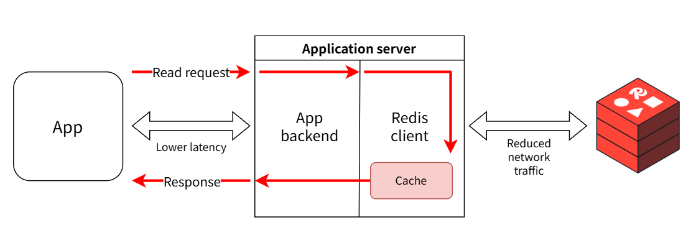

>[!NOTE]
>
>目标: 结合WebSocket的FastAPI+Postgres+SQLModel+Redis+Kafka+Kubernetes+Prometheus+Grafana+pytest,做一个即时通讯(Instant Messaging)软件出来,前端采用普通的Zustand+React+TanStack Query(根据情况考虑是否用AI写前端).

## ch0: 前言
1. 为什么做这个项目?
   1. 锻炼学习自己,有很多我不熟悉的领域,最多看过相关的书籍,但没有深入实践过
2. 你跟其他IM软件的区别?
   1. 比较独特,至少Github上没找到技术栈选型完全一样的项目(即使是一些AI项目也只是部分重合)
## ch1: redis-py学习
### 初印象
docker启动redis:
```bash
docker run -d --name redis -p 6379:6379 redis:8-alpine
```

使用redis-cli与刚刚启动的redis交互:
```bash
docker exec -it redis redis-cli
```
若出现`127.0.0.1:6379>`交互提示则说明Redis运行正常

使用uv启用python示例项目:
```python
import redis

r = redis.Redis(host="localhost", port=6379, decode_responses=True)

r.set("bike:1", "Process 134")
print(r.get("bike:1"))
```

运行后成功打印值`Process 134`.


- 连接到Redis的另一个方式则是使用DSN的url格式:
```python
r = redis.from_url("redis://default:<password>@<host>:<port>")
```

存取字符串:
```python
r.set('foo', 'bar')
# True
r.get('foo')
# bar
```

存储dict:
```py
r.hset(
    "user:123",
    mapping={
        "name": "john",
        "age": 29,
        "company": "Redis",
    },
)

print(r.hget("user:123", "name"))
print(r.hgetall("user:123"))
```

关闭连接:
```py
r.close()
```
### 基础知识
#### 连接方式
redis.Redis初始化方法默认使用`localhost:6379`,且使用数据库0,所以我们只需要配置`decode_responses=True`即可,写成`r=redis.Redis(decode_responses=True)`即可,如果不配置的话,则会默认返回字节格式(bytes),可读性是一方面,数据处理上影响就大了.
#### 异步配置
Redis支持Async配置:
```py
import redis.asyncio as redis
import asyncio


async def basic_example():
    r = redis.Redis(host="localhost", port=6379, decode_responses=True)
    await r.set("foo", "bar")
    value = await r.get("foo")
    print(value)
    # bar
    await r.aclose()


asyncio.run(basic_example())
```
更推荐的写法是使用`async with`来自动关闭连接:
```py
async def context_example():
    async with redis.Redis(
        host='localhost', port=6379, decode_responses=True
    ) as r:
        await r.set('foo', 'bar')
        value = await r.get('foo')
        print(value)
        # bar

asyncio.run(context_example())
```
都开异步了,自然需要支持连接池,否则开了个寂寞:
```py
async def shared_client_example():
    # Create one client at startup. It owns its own internal pool,
    # which is sized by max_connections.
    r = redis.Redis(
        host='localhost', port=6379, decode_responses=True,
        max_connections=10,
    )
    try:
        # Share `r` across every request and task for the app's lifetime.
        await r.set('foo', 'bar')
        value = await r.get('foo')
        print(value)
        # bar
    finally:
        # Close the client at shutdown to release pooled connections.
        await r.aclose()

asyncio.run(shared_client_example())
```

Redis的事务管理长这样:
```py
async def pipeline_example():
    async with redis.Redis(
        host='localhost', port=6379, decode_responses=True
    ) as r:
        async with r.pipeline(transaction=True) as pipe:
            pipe.set('a', '1')
            pipe.set('b', '2')
            pipe.get('a')
            pipe.get('b')
            results = await pipe.execute()
            print(results)
            # [True, True, '1', '2']

asyncio.run(pipeline_example())
```

### 进阶知识

#### Client-side caching
这里的客户端指的是连接数据库的后端,无论是字符串的值,还是hash表的值,都可以在第一次存取后缓存在客户端中,从而极大地降低延迟


配置方法如下:
```py
import redis
from redis.cache import CacheConfig

r = redis.Redis(
    protocol=3,
    cache_config=CacheConfig(),
    decode_responses=True
)

r.set("city", "New York")
cityNameAttempt1 = r.get("city")    # Retrieved from Redis server and cached
cityNameAttempt2 = r.get("city")    # Retrieved from cache
```

## ch2: confluent-kafka学习

## ch3: 相关项目学习
当我们想要从零开始搭建一个新领域项目时,往往是无从下手的,原因很简单,你见都没见过相关代码,怎么可能突然就会写了呢,所以,我们需要先找一下相关的领域项目,学习前人的设计经验.

### 小型项目1
- [仓库](https://github.com/notarious2/fastapi-chat)

技术栈选型:
* FastAPI, Websockets, Pydantic 2
* Postgres (asyncpg), async Redis (PubSub and Cache)
* SQLAlchemy 2

技术选型是非常对我胃口的,现在来具体分析一下.

一般来说,看一个python后端项目,我倾向于先看`main.py`,再看models,再看api,再看crud,最后看测试和配置,让我们按照这个流程来走一遍.
#### main.py
```py
import logging

import redis.asyncio as aioredis
import sentry_sdk
from fastapi import FastAPI
from fastapi.middleware.cors import CORSMiddleware
from fastapi.staticfiles import StaticFiles
from fastapi_limiter import FastAPILimiter
from fastapi_pagination import add_pagination
from sqladmin import Admin

from src.admin.admin import admin_models
from src.admin.authentication_backend import authentication_backend
from src.config import LOGGING_CONFIG, settings
from src.database import engine, redis_pool
from src.routers import routers


logger = logging.getLogger(__name__)


app = FastAPI()
app.mount("/static", StaticFiles(directory="src/static"), name="static")

admin = Admin(app, engine, authentication_backend=authentication_backend)

for router in routers:
    app.include_router(router)


allowed_origins = settings.ALLOWED_ORIGINS.split(",")


app.add_middleware(
    CORSMiddleware,
    allow_origins=allowed_origins,
    allow_credentials=True,
    allow_methods=["*"],
    allow_headers=["*"],
)

add_pagination(app)


@app.on_event("startup")
async def startup():
    logger.info("Application is started")
    redis = aioredis.Redis(connection_pool=redis_pool)
    await FastAPILimiter.init(redis)


# Error displayed on shutdown (will be fixed in later versions): https://github.com/python/cpython/issues/109538
@app.on_event("shutdown")
async def shutdown_event():
    logger.info("Application is closed")


# register admin models
for model in admin_models:
    admin.add_view(model)
```
看到了好几个没见过的库和fastapi方法:
1. `app.mount("/static")`: 挂载静态文件,从`static`路由访问,如`src/static/logo.png`对应`http://localhost:8000/static/logo.png`
   1. 不过只要有前端的话,这个方法就没必要用了
2. `from sqladmin import Admin`: 在FastAPI项目中快速创建一个Web管理后台,支持CRUD,直接通过ORM和session创建,绕过Service层
   1. 顶多用到小项目中,这完全是代码架构的破坏利器
3. `from fastapi_limiter import FastAPILimiter`: fastapi限流器,毕竟官方不支持限流,所以只好用第三方库了
   1. 不过现在这库的api改了,所以原代码中的写法也需要改
4. `@app.on_event("startup")`: `on_event`方法已经启用,现在统一用lifespan了.lifespan是fastapi应用的生命周期管理器,负责应用启动和关闭时需要执行的操作,基本用法如下:

```py
from contextlib import asynccontextmanager
from fastapi import FastAPI


@asynccontextmanager
async def lifespan(app: FastAPI):
    # 应用启动时执行
    print("Application starting...")

    yield

    # 应用关闭时执行
    print("Application shutting down...")


app = FastAPI(lifespan=lifespan)
```

这非常适合于需要显式关闭数据库连接的情况:
```py
@asynccontextmanager
async def lifespan(app: FastAPI):
    # Startup
    redis = Redis.from_url(REDIS_URL)
    app.state.redis = redis

    try:
        await redis.ping()
        yield
    finally:
        # Shutdown
        await redis.aclose()
        await engine.dispose()
```

#### models.py

```py
import enum
import uuid
from datetime import datetime
from typing import Any, List

from sqlalchemy import Boolean, Column, DateTime, Enum, ForeignKey, Index, String, Table
from sqlalchemy.dialects.postgresql import JSONB, UUID
from sqlalchemy.orm import Mapped, mapped_column, relationship

from src.database import BaseModel, RemoveBaseFieldsMixin, metadata


class ChatType(enum.Enum):
    DIRECT = "direct"
    GROUP = "group"


chat_participant = Table(
    "chat_participant",
    metadata,
    Column("user_id", ForeignKey("user.id"), primary_key=True),
    Column("chat_id", ForeignKey("chat.id"), primary_key=True),
)


class User(BaseModel):
    __tablename__ = "user"

    id: Mapped[int] = mapped_column(primary_key=True, autoincrement=True)
    guid: Mapped[uuid.UUID] = mapped_column(UUID(as_uuid=True), unique=True, default=uuid.uuid4)
    password: Mapped[str] = mapped_column(String(128))
    username: Mapped[str] = mapped_column(String(150), unique=True)
    first_name: Mapped[str] = mapped_column(String(150), default="")
    last_name: Mapped[str] = mapped_column(String(150), default="")
    email: Mapped[str] = mapped_column(String(254), unique=True)
    last_login: Mapped[datetime] = mapped_column(DateTime(timezone=True), nullable=True)
    is_superuser: Mapped[bool] = mapped_column(Boolean, default=False)
    user_image: Mapped[str] = mapped_column(String(1048), nullable=True)
    settings: Mapped[dict[str, Any]] = mapped_column(JSONB, server_default="{}")
    is_deleted: Mapped[bool] = mapped_column(Boolean, default=False)  # redefine is_deleted column for index

    chats: Mapped[List["Chat"]] = relationship(secondary=chat_participant, back_populates="users")
    messages: Mapped[List["Message"]] = relationship(back_populates="user")
    read_statuses: Mapped[List["ReadStatus"]] = relationship(back_populates="user")

    def __str__(self):
        return f"{self.username}"

    # Indexes

    __table_args__ = (
        Index("idx_user_on_email_username", "email", "username", postgresql_concurrently=True),
        Index(
            "idx_user_partial_on_email_not_deleted",
            "email",
            "is_deleted",
            postgresql_concurrently=True,
            postgresql_where=(is_deleted.is_(False)),
        ),
    )


class Chat(BaseModel):
    __tablename__ = "chat"

    id: Mapped[int] = mapped_column(primary_key=True, autoincrement=True)
    guid: Mapped[uuid.UUID] = mapped_column(UUID(as_uuid=True), default=uuid.uuid4)
    chat_type: Mapped[str] = mapped_column(Enum(ChatType, inherit_schema=True))

    users: Mapped[List["User"]] = relationship(secondary=chat_participant, back_populates="chats")
    messages: Mapped[List["Message"]] = relationship(back_populates="chat", cascade="all,delete")
    read_statuses: Mapped[List["ReadStatus"]] = relationship(back_populates="chat", cascade="all,delete")

    def __str__(self):
        return f"{self.chat_type.value.title()} {self.guid}"

    __table_args__ = (
        Index("idx_chat_on_is_deleted_chat_type", "is_deleted", "chat_type", postgresql_concurrently=True),
        Index("idx_chat_on_guid", "guid", postgresql_concurrently=True),
    )


class MessageType(enum.Enum):
    TEXT = "text"
    FILE = "file"


class Message(BaseModel):
    __tablename__ = "message"

    id: Mapped[int] = mapped_column(primary_key=True, autoincrement=True)
    guid: Mapped[uuid.UUID] = mapped_column(UUID(as_uuid=True), default=uuid.uuid4)
    message_type: Mapped[str] = mapped_column(Enum(MessageType, inherit_schema=True), default=MessageType.TEXT)
    content: Mapped[str] = mapped_column(String(5000))
    user_id: Mapped[int] = mapped_column(ForeignKey("user.id"))
    chat_id: Mapped[int] = mapped_column(ForeignKey("chat.id"))

    file_name: Mapped[str] = mapped_column(String(50), nullable=True)
    file_path: Mapped[str] = mapped_column(String(1000), nullable=True)

    chat: Mapped["Chat"] = relationship(back_populates="messages")
    user: Mapped["User"] = relationship(back_populates="messages")

    def __str__(self):
        return f"{self.content}"

    __table_args__ = (
        Index("idx_message_on_chat_id", "chat_id", postgresql_concurrently=True),
        Index("idx_message_on_user_id", "user_id", postgresql_concurrently=True),
        Index("idx_message_on_user_id_chat_id", "chat_id", "user_id", postgresql_concurrently=True),
    )


class ReadStatus(RemoveBaseFieldsMixin, BaseModel):
    __tablename__ = "read_status"

    id: Mapped[int] = mapped_column(primary_key=True, autoincrement=True)
    last_read_message_id: Mapped[int] = mapped_column(nullable=True)
    user_id: Mapped[int] = mapped_column(ForeignKey("user.id"))
    chat_id: Mapped[int] = mapped_column(ForeignKey("chat.id"))

    # to display unread messages for a user in different chats
    chat: Mapped["Chat"] = relationship(back_populates="read_statuses")
    user: Mapped["User"] = relationship(back_populates="read_statuses")

    def __str__(self):
        return f"User: {self.user_id}, Message: {self.last_read_message_id}"

    __table_args__ = (
        Index("idx_read_status_on_chat_id", "chat_id", postgresql_concurrently=True),
        Index("idx_read_status_on_user_id", "user_id", postgresql_concurrently=True),
    )
```
>用sqlalchemy写的,我看着不太习惯,但由于老项目都是用的它,所以还是勉强自己看下去.

有以下要点:
1. 数据库同时设置id和guid,guid用于对外暴露,而id用于数据库索引,从而保证应用不会暴露数据库的细节
2. 总计是有User,Chat,Message,ReadStatus四张表,非常符合一个标准的聊天系统设计
3. 第四张表的设计很合理,记录的是单次对话中每个用户读到的最后一条消息,从而避免所有消息都要加上已读/未读统计(这很容易引发大批量更新,数据库吃不消).

#### routers
有一下几个router:
```py
from src.authentication.router import auth_router
from src.chat.router import chat_router
from src.contact.router import contact_router
from src.registration.router import account_router
from src.settings.router import settings_router
from src.websocket.router import websocket_router
```
即:
* `src.authentication`
* `src.chat`: 核心
* `src.contact`
* `src.registration`
* `src.settings`: 过于简单,跳过
* `src.websocket`: 核心


尽管是个人设计,但还是把这些router都包装到一个文件夹里更好.

整体设计是每个路由都有一个专门的service(即crud)和schema,但就这个项目的规模来看,其实不太有必要,毕竟只在文件里放一个函数还是有点别扭的.
##### authentication
1. 用户填写表单后签发access_token和refresh_token,并通过`set_cookie`方法显式指明浏览器用cookie保存两个token:
```py

@auth_router.post(
    "/login/",
    dependencies=[
        Depends(RateLimiter(times=50, hours=24)),  # keep lower of result on top
        Depends(RateLimiter(times=10, minutes=1)),
    ],
    summary="Create access and refresh tokens for a user",
)
async def login(
    response: Response,
    background_tasks: BackgroundTasks,
    db_session: AsyncSession = Depends(get_async_session),
    form_data: OAuth2PasswordRequestForm = Depends(),
):
    login_identifier, password = form_data.username.lower(), form_data.password
    user: User | None = await authenticate_user(
        db_session=db_session, login_identifier=login_identifier, password=password
    )

    if not user:
        raise HTTPException(
            status_code=status.HTTP_400_BAD_REQUEST,
            detail="Incorrect email/username or password",
        )

    # create token based on login identifier instead of static username/email
    access_token: str = create_access_token(login_identifier)
    refresh_token: str = create_refresh_token(login_identifier)

    response.set_cookie(
        key="access_token",
        value=access_token,
        httponly=True,
        samesite="none",
        secure=True,
    )
    response.set_cookie(
        key="refresh_token",
        value=refresh_token,
        httponly=True,
        samesite="none",
        secure=True,
    )

    # update last login date
    background_tasks.add_task(update_user_last_login, db_session, user=user)

    login_response = UserLoginResponseSchema.model_validate(user)
    return login_response
```
2. 用户通过Google登录后同样签发token,如果用户已经存在则更新登录时间,如果不存在则根据用户邮箱创建用户(这也是很多网站Google登录免注册的基本原理)
```py
@auth_router.post(
    "/google-login/",
    dependencies=[
        Depends(RateLimiter(times=50, hours=24)),  # keep lower of result on top
        Depends(RateLimiter(times=10, minutes=1)),
    ],
    summary="Login with Google oauth2",
)
async def login_with_google(
    response: Response,
    google_login_schema: GoogleLoginSchema,
    background_tasks: BackgroundTasks,
    db_session: AsyncSession = Depends(get_async_session),
):
    google_access_token: str = google_login_schema.access_token
    user_info: dict[str, str] | None = await verify_google_token(google_access_token)

    if not user_info:
        raise HTTPException(
            status_code=status.HTTP_401_UNAUTHORIZED,
            detail="Could not verify Google credentials",
        )

    # email field is case insensitive, db holds only lower case representation
    email: str = user_info.get("email", "").lower()
    if not email:
        HTTPException(
            status_code=status.HTTP_401_UNAUTHORIZED, detail="Email was not provided"
        )

    if not (user := await get_user_by_email(db_session, email=email)):
        user: User = await create_user_from_google_credentials(db_session, **user_info)

    else:
        # update last login for existing user
        background_tasks.add_task(update_user_last_login, db_session, user=user)

    access_token: str = create_access_token(email)
    refresh_token: str = create_refresh_token(email)

    # Send access and refresh tokens in HTTP only cookies
    response.set_cookie(
        key="access_token",
        value=access_token,
        httponly=True,
        samesite="none",
        secure=True,
    )
    response.set_cookie(
        key="refresh_token",
        value=refresh_token,
        httponly=True,
        samesite="none",
        secure=True,
    )

    login_response = UserLoginResponseSchema.model_validate(user)
    return login_response
```
3. 根据refresh_token来获取新的access_token,并重新设置cookie
4. 用户自己logout,移除两种cookie


##### contact
```py
@contact_router.get("/users/", summary="Get all users")
async def get_contacts_view(
    db_session: AsyncSession = Depends(get_async_session),
    current_user: User = Depends(get_current_user),
    cache: aioredis.Redis = Depends(get_cache),
    cache_enabled: bool = Depends(get_cache_setting),
):
    cache_key = f"{current_user.guid}_all_users"

    if cache_enabled:
        # return cached users list if key exists
        if cached_all_users := await cache.get(cache_key):
            logging.info("Cache: Users")
            return json.loads(cached_all_users)

    users: list[User] = await get_all_users(db_session, current_user=current_user)

    response = GetUsersResponseSchema.model_validate(users, from_attributes=True)

    if cache_enabled:
        await cache.set(cache_key, response.model_dump_json(), ex=settings.REDIS_CACHE_EXPIRATION_SECONDS)

    return response
```
这里的缓存需要重点理解:
1. 第一次是没有缓存的,所以在获取用户列表后,需要特定指明`cache.set`,并指明缓存过期时间
2. 之后读取用户时,如果缓存没有失效,那么就读取缓存
3. 不过由于没有设置缓存更新,所以即便用户列表有更新,我们仍然读到老数据,这就会是一个重大的设计失误.除非我们在其他地方设置了缓存更新,而这个项目也的确是这么设计的.


##### registration
```py
@account_router.post("/register/", summary="Register user")
async def register_user(
    background_tasks: BackgroundTasks,
    db_session: AsyncSession = Depends(get_async_session),
    cache: aioredis.Redis = Depends(get_cache),
    user_schema: UserRegisterSchema = Depends(UserRegisterSchema),
):
    # check if user with username or email already exists
    if await get_user_by_email_or_username(db_session, email=user_schema.email, username=user_schema.username):
        raise HTTPException(
            status_code=status.HTTP_409_CONFLICT, detail="User with provided credentials already exists"
        )

    try:
        user: User = await create_user(db_session, user_schema=user_schema)
        # background_task is executed after the response is sent to the client.
        # this allows to save an image without affecting the user experience.
        if uploaded_image := user_schema.uploaded_image:
            image_saver = ImageSaver(db_session, user=user)
            background_tasks.add_task(image_saver.save_user_image, user, uploaded_image)

    except Exception as excinfo:
        raise HTTPException(status_code=status.HTTP_400_BAD_REQUEST, detail=f"{excinfo}")
    else:
        # clear cache for all users
        await clear_cache_for_all_users(cache)
        return "User has been successfully created"
```

- 每次新用户注册时就撤销所有缓存

##### chat
核心文件,看一下路由设计:
```py
@chat_router.post("/chat/direct/", summary="Create a direct chat", response_model=DisplayDirectChatSchema)
async def create_direct_chat_view(
    create_direct_chat_schema: CreateDirectChatSchema,
    db_session: AsyncSession = Depends(get_async_session),
    current_user: User = Depends(get_current_user),
):
    # check if another user (recipient) exists
    recipient_user_guid = create_direct_chat_schema.recipient_user_guid
    recipient_user: User | None = await get_user_by_guid(db_session, user_guid=recipient_user_guid)

    # TODO: must check that recipient user is not the same as initiator
    if not recipient_user:
        raise HTTPException(
            status_code=status.HTTP_404_NOT_FOUND,
            detail=f"There is no recipient user with provided guid [{recipient_user_guid}]",
        )

    if await direct_chat_exists(db_session, current_user=current_user, recipient_user=recipient_user):
        raise HTTPException(
            status_code=status.HTTP_409_CONFLICT, detail=f"Chat with recipient user exists [{recipient_user_guid}]"
        )

    # Check if the data is already in the cache
    chat: Chat = await create_direct_chat(db_session, initiator_user=current_user, recipient_user=recipient_user)

    return chat


@chat_router.get("/chat/{chat_guid}/messages/", summary="Get user's chat messages")
async def get_user_messages_in_chat(
    chat_guid: UUID,
    size: Annotated[int | None, Query(gt=0, lt=200)] = 20,
    db_session: AsyncSession = Depends(get_async_session),
    current_user: User = Depends(get_current_user),
    cache: aioredis.Redis = Depends(get_cache),
    cache_enabled: bool = Depends(get_cache_setting),
):
    chat: Chat | None = await get_chat_by_guid(db_session, chat_guid=chat_guid)

    if not chat:
        raise HTTPException(status_code=status.HTTP_404_NOT_FOUND, detail="Chat with provided guid does not exist")

    # determine the number of unread messages
    unread_messages_count: int = await get_unread_messages_count(db_session, user_id=current_user.id, chat=chat)

    # get larger of provided messages size or unread messages
    size: int = max(size, unread_messages_count)

    # determine cache key
    cache_key: str = f"messages_{chat_guid}_{size}"

    if cache_enabled:
        # return cached chat messages if key exists
        if cached_chat_messages := await cache.get(cache_key):
            logger.info("Cache: Messages")
            return json.loads(cached_chat_messages)

    if current_user not in chat.users:
        raise HTTPException(status_code=status.HTTP_409_CONFLICT, detail="You don't have access to this chat")

    messages, has_more_messages, last_read_message = await get_chat_messages(
        db_session, user_id=current_user.id, chat=chat, size=size
    )
    response = GetMessagesSchema(
        messages=messages,
        has_more_messages=has_more_messages,
    )
    if last_read_message:
        response.last_read_message = last_read_message

    if cache_enabled:
        # Store the chat in the cache with a TTL
        await cache.set(cache_key, response.model_dump_json(), ex=settings.REDIS_CACHE_EXPIRATION_SECONDS)

    return response


# TODO: when to clear the cache?
@chat_router.get("/chats/direct/", summary="Get user's direct chats")
async def get_user_chats_view(
    db_session: AsyncSession = Depends(get_async_session),
    current_user: User = Depends(get_current_user),
    cache: aioredis.Redis = Depends(get_cache),
    cache_enabled: bool = Depends(get_cache_setting),
):
    # return cached direct chats if key exists
    cache_key = f"direct_chats_{current_user.guid}"
    if cached_direct_chats := await cache.get(cache_key):
        logger.info("Cache: Chats")
        return json.loads(cached_direct_chats)

    chats: list[Chat] = await get_user_direct_chats(db_session, current_user=current_user)

    chats_with_new_messages_count: list[GetDirectChatSchema] = await get_new_messages_per_chat(
        db_session, chats, current_user
    )

    # calculate total unread messages count for all user's chats
    total_unread_messages_count = sum(direct_chat.new_messages_count for direct_chat in chats_with_new_messages_count)

    response = GetDirectChatsSchema(
        chats=chats_with_new_messages_count, total_unread_messages_count=total_unread_messages_count
    )

    if cache_enabled:
        # Store response in the cache with a TTL
        await cache.set(cache_key, response.model_dump_json(), ex=settings.REDIS_CACHE_EXPIRATION_SECONDS)

    return response


@chat_router.delete("/chats/direct/{chat_guid}/", summary="Delete user's chat", status_code=status.HTTP_204_NO_CONTENT)
async def delete_direct_chat_view(
    chat_guid: UUID,
    db_session: AsyncSession = Depends(get_async_session),
    current_user: User = Depends(get_current_user),
    cache: aioredis.Redis = Depends(get_cache),
    cache_enabled: bool = Depends(get_cache_setting),
):
    chat: Chat | None = await get_chat_by_guid(db_session, chat_guid=chat_guid)

    if not chat or current_user not in chat.users:
        raise HTTPException(status_code=status.HTTP_404_NOT_FOUND, detail="Chat with provided guid is not found")

    await db_session.delete(chat)
    await db_session.commit()

    if cache_enabled:
        for user in chat.users:
            await clear_cache_for_get_direct_chats(cache=cache, user=user)


@chat_router.get(
    "/chat/{chat_guid}/messages/old/{message_guid}/",
    summary="Get user's historical chat messages",
)
async def get_older_messages(
    chat_guid: UUID,
    message_guid: UUID,
    limit: Annotated[int | None, Query(gt=0, lt=200)] = 10,
    db_session: AsyncSession = Depends(get_async_session),
    current_user: User = Depends(get_current_user),
):
    chat: Chat | None = await get_chat_by_guid(db_session, chat_guid=chat_guid)

    if not chat:
        raise HTTPException(status_code=status.HTTP_404_NOT_FOUND, detail="Chat with provided guid is not found")

    if current_user not in chat.users:
        raise HTTPException(status_code=status.HTTP_409_CONFLICT, detail="You don't have access to this chat")

    message: Message | None = await get_active_message_by_guid_and_chat(
        db_session, chat_id=chat.id, message_guid=message_guid
    )

    if not message:
        raise HTTPException(status_code=status.HTTP_404_NOT_FOUND, detail="Message with provided guid is not found")

    old_messages, has_more_messages = await get_older_chat_messages(
        db_session, chat=chat, user_id=current_user.id, created_at=message.created_at, limit=limit
    )
    return GetOldMessagesSchema(messages=old_messages, has_more_messages=has_more_messages)
```

1. post:`/chat/direct/`
   1. 首先是获取私聊对象用户
   2. 然后检查该私聊是否已经存在
   3. 创建私聊,更新对话成员和阅读状态
   4. 最后直接返回整个数据库表就不对了,最好专门再写一个schema
2. get:`/chat/{chat_guid}/messages/`
   1. 首先是根据uuid获取对话
   2. 接着是统计未读消息,如果未读消息有几千几万条,那显然不能也照样返回计数,这有两种方法处理,原样取回所有消息后用最大限额截断计数,或者原样取回所有消息后不截断
   3. 获取对话消息的函数非常有意思,我们来全面剖析一下:

```py
async def get_chat_messages(
    db_session: AsyncSession, *, user_id: int, chat: Chat, size: int
) -> tuple[list[Chat], bool, Message | None]:
    query = (
        select(Message)
        .where(and_(Message.chat_id == chat.id, Message.is_deleted.is_(False)))
        .order_by(Message.created_at.desc())
        .limit(size + 1)
        .options(selectinload(Message.user), selectinload(Message.chat))
    )
    result = await db_session.execute(query)
    messages: list[Message] = result.scalars().all()
    # check if there are more messages
    has_more_messages = len(messages) > size
    messages = messages[:size]

    # assuming only two read statuses
    # Initialize variables to prevent NameError
    my_last_read_message_id = None
    other_user_last_read_message_id = None

    # Loop through chat.read_statuses and assign the read message IDs
    for read_status in chat.read_statuses:
        if read_status.user_id != user_id:
            other_user_last_read_message_id = read_status.last_read_message_id
        else:
            my_last_read_message_id = read_status.last_read_message_id

    # If no value is assigned, you could choose to set a default value
    # or handle this case accordingly (e.g., using a placeholder)
    if my_last_read_message_id is None:
        my_last_read_message_id = 0  # Or some other default value

    if other_user_last_read_message_id is None:
        other_user_last_read_message_id = 0  # Or some other default value

    # Retrieve the last read message for the other user
    last_read_message = await db_session.get(Message, other_user_last_read_message_id)

    # Construct GetMessageSchema list
    get_message_schemas = [
        GetMessageSchema(
            message_guid=message.guid,
            content=message.content,
            created_at=message.created_at,
            chat_guid=message.chat.guid,
            user_guid=message.user.guid,
            is_read=message.id
            <= (other_user_last_read_message_id if message.user.id == user_id else my_last_read_message_id),
        )
        for message in messages
    ]

    return get_message_schemas, has_more_messages, last_read_message
```

这里最巧妙的一个设计就是`.limit(size + 1)`,如果是我亲手写出来的,那我做梦都能笑醒.

原理如下:
1. 故意获取比size大一的消息列表
2. 如果发现这个消息列表的长度>size,也就是为size+1,说明之后还有消息
3. 但这次我们只需要返回size大小的消息即可,并标记之后还有消息要读取

你看,我们只需要多查一条数据,就能得到这么多隐含信息,实在是太天才了.

另一个重点在于这是一个私聊对话,因为需要判断已读状态(毕竟群聊的话也就无从谈起已读了),所以需要区分自己的已读消息和对方的未读消息,原代码的列表表达式实在是太难懂了,拆分出来是这样的:

```py
for message in messages:
    is_my_message = message.user_id == user_id

    if is_my_message:
        # 自己发的消息：判断对方是否已读
        is_read = message.id <= other_user_last_read_message_id
    else:
        # 对方发的消息：判断自己是否已读
        is_read = message.id <= my_last_read_message_id
```
3. get:`chats/direct/`
   1. 获取该用户所有的对话列表
   2. 获取每个对话的该用户未读消息
   3. 合并成response并缓存
   4. 问题在于,如果这么操作,即便有上百个未读对话,只要用户读了其中一个对话,那么就需要清除缓存,这还不如不设置缓存,更何况代码中根本就没考虑清除缓存的问题
4. delete:`/chats/direct/{chat_guid}/`
   1. 单方面删除对话,比较糟糕的设计,但如果是即时聊天,貌似也还说的过去
5. get:`/chat/{chat_guid}/messages/old/{message_guid}/`
   1. 获取历史消息,属于冗余设计
#### websocket设计


