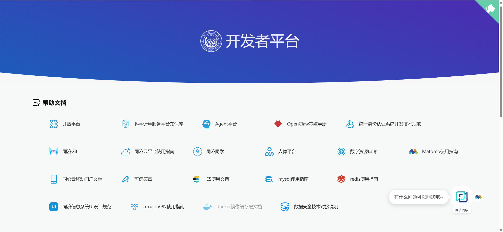
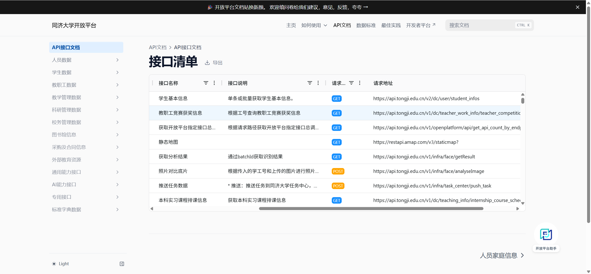
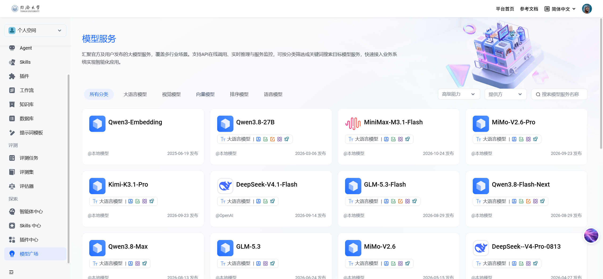
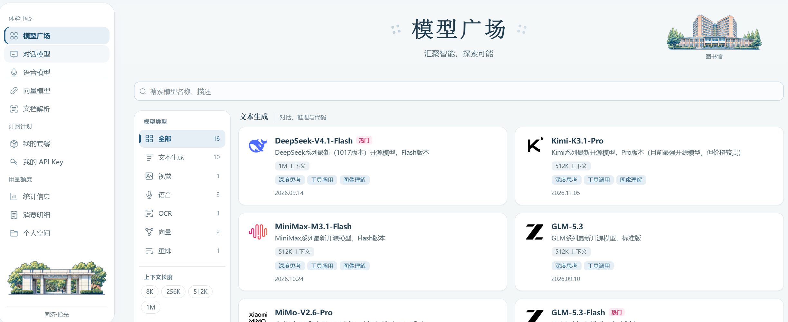
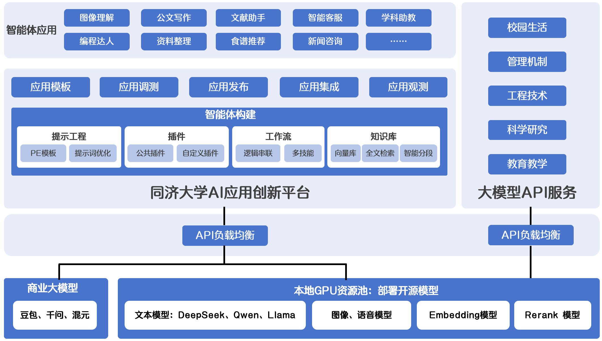
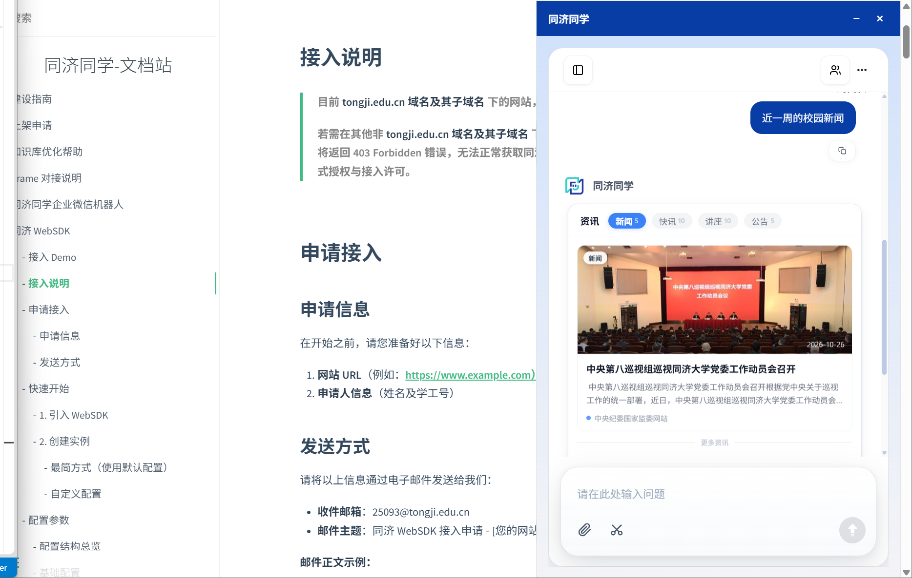
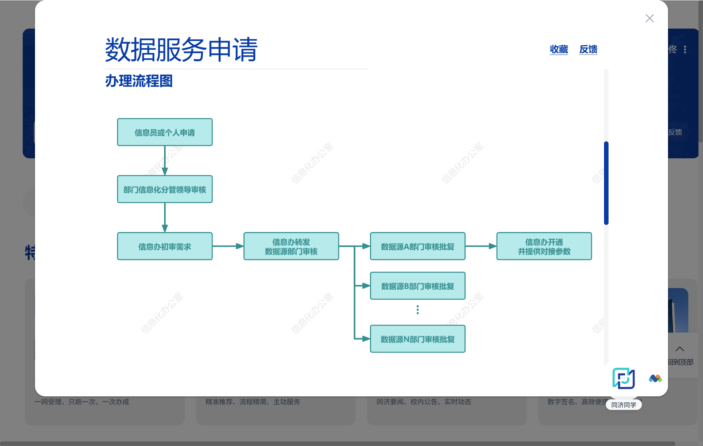
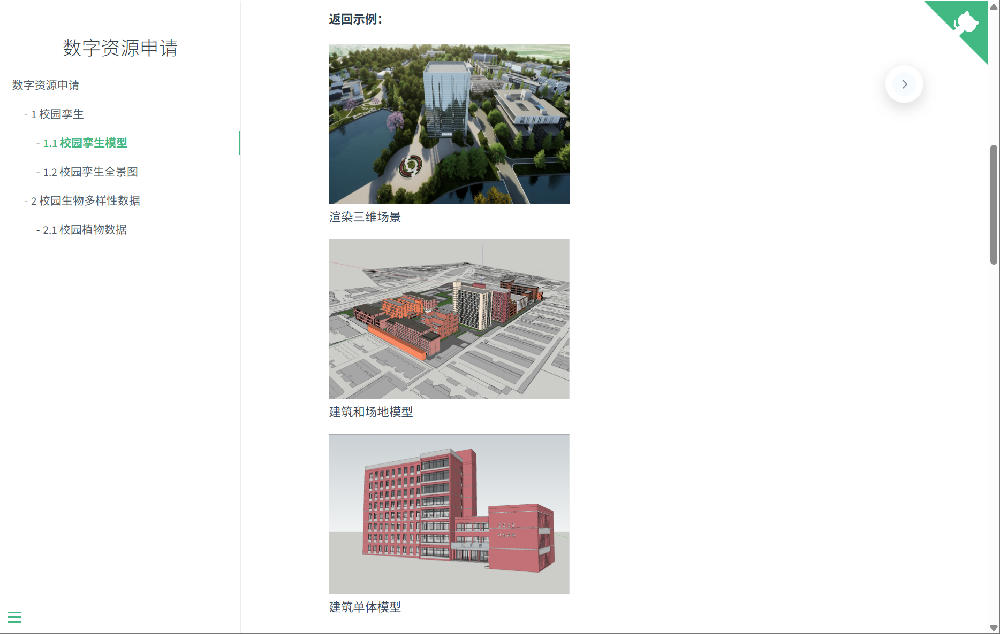

# 技术方面
## tj开发者平台
### 概述
[这个网站](https://dev.tongji.edu.cn/)收录了同济技术开发相关的所有网站(终于知道经费被花到哪里了😇),看一下页面:

实际上是这些网站不少还是挺有意思的,让我们来按顺序一个个尝尝鲜.
### API开放平台

可以说把一个学校平常能用到的所有基础的技术支持全都归纳进来了,基本都是GET请求,而且权限控制很严格,关键的信息接口不支持DELETE和POST.

不过大部分都涉及个人隐私,所以不支持学生个人申请:

>学校数据开放平台服务主要用户范围为全校师生正式使用的业务系统/应用，其中涉及全校的师生用户数据，出于对个人数据的保护和服务有效性的控制，暂不向个人开发者开放，请谅解。

### 科学计算服务平台
#### 概览
这个科研平台由两个子平台构成:
1. 超算平台
   1. 基于Linux系统,无图形界面,按使用时间计费
2. 虚拟工作站平台(云桌面)
   1. 基于虚拟机,Windows或者Ubuntu,有图形界面,按照包机时间计费

>说这么高级,其实就是租服务器哈😅

看一下配置怎么样:
1. GPU
   1. A800: 使用NVLINK,56核,内存1TB
      1. 还可以,就是不知道能配几张
   2. L40: 使用PCIE,56核,内存1TB
      1. 也还行
   3. 这个世代相对有一点点老,但不用国产芯片还是有说法的
2. CPU
   1. 配置上有点好的过分了,看来学校闲钱有点多.
3. 存储
   1. 3PB全闪存储,45PB混闪存储,带宽200Gbps
   2. 这才发现学校多有钱,可惜不给学生用

#### 收费标准
| 资源名称                   | 校内价格（元） | 单位 |
| :------------------------- | :------------- | :--- |
| NVIDIA A800 SXM / 80GB     | 4              | 卡时 |
| NVIDIA L40 PCIE / 48GB     | 2              | 卡时 |
| AMD 9654 / 96核 * 2        | 0.02           | 核时 |
| INTEL 9468/48核/64GHBM * 2 | 0.04           | 核时 |
| AMD 9654 /96核 * 2 3TB内存 | 0.06           | 核时 |
| 混闪（免费1.5T，超出每T）  | 5              | TB月 |
| 全闪（免费512G，超出每T）  | 60             | TB月 |

象征性收费,至于维护资金从哪来,那就从经费里拨了.
### AI应用创新平台
- [网站链接](https://agent.tongji.edu.cn/)

不限额度,随便调用,但只能网页对话,额,其实做点日常任务还是可以的,特别是现在deepseek限制了日token输入的话.

### 人工智能服务平台

最有说法的一个平台,每周送1000积分,对比模型标价的话,deepseekv4.1-flash可以用10亿token.

- 终于把钱花到该花的地方了
### 统一身份认证系统开发
>单点登录（Single Sign-On，简称SSO）平台支持单点登录，允许用户在登录一次后，无需再次输入凭证即可访问其他相关系统。这提高了用户的便捷性，减少了重复登录的需要。

高校统一身份认证平台提供统一的身份验证服务，允许用户使用单一凭证登录到多个校园系统和应用。这提高了用户体验，减少了用户需要记住的不同账户和密码数量，同时提高了安全性。

- 同样,也是不支持学生单独对接的,需要指导教师通过教职工申请流程进行申请.

不过这里有个非常有趣的学工号表格,可以看懂自己学号的来历,如本科生一律采用2位年号+1个5+4位区段号组成,如2459999就是24年入学的学生.这个区段号按照考生籍贯来顺序排列(待久了就能猜出来的).

### TJ Git
脱裤子放屁的事呢,显然是用来骗经费的.

- 不过现在好像也用不了了.

### 云平台
主要面向信息办内部

### TJ同学
侧栏智能体,额,或许还能用:

### 人像平台
管理全校师生的头像和人像识别底片,同样面向教职工,实测下来效果一般,至少宿舍门口我一般要刷上两次脸才能进.
### 数字资源申请
>竟然还有数字孪生,整的挺高端

- 通过“一网通办”（all.tongji.edu.cn）中搜索“数据服务申请”进行申请。

甚至还要签署保密协议,在相关平台备案,非常明显,还是面向教职工的...

不过嘛,看着效果也并没有多好:

### Matomo
Matomo（原名 Piwik）是一个开源的网站访问统计分析系统，它提供了详细的网站访问数据分析功能，帮助您了解网站的访问情况、用户行为和内容表现。

换句话说,最早可能是某个文科教授想要给自己的网站加上访客统计,但不想自己花钱或者不懂怎么配置,于是信息办就整了一个傻瓜式的脚本式接入访客统计.

至于有没有任何一个官网用到这个功能,不好意思没有😅
### 同心云移动门户
向来是诟病最多的平台,但官网没有任何具体的内部结构说明,只有一个第三方应用接入规范...

