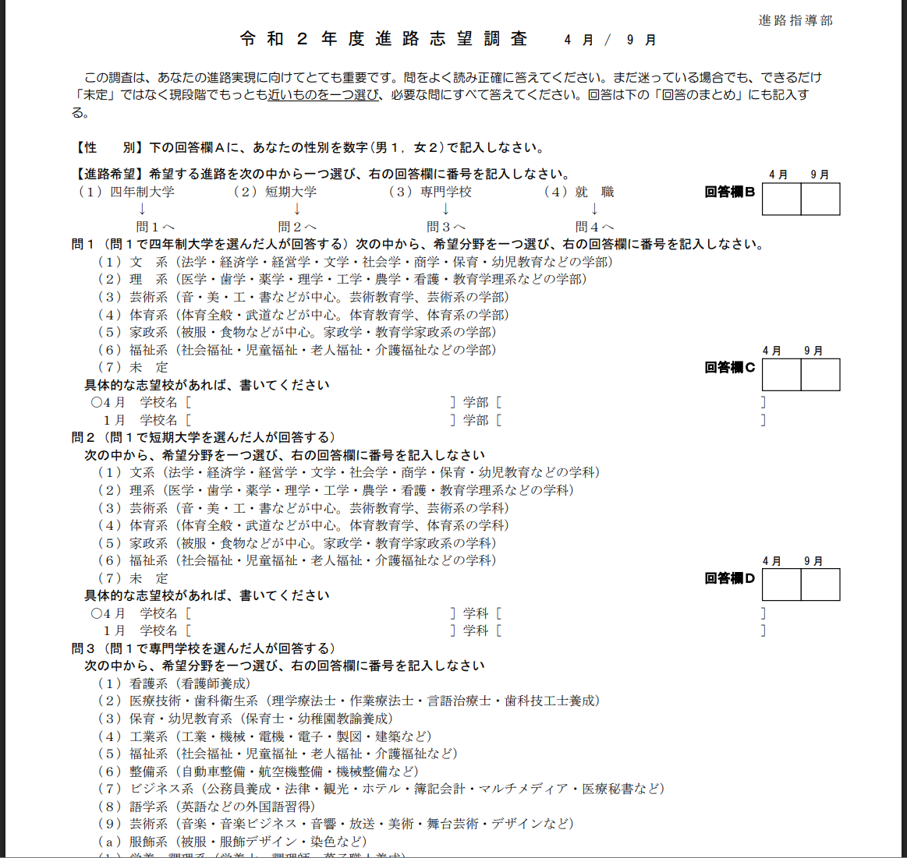
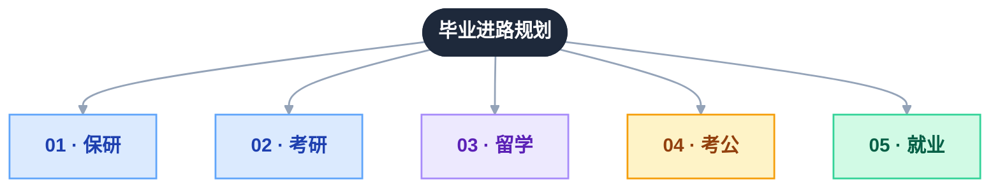
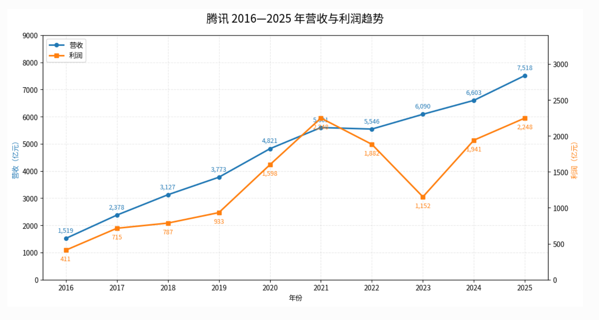
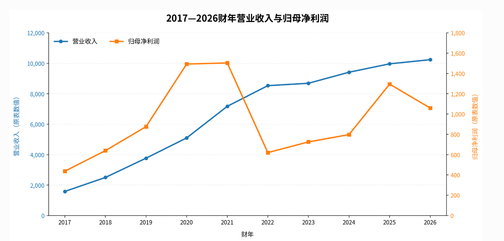
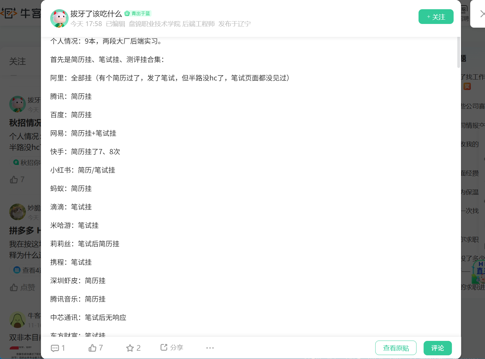
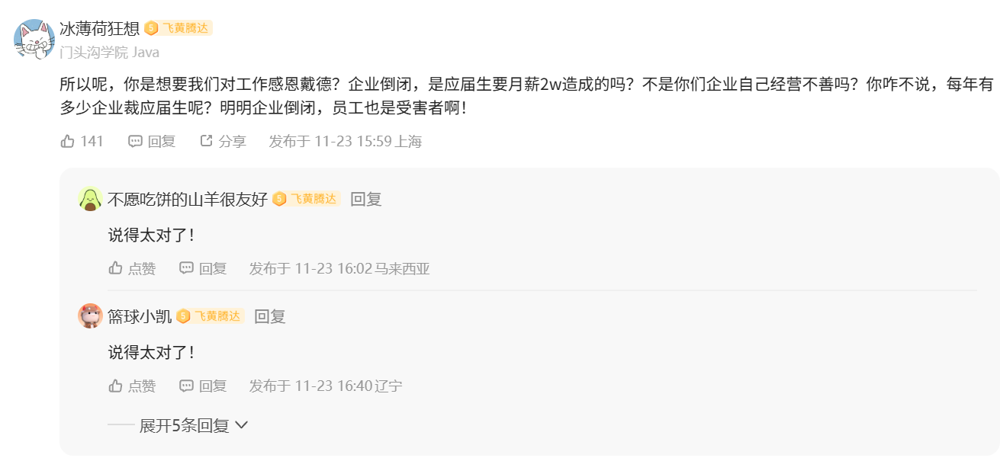
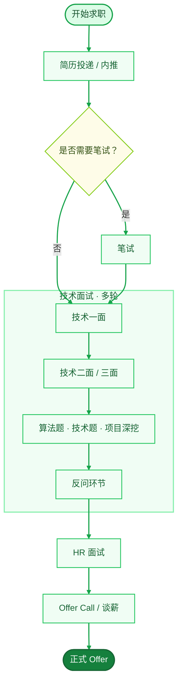

日本高中很有意思的地方在于,在学生面临大学考试时(不过有些学校在高中的每年都会发),会发放一个进路调查表,样式如下:



- [原文件链接在此](https://cms2.chiba-c.ed.jp/n.otaka-h/wysiwyg/file/download/135/1801?)

上图的大致意思是选择读四年制大学,专门学校还是直接就业?如果读四年制大学,选什么专业?如果就业,你想要去哪个行业?

问题都很简单,但对于一个尚未成年的孩子来说,略显沉重.

不过对于中国的高中生来说,并没有这个烦恼,好好学习,考个好大学就行了,但是考上了大学之后要怎么做,对不起,没有人教你.

因此,中国的大学生,反而是最有必要填写一份进路调查表的群体,在这个迷茫的时代更是如此.我无意居高临下指点他人,但却愿意记录一下我自己的考量.

无论怎么掰扯,一个大学生毕业之后的道路无非只有五种选择(选择这么少真是抱歉):



接下来,就让我们逐一审视一下自己的未来,看一下那些曾被忽略的可能.
## 保研
### 资源清单
由于保研向来就是你死我活的斗争,靠信息差打赢保研战是非常常见的,因此那些无私的分享就显得更为可贵

- [CS保研必看: CSWiki](https://csbaoyan.top/)
- [保研wiki](https://openshtu.github.io/Baoyan-Wiki)
- [竞赛通知网](https://jingsaitongzhi.com/)
- [保研站](https://baoyanzhan.com/)
- [知识库](https://qingbaoyan.cn/)
- [各夏令营/预推免的ddl](https://ddl.csbaoyan.top/)
- [导航站](https://career-plan.eu.org/)

### 保研条件
尽管不同学校的保研条件有所差别,加分比例有所不同,但都大差不大,拿我自己的学校举例,最终的保研成绩计算公式如下:
1. 绩点(占比85%)
   1. 老实听课很枯燥吧,再来个考勤,小测,期末怎么样
2. 科研(占比5%)
   1. 期刊论文/会议论文/专利 都可以加分,但一般都会针对不同等级制定不同的加分比例,如果你离保研的分数线并不遥远,可以通过水一篇论文,交点版面费,实现弯道超车(前提是你认识一个关系还可以的教授,或者单纯有钱也行)
3. 竞赛(占比5%)
   1. 不同学校对竞赛的等级划分不同,高等级竞赛加分多,低等级竞赛加分少,换句话说可以通过多个水赛二等奖实现挑战杯金奖的效果
4. 志愿服务(占比5%)
   1. 不同学校对志愿服务的要求不同,有些学校不会把它计入保研加分,但如果计入了,想要保研的话就要去好好钻营如何参加大规模的志愿服务了.
   2. 我们学校比较离谱,只有联合国和世博会这种国家级和国际级别的志愿服务才算.自然,大家都抢的很欢乐.

>当然,不能挂科,不能有特别离谱的污点事迹,如果你专业的保研率很高,说不定保研唯一的难点就是不能挂科了(不过有的学校允许挂一两门,视具体政策而定).


不管怎样,绩点才是王道,大多数学校的大一,大二绩点占比最重,决定了你能不能保研.所以真想读研的话就必须在**一入学就拼命的卷啊卷**,一刻不能放松,即便到了大三下学期排名出来后,还是需要准备夏令营的面试和笔试,直到获得优营和offer后才可以松一口气.

换句话说,如果你选择保研,你需要痛苦三年换取轻松一年,但如果选择考研,你可以轻松三年,然后痛苦半年,再轻松半年.单纯这么算账的话还是考研划算...

### 打比赛
如果你不知道要打什么比赛,可以稍微参考一下这个表格:

| 竞赛名称                          | 量级 | 核心任务                                                                  | 报名与截止时间 (参考)                 | 官方网站                                                                 |
| --------------------------------- | ---- | ------------------------------------------------------------------------- | ------------------------------------- | ------------------------------------------------------------------------ |
| **ACM-ICPC (WF)**                 | 1    | 3人1机，数小时内现场编写算法解决 10+ 难度极高的程序设计题。               | **WF (全球总决赛):** 需通过区域赛晋级 | [icpc.global](https://icpc.global/)                                      |
| **ACM-ICPC (Region)**             | 0.9  | 亚洲区预选赛，争夺进入全球总决赛的资格，题目难度与 WF 衔接。              | **报名:** 8-9月；**截止:** 10月       | [icpc.global](https://icpc.global/)                                      |
| **CCPC 全国大学生程序设计竞赛**   | 0.9  | 国内最高规格的算法竞赛，侧重于纯算法逻辑、复杂数学建模与代码实现。        | **报名:** 8-9月；**截止:** 10月       | [ccpc.io](https://ccpc.io/)                                              |
| **全国大学生计算机系统能力大赛**  | 0.9  | 俗称“龙芯杯”或“编译/OS挑战赛”，需自研 CPU、编译器或操作系统底层。         | **报名:** 3-5月；**截止:** 8-9月      | [pacc.ict.ac.cn](https://www.google.com/search?q=http://pacc.ict.ac.cn/) |
| **C4-大数据挑战赛/天梯赛**        | 0.8  | 大数据赛侧重海量数据挖掘预测；天梯赛考核团队算法平均解决能力。            | **报名:** 3-5月；**截止:** 7-8月      | [c4contest.com]()                                                        |
| **全国大学生信息安全竞赛**        | 0.8  | **作品赛:** 开发安全工具系统；**创新实践赛:** CTF 夺旗对抗模式。          | **报名:** 3-5月；**截止:** 6月        | [ciscn.cn]()                                                             |
| **全国大学生电子设计竞赛**        | 0.7  | 4天3夜封闭赛制，现场根据题目要求设计电路、焊接并编写嵌入式代码。          | **报名:** 4-6月；**单/双年赛制**      | [nuedc.xjtu.edu.cn]()                                                    |
| **全国大学生物联网设计竞赛**      | 0.7  | 结合传感器、云平台与边缘计算，开发完整的物联网垂直领域应用系统。          | **报名:** 4-6月；**截止:** 8月        | [iot.sjtu.edu.cn]()                                                      |
| **华为 ICT 大赛 (AI/网络)**       | 0.7  | 学习并运用华为自研平台（昇腾/鲲鹏等）解决 AI 算法开发与网络部署。         | **报名:** 9-11月；**截止:** 12月      | [e.huawei.com]()                                                         |
| **百度之星·程序设计大赛**         | 0.7  | 百度主办，包含经典算法竞赛与紧跟技术前沿（如 AI 调度）的工程赛。          | **报名:** 5-7月；**截止:** 8月        | [astar.baidu.com]()                                                      |
| **ISCC 信息安全与对抗技术竞赛**   | 0.7  | 开展 CTF 夺旗赛与模拟实战对抗，侧重于渗透测试与漏洞分析。                 | **报名:** 4-5月；**截止:** 6月        | [isclab.org.cn]()                                                        |
| **中国大学生计算机设计大赛**      | 0.7  | 涵盖软件开发、微课、数字媒体等，要求提交完整的计算机应用作品。            | **报名:** 3-4月；**截止:** 5-6月      | [jsjds.blcu.edu.cn]()                                                    |
| **蓝桥杯**                        | 0.7  | 规模最大的个人赛，考察常用算法数据结构或嵌入式开发实操能力。              | **报名:** 10-12月；**截止:** 次年1月  | [lanqiao.cn]()                                                           |
| **“中国软件杯”**                  | 0.7  | 企业实际命题，开发具备商业价值或解决工业痛点的软件系统。                  | **报名:** 3-5月；**截止:** 7月        | [cnsoftbei.com]()                                                        |
| **中国大学生服务外包大赛**        | 0.7  | 模拟企业真实外包项目，涉及金融、医疗等领域的软件架构与落地。              | **报名:** 11-12月；**截止:** 次年3月  | [fwwb.org.cn]()                                                          |
| **全国大学生软件创新大赛**        | 0.7  | 强调创新性，通常有特定主题（如 AI 驱动的移动端软件开发）。                | **报名:** 10-11月；**截止:** 次年4月  | [swcontest.com.cn]()                                                     |
| **Apple WWDC Scholarship**        | 0.7  | 使用 Swift 语言设计并制作一个具有创意、互动性强的 Swift Playground 作品。 | **报名:** 2-3月；**截止:** 4月        | [developer.apple.com]()                                                  |
| **微软"创新杯" (Imagine Cup)**    | 0.7  | 利用 Azure 云平台和 AI 技术解决社会或商业领域的复杂挑战。                 | **报名:** 10-12月；**截止:** 次年1月  | [imaginecup.microsoft.com]()                                             |
| **中美青年创客大赛**              | 0.7  | 48小时黑客松或作品展示，利用开源软硬件开发解决可持续发展的产品。          | **报名:** 5-6月；**截止:** 7月        | [cscse.edu.cn]()                                                         |
| **全国大学生数学建模竞赛**        | 0.7  | 3人组队在 72 小时内针对复杂工程问题建立数学模型并编程求解。               | **报名:** 5-6月；**截止:** 9月初      | [mcm.edu.cn]()                                                           |
| **C4-AIGC/人工智能创意赛**        | 0.5  | 使用大模型、深度学习技术设计 Agent 或内容生成类创新应用。                 | **报名:** 4-5月；**截止:** 5月下旬    | [c4contest.com]()                                                        |
| **CCF CCSP 计算机系统与程序设计** | 0.5  | 考察个人对算法与底层系统（如文件系统、指令集）综合实现的硬实力。          | **报名:** 8-9月；**截止:** 10月       | [ccsp.ccf.org.cn]()                                                      |
| **CCF BDCI (大数据与计算智能)**   | 0.5  | 真实工业数据集下的算法挑战，如推荐算法、风控、时序预测等。                | **报名:** 9-11月；**截止:** 12月      | [datafountain.cn]()                                                      |
| **强网杯/网鼎杯**                 | 0.5  | 国家级高水平 CTF 赛事，涵盖 Pwn、Reverse、Web 等全方位攻防技巧。          | **报名:** 5-6月；**视具体赛季而定**   | [qiangwangcup.com]()                                                     |
| **全球校园 AI 算法精英大赛**      | 0.5  | 针对计算机视觉、自然语言处理等垂直领域的算法模型优化比拼。                | **报名:** 9-10月；**截止:** 11月      | [caia.org.cn]()                                                          |
| **“西门子杯”智能制造赛**          | 0.5  | 利用西门子软硬件平台，针对离散或过程控制进行仿真建模与调试。              | **报名:** 3-5月；**截止:** 6月        | [siemenscup-cimc.org.cn]()                                               |
| **中国高校智能机器人创意大赛**    | 0.5  | 设计具备特定功能的机器人原型，涉及机械设计、电子控制与视觉算法。          | **报名:** 3-5月；**截止:** 6-7月      | [robotcontest.cn]()                                                      |
| **中国机器人大赛 (RoboCup)**      | 0.5  | 包含足球机器人、救援机器人等，考验多机协同与实时计算机视觉。              | **报名:** 4-6月；**截止:** 8-9月      | [rcccaa.org]()                                                           |
| **睿抗机器人开发者大赛 (RAICOM)** | 0.5  | 开发具有自主导航、智能抓取等能力的各种轮式或足式机器人系统。              | **报名:** 3-5月；**截止:** 6月        | [raicom.com.cn]()                                                        |
| **全国大学生智能汽车竞赛**        | 0.5  | 制作自主寻线竞赛小车，涉及运动控制算法、传感器融合与 PID 调试。           | **报名:** 11-12月；**截止:** 次年3月  | [smartcar.cdhu.edu.cn]()                                                 |
| **全国集成电路创新创业大赛**      | 0.5  | 涉及芯片设计（数字/模拟）、EDA 工具应用及电路系统优化。                   | **报名:** 1-3月；**截止:** 4月        | [univ.ciciec.com]()                                                      |
| **中国机器人及人工智能大赛**      | 0.5  | 集成 AI 算法于机器人平台，实现人机交互、自主决策等功能。                  | **报名:** 4-6月；**截止:** 8月        | [caia.org.cn]()                                                          |
| **全国大学生嵌入式设计竞赛**      | 0.5  | 基于特定芯片平台开发创新系统，涉及底层驱动、RTOS 及应用开发。             | **报名:** 3-4月；**截止:** 5-6月      | [embeddedcontest.org]()                                                  |
| **全国大学生三创赛 (电子商务)**   | 0.5  | 偏重商业方案与软件实现的结合，需开发原型系统并撰写策划书。                | **报名:** 10-12月；**截止:** 次年3月  | [3chuang.net]()                                                          |
| **全国大学生数学竞赛 (非数)**     | 0.5  | 纯纸笔考试，考察高等数学的理解与解题技巧。                                | **报名:** 9-10月；**考试:** 11月      | [cmathc.cn]()                                                            |
| **全国大学生统计建模大赛**        | 0.5  | 利用统计学方法、机器学习模型对社会经济数据进行深度挖掘分析。              | **报名:** 3-4月；**截止:** 5月        | [tjjm.univs.cn]()                                                        |
| **SAS 数据分析大赛**              | 0.5  | 使用 SAS 软件进行大规模数据处理、统计建模与商业预测。                     | **报名:** 8-9月；**截止:** 10月       | [sas.com]()                                                              |
| **国际遗传工程机器大赛 (iGEM)**   | 0.5  | 结合合成生物学与计算机建模（Dry Lab），设计基因电路并进行仿真。           | **报名:** 1-3月；**截止:** 4月        | [igem.org]()                                                             |

大致可以分成以下四类:
1. 算法类比赛: 难度普遍较高,到最后考的都是数学,最考验做题功力的一集
2. 网络安全类比赛: 门槛高,领域深,内容多,但据说这两年成了AI大赛
3. 软件类/商业类比赛: 难度最低,一般占比更多的反而是计划书和吹牛能力,但隐藏的难度很高,因为要看人脉和资金
4. 硬件类比赛: 难度也很高,和硬件打交道,研究底层,做机器人和嵌入式,

斟酌一下:
1. 如果你对自己的算法能力有自信或者觉得算法不难,可以稍微瞅一眼百度之星的往年决赛题,如果有自信可以经过一段时间的学习后解决它的话,那就建议打算法比赛.
2. 如果你对自己的硬件能力有自信,能够搞得懂各种嵌入式的话,可以试试硬件类.
3. 网络安全类比赛需要自己真的感兴趣才可以去打,比较耗精力.
4. 不管怎样,对于我这个菜鸡来说,适合就只有软件设计类比赛了


>说实话,大多数人之所以去打比赛,与其说是想要争取保研或者拿荣誉,倒不如说是没什么可做的,打个比赛显得比较忙罢了,因为大学生真的很闲,尤其是大一大二的学生...


### 保研流程
保研并非是"保证读研",而是给了你一个推免名额,可以进入国家推免网站申请自己想要读研的学校.

但学校没道理直接接收你啊,所以大多数头部高校都在大三下的那个暑假开设夏令营,让具有推免名额的学生到学校里面进行笔试和面试,不仅让导师了解学生,也让学生了解导师.

- 筛选标准是什么呢?好难猜啊,就是你在自己学校的专业排名(除非你的履历亮眼到了极致),某些学校是出了名的口味刁,只收专业第一,或者专业前三这样的.

如果你的表现较好,会获得一个优秀营员的证书,但它本身不具有什么效力,需要你选择的导师或者招生组给你发邮件,告诉你被预录取了,这也就是**口头offer**.

有了口头offer后,对面的招生组就会手动在系统里为你预留一个名额(所以鸽掉名额会让招生组很生气),你在**9月份下旬**时打开推免网站申请该学校时,对面就可以将你的信息与之比对,从而直接录取你,而无需再经过笔试和面试.如果愿意的话,你可以提前跑到老师的实验室去打工,或者去爽玩个一年.

当然,这是通常的流程,如果很不幸没有得到offer,你有以下方法:

- 预推免阶段（8月-9月）： 如果你没参加夏令营，或者在夏令营被刷了，可以参加预推免。流程非常快，通常只有一两天。
- 九月正式推免（9月底）： 如果学校在预推免后还有名额，会通过国家推免系统发放通知。

如果这也没被录取上,那就只好考研了...但一般来说,选择本校是能够兜底的.
## 考研
### 资源清单
- [计算机考研杂货铺](https://www.csgraduates.com/)
  - 收集了历年的408考研真题和知识点
- [易考研](https://www.yikaoyan.com/)
- [研查网](https://www.yancha.online/)
- [真题数据库](https://study.aseeker.bio/)
- [官方网站: 研究生招生信息网](https://yz.chsi.com.cn/kyzx/zcdh/)
  - 由于其他的二手总结和第三方消息过于含混不清,所以下面直接拿25年发放的**教育部关于印发《2026年全国硕士研究生招生工作管理规定》的通知**作为大杀器了.

#### 尚未整理
- [考研指南（for-Graduate_student）](https://github.com/WangRongsheng/for-Graduate_student?utm_source=chatgpt.com)
  - 开源考研资源合集，涵盖择校、初试、复试及经验分享。
- [Anki Pipeline](https://github.com/CHNragdoll/anki-pipeline?utm_source=chatgpt.com)
  - 汇集考研数学、英语、政治、408、199及396历年真题和Anki记忆卡包。
- [懒笔记·考研英语](https://english-exam.lazynote.cn/?utm_source=chatgpt.com)
  - 收录历年考研英语真题，提供文章精读、长难句分析及词汇整理。
- [英语真题网](https://www.yingyuzhenti.com/?utm_source=chatgpt.com)
  - 提供考研英语历年真题、在线模考、错题管理及文章解析，部分功能收费。
- [计算机考研信息站](https://cskaoyan.cn/?utm_source=chatgpt.com)
  - 汇集国科大及中科院各研究所的考研信息与经验。
- [408 Official Resources](https://github.com/DzmingLi/408-official-resources?utm_source=chatgpt.com)
  - 汇总408考试大纲、历年真题及分类学习资料。
- [CSKaoyan](https://github.com/csseky/cskaoyan?utm_source=chatgpt.com)
  - 收集全国高校计算机、软件工程专业自主命题真题。
- [22408](https://github.com/gtqbhksl/22408?utm_source=chatgpt.com)
  - 集合数学二、英语、政治和408的考研复习工具。
- [22408 Notebook](https://github.com/luxiaolu-30/22408_Notebook?utm_source=chatgpt.com)
  - 个人整理的考研复习笔记、学习计划及真题解析。
- [CS Kaoyan Review](https://github.com/Eslzzyl/cs-kaoyan-review?utm_source=chatgpt.com)
  - 个人开源计算机考研复习知识库。
- [CS Re-examination](https://github.com/kekerui/CS_Re-examination?utm_source=chatgpt.com)
  - 汇总计算机考研复试、机试、面试及联系导师的经验。

### 前置概念
>第六条 全国硕士研究生招生考试分初试和复试两个阶段。初试**由国家统一组织**，复试**由招生单位自行组织**。初试和复试都是硕士研究生招生考试的重要组成部分。**教育部统一确定初试、复试时间。**
>
>初试方式分为全国统一考试、单独考试以及推荐免试。全国统一考试、单独考试的初试科目包括全国统一命题科目和招生单位自命题、联合命题科目。

>第八条 硕士研究生学习方式分为**全日制和非全日制**。**全日制和非全日制研究生考试招生依据国家统一要求，执行相同的政策和标准。**
>
>硕士研究生就业方式分为定向就业和非定向就业。

### 报名条件
第十五条 报名参加全国硕士研究生招生考试的人员，须符合下列条件：

1. 中华人民共和国公民。
2. 拥护中国共产党的领导，遵纪守法，品德良好。
3. 身体健康状况符合国家和招生单位规定的体检要求。
4. 考生学业水平须符合下列条件之一，本章另有规定的除外：
   1. 国家承认学历的**应届本科毕业生**（含普通高校、成人高校、普通高校举办的成人高等学历教育等应届本科毕业生）及自学考试和网络教育届时可毕业本科生。
   2. 具有国家承认的**本科毕业学历**的人员。
   3. 获得国家承认的**高职（专科）毕业学历后满2年及以上**人员（毕业后到录取当年入学前，下同）或国家承认学历的本科结业生，且符合招生单位提出的具体学业要求的，按本科毕业同等学力身份报考。
   4. 已获硕士、博士研究生学历或学位的人员。

>也就是说,如果你打算工作几年后再去考研究生,是完全没问题的.

### 加分条件
第二十二条 符合下列条件之一后3年内报名参加全国硕士研究生招生考试（不含单独考试）的考生，可申请享受初试总成绩加10分，同等条件下优先录取。符合多项加分项目的考生，分值不得累加。

（一）**参加“大学生志愿服务西部计划”“三支一扶计划”“农村义务教育阶段学校教师特设岗位计划”“国际中文教育志愿者”项目之一**，服务期满且考核合格。

（二）**退役大学生士兵**〔即高校学生应征入伍退出现役者，其中，高校学生指全日制普通本专科（含高职）、研究生、第二学士学位的应（往）届毕业生、在校生和入学新生，以及成人高校招收的普通本专科（含高职）应（往）届毕业生、在校生和入学新生，下同〕达到全国硕士研究生招生考试报考条件。

**除上述加分项目外，各地各招生单位不得擅自扩大加分范围、另设标准。**
### 网上报名环节
第十九条 报名包括网上报名和网上确认两个阶段。

网上报名时间为2025年10月16日至10月27日（网上预报名时间为2025年10月10日至10月13日，相关工作安排由各省级教育招生考试机构确定并公布），每日9:00—22:00。**考生应在规定时间登录“中国研究生招生信息网”（网址：https://yz.chsi.com.cn）参加报名，按要求如实填写并提供真实材料。**

网上确认时间由各省级教育招生考试机构根据教育部有关工作安排和本地区报考组织情况自行确定和公布，具体确认工作由相关报考点组织实施。

**所有考生均须参加网上报名和网上确认**，积极配合签署《考生诚信考试承诺书》并遵守相关约定，认真核对并确认本人报名信息，根据核验工作要求提交补充材料，逾期不得补办。在读研究生报考须在报名前征得所在培养单位同意。考生因网报信息填写错误、填报虚假信息而造成不能考试（含初试、复试）或录取的，后果由考生本人承担。

### 初试考试科目

>第三十二条 初试一般设置四个单元考试科目，即**思想政治理论、外国语**、业务课（一）和业务课（二），满分分别为100分、100分、150分、150分。

- 可以看到英语和思政是必考项,但还是专业课占了大头

>第三十四条 全国统一命题科目有，思想政治理论、英语（一）、英语（二）、俄语、日语、数学（一）、数学（二）、数学（三）、教育学专业基础、心理学专业基础、历史学专业基础、临床医学综合能力（中医）、临床医学综合能力（西医）、数学（农）、化学（农）、植物生理学与生物化学、动物生理学与生物化学、**计算机学科专业基础**、管理类综合能力、法律硕士专业基础（非法学）、法律硕士综合（非法学）、法律硕士专业基础（法学）、法律硕士综合（法学）、经济类综合能力、教育综合。

**以大多数学校的计算机专业为例**,初试里你需要考的是这四门:
1. 思想政治理论
2. 英语(一)
3. 数学(一)
4. 全国统考408,涵盖内容如下:
   1. 数据结构（45分）
   2. 计算机组成原理（45分）
   3. 操作系统（35分）
   4. 计算机网络（25分）

408 考试的卷面结构非常死板（这也方便了考生针对性复习）：
*   **单项选择题**：1-40 题，每小题 2 分，共 80 分。
    *   1-11 题：数据结构
    *   12-22 题：计组
    *   23-32 题：操作系统
    *   33-40 题：计网
*   **综合应用题（大题）**：41-47 题，共 70 分。
    *   41、42 题：数据结构（通常含一道算法设计）
    *   43、44 题：计组
    *   45、46 题：操作系统
    *   47 题：计网


### 初试考试安排
>第三十六条 初试方式均为笔试。初试时间为2025年12月20日至21日。其中，12月20日上午8:30—11:30，思想政治理论或管理类综合能力；12月20日下午14:00—17:00，外国语；12月21日上午8:30—11:30，业务课（一）或专业基础综合；12月21日14:00开始，业务课（二）。考试时间以北京时间为准。
>
>**不在规定日期举行的考试，一律不予承认。具体考试时间、考试科目及有关要求等由报考点和招生单位公布。**

- 如上所述,时间和高考一样是定死的,你必须严格按着考试时间来调整状态和复习
#### 误区辨析
- **考研并非在“毕业后”考，而是在“毕业前”考。**

对于本科生而言，最标准的参加时间是**大四上学期**。
*   **报名时间**：大四上学期的10月份。
*   **初试时间**：大四上学期的12月下旬（通常是倒数第一个或第二个周末）。
*   **复试时间**：大四下学期的3月至4月。
*   **录取与入学**：大四下学期的6月领取录取通知书，7月本科毕业，9月以研究生身份入学。

>这种安排是为了确保学历的**无缝衔接**。如果你在大四毕业后的那个12月才考，那在法律和档案意义上，你已经属于“往届生”或“社会考生”，

- 换句话说,所谓的26考研实际上是在25年12月考试.

### 复试安排
>第四十六条 复试的主要形式有笔试、面试、实践（实验）能力考核等，其中面试是必要环节。招生单位应对复试考核总成绩设立合格标准，也可在此基础上，根据部分学科专业特点对复试中的单项考核成绩设立合格标准。复试不合格者不予录取。

>第四十八条 **教育部按照一区、二区制定并公布参加全国硕士研究生招生考试考生进入复试的初试成绩基本要求**（以下简称国家分数线）。一区包括北京、天津、河北、山西、辽宁、吉林、黑龙江、上海、江苏、浙江、安徽、福建、江西、山东、河南、湖北、湖南、广东、重庆、四川、陕西等21省（市）；二区包括内蒙古、广西、海南、贵州、云南、西藏、甘肃、青海、宁夏、新疆等10省（区）。原则上按学科门类分别划线，“少数民族高层次骨干人才计划”、少数民族照顾政策、工商管理等管理类专业学位、以及有关照顾专业（指工学、教育学照顾专业，具体范围由教育部根据国家战略需要、社会发展需求、考生报考情况等因素适时调整，下同）单独划线。

尽管如此,每个学校都会单独根据各自的报考的学生的成绩水平来制定分数线的,显然越好的学校分数线越高.如果你的初试分数很高,但很不幸的选择了分数线巨高无比的学校,就算只差了一两分,就算你选其他的学校报考都绰绰有余,你还是落榜了,只能选择调剂或者再考一年
### 调剂
>**招生单位在第一志愿合格生源不足时**，可组织开展调剂工作。招生单位接受所有考生（含报考“退役大学生士兵计划”与普通计划之间调剂的考生等）调剂申请均须通过教育部“全国硕士生招生复试调剂服务系统”（网址：https://yz.chsi.com.cn/yztj）进行，严禁通过其他渠道接受考生调剂申请。

也就是说,只有当学校生源不够时才会接受调剂,按照现在**向上考**的趋势来看,211,985是不可能被调剂上的,能够调剂到个一本就不错了...

### 导师联系
自然,即便是考研,你也是要自己选择学校和专业方向的,那么这一定是建立在你看中了某个导师的前提之上吧(不然你报这个学校干嘛,当环卫工啊).

因此,最好是通过小红书或者什么第三方渠道看看这个导师是否靠谱,然后再通过邮件联系导师(通过人脉要到微信也行),咨询一下基本事项,以及表达读研的愿望,一般来说,只要你的态度够好,简历还行,是会考虑一下你的,但前提是你得先初试通过再说吧,不然没考上那不就丢人了.

>不提前联系也行,直接去复试现场见老师的话那就看眼缘了.

### 专硕与学硕的区别
- [参考文章](https://yz.chsi.com.cn/kyzx/jyxd/202207/20220712/2201735855.html)
  - 好歹是考研官网上的说明,稍微权威一点

- 学术学位硕士研究生: **简称“学硕”**，以学术研究为导向，偏重理论和研究，以培养从事教学和科研的高层次学术研究型人才为主，学习方式一般为全日制，少量学校有非全日制。
- 专业学位硕士研究生: **简称“专硕”**，以职业培养为导向，实践与学术并重，以培养工程师、医师、设计师等高层次应用型人才为主，学习方式分为全日制与非全日制。
#### 历史缘故
>我国于1978年正式恢复招收研究生，当时学硕一支独秀，后来陆续有MBA、软件工程等专硕陆续开始进入学历教育培养；2009年开始，我国学历教育开始招收专硕，一开始规模较小，但发展较快，招生指标以每年5%的速度，逐年递增，而学硕比例则在逐年减少。到2015年，学硕、专硕各占半壁江山。2017年，我国统筹全日制和非全日制研究生管理，学历教育中非全日制专硕数量急剧增长。自此，我国学历研究生教育的学习形式，便形成了全日制学硕、全日制专硕、非全日制专硕多元并存，协调发展的良好局面。
#### 部分细微的区别
学硕一般实行独立导师制。在基本职能方面，研究生导师对学生进行研究生课程教学、课题研究指导与学位论文指导。在导学内容方面，研究生导师对其研究生在读研期间的全过程进行指导，并根据学校要求进入学位论文答辩程序。

专硕一般实行双导师制。根据教育部相关文件精神，各专业学位研究生培养单位要建立健全校内外双导师制，以校内导师指导为主，校外导师应参与实践过程、项目研究、课程与论文等多个环节的指导工作。在培养过程中校内导师以教授理论知识、学术指导为主，而校外导师则以培养技能、指导实践为主。
#### 总体认识
如果是考研的话,专硕和学硕的初试考题是一样的,顶多是一个更偏向科研一点,另一个则偏向就业一点.但如今的用人单位是不考量这二者的区别的,只要是硕士就可以了

### 总结
考研的话就全靠自己实力了,但是吧,就算是工作了好几年的青壮年码农,除了思想政治要背模板和高等数学要重新复习外,其他的科目照理来说都是很简单的,再去考个研究生也是不迟的.

**可是为什么这种上班上到一半再去考研的事例特别少见呢**,那其实就说明本科毕业的码农很少有再要去读研的必要了,不过这些事情很少会有人提到而已.

看一下最近几年辞职考研的几个帖子:
- [24年决定考研](https://www.tangda.me/posts/2024-12-25-summary-of-2024/)
  - 作者交大毕业,22年考研失利,23年取消报名,24年裸辞考研,最终考入浙江大学,还是很励志的
- [22年在职考研](https://neusoftware.top/articles/2022/07/12/1657619387078.html)
  - 作者一战失败,春招上岸,最终22年在职考研成功进入华理,方向为NLP,刚好踩上了LLM起飞的节点毕业,也是相当励志
- [帖子讨论](https://linux.do/t/topic/2897443?)
  - [拓展帖子](https://linux.do/t/topic/559151)
    - 你能接受硕士毕业之后只给你开应届生的工资水平吗？这句话没绷住😇

一个难题在于,考研只能报一所学校,一旦落榜就只能再等一年或者先去就业混着,相当残酷,不像保研一样能够自己挑学校,鸽Offer.

另外一个考研的槽点在于: 现在的考研难度比起更高了,大多数人都挤破头冲击头部高校,而头部高校的研究生导师却不会轻易扩招,而且大部分名额尤其是优质导师的名额都已经在保研的时候被瓜分走了(换句话说,你只能在大雷和小雷之间选).

## 留学(待补充)
对于我这个从小县城出来的人来说,留学一向是高不可攀的选择,实际上,留学并不可怕,但难度也是有的,语言是其次,重点在于经费充不充足,就算有了奖学金来充抵学费,但生活费却是实打实扣钱的,所以,请量力而行,如果家里有钱,那当我没说.

### 资源清单
- [留学基本要求](https://xuanxiao.org/articles/how-study-abroad-frequently-asked-questions)
- [飞跃手册](https://feiyue.online/)
- [资料库](https://gradoffernow.com/)


## 考公(待补充)
能走这条路的一般都有自己的考量,但这需要从你刚入学甚至入学之前开始准备,否则,悔之晚矣.中央选调的争夺残酷无比(只要最好,不要次好),让无数勇者为之扼腕,只好退而求其次.
### 资源清单
1. [导航入口](https://posstos.github.io/kaogong-official-resources/)
2. [知识库](https://www.saduck.top/)
3. [查岗位](https://www.gkw.net/)
4. [题库](https://github.com/ProfessorZhi/gwy-zhenti)
5. [选调](https://www.xuandiao.online/)


## 互联网就业
>能看到我这篇文章的一般都是互联网相关的,而我也只能讲讲互联网相关的进路.不过嘛,这方面我的调研比较深入,所以篇幅会很长很长.
### 资源清单
#### 简历模板

* [闻所未闻的动态简历](https://jirengu-inc.github.io/animating-resume/public/)
  * 这个模板让人耳目一新,但只适合前端工程师
* [可在线编辑的简历](https://visiky.github.io/resume/?template=template2&user=visiky)
  * 中规中矩,比较清晰,推荐使用
* [精美简历](https://github.com/salomonelli/best-resume-ever)
  * 需要专门去下载老版本的node才可以运行,根据issue和实测,至少大于18版本的node都不行
* - [简历一键生成网站](https://rxresu.me/)
  * 比较推荐
* [md格式简历](https://github.com/geekcompany/ResumeSample)
  * 没什么弯弯绕绕,也很好编辑
* [简历模板大集合](https://github.com/mmmlllnnn/ResumeCollection)
  * 如果都不满意,就来这里找适合自己的
#### 基本工具
- [WLB清单](https://github.com/formulahendry/955.WLB)
  - 大厂一定不是WLB,要想WLB要么外企要么中小厂,别无选择

#### 面经
- [面栈](https://mianstack.com/)
  - AI过于好用,还是开源的,吊打所有的面经平台
- [牛客](https://www.nowcoder.com/)
  - 虽然内容散,但架不住量太大,活跃人数太多
#### 招聘信息
- [导航站](https://campus2027.top/)
  - 没人维护,所以只作为导航站就够了
  - 自己拿AI搓一个导航站也是不错的
- [远程工作](https://easynomad.cn/)
  - 疫情时候远程工作火了一把,但能线下工作的时候谁还让你摆大牌,因此,大多数远程工作其实就是外包的代名词,也只有小厂和初创公司比较提倡这个
  - 更何况,国内支持远程的,能够有点名气的公司,基本不存在.
- [薪资清单](https://www.xiaolincoding.com/salary/class_2026.html)

#### 知识库
- [python](https://wiki.masantu.com/socket/)
- [CSNOTE](https://cyc2018.xyz/)
  - 时间不够就看这个,据说一个月就能神功大成.


### 现状分析
>放在最前面做个提醒

先拿几个龙头企业来看看大环境:
Tencent:
| Year | Revenue | Profit  |
| :--- | :------ | :------ |
| 2016 | 1519.38 | 410.95  |
| 2017 | 2377.6  | 715.1   |
| 2018 | 3126.94 | 787.19  |
| 2019 | 3772.89 | 933.1   |
| 2020 | 4820.64 | 1598.47 |
| 2021 | 5601.18 | 2248.22 |
| 2022 | 5545.52 | 1882.43 |
| 2023 | 6090.15 | 1152.16 |
| 2024 | 6602.57 | 1940.73 |
| 2025 | 7517.66 | 2248.42 |




阿里:
| 财年 | 营业收入  | 归母净利润 |
| :--- | :-------- | :--------- |
| 2017 | 1,582.73  | 436.75     |
| 2018 | 2,502.66  | 639.85     |
| 2019 | 3,768.44  | 876.00     |
| 2020 | 5,097.11  | 1,492.63   |
| 2021 | 7,172.89  | 1,503.08   |
| 2022 | 8,530.62  | 619.59     |
| 2023 | 8,686.87  | 725.09     |
| 2024 | 9,411.68  | 797.41     |
| 2025 | 9,963.47  | 1,294.70   |
| 2026 | 10,236.70 | 1,059.04   |



非常明显,疫情对国内市场的影响还是比较显著的,直到现在也没能彻底恢复过来,而国内的用户量也已经到了瓶颈期,这也是为什么最近几年各大公司都在积极寻找海外市场增长点的原因.

AI冲击是假的,公司没钱了是真的,如果不是没钱,谁不愿意多招点人呢,但现在呢,只好尽可能招有工作经验的,学历够高的,可用可丢的牛马了.

放疫情之前,只要是个985出来的,找工作还是比较简单的,当时的开发岗校招难度和今天比起来完全不是一个量级呢.至少面试官会好好看看你的简历呢,不会随便挂人,面试轮数也没现在这么多.

一个例子:
```md
1、自我介绍。

2、Linux下如何查看网络中服务器状态？

3、Linux下TCP服务器都有什么状态？

4、Linux下TIME_WAIT和CLOSE_WAIT区别是什么？

5、知道epoll和select吗？

6、创建一个TCP服务器的步骤是什么？

7、端口是干什么用的？

8、知道哪些排序算法，说一下时间复杂度，快速排序什么情况下时间复杂度最高？

9、图中的最短路径问题怎么求、迪杰斯特拉算法和弗洛伊德算法的区别有哪些？

10、B树和B+树的区别有哪些？

11、操作系统中的PV操作是做什么用的，能否举个例子？
```

而现在呢:


就算你想说,我不一样,但现状如此,拼尽全力也未必奏效.



### 面试流程

#### 内推码

在有了简历之后,我们就可以去对应公司的官网投递了,由于内地公司盛行内推码(真不知道最早是哪个**小可爱**想出来的),所以你需要先去小红书/微信上搜索对应公司的内推码,一般直接搜就会有最新的内推码了,直接用就可以.

* 当然有认识的学长学姐更好,但正常来说不会这么凑巧吧...

#### 简历与个人介绍
写简历最难的地方就是找自己的优点了,我们需要通过一种实在的角度来夸自己,不过分包装,但要让自己显得很专业很厉害,需要一点语言上的基本功.

记得一定要给自己准备一段个人介绍,保不齐某个面试官还保留着面试的基本礼节.

#### 陷阱-面评
需要注意的是,每一轮面试结束后，面试官不是只点“通过/不通过”，还会在公司招聘系统里留下结构化评分和文字评价,这被称为**面评**(即面试评价)

>面试官在评价你的简历的时候是可以看得到你投递了别的岗位的，也可以看到别的面试官对你的简历评价的，你仔细想想，本来一个面试官想给你面试机会的，但一看下面有个面试官的评价“资历平平，简历毫无亮点”，多多少少还是会受到影响。正确的做法应该是：选择与自己适配度的两三个岗位，数量不宜多，把最适合自己的优先投递。 

#### 笔试

1. 技术岗常规设置笔试（8 家）
- 阿里巴巴
- 美团
- 百度
- 拼多多
- 华为
- 携程
- 哔哩哔哩
- 网易
- 字节跳动
2. 部分岗位笔试 / 灵活安排（7 家）
- 腾讯
- 蚂蚁集团
- 京东
- 快手
- 滴滴

#### 算法题

刷题是面试的必备环节,尽管这些算法你以后再也不会在项目中用到,但还是需要你背得滚瓜烂熟.

至于为什么要考算法题,我之前看到有个人说的很好: **企业不敢招连算法题都不会的人**.

这本质上是一场服从性测试,如果你面试前连算法都不愿意去刷的话,你又怎么愿意为了这个公司付出更大的努力呢.

而由于面试的算法题跟竞赛题比起来简直是小儿科,因此基本只要**一个月每天刷个10道题**就可以秒杀所有的面试题了.如果你不满足于刷题的话,可以去看洛谷的**深入浅出系列**,并跟着题单来刷,保证可以快速入门算法.

#### 反问环节
* 可参考GitHub仓库: reverse-interview-zh

**"你有什么想问的吗?"**,这个问题基本是面试的收尾必备环节,到了这一步你的表现其实已经不大重要了,毕竟该暴露的都已经暴露了...所以情商不要太低就行,随便问点问题水过去,比如:

* 职责
    * 我的日常工作是什么？
    * 有给我设定的特定目标吗？
    * 团队里面初级和高级工程师的比例是多少？（有计划改变吗）
    * 入职培训 (onboarding) 会是什么样的？
* 技术
    * 公司常用的技术栈是什么？
    * 你们怎么测试代码？
* 团队
    * 团队内 / 团队间的交流通常是怎样的？
    * 当团队有压力并且在超负荷工作的时候怎么处理？
    * 如果有人注意到了在流程或者技术等其他方面又改进的地方，怎么办？

### 薪资构成
总包(Total Compensation，TC) = 固定工资 + 绩效奖金 + 签字费 + 股权激励 + 其他现金补贴

| 薪资组成                          | 含义                                 | 主要特点                                     |
| :-------------------------------- | :----------------------------------- | :------------------------------------------- |
| **基本工资（Base Salary）**       | 每月固定发放的税前工资               | 稳定性最高                                   |
| **年终奖（Annual Bonus）**        | 根据公司、部门及个人绩效发放         | 可能为数个月工资，金额不保证                 |
| **绩效奖金（Performance Bonus）** | 与季度、半年或年度绩效挂钩的额外奖励 | 部分公司与年终奖属于同一奖金池，不应重复计算 |
| **签字费（Signing Bonus）**       | 入职时约定的一次性或分期现金奖励     | 常见于高竞争力岗位，不属于长期收入           |
| **股权激励（Equity）**            | 股票、限制性股票单位（RSU）或期权等  | 受归属、股价、行权与流动性影响               |
| **其他补贴（Allowances）**        | 餐补、房补、交通补贴等               | 需要区分现金补贴与实物福利                   |

### 加班文化
- Tencent: WXG曾实行1065制度,但现在不清楚,不过工作节奏相对轻松,一般都有双休,工作日加班到八九点的部门也不少.不过相对其他企业来说确实已经很好了,所以也说腾讯养老
  - [基本体验](https://www.nowcoder.com/discuss/789814941619355648)
- 字节: 加班文化盛行,尽管2021年曾推行过1075制度,但真实情况就要惨烈不少了,九十点下班是比较常见的,项目紧张/上线时,整到凌晨也有可能;某些重要部门需要工作15个小时,周末也没有休息
  - [飞书体验](https://www.v2ex.com/t/1028575)
    - 组织和方向变动频繁。之前入职同事聚餐的时候我说我之前的工作基本都在一个组干，大家都好像很惊讶的样子，并且意味深长的说你以后就懂了。现在我懂大家的意思了。我这段短暂的 4 个月工作经历里，工作方向至少变动了 3 次，甚至在最后离职的时候都没有什么需要交接的内容。因为之前的产出都不需要了，就是这么神奇。
    - 没绷住
  - [基本体验](https://v2ex.com/t/1105087)
- 阿里: 一些部门如阿里云加班少,七八点下班比较正常,但部分部门特别是最近闹得很厉害的钉钉,是众所周知的push,而淘天集团和高德等据说是八九点下班.其实相对某些公司来说节奏是很不错的.
  - [阿里云体验](https://jishuzhan.net/article/1931161839559290882)
- 美团: 通常周末双休,工作日八九点下班,其实也勉强能看
  - [基本情况](https://www.nowcoder.com/discuss/815395805610696704?sourceSSR=enterprise)
- 拼多多: 11116可是没有多少人能够在第一次听说时绷住的,当然,给的钱相对于其他企业肯定多了,但要真算时薪的话,你会发现还要少上不少😅
  - [拼多多体验](https://www.nowcoder.com/feed/main/detail/668b5192fa9c428399734eebec3df0ba)
  - 牛客网上看到的pdd体验相关帖子下面一般都附有校招/内推链接,并把11116看的理所当然,而其他平台都找不到对pdd的具体评价,细品一下...
- 百度: 八九点?相关资料有点少,不过好歹也是曾经的Top1,也不看BAT曾经由谁打头的,想必情况不会太离谱
  - [对比](https://www.nowcoder.com/discuss/686665295796207616)


所以总的来看,除了个别企业外,大多数的加班时间勉强算是可控的,不至于特别离谱,苦中作乐,极乐往生😇

### 人才计划
既是符合政策风向,也是出于企业成长,各个大厂纷纷开设高薪的研究型人才计划,下面做一个总结:

- ★★★★★：极难，通常面向顶尖科研、算法或工程人才
- ★★★★☆：很难，要求突出的技术、项目或综合能力
- ★★★☆☆：较难，属于有竞争力的校招或高潜人才项目

| 名称                                                                                                                                                   | 领域                                 | 公司     | 启动时间                              | 难度  |
| ------------------------------------------------------------------------------------------------------------------------------------------------------ | ------------------------------------ | -------- | ------------------------------------- | ----- |
| [Seed 大模型人才校招](https://seed.bytedance.com/zh/seedearlycareer?utm_source=chatgpt.com)                                                            | 大模型、Agent、AI Infra、强化学习    | 字节跳动 | 2026.04（前身 Top Seed 始于 2024.05） | ★★★★★ |
| [前沿技术领域人才校招](https://jobs.bytedance.com/campus/?utm_source=chatgpt.com)                                                                      | AI、计算机系统、前沿技术研究         | 字节跳动 | 2026.04                               | ★★★★★ |
| [Seed Alignment & Preparedness](https://seed.bytedance.com/zh/blog/seed-alignment-preparedness-team-looking-for-global-talents?utm_source=chatgpt.com) | AI 安全、模型对齐、强化学习          | 字节跳动 | 2026.10                               | ★★★★★ |
| [青云计划](https://join.qq.com/?utm_source=chatgpt.com)                                                                                                | 大模型、算法、系统研发、AI Infra     | 腾讯     | 2023.09                               | ★★★★★ |
| [技术大咖计划](https://join.tencentmusic.com/master/?utm_source=chatgpt.com)                                                                           | 大模型、音视频、语音、机器学习       | 腾讯音乐 | 不晚于2020.07                         | ★★★★★ |
| [阿里星](https://campus-talent.alibaba.com/?utm_source=chatgpt.com)                                                                                    | 大模型、AI Infra、芯片、计算系统     | 阿里巴巴 | 2011年（另有2012年说法）              | ★★★★★ |
| [A Star](https://careers.alibabacloud.com/en/a-star?utm_source=chatgpt.com)                                                                            | AGI、基础模型、AI Infra、云计算      | 阿里云   | 2021年                                | ★★★★★ |
| [T-Star](https://talent.taotian.com/campus/home?utm_source=chatgpt.com)                                                                                | AI、推荐搜索、研发、前沿技术         | 淘天集团 | 2023.11                               | ★★★★☆ |
| [蚂蚁星](https://www.jdjianli.com/campus/company/4901?utm_source=chatgpt.com)                                                                          | 大模型、密码学、AI Infra、算法研究   | 蚂蚁集团 | 2016年                                | ★★★★★ |
| [Plan A](https://www.jdjianli.com/campus/company/4901?utm_source=chatgpt.com)                                                                          | 大模型、Agent、强化学习、AI Infra    | 蚂蚁集团 | 2025.04                               | ★★★★★ |
| [北斗计划](https://job.meituan.com/web/beidouprogram?utm_source=chatgpt.com)                                                                           | 大模型、自动驾驶、具身智能、智能决策 | 美团     | 2017年                                | ★★★★★ |
| [LongCat 顶尖人才校招](https://zhaopin.meituan.com/longcatprogram?utm_source=chatgpt.com)                                                              | 大模型、Agent、强化学习、AI Infra    | 美团     | 2026.06                               | ★★★★★ |
| [食杂零售管培生计划](https://zhaopin.meituan.com/web/campus?utm_source=chatgpt.com)                                                                    | 零售运营、供应链、业务管理           | 美团     | 2026.03                               | ★★★☆☆ |
| [境外业务校招计划](https://zhaopin.meituan.com/web/campus?utm_source=chatgpt.com)                                                                      | 国际业务、产品、运营、商业分析       | 美团     | 2026.08                               | ★★★☆☆ |
| [云弧计划](https://careers.pddglobalhr.com/campus/grad?utm_source=chatgpt.com)                                                                         | 大模型算法、AI Infra                 | 拼多多   | 2025.09                               | ★★★★★ |
| [TGT 顶尖青年技术天才计划](https://campus.jd.com/?utm_source=chatgpt.com)                                                                              | 大模型、AI Infra、具身智能、搜广推   | 京东     | 2025.05                               | ★★★★★ |
| [TET 管理培训生](https://campus.jd.com/?utm_source=chatgpt.com)                                                                                        | 战略、综合管理、产品、技术、物流     | 京东     | 2007年                                | ★★★★☆ |
| [JD STAR 新星计划](https://campus.jd.com/?utm_source=chatgpt.com)                                                                                      | 技术、产品、运营、采销、物流         | 京东     | 2015年                                | ★★★☆☆ |
| [JD YOUNG 实习生计划](https://campus.jd.com/?utm_source=chatgpt.com)                                                                                   | 研发、产品、运营、设计               | 京东     | 2023.03                               | ★★★☆☆ |
| [新锐之星](https://campus.jd.com/?utm_source=chatgpt.com)                                                                                              | 医药健康、门店管理、医疗服务         | 京东健康 | 首次启动时间未核实                    | ★★★☆☆ |
| [快Star 顶尖技术人才计划](https://ir.kuaishou.com/zh-hans/news-releases/news-release-details-193?utm_source=chatgpt.com)                               | 大模型、音视频、推荐、搜索、基础架构 | 快手     | 2019.07                               | ★★★★★ |
| [AIDU 计划](https://talent.baidu.com/jobs/?utm_source=chatgpt.com)                                                                                     | 大模型、AI Infra、多模态、AI 算法    | 百度     | 2018年（官网口径）                    | ★★★★★ |
| [管理培训生计划](https://talent.baidu.com/jobs/?utm_source=chatgpt.com)                                                                                | 综合管理、业务战略                   | 百度     | 2020.08                               | ★★★★☆ |
| [REDstar 顶尖人才计划](https://job.xiaohongshu.com/campus/redstar?utm_source=chatgpt.com)                                                              | 算法、研发、AI、基础架构             | 小红书   | 2022.07                               | ★★★★★ |
| [Ace 顶尖实习生计划](https://job.xiaohongshu.com/campus?utm_source=chatgpt.com)                                                                        | 大模型、AI Agent、搜广推、AI Infra   | 小红书   | 2026.04                               | ★★★★★ |

如果觉得自己很NB,不妨去看看这些人才计划的招聘bar🙂

但我们也可以看到,这些人才计划中的部分岗位也有壁垒没那么高的,甚至特别优秀的本科生也能进,如:
1. 小红书的REDstar: 扎实的后端基础+资深的AI经验即可
2. 美团的北斗: 扎实的后端基础+吃透Linux+云原生/分布式系统经验即可
3. 快手的快Star: 扎实的后端基础+深度云原生经验即可

尽管光是这些要求本科生就有点难做到了,至于其他大厂的人才计划,要么是只收硕博+顶刊论文,要么是只收硕博+加极高bar,所以,量力而行,别给自己难堪为好.


其实今年的Agent相关岗位特别多,供过于求,可惜的是nmd读研读博不要时间啊,三四年前有这个眼力见的人我想不会太多吧,而现在再去读的话,嘿嘿,晚了,大家都知道这个岗位热度大,最终的结果就是,读完研依旧是供过于求,只不过自己成了供给方.

### 公司梯队
#### 表格
T0：

| 企业     | 核心业务                       | 2025年利润               |
| -------- | ------------------------------ | ------------------------ |
| 腾讯     | 微信、QQ、游戏、云计算         | 2,248.42亿元             |
| 阿里巴巴 | 淘宝、天猫、阿里云、国际电商   | 1,294.70亿元（2025财年） |
| 字节跳动 | 抖音、TikTok、豆包、今日头条   | 猜测约两千多亿元         |
| 拼多多   | 拼多多、Temu                   | 993.65亿元               |
| 美团     | 外卖、到店、本地生活、即时零售 | -233.55亿元              |
| 蚂蚁集团 | 支付宝、金融科技、蚂蚁数科     | 猜测约153亿元            |

T1：

| 企业   | 核心业务               | 2025年利润 |
| ------ | ---------------------- | ---------- |
| 京东   | 电商、物流、供应链     | 196亿元    |
| 百度   | 搜索、AI、云计算       | 56亿元     |
| 网易   | 游戏、音乐、邮箱、有道 | 338亿元    |
| 快手   | 短视频、直播、电商     | 186亿元    |
| 小红书 | 内容社区、社交电商     | \_         |
| 滴滴   | 网约车、出行服务       | 9.92亿元   |
| 携程   | 在线旅游、酒店、机票   | 333亿元    |

T2：

| 企业            | 核心业务           | 2025年利润 |
| --------------- | ------------------ | ---------- |
| 哔哩哔哩（B站） | 视频社区、直播     | 11.93亿元  |
| 米哈游          | 游戏、数字内容     | \_         |
| 得物            | 潮流电商           | \_         |
| 贝壳            | 房产交易、居住服务 | 29.94亿元  |
| BOSS直聘        | 在线招聘           | 26.90亿元  |
| 360             | 网络安全、搜索、AI | 2.63亿元   |
| 腾讯音乐        | QQ音乐、酷狗、酷我 | 110.60亿元 |
| 同程旅行        | 在线旅游           | 23.71亿元  |
| 唯品会          | 特卖电商           | 约72亿元   |
| 东方财富        | 互联网金融信息服务 | 120.85亿元 |
| 货拉拉          | 同城货运平台       | \_         |

T3：

| 企业       | 核心业务           | 2025年利润 |
| ---------- | ------------------ | ---------- |
| 新浪微博   | 社交媒体           | 4.49亿美元 |
| 搜狐       | 门户、视频、游戏   | 3.94亿美元 |
| 知乎       | 问答社区、内容服务 | -1.95亿元  |
| 爱奇艺     | 长视频、影视娱乐   | -2.06亿元  |
| 虎牙       | 游戏直播           | -1.13亿元  |
| 斗鱼       | 游戏直播           | -0.29亿元  |
| 汽车之家   | 汽车资讯、汽车服务 | 14.43亿元  |
| 喜马拉雅   | 在线音频           | \_         |
| 4399       | 网络游戏           | \_         |
| 三七互娱   | 游戏研发与发行     | 29.00亿元  |
| 莉莉丝游戏 | 游戏研发与发行     | \_         |
| 叠纸游戏   | 游戏研发与发行     | \_         |

T0和T1都可以被称为大厂,再往下就可算可不算了,看一下各自的2025经济状况:

| 排名 | 公司     | 2025年营收（人民币）      | 2025年利润（人民币）     |
| :--- | :------- | :------------------------ | :----------------------- |
| 1    | 字节跳动 | 约14,300亿元（媒体披露）  | 约2,825亿元（媒体披露）  |
| 2    | 腾讯     | 7,517.7亿元               | 2,248.42亿元             |
| 3    | 阿里巴巴 | 约10,167亿元              | 1,294.70亿元（2025财年） |
| 4    | 拼多多   | 约4,318亿元               | 993.65亿元               |
| 5    | 网易     | 1,126.26亿元              | 约338亿元                |
| 6    | 携程     | 约624亿元                 | 约333亿元                |
| 7    | 小红书   | 约420亿元（媒体估算）     | 约210亿元（媒体预测）    |
| 8    | 京东     | 13,090.85亿元             | 约196亿元                |
| 9    | 快手     | 约1,428亿元               | 约186亿元                |
| 10   | 蚂蚁集团 | 约1,800—1,930亿元（粗估） | 约153亿元（推算）        |
| 11   | 百度     | 约1,291亿元               | 约56亿元                 |
| 12   | 滴滴     | 约2,267亿元               | 约9.92亿元               |
| 13   | 美团     | 约3,648.5亿元             | -233.55亿元              |


#### 腾讯（Tencent）

**企业文化**

腾讯在程序员群体中的传统印象是**“相对稳定、福利完善、技术积累深厚，但大公司病较明显”**。

- **工作氛围：** 相比字节、拼多多，腾讯通常被认为管理风格更温和，部分成熟业务团队工作节奏相对稳定。但“腾讯养老”的说法具有明显的调侃性质，视频号、游戏研发等团队同样可能存在高强度加班。
- **组织管理：** 事业群独立性强，部门之间存在较明显的资源壁垒。大型项目需要跨团队协调，流程较长，部分员工反映沟通成本较高、决策效率偏低。
- **技术环境：** 微信、QQ、游戏、云计算等业务拥有海量用户和复杂的基础设施，适合积累高并发、分布式系统、音视频等技术经验。不过，成熟业务中的部分岗位也可能长期负责维护、需求迭代。
- **职场现实：** 公司规模庞大、管理层级较多，晋升通常需要持续的业务贡献和组织认可。员工可能面临绩效竞争、晋升名额限制，以及团队调整带来的不确定性。

**晋升与考核**

1. **考核方式：** 采用绩效目标、业务贡献和能力评价相结合的方式。2022年起将原五档绩效简化为 Outstanding（突出）、Good（良好）、Underperform（待改进）三档，绩效影响奖金、调薪及晋升。晋升通常需要申请或提名，并通过专业能力评审。
2. **职级体系：** 采用专业、管理双通道。专业序列在2019年改革后采用4—17级，共14个等级，替代更早的T1—T6等旧体系。技术岗位大致可将4—5级理解为初级、6—8级为工程师及高级工程师、9—11级为骨干或专家、12—14级为高级专家、15—17级为资深专家及更高层次人才。
3. **培养体系：** 腾讯学堂提供新人培训、技术课程、专业交流和管理培训。设有技术周、内部专家分享，以及面向管理人才的专项培养项目。“活水计划”支持跨部门转岗，允许员工探索不同业务方向。

**薪酬与福利**

| 类别     | 主要待遇                                                             |
| -------- | -------------------------------------------------------------------- |
| 薪酬结构 | 固定薪资＋绩效奖金＋长期股权激励                                     |
| 住房支持 | 安居计划（符合条件的首套房免息借款）、易居计划（部分校招生租房补贴） |
| 医疗健康 | 年度体检、补充商业医疗保险、重大疾病保障                             |
| 家庭保障 | 配偶、子女和父母相关保险及就医支持                                   |
| 假期关怀 | 春节特别假、公益假及相关育儿假期等                                   |

---

#### 阿里巴巴（Alibaba）

**企业文化**

阿里在程序员社区中具有非常鲜明的文化标签：**“商业能力强、强调组织文化、管理体系复杂、绩效与晋升竞争激烈”**。

- **工作氛围：** 阿里长期重视组织文化、团队凝聚力和价值观考核。员工通常需要较强的业务理解、汇报表达与跨部门协调能力。程序员社区常用“阿里味”调侃其较浓厚的组织话语、汇报文化和管理风格。
- **组织管理：** 阿里以复杂的商业体系和频繁的组织调整著称。近年来集团经历多次业务重组，不同事业群的人事、绩效和职级制度逐渐产生差异。员工可能经历团队合并、业务转型、岗位调整等变化。
- **技术环境：** 电商、支付生态、云计算等业务积累了大型分布式系统、中间件、数据库及基础设施技术。不过，部分员工反映，在大型组织中，项目价值、业务影响力以及工作成果的可见度，对职业发展具有重要影响。
- **职场现实：** 阿里的职业发展与组织关系、绩效评价联系较紧密。技术能力之外，项目协调、成果展示和管理者认可同样重要。程序员社区对于“晋升答辩”“绩效竞争”“汇报成本”等现象有较多讨论。

**晋升与考核**

1. **考核方式：** 采用业务目标、绩效结果、价值观和多方评价结合的机制。传统上常见3.25、3.5、3.75等绩效分数。不同业务集团存在季度、半年度或年度评价机制，结果影响晋升、奖金和股票激励。
2. **职级体系：** 传统体系分为P（专业）与M（管理）序列：P4—P5一般对应初级工程师，P6为高级工程师，P7为技术专家，P8为高级专家，P9为资深专家，P10及以上属于更高级别的专家或组织领导岗位。
3. **培养体系：** 设有新人地图、师兄师姐带教、“百年阿里”培训，以及专门面向技术人员的线上学院、技术论坛和学习资源。内部还提供专业课程、管理培训和跨业务发展机会。

**薪酬与福利**

| 类别     | 主要待遇                               |
| -------- | -------------------------------------- |
| 薪酬结构 | 固定工资、绩效奖金及适用岗位的长期激励 |
| 特殊假期 | 陪伴假、长期服务假、路途假等           |
| 住房支持 | iHome置业计划                          |
| 健康保障 | 商业补充医疗保险、百万医疗险、年度体检 |
| 家庭关怀 | 子女商业保险、“康乃馨”父母体检计划     |
| 日常福利 | 餐饮补贴、节日礼物、周年关怀           |

---

#### 字节跳动（ByteDance）

**企业文化**

字节在程序员群体中的典型印象是**“高薪、高效率、扁平化、强绩效，同时工作压力较大”**。

- **工作氛围：** 字节长期强调直接沟通、快速决策和减少形式主义。很多团队使用飞书开展文档协作、目标管理和项目推进，信息传递速度快。但这也意味着员工可能面临频繁的即时沟通、快速反馈和较紧的交付周期。
- **组织管理：** 字节倾向于让年轻员工较早承担实际业务责任。部分团队层级相对扁平，对年龄和资历的依赖较低。然而，业务变化迅速、项目调整频繁，员工需要较强的适应能力。
- **技术环境：** 抖音、TikTok、推荐算法、广告系统及AI业务拥有庞大的数据规模和技术场景。工程师能够接触大规模在线服务、推荐系统、机器学习和AI基础设施，但不同业务线的技术含量差异明显。
- **职场现实：** 字节以绩效竞争和快速成长机会著称。员工社区经常讨论绩效评级、业务成果量化以及频繁的目标调整。部分员工认为评价方式较透明、优秀者容易获得激励，也有人反映长期绩效压力和高工作强度影响工作生活平衡。

**晋升与考核**

1. **考核方式：** 采用目标管理、业务结果、360度反馈及价值观评价。常见绩效等级包括M、M+、E、E+等。2025年调整后，晋升提名条件由此前连续两次M+放宽至一次M+。2026年进一步加强高绩效激励，并将价值观及领导力评价纳入综合绩效调节。
2. **职级体系：** 2026年1月起启用L1—L10十级体系，取代原来的1-1至5-2体系。原1-1和1-2合并为L1，并新增顶级职级L10。新职级在薪酬带宽和晋升空间上进行了调整，不能直接按照旧等级逐项对应。完整的新职级岗位能力标准尚未全部公开。
3. **培养体系：** 通过新人培训、导师带教、内部学习平台和业务线专项培训培养员工。强调在实际项目中学习，对优秀员工提供承担大型项目、跨团队协作及管理岗位的机会，培养过程具有较强的实践导向。

**薪酬与福利**

| 类别       | 主要待遇                                  |
| ---------- | ----------------------------------------- |
| 薪酬结构   | 固定工资＋绩效奖金＋适用岗位的期权/RSU    |
| 2025年调整 | 全年绩效奖金投入较上一周期增加35%         |
| 调薪预算   | 相关绩效周期调薪投入提升至上一周期的1.5倍 |
| 健康福利   | 年度体检、心理关怀、健康服务              |
| 员工培养   | 内部学习平台、专业技能与领导力培训        |

2026年起，相关高绩效半年激励采用25%现金、75%期权或RSU的发放结构。预算增长不等于全员等比例涨薪，股权也存在归属周期和流动性限制。

---

#### 拼多多（PDD Holdings）

**企业文化**

拼多多在程序员圈中的形象非常突出：**“薪资竞争力强、组织精简、执行效率高，但工时长、管理严格、工作与生活难以平衡”**。

- **工作氛围：** 拼多多长期以高强度工作著称。媒体调查及员工分享中多次出现“11—11—6”（上午11点至晚上11点，每周6天）的说法。实际情况因团队和业务线而异，但长工时确实是其雇主评价中最突出的争议之一。
- **组织管理：** 拼多多强调业务结果和执行效率。团队通常较精简，层级相对扁平，会议和非必要流程较少，员工需要直接承担业务责任。部分员工认为这种方式减少了无效沟通，也有人反映工作压力集中、个人自主空间有限。
- **技术环境：** 电商平台、推荐系统、搜索、交易和供应链业务具有较高的技术复杂度。但由于业务推进速度快，部分岗位更重视交付效率与线上结果，技术重构、长期架构优化可能需要服从业务优先级。
- **职场现实：** 财新等媒体曾报道拼多多实行高强度绩效筛选机制，员工淘汰与绩效结果联系紧密。程序员社区常将其视为愿意以较高劳动投入换取竞争性薪酬的平台。需要注意，这些调查反映特定时期及受访者的经历，不能据此断言每个团队都执行相同规则。

**晋升与考核**

1. **考核方式：** 历史媒体调查曾报道其使用“2—7—1”绩效分布，即约20%优秀、70%中等、10%较差，考核与调薪、岗位调整及人员去留相关。该规则的2026年实际执行范围与细节缺乏充分公开证据。
2. **职级体系：** 拼多多没有公开足以可靠重建的全集团统一职级表。对外讨论中常出现普通员工、小组长、二级主管、一级主管等岗位层次，但这属于组织职责的概括，不能当作经过确认的正式职级序列。具体晋升路径应以招聘岗位及内部制度为准。
3. **培养体系：** 校招官网明确提及导师带教、专业培训、创新项目实战及新人授权。部分岗位采取一对一资深员工指导、业务轮岗等方式。总体较重视在真实业务中快速积累经验。

**薪酬与福利**

| 类别     | 主要待遇                                     |
| -------- | -------------------------------------------- |
| 现金薪酬 | 校招材料强调具有市场竞争力的薪酬             |
| 股权激励 | 集团设有股份支付激励，具体授予对象和条件不同 |
| 日常福利 | 部分员工报告提供工作餐、餐饮配套等           |
| 人才培养 | 一对一导师带教及培训资源                     |
| 主要成本 | 长工时风险，需要核实具体部门安排             |

拼多多的竞争性薪酬需要与实际工作时长共同评价。长期股权激励还需要考虑归属条件、兑现方式和离职处理规则。

---

#### 美团（Meituan）

**企业文化**

美团在程序员社区的典型印象是**“业务驱动、执行力强、工作节奏快，组织管理务实但绩效压力明显”**。

- **工作氛围：** 美团高度重视业务效率、指标和实际结果。外卖、即时零售等业务竞争激烈，项目通常围绕增长、履约效率、成本控制等目标推进。员工需要理解业务逻辑，适应持续变化的需求。
- **组织管理：** 美团拥有复杂的线上线下业务体系，运营、产品、技术和商业团队联系紧密。程序员除了完成技术任务，还经常需要处理业务协调、紧急需求和线上问题。部分员工反映其管理方式具有较强的目标导向，工作成果与业务指标联系密切。
- **技术环境：** 美团的高并发交易、调度算法、配送路径优化、实时计算和分布式系统具有较高技术价值。对于希望深入后端架构、数据工程和复杂业务系统的程序员而言，相关核心团队提供了较丰富的技术场景。
- **职场现实：** 美团长期被程序员社区认为工作节奏较快，部分业务团队存在加班和较高绩效压力。成熟平台团队、新业务团队以及一线运营岗位的工作方式存在明显差异。

**晋升与考核**

1. **考核方式：** 美团2025年年报披露，销售、客服等岗位通常采用月度或季度评价，研发及职能岗位开展年度综合绩效评估，管理者接受年度360度评价。晋升综合考虑业务贡献、专业能力和领导力，并设有优秀人才快速晋升通道。
2. **职级体系：** 采用L序列职级，公开技术招聘及薪酬样本中常见L5—L10。大致可以理解为L5—L6覆盖成熟工程师及骨干岗位，L7—L8更多涉及技术专家、复杂项目负责人，L9—L10通常对应更高层次的技术专家或管理负责人。这些对应关系仅供理解；公司尚未完整公开全部职级的正式定义，不能用工作年限直接推算职级。
3. **培养体系：** 设有“萌芽校招生成长计划”、导师带教、内部学习平台和跨岗位发展机制。2025年公开招聘资料提及约5.8万门内部线上课程，并向校招生提供项目实践、轮岗及内部流动机会。

**薪酬与福利**

| 类别     | 主要待遇                                 |
| -------- | ---------------------------------------- |
| 薪酬结构 | 固定薪资＋绩效激励＋部分关键岗位股权激励 |
| 商业保险 | 意外险、补充医疗险                       |
| 特殊保障 | 爱心基金、重疾关怀、紧急援助             |
| 日常配套 | 主要办公场所的食堂、健身房、图书馆等     |
| 员工福利 | 自有产品优惠、节日礼物、家庭日           |
| 假期     | 带薪病假、育儿假及相关福利假期           |

---

#### 蚂蚁集团（Ant Group）

**企业文化**

蚂蚁集团在程序员社区的印象是**“技术基础较强、福利体系成熟、业务规则复杂、金融合规要求严格，同时保留一定的阿里式组织文化”**。

- **工作氛围：** 蚂蚁继承了阿里体系中的部分管理方式，包括绩效评价、技术专家路线和团队文化建设。但由于业务高度涉及支付交易、资金安全、风险控制及金融科技，开发流程往往更加重视安全、稳定和合规。
- **组织管理：** 相比纯内容平台，金融科技业务更依赖跨部门审查、风险管理和技术验证。部分技术人员需要面对较复杂的审批流程、风控要求和监管变化，这可能提高系统可靠性要求，也增加业务推进成本。
- **技术环境：** 支付宝及相关金融科技业务积累了分布式事务、数据库、高可用架构、信息安全、密码学和风控等技术经验。核心支付、数据库和基础设施团队通常具有较强的技术专业性。
- **职场现实：** 蚂蚁的员工待遇和保障在互联网行业具有一定吸引力，但金融科技行业的监管变化、组织重构和业务转型也给职业发展带来不确定性。核心技术团队、金融业务团队及创新业务团队的工作压力存在差异。

**晋升与考核**

1. **考核方式：** 结合业务成果、岗位能力、绩效评级及团队评价。传统绩效体系中常见3.25、3.5、3.5+、3.75等等级，绩效影响奖金、股权及晋升。高绩效员工可能获得更多激励，但具体晋升条件由内部岗位标准决定。
2. **职级体系：** 2023年推进职级细化改革，将原P5—P9拆分为更细的等级：P5对应10—11级、P6对应12—13级、P7对应14—15级、P8对应16—17级、P9对应18—19级。通常分别涉及初中级专业人员、高级工程师、技术专家、高级专家和资深专家等层次。具体岗位与等级的对应关系需要以改革后的内部标准为准。
3. **培养体系：** 通过新人培训、导师带教、专业技术课程、内部知识分享及岗位实践培养人才。重点技术方向包括支付、金融风控、安全、数据库和AI。集团还设有内部人才流动机制，帮助员工跨岗位积累经验。

**薪酬与福利**

| 类别       | 主要待遇或制度                    |
| ---------- | --------------------------------- |
| 17级及以下 | 原13薪并入每月基本工资            |
| 18级及以上 | 原13薪并入与绩效挂钩的年度奖金    |
| 股权激励   | 2025年4月起新授予绩效股按季度归属 |
| 健康福利   | 员工健康保障、互助基金            |
| 家庭关怀   | 补充保险、家属健康保障            |
| 特殊假期   | 每年5天带薪健康假                 |

#### 总结
只要不是实在没班上,都请尽量对自己的选择负责,再怎么心浮气躁,这家公司的产品效益怎样总要调研一下吧,这家公司的近年经济情况也要查一下吧,如果这家公司正好在下行期,那你急冲冲跑进去干嘛,不是冲着被裁嘛.

除非你认定了这公司在不久后就会雄起,或者又认为某家公司在不久后会达到瓶颈期,那就做一点与众不同的选择也无妨,但这是非常考量个人眼光的(实际上还是看运气).

- 不过嘛,现在大多数公司都在下行期和稳定期,就很...


