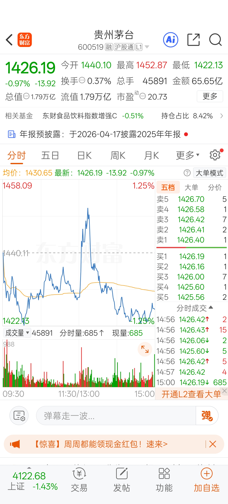
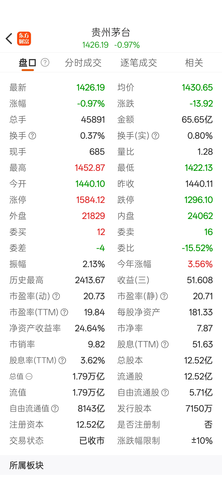
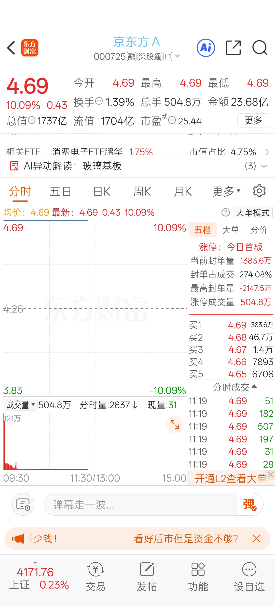
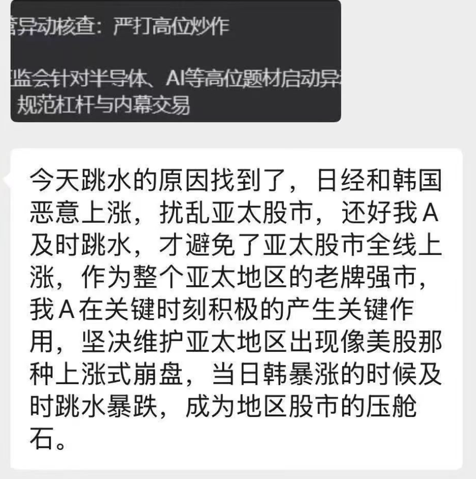
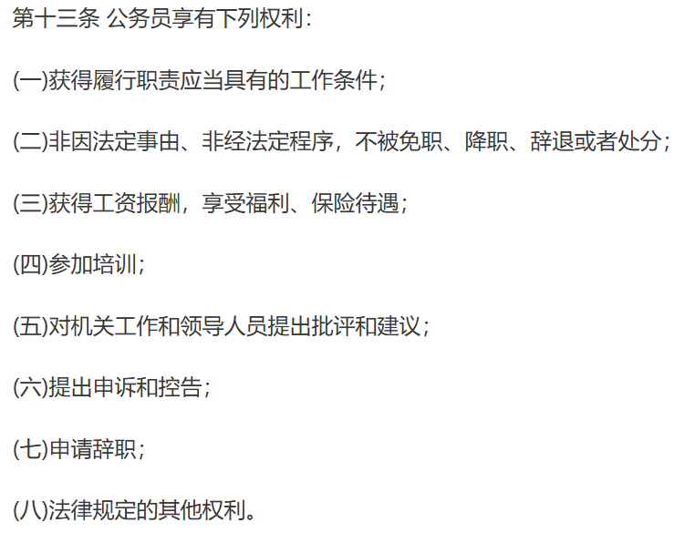
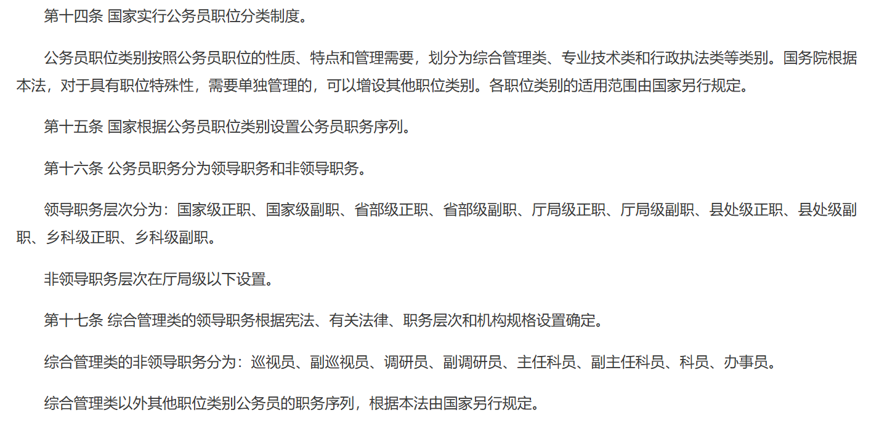
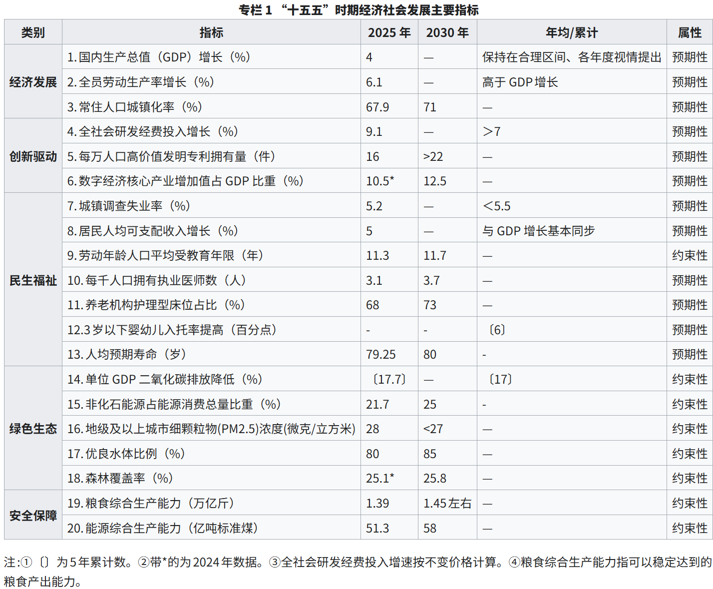
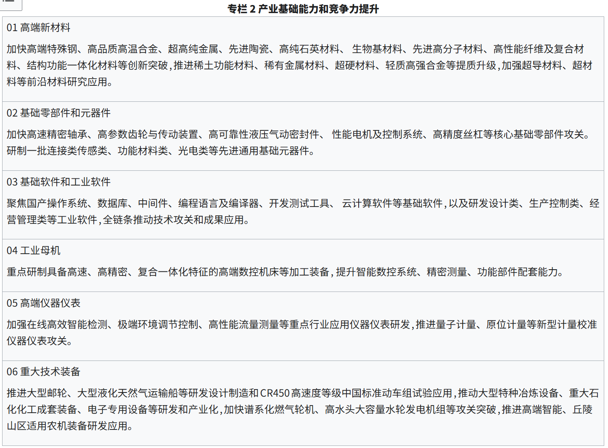
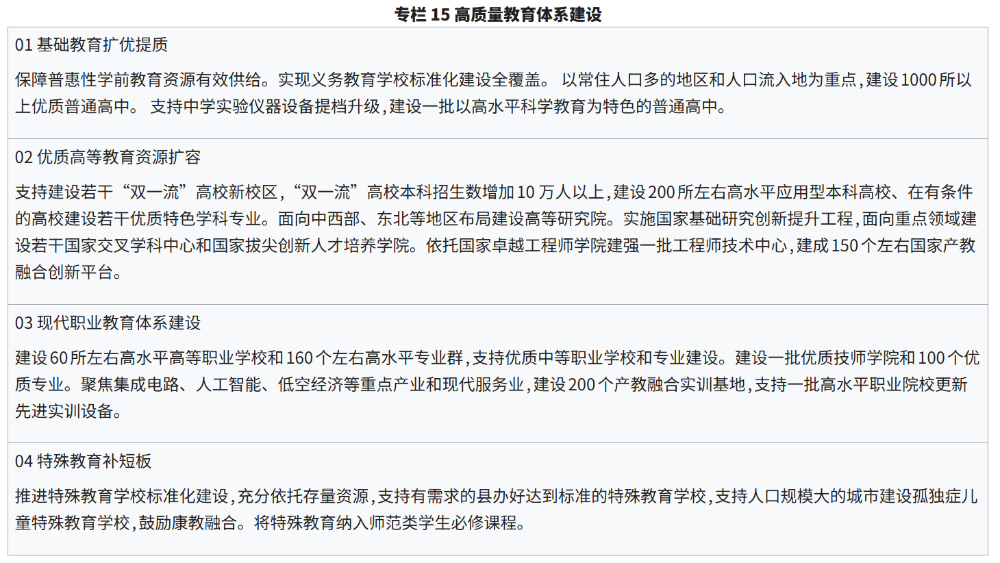
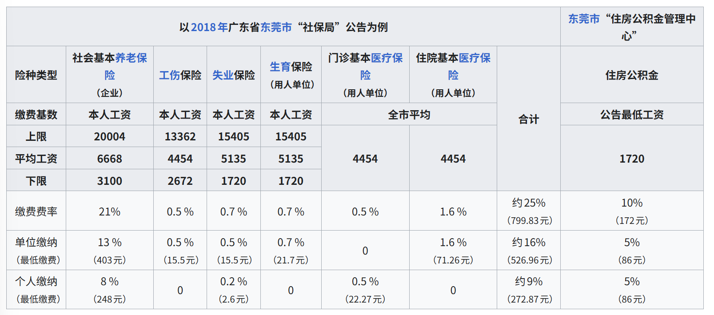

## 常见英文缩写
### 拉丁文缩写
英文中不时能够看见拉丁文缩写,一般规则如下:
- 如果该拉丁文单词被缩写了,就在缩写后加个点
- 如果拉丁文单词是完整的,就不做处理


有一个例子可以很好的说明:
- `et al.`: (et alii),et是完整单词,但`alii`不是,所以al后面加了一个`.`

- `w.r.t`: **with respect to**,关于,相对于,常用于技术文献中:
  - "If the function is differentiable w.r.t. its parameters..."
  - “如果该函数关于其参数是可微的（可求导的）……”
- `i.e.` : (id est),换句话说
- `e.g.` : (exempli gratia),例如
- `et al.`: (et alii),**以及其他人**,常作为文献中的引用说明:
  - Objectives may also have other sources of noise than data subsampling, such as dropout (Hinton et al., 2012b) regularization. 

### 技术名词
- TL;DR: 是 "Too Long; Didn't Read"（太长不看）的缩写,常作为文档总结
- FYR: 是 "For Your Reference" 的缩写,表示供你参考
- FYI: 是 "For Your Information" 的缩写，意为**“供你知晓”**
- PoC: "Proof of Concept",为了证明某个技术方案在物理上是可行的，先写一个简陋的 Demo。
- MVP: `Minimal Viable Product`,用于验证是否满足基本需求的demo产品.
- SOTA: **State-of-the-Art**,表示该模型/算法是当前任务中性能最好的
  - 附加两个经常用到的英文单词
  - Baseline: **基础参照物**,用于与改进模型进行对比的基本模型
  - Benchmark: **基准**,用于评估模型性能的标准数据集.
- SOA: **Service-oriented architecture**,通过服务来划分架构


## 程序员世界
### 学术组织与实验室

#### [ACM](https://en.wikipedia.org/wiki/Association_for_Computing_Machinery)

##### 介绍

ACM的全名为**Association for Computing Machinery**，中文通常译为“美国计算机协会”或“计算机协会”。它成立于1947年，是面向计算机科学研究者、教育工作者和从业人员的国际性专业学会。

ACM的主要贡献不在于直接开发软件，而在于组织学术会议、出版计算机科学期刊和会议论文、设立专业兴趣组，并参与计算机教育课程体系的制定。ACM图灵奖是计算机科学领域最具影响力的学术奖项之一。其代表性公共资源主要是ACM Digital Library、计算课程指南以及各专业兴趣组发布的研究资料。

#### [Bell Labs](https://en.wikipedia.org/wiki/Bell_Labs)

真神降临,互联网的一切都来源于这个小小的实验室,可惜的是,知晓其重要性的人却不多.

##### 介绍

Bell Labs即**贝尔实验室**，其正式机构可追溯至1925年成立的Bell Telephone Laboratories。它长期承担美国贝尔电话系统的基础研究和工业研发工作，后来先后隶属于AT&T、Lucent、Alcatel-Lucent和Nokia。

贝尔实验室的重要成果包括晶体管、信息论、激光、通信卫星技术、Unix操作系统以及C、C++、AWK等编程语言。早期Unix采用商业授权,与开源关系较密切的成果包括后来开放源代码的**Plan 9**，以及经BSD、Linux等系统继承和扩展的Unix技术传统。

#### [Berkeley（University of California, Berkeley）](https://en.wikipedia.org/wiki/University_of_California%2C_Berkeley)

##### 介绍

这里的Berkeley指**加州大学伯克利分校**及其计算机科学研究机构。伯克利计算机系统研究组在AT&T Unix基础上开发了**Berkeley Software Distribution（BSD）**，对现代Unix、FreeBSD、OpenBSD、NetBSD以及macOS的底层体系产生了持续影响。其他代表性开放项目包括**BOINC、Caffe**等；伯克利的研究还推动了RISC体系结构、数据库系统和分布式计算的发展。

#### [Xerox PARC](https://en.wikipedia.org/wiki/PARC_%28company%29)

##### 介绍

Xerox PARC的全名最初为**Xerox Palo Alto Research Center**，中文通常译为“施乐帕洛阿尔托研究中心”。它由Xerox于1970年建立，主要从事计算机系统、办公自动化和信息技术方面的长期研究。

PARC的重要成果包括**Alto个人计算机、图形用户界面、Smalltalk、以太网和激光打印技术**。这些成果并非都由PARC独自完成商业化，但对个人计算机、面向对象编程、局域网和现代办公系统产生了持续影响。

#### [IBM Research](https://en.wikipedia.org/wiki/IBM_Research)

##### 介绍

IBM Research即**IBM研究院**，是IBM长期设立的企业研究体系，研究范围覆盖计算机体系结构、半导体、人工智能、量子计算、数据库和材料科学等领域。

IBM研究人员参与开发了**Fortran**，提出了关系数据库模型，并通过System R等项目推动了SQL和关系型数据库的实际发展

#### [CERN](https://en.wikipedia.org/wiki/CERN)

##### 介绍

CERN的全名为**European Organization for Nuclear Research**，中文通常译为“欧洲核子研究中心”。它成立于1954年，主要任务是开展粒子物理研究，并建设和运行大型粒子加速器及相关计算设施。

Tim Berners-Lee于1989年在CERN提出万维网，并随后开发了早期Web服务器、浏览器以及HTML、HTTP和URL等基础机制。CERN于1993年公开发布Web软件，使其能够被广泛采用。除万维网外，CERN还开发或参与维护了**ROOT、Geant4、CERN Open Data Portal**等开放科研软件与数据基础设施。

#### [Google](https://en.wikipedia.org/wiki/Google)

##### 介绍

Google成立于1998年，最初围绕Larry Page和Sergey Brin在斯坦福大学开发的搜索引擎建立。其业务后来扩展到在线广告、云计算、移动操作系统、浏览器、人工智能和办公服务等领域。

Google对互联网基础设施和开发工具的重要贡献包括搜索引擎工程、大规模分布式系统、MapReduce相关思想以及云原生技术。代表性开源项目包括**Android、Chromium、Kubernetes、TensorFlow、Go、Bazel、gRPC和Protocol Buffers**。其中一些项目后来转交独立基金会或社区治理，并不完全由Google单独控制。

#### [Meta](https://en.wikipedia.org/wiki/Meta_Platforms)

##### 介绍

Meta Platforms的前身是2004年成立的Facebook公司，并于2021年更名为Meta。其主要业务包括Facebook、Instagram、WhatsApp、Messenger、Threads，以及虚拟现实、人工智能和广告技术。

Meta在前端开发、移动开发和机器学习领域发布过较多开源项目。代表性项目包括**React、React Native、PyTorch、Jest、GraphQL、HHVM和Docusaurus**。部分项目后来转由独立基金会或社区治理，例如PyTorch目前由Linux基金会体系下的PyTorch Foundation支持。

#### [Microsoft](https://en.wikipedia.org/wiki/Microsoft)

##### 介绍

Microsoft成立于1975年，最初为Altair 8800开发和销售BASIC解释器，随后凭借MS-DOS、Windows和Office成为个人计算机软件领域的重要企业。其业务后来扩展到Azure云计算、开发工具、数据库、游戏和人工智能等领域。

Microsoft早期主要采用专有软件模式，近年来则广泛参与开源生态。代表性开源项目包括**NET、TypeScript**。Visual Studio Code的大部分基础代码以**Code-OSS**形式开放

### 标准组织与基金会

#### [Apache Software Foundation（ASF）](https://en.wikipedia.org/wiki/The_Apache_Software_Foundation)
当之无愧的劳模,每个项目的名字都如雷贯耳,不过大多数项目都是由其他公司捐献出来的,而非独立研发的
##### 介绍

Apache Software Foundation即**Apache软件基金会**，成立于1999年，起源于Apache HTTP Server开发者社区。它为开源项目提供法律主体、商标管理、基础设施和社区治理支持，各项目通常由相对独立的项目管理委员会负责。

ASF在Web服务器、大数据、分布式计算、消息系统和企业中间件等领域具有广泛影响。主要开源项目包括**Apache HTTP Server、Hadoop、ANT/Maven, Spark、Kafka、Flink、Maven、Tomcat、Dubbo、Airflow、Iceberg、Lucene和Cassandra**等。这些项目通常采用较为宽松的Apache License 2.0。

#### GNU(4/2)

* [GNU官网](https://www.gnu.org/)

##### 介绍

> [wiki](https://en.wikipedia.org/wiki/GNU)
>
> GNU is a recursive acronym for **"GNU's Not Unix!"**, chosen because GNU's design is Unix-like, but differs from Unix by being free software and containing no Unix code.

GNU 是由理查德·斯托曼于 1983 年发起的一项自由软件运动，旨在开发一套与 Unix 兼容但完全不含其私有代码的自由操作系统。该项目不仅催生了包括 GCC、Emacs 及核心工具链在内的数百个软件包，还奠定了自由软件基金会（FSF）与 GPL 许可证的基础，最终通过与 Linux 等内核结合，构建出了现代广泛使用的自由操作系统生态。

GNU组织名下最著名的几个软件是: Bash,gcc,gdb,make,Emacs.每一个都有着举足轻重的地位.

* [完整软件列表](https://www.gnu.org/software/software.html)

##### Bash

* [官方](https://www.gnu.org/software/bash/manual/bash.html#Bash-POSIX-Mode-1)
* [wiki](https://zh.wikipedia.org/wiki/Bash)

> Bash是Bourne shell的后继兼容版本与开放源代码版本，它的名称来自Bourne shell（sh）的一个双关语（Bourne again / born again）：Bourne-Again SHell。
>
> Bash is an interactive command interpreter and command language developed for **Unix-like operating systems**.

* 大多数Linux系统都默认使用Bash作为脚本执行工具

##### gcc

* [官网](https://www.gnu.org/software/gcc/)
* gcc全名为**GNU Compiler Collection**

> The GNU Compiler Collection includes front ends for **C, C++**, Objective-C, Objective-C++, Fortran, Ada, **Go**, D, Modula-2, COBOL, **Rust**, and Algol 68 as well as libraries for these languages (libstdc++,...). GCC was originally written as the compiler for the GNU operating system. The GNU system was developed to be 100% free software, free in the sense that it respects the user's freedom.

我们需要知道的是,gcc通过不同的前端部分处理不同的编程语言,在经过中间处理后,使用相同的后端部分翻译成可执行文件,这种构造使得语言开发者不用太多的考虑中间文件到机器语言的转换.

##### gdb

* [官网](https://www.sourceware.org/gdb/)

> GDB, the **GNU Project debugger**, allows you to see what is going on `inside' another program while it executes -- or what another program was doing at the moment it crashed.

* GDB can run on most popular UNIX and Microsoft Windows variants, as well as on macOS.

在vscode里对cpp程序进行断点调试靠的就是gdb

##### make

* [官网](https://www.gnu.org/software/make/manual/make.html)

cpp的底层构建工具,不必多谈

##### Emacs

* [官网](https://www.gnu.org/software/emacs/tour/index.html)

Emacs是一个"重量级"文本编辑器(当然比vscode还是要轻量的多),支持的基础功能就有很多,如下方表格所示:

| 功能模块                                                                                                                                                        | 基础版内置支持说明                                           |
| :-------------------------------------------------------------------------------------------------------------------------------------------------------------- | :----------------------------------------------------------- |
| **文本编辑**                                                                                                                                                    | 缓冲区（Buffer）管理、无限撤销（Undo）、矩形编辑、宏录制     |
| **文件系统**                                                                                                                                                    | Dired（目录浏览器）、远程文件编辑（TRAMP）、多文件全局搜索   |
| **编程辅助**                                                                                                                                                    | 语法高亮（Font Lock）、自动缩进、S-expression 导航、基础补全 |
| **多任务管理**                                                                                                                                                  | 窗口（Window）任意切分、框架（Frame/多端显示）管理           |
| **自省系统**                                                                                                                                                    | 实时查看函数定义（Describe Function）、变量文档及快捷键绑定  |
| **内置终端**                                                                                                                                                    | Eshell（纯 Elisp 实现的 Shell）、Term、Ansi-term             |
| **版本控制**                                                                                                                                                    | VC 模式（支持 Git, SVN, Mercurial 的基础操作）               |
| **文本处理**                                                                                                                                                    | 正则表达式搜索替换、文本对齐、各种字符编码转换               |
| **组织与日程**                                                                                                                                                  | Org-mode（基础笔记、任务追踪、导出 HTML/LaTeX）              |
| **网络工具**                                                                                                                                                    | EWW 浏览器、邮件客户端（Gnus/Rmail）、FTP 支持               |
| 可以看的出来它比vim要复杂繁重的多,集成了很多不是非常有必要的功能,这也就导致Emacs的快捷键比vim要多,甚至有不少的多级快捷键操作,所以使用vi/vim的人比Emacs要多很多. |                                                              |
| Emacs的拥护者与vi(著名的vim为vi的改版)的拥护者曾经[闹得不可开交](https://en.wikipedia.org/wiki/Editor_war),但在vscode成为了主流以后就没有争吵的必要了😆.         |                                                              |

#### [Free Software Foundation（FSF）](https://en.wikipedia.org/wiki/Free_Software_Foundation)

##### 介绍

Free Software Foundation即**自由软件基金会**，由Richard Stallman于1985年成立，用于支持GNU计划并推广用户运行、研究、修改和重新分发软件的自由。

FSF的重要贡献包括发布和维护**GNU General Public License（GPL）**、LGPL和AGPL等许可证，并为GNU软件、自由软件基础设施和许可证合规工作提供支持

#### [ICANN](https://en.wikipedia.org/wiki/ICANN)

##### 介绍

ICANN的全名为**Internet Corporation for Assigned Names and Numbers**，中文通常译为“互联网名称与数字地址分配机构”。它成立于1998年，是负责协调互联网关键标识符系统的非营利组织。

ICANN主要处理域名系统顶层结构、DNS根区、IP地址空间协调、协议参数以及IANA相关职能。

#### [IEEE](https://en.wikipedia.org/wiki/Institute_of_Electrical_and_Electronics_Engineers)

##### 介绍

IEEE的全名为**Institute of Electrical and Electronics Engineers**，中文通常译为“电气与电子工程师协会”。它于1963年由美国电气工程师学会和无线电工程师学会合并成立，是覆盖电子、电气、通信和计算机工程的国际专业组织。

IEEE的主要贡献包括出版论文、举办技术会议和制定工程标准。代表性标准包括**IEEE 802.3以太网、IEEE 802.11无线局域网、IEEE 754浮点数标准和IEEE 1003 POSIX**。

#### [Khronos Group](https://en.wikipedia.org/wiki/Khronos_Group)

##### 介绍

Khronos Group即**科纳斯组织**，成立于2000年，是由芯片厂商、操作系统厂商、软件企业和研究机构共同参与的开放技术标准联盟。

Khronos主要制定图形计算、并行计算、三维资产和扩展现实领域的跨平台标准，代表性成果包括**OpenGL、Vulkan、OpenCL、WebGL、OpenXR、glTF、SPIR-V和SYCL**。

#### [IETF](https://en.wikipedia.org/wiki/Internet_Engineering_Task_Force)

##### 介绍

IETF的全名为**Internet Engineering Task Force**，中文通常译为“互联网工程任务组”。它形成于1986年，是一个开放参与、以工作组和技术共识为主要运作方式的互联网标准组织。

IETF通过发布**RFC**制定或记录互联网协议，其工作覆盖IP、TCP、UDP、DNS、电子邮件、HTTP、TLS、QUIC和路由协议等领域。

#### [ISO](https://en.wikipedia.org/wiki/International_Organization_for_Standardization)

##### 介绍

ISO的英文名称为**International Organization for Standardization**，中文译为“国际标准化组织”。它于1947年正式运作，由各成员国家或地区的标准化机构组成，是一个独立的国际非政府组织。

ISO制定的标准覆盖质量管理、制造、信息技术、食品安全、交通、医疗和环境管理等领域。常见标准包括**ISO 9001、ISO 14001、ISO 8601、ISO 3166**以及与IEC合作制定的众多信息技术标准。

#### [Ecma International](https://en.wikipedia.org/wiki/Ecma_International)

##### 介绍

Ecma International最初于1961年以**European Computer Manufacturers Association**的名义成立，后来发展为制定信息与通信技术标准的国际性行业组织。

Ecma最著名的工作是由TC39委员会维护**ECMAScript**语言标准，即JavaScript共同遵循的核心规范。其他代表性标准还包括**JSON、C#、Common Language Infrastructure和Office Open XML**等。
#### [Unicode Consortium](https://en.wikipedia.org/wiki/Unicode_Consortium)

##### 介绍

Unicode Consortium即**统一码联盟**，成立于1991年，是负责维护Unicode标准和软件国际化数据的非营利组织。其成员包括科技企业、研究机构、政府部门和个人成员。

Unicode标准为世界各地的文字、符号和表情字符分配统一编码，使不同操作系统、编程语言和网络服务能够较为一致地处理文本。其代表性开放成果包括**Unicode Standard、Unicode Character Database、Common Locale Data Repository（CLDR）和International Components for Unicode（ICU）**。

#### [Linux Foundation](https://en.wikipedia.org/wiki/Linux_Foundation)

##### 介绍

Linux Foundation即**Linux基金会**，其前身Open Source Development Labs成立于2000年，并在2007年与Free Standards Group合并。它最初主要为Linux内核开发和推广提供支持，后来逐渐发展为托管多个开源基金会和项目的综合性组织。

Linux基金会为项目提供资金、治理、商标、培训、认证和技术基础设施。其体系内的代表性项目和组织包括**Linux内核、Cloud Native Computing Foundation、Kubernetes、Hyperledger、Zephyr、OpenSSF和LF Networking**。

#### [Mozilla Foundation](https://en.wikipedia.org/wiki/Mozilla_Foundation)

##### 介绍

Mozilla Foundation即**Mozilla基金会**，成立于2003年，用于承接和支持Mozilla开源社区，并以非营利组织的形式维护开放互联网相关的公共目标。Mozilla项目本身则可以追溯到1998年Netscape开放浏览器源代码之后形成的社区。

Mozilla体系最具代表性的开源产品是**Firefox**，其他重要成果包括**Gecko、SpiderMonkey、Thunderbird、MDN Web Docs**以及最初由Mozilla推动的Rust语言。

#### [Open Source Initiative（OSI）](https://en.wikipedia.org/wiki/Open_Source_Initiative)

##### 介绍

Open Source Initiative即**开放源代码促进会**，成立于1998年，由Eric Raymond和Bruce Perens等人参与创建，主要负责解释、维护和推广“开放源代码”这一概念。

OSI维护**Open Source Definition**，并通过公开审查程序认定符合条件的开源许可证。与更强调软件自由和用户权利的FSF相比，OSI通常更集中于开放开发模式、许可证标准和产业协作。

#### [NIST](https://en.wikipedia.org/wiki/National_Institute_of_Standards_and_Technology)

##### 介绍

NIST的全名为**National Institute of Standards and Technology**，中文通常译为“美国国家标准与技术研究院”。它成立于1901年，最初名为National Bureau of Standards，1988年改用现名，隶属于美国商务部。

NIST主要从事计量科学、材料测量、物理标准、网络安全和信息技术研究。代表性成果包括**AES加密算法遴选、SHA-3竞赛、NIST Cybersecurity Framework、SP 800系列安全指南、国家漏洞数据库NVD**以及各种标准参考数据。
#### [W3C](https://en.wikipedia.org/wiki/World_Wide_Web_Consortium)

##### 介绍

W3C的全名为**World Wide Web Consortium**，中文通常译为“万维网联盟”。它由Tim Berners-Lee于1994年创立，主要负责组织浏览器厂商、研究机构、企业和公共组织共同制定Web技术标准。

W3C的重要成果包括**HTML、CSS、DOM、XML、SVG、Web Accessibility Initiative和WCAG无障碍标准**。

### 著名出版社
#### 汇总
| 出版社 / 品牌                   | 主要定位              | 最强领域                             | 典型风格                  | 代表性图书/系列                                       | 我会怎么评价                 |
| ------------------------------- | --------------------- | ------------------------------------ | ------------------------- | ----------------------------------------------------- | ---------------------------- |
| **O’Reilly Media**              | 现代软件工程与新技术  | 后端、数据、云原生、AI、架构         | 原理 + 工程实践，紧跟产业 | *Designing Data-Intensive Applications*、动物封面系列 | **现代工程技术首选**         |
| **Manning**                     | 教学型专业技术书      | Java、架构、ML、微服务               | 循序渐进、案例驱动        | *Microservices Patterns*、*… in Action*、*Grokking…*  | **最适合系统学习**           |
| **Apress**                      | 专业/应用计算         | 数据库、Java/.NET、Web、细分技术     | 系统、正式、覆盖面极广    | *Pro…*、*Beginning…*、*Practical…*                    | **细分主题非常强**           |
| **Addison-Wesley Professional** | 软件工程经典          | 编程思想、设计、语言、工程方法       | 重思想、生命周期长        | *Design Patterns*、*Refactoring*、*Effective Java*    | **经典密度最高之一**         |
| **No Starch Press**             | Hacker/系统/安全文化  | Linux、安全、Python、底层系统        | 可读性强、作者风格鲜明    | *How Linux Works*、*Python Crash Course*              | **系统与安全尤其值得看**     |
| **The Pragmatic Bookshelf**     | 开发者实践            | 编程语言、DevOps、工程方法           | 小而精、实践性强          | Programming 系列、开发实践类                          | **开发者味道最浓**           |
| **MIT Press**                   | 计算机科学/研究型教材 | 算法、AI、ML、PL、理论、机器人       | 学术性强、原理长期有效    | *SICP*、*CLRS*、*Deep Learning*                       | **CS 理论与研究型学习首选**  |
| **Packt**                       | 快速覆盖新技术        | 云、框架、AI、DevOps                 | Hands-on、版本导向        | *Mastering…*、*Hands-On…*、Cookbook                   | **更新极快，但质量波动最大** |
| **Microsoft Press**             | Microsoft 技术生态    | Azure、Windows、.NET、Microsoft 认证 | 官方/准官方、产品导向     | Azure、Windows、Power Platform 系列                   | **学微软生态很有价值**       |


O’Reilly是绝对的龙头,有着很多经典,而Manning的in action系列不少还是可以的,Packt确实是有点波动了,但也有一些好书,至于其他的出版社还是得看具体出版的书,不能一概而论.
### 图灵奖得主调研
#### 图灵奖介绍
- [wiki](https://en.wikipedia.org/wiki/Turing_Award)

图灵奖(Turing Award)是计算机领域的公认最高奖项,每年由ACM学会颁布,第一个图灵奖于1966年颁布,至今(2026年)为止,总共只有81个人获得了该奖项,说明这个奖的含金量还是很高的.

#### Richard Hamming(1968)
- [wiki](https://en.wikipedia.org/wiki/Richard_Hamming)

>His contributions include the **Hamming code** (which makes use of a Hamming matrix), the Hamming window, Hamming numbers, the sphere-packing or Hamming bound, Hamming graph concepts, and the **Hamming distance**.

汉明距离: 用不同字符的数量来标识两个等长字符串之间的"距离"
#### Edsger W. Dijkstra(1972)
- [wiki](https://en.wikipedia.org/wiki/Edsger_W._Dijkstra)

他最出名的贡献就是同名的Dijkstra算法了,除此之外,他还协助开发了THE操作系统和ALGOL 60的编译器.

#### Robert W. Floyd(1978)
- [wiki](https://en.wikipedia.org/wiki/Robert_W._Floyd)

最知名的贡献就是图算法中的Floyd-Warshall算法了.
#### Edgar F. Codd(1981)
- [wiki](https://en.wikipedia.org/wiki/Edgar_F._Codd)

Edgar F. Codd是关系型数据库之父,在任职于IBM期间发布了著名的论文"A Relational Model of Data for Large Shared Data Banks",但是他提出的关系数据库模型和SQL的原型语言Alpha并没有立刻被IBM采纳,而是雪藏了几年后由于商业竞争才不得不被采用.

- Boyce-Codd范式中的Codd指的也是他.

#### 姚期智(2000)
- [wiki](https://en.wikipedia.org/wiki/Andrew_Yao)

>2015年,姚期智和杨振宁一同放弃美国国籍,加入中国国籍

姚期智的主要研究方向是量子计算和密码学领域,这更偏向于数学,但他就任的岗位却是清华大学人工智能学院,额,那我就不理解了.

#### Yoshua Bengio(2018)
- [wiki](https://en.wikipedia.org/wiki/Yoshua_Bengio)

他是被引用次数的计算机科学家,也是所有领域中被引用次数最多的在世科学家,他最知名的论文应该就是03年的那篇"A Neural Probabilistic Language Model"了.
#### Geoffrey Hinton(2018)
- [wiki](https://en.wikipedia.org/wiki/Geoffrey_Hinton)

Geoffrey Hinton是公认的AI教父,著名的论文有1986年的"Learning representations by back-propagation errors",2012年的"ImageNet Classification with Deep Convolutional Neural Networks"等
#### Yann LeCun(2018)
- [wiki](https://en.wikipedia.org/wiki/Yann_LeCun)

Yann LeCun是Geoffrey Hinton在多伦多大学的博士后,也有着相当不俗的成就,最突出的贡献就是发明了卷积神经网络.

## 投资

### 概念理清
可惜的是,能够好好讲清楚什么是期货,股票的运作模式是怎样的,如何选基金的入门书太少了,充斥在市面上的只有诸如<<穷爸爸富爸爸>>这样的垃圾书,不过仔细想想也是,要是把如何致富的方法都告诉你了,那我还怎么赚钱.
<<半小时漫画经济学4>>是我至今唯一能看的过去的入门书,别看内容少,但基本能够让小白大致了解到投资的各种途径以及对应的风险情况.
#### 债券
普通人接触最多的债券应该就是国债了,相当于借钱给国家去投资,非常稳定,也就说明利润很低,基本和在银行存款的利息没什么差别
#### 股票
股票原先是帮初创公司用来募集资金的(如果全国14亿人每人给我一元,那我不就成亿万富翁了),一般都是由大股东持有大部分股票,剩余的股票中再分出一小部分给散户来投资.

但初创公司也需要选择在哪家交易所上市,如果全都挤到一个交易所里进行交易那显然不利于企业良性竞争,以下是交易所的类型:
1. 国内A股: 国内只有两家交易所,上交所(上海证券交易所)-金融能源板,大型国企板,深交所(深圳证券交易所)-创业板,科创板
2. 港股: 香港联合交易所,内地投资者可以通过港股通代理商来投资,看了看好像要持仓50w以上😅
3. 美股: 如NYSE等证券交易所,可以买入美国科技股,国内也需要走代理商

买入股票前需要先开户,然后选定自己看中的股票买入100或者其他份数的股票,一份股票的价格就是股票图上的价格.
**注意事项**
1. T+1规则(A股):买入当天不能卖出,次日可卖
2. 手续费:印花税,佣金等按比例收取的费用,会随着你持有股票(持仓)的日期逐渐下降,当你买卖股票的差额过小时可能连手续费都交不满


股票说来简单做起来很难,也就四个字:低买高卖,因此是高风险投资的首选,但可操作性和运气成分太高了,莽夫也可能误打误撞碰到连续涨停,运气差了即便你机关算尽也不能及时止损.
#### 期货
期货实际上就是一张合约,卖方要以约定的价格在给定期限来临时把合约上的相关产品卖给买方,刚发明出来的时候是为了方便买卖方进行现货交易的,但现在基本是用来炒的了,有两种方式来炒期货
1. 做多: 简单说就是赌这个产品会涨,低买高卖
2. 做空: 赌这个产品会跌,在期限来临时以当日价格买入,但卖方要以当时的约定价格卖出,也是低买高卖
看上去就有风险对吧,谁说得清几个月后的事情是怎样的呢?同时,由于期货只需要冻结10%的保证金就可以持仓(买入后并持有期货),故有着相当大的杠杆,一旦价格波动过大导致保证金都不能弥补亏损,会被庄家强制平仓(以约定价格全款结算期货),想想都可怕,因此期货是勇敢者的游戏,不建议平民参与
#### 基金
实际上就是找代理人帮你投资,分为两种情况
1. 稳健型基金: 大部分买入国债等稳定性资产,少部分用来进行高风险投资,保证基本盘
2. 风险型基金: 大部分进行高风险投资,少部分买入,事实上ETF(exchange-traded funds,交易型开放式指数基金)就属于这一类型,但它会根据诸如纳斯达克指数这样的指标进行投资,相对来说风险会低一点点.


#### 实物
房地产,黄金等可以用来炒作的(稀缺?)资源,均为高端局,不建议平民参与
- [为什么普通人不适合投资实物黄金](https://liyafu.com/2025-10-23-golden-investment/)


### 股票详解
#### 交易规则
##### 交易时间
周一至周五 (法定休假日除外)
- 上午9：30 --11：30
- 下午1：00 -- 3：00
##### 交易单位
股票的交易单位为“股”，100股＝1手，委托买入数量必须为100股或其整数倍
##### 交易方法
我开户用的是东方财富,只看股票就行,里面的资讯基本都是垃圾,当然用同花顺app或者其他的也可以,建议下载雪球app来学习别人的经验

切记创业板等高端局需要你在其他板块交易第一次之后两年才解封,所以建议先选一个价位稳定的股票交易一次,才可以在以后投资科创板.
- 入股创业板的准确要求: 二十天内平均持仓20w以上并且有两年投资经验
- 使用港股通的准确要求: 二十天内平均持仓50w以上
#### 术语理解(3/4)
- 委托: 事实上买卖股票是一个双方的过程,买股票时你自己的定价和买入份数便是一份买入委托,卖股票时你自己的定价和卖出份数便是一份卖出委托,只有当买入委托的价格高于或等于卖出委托的价格时,交易才会成立,不然就会一直留存在系统上,俗称'挂单'.
- 涨停:内地独有的机制,A股的日涨跌幅一般限制在10%,也有一些会限制在20%, 一旦达到限额,当日成交价高于涨停价或者低于跌停价的订单都要到次日进行结算,从而保证了股市不会大规模动荡,也就说明A股的短线交易利润率不会特别离谱
- 熔断:如果指数跌幅超过阈值,将会暂停整个交易所内的交易
- 杠杆: 当你借入资金来买入比如10倍份额的股票,那么亏损和收益就会被放大十遍,类似于物理学中的杠杆原理,实现作用力的放大.因此需要有自知之明,不要轻易加杠杆
- 短线/长线: 长短指的是持仓时间,如果你T+1日或者T+2日就卖出,那肯定是短线交易;如果你持仓几个月,或者好几年,那就是长线交易.这两种方法各有各的利弊.
- 阻力位: 目标价格上涨时可能遇到的压力，即交易者认为卖方力量开始反超买方，从而价格难以继续上涨或从此回调下跌的价位
- 支撑位: 交易者认为买方力量开始反超卖方，从而止跌或反弹上涨的价位。
##### 股票种类
- 概念股[(来源)](https://baike.eastmoney.com/item/%E6%A6%82%E5%BF%B5%E8%82%A1):概念股是与业绩股相对而言的。业绩股需要有良好的业绩支撑。概念股则是依靠某一种题材比如资产重组概念，三通概念等支撑价格。中国概念股就是外资因为看好中国经济成长而对所有在海外上市的中国股票的称呼。也有称中国概念股是“就是为了使人相信其谎言而编造的一切谎言”。
- 蓝筹股:股票市场上，投资者把那些在其所属行业内占有重要支配性地位、业绩优良，成交活跃、红利优厚的大公司股票称为蓝筹股。“蓝筹”一词源于西方赌场。在西方赌场中，有二种颜色的筹码、其中蓝色筹码最为值钱，红色筹码次之，白色筹码最差。投资者把这些行话套用到股票上就有了这一称谓。
- 绩优股: 就是业绩优良公司的股票，但对于绩优股的定义国内外却有所不同。在我国，投资者衡量绩优股的主要指标是每股税后利润和净资产收益率。一般而言，每股税后利润在全体上市公司中处于中上地位，公司上市后净资产收益率连续三年显著超过10％的股票当属绩优股之列。绩优股具有较高的投资回报和投资价值。
#### 交易界面详解(根据[知乎文章](http://zhuanlan.zhihu.com/p/696334921?utm_campaign=shareopn&utm_medium=social&utm_psn=2012303744939876671&utm_source=wechat_session)撰写)

**上方部分**
- 贵州茅台：股票简称
- 600519：股票代码
- 1426.19: 股票现价
- 金额(65.65亿): 当日交易总金额
- 最高: 当日最高成交价
- 最低: 当日最低成交价
- 换手率: 当日的成交量/发行总股数×100%，是反映市场交投活跃程度最重要的技术指标之一
- 总手: 当日开盘到现在为止的总成交手数,一手等于一百股
- 总值: 以当前股价乘以总股本数计算出来的股票总价值
- 流值: 可以流通的股票市值(这里流值和总值相同说明所有股票都是流通的,**全都抛出来赚钱了**)
- 市盈率: 总市值/预估全年净利润,一般在10-20之间比较好,太低的要么是被过于低估,要么是流动性太低;太高的,比如说贵州茅台,都是热门的,饱受炒作的股票

>看得出来持仓茅台的都是精英中的精英(毕竟一千多一股呢,动辄就几百万了),不会轻易出手,一次交易的手数一般都比较少,股价波动非常缓慢



**中间部分**
- 五档:包含卖盘、买盘等候栏,该栏中卖一、卖二、卖三依次等候卖出。按照价格优先，时间优先的原则，谁卖出的报价低谁就排在前面，而这一切由电脑自动计算。卖一后面的数字为价格，再后面的数字为股票手数;该栏中买一、买二、买三表示依次等候买进，与卖出相反，谁买进的价格高谁就排在前面
- 现手: 最近的一笔交易手数
- 量比: 开市后每分钟平均成交量与过去5个交易日每分钟平均交易量的比值,表示交易的活跃度和投机性
- 委买: 还没有成交的买单
- 委买手数:当前所有个股委托买入前三档的手数总和。委托买入的手数比委托卖出的手数多，表示买比卖强，指数向上的概率比较大；委卖手数同理
- 外盘: 以卖出的报价成交叫外盘，俗称主动性买盘。当外盘累计数量比内盘大很多，而股价上涨时，表示很多人在抢着买进股票。如：外盘32721 内盘 29452，说明当日主动性抛盘远小于主动性买盘，形势对多方有利。
- 内盘：以买入的报价成交叫内盘，俗称主动性抛盘。当内盘累计数量比外盘累计数量大很多，而股价下跌时，表示很多人在卖出股票
- 流通股：上市公司股份中，可以在交易所流通的股份数量，按市场属性的不同可分为A股、B股、法人股和境外上市股。与流通股对应的，还有非流通股，非流通股股票主要是指暂时不能上市流通的国家股和法人股
- 自由流通股: 去除大股东后所剩的流通股

#### 好文记录
zlib上搜索雪球专刊精选,总共有四本,里面的每一篇文章都很优质,建议小白在了解基本概念后就去看
- 但不要看太多,很多文章之间的观点都是相互矛盾的,并且到了最后你会发现讲的东西都差不多
##### [投资体验](https://jingliwh.github.io/life/2016/05/08/programmer-finance.html)
##### 投资教学-爱吃鸡爪的阿辉
- 由于是雪球上的文章,不好转链接,文章又不是太长,故直接附录全文如下

今天来讲讲小白投资第一课，主要最近有一些大学生刚刚接触到这个市场，问我从哪里入手，那我们就来讲讲对于小白来说，普通人常见的失误，这些失误要不去犯，再接下来就是讲讲我觉得小白如何完成第一桶金投资，并建立正确的投资理念，当然这些仅是我的观点，不一定正确，仅供参考，不构成任何投资建议。

1、首先要做的就是先把自己的账户激活，我国开通创业板和科创板需要两年的投资经验，翻译过来就是说，你需要在中登公司有一笔交易，并且这个交易要达两年，这个交易在任何一个券商做的买卖都是可以的。

中登公司的全名叫着中国证券登记结算有限公司，是一个政府机构，不是一家公司，我们所开立的上海股东户，深圳股东户，每人只能开三个，就是中登公司的上海股东户和深圳股东户只能开三个的要求。

要激活这个第一笔交易，买入ETF可不算哦，需要激活的是股票交易，比如花个800元买一手工商银行，明天再卖回掉，就算激活了，工商银行波动小，一天不会产生什么大的亏损，当然如果本是想要边炒股边学习，就没有必要做这个动作了，只要是买入任何一个股票，都会激活账户。

2、常见错误。

2.1 对于小白来说，正常不会入很多资金，一般来说，好公司股价都偏贵，大几十块钱，上百元，所以买一手就要大几千元上万元，对于小白来说，天然的第一个失误，会去买十块钱以下的个股，10元以下的个股，如果还是好公司，要么公共基施设施，要么高负债的公司。

但总的来说10元以下的个股，大概率都是不好的股票为主，这个是小白第一坑，认为5元涨一元就能涨20%，50元涨1元才涨2%，股市涨跌不是这么算的，是按比率算的，5元涨1元，和50元涨10元，都是20%，难度是一样的。而选择不好的低单价的公司，输的概率就特别的高，比历史的统计数据中，中位数选择20至50元之间单价的个股，很多品质很好，并且活跃性特别好。

2.2 小白的选股渠道这是所有亏损原因的重大原因，小白不会使用软件，不知道市场有多少个股票，分别是什么，只能接触到一个股票了解一个，几年时间，手中知道的股票也没有超过20多支，之所了了解到，是因为亲友推荐，或者新闻中看到，或者证券公司软件弹出来的信息。

为何是重大的亏损原因，是因为以上几个渠道得来的股票，全是热门股，并且都天花板极别的个股，很多已经是3至5倍涨幅的个股，有的甚至10倍涨幅的个股，最关键的时，这些个股，因为很热门，买进去，一般情况下还是能先赚钱的，接下来就是，不卖，这么贵，大回撤是必然，很容易亏大钱，如果卖了，因为自己不会使用软件选股，所以换另一个热门股，而热门股总有结束的时候，所以赚小钱，亏大钱，几乎是必然的。

2.3 浮盈加仓，一把亏光。对于小白来说，如果很幸运遇到一个相对不是很贵的好公司，刚开始做投资谁也没有勇气买很多，我第一笔入市资金才5万元，对于不了解的东西，我们有着天然的恐惧心理，所以会买一点点，然后看着它上涨，然后把它卖了，不过它继续涨就会更大仓位买回来，具体操作可能如下。

第一次，小金额，10元买入，11元卖出，赚钱了信心加持，第二次，中等金额，15元再次买入，17元卖出，两次的正确，信心暴棚，第三次20元大仓位买入，并且还向好朋友推荐，因为自己已成功在这个个股赚到钱，信心暴棚是很正常的，以为会一直持续，但是实际该个股开始买就10元，到现在翻倍，底部上来可能就3至5倍了，然后重大回撤，用小仓位来赚钱，用大仓位来亏钱。

2.4 高位亏损补仓，重仓套牢。对于小白来说，基本上不太可能买冷门股，也接触不到，能接触到的全是热门股，都是在天上飘的个股，这些股一旦发生回撤，下跌50%很正常，就像我们刚刚举的10元变成50元的股票，回撤50%变成25元，也是很贵很贵的，所以高位补仓，基本没有好的。

这个是所有小白中亏损最为严重的原因之一，因为大家都怕高，所以也在等，等到个股回撤了百分之十几，觉得机会了，高位进行补仓，要平摊自己的成本，等反弹保本，也就是10元涨到50元，被小白买入，然后跌到45元就觉得差不多了，然后补，又跌到40元，觉得跌太多了，又补，等跌到35元，觉得这是底了，再补，结果就是用月线一看，10元的股票，现在35元觉得是底，这个判断严重有误。

于是就出现了，亏损越跌越补，第一次补在山顶上，然后补在半山腰上，总结经验得出结论为：你想抄它的底，它想抄你的家，以为补在地板了，发现还有地下室，以来地下室了，发现还有十八层地狱。

对于越跌越补，只能是好公司很便宜的时候，才能使用这个方法，这个方法有很强的局限性，因为如何判断它是不是好公司，并且便不便宜，新手基本不可能做到，所以新手千万不要使用越跌越补，就是跌了，要么让它跌等反弹，要么就止损，不可以补仓。

2.5 卖出盈利，补仓亏损，最后自动单仓单票套牢。这个我早年常干的大蠢事，比如我买入股票A、B、C、D四支股票，如果A 涨了，盈利了我担心回撤，会把A卖掉，去补正在亏损的BCD，然后B也开始赚钱了，又卖掉去补还是亏损的CD，等C也反弹赚钱了，再次卖出去补还在亏损的D，最后本来布局了AB­CD四个票，结果就是三个上涨全部卖飞，留下了处于亏损的D，然后抱怨自己的运气不太好，而不反思自己有意为之把钱集中到亏禹的D中进行套牢。

对于这个方法，我一般都是分AB­CD买入，买入后不论涨跌，都不动，涨的让它涨，跌的让它跌，那最终赚钱和亏钱，就看自己当时买入这四家公司的价格贵不贵了，如果不贵，四家都赚钱，如果买的是中性的价格，账户还是赚钱的，如果全买贵了，账户亏钱。

因为买得便宜，四家全能暴涨，买得中性，下跌最多跌50%非常极致了，而上涨的个股中会出现翻倍或翻好几倍的，最终赚钱还是赚钱不错的，那全买贵了，很多贵的公司是真的品质很好，会更贵，或者很长时间留在贵的区域用业绩来夯实股价，比如像阳光电源，当时很贵，但也不跌，因为业绩增长慢慢的内在价值上升，股价从很贵变成贵，变成中性，后来继续上涨，当然其它很贵的下跌，但只要不动，也不一定会亏很多钱。

2.6 单仓单票，新手对市场认知不足，不能像老股民可以拿个五年十年，那么单仓单票，没有涨的话，实在是熬不过去，最后追涨杀跌，结果就是一直在换票的路上，不断卖飞，不断套牢止损，结果就亏钱很严重了。

3、该如何规划自己的投资生涯呢。

3.1 以学习为主，投资为辅，但是需要边操作边学习，人对自己无关事天然无法引发关注，如果没有注入适当的资金，基本上年轻人是不太可能学得会投资的，因为不关心也不关注，也没有输赢，学习天然要有输赢加持才会努力，比如在学校为了分数，那些不在乎分数的学生，就不会去关注老师上课说了什么。


就像我现在说找工作，第一要求，不管收入多少，必须交医社保，否则再高工资都不考虑，这句话对于不生病，又很年轻的大学生，肯定不会关心，只是听到，不会听进，但是你让45岁的中年人，没有医社保的工作，基本上不考虑，我们这个年龄会生病，也要考虑养老金，这句话还是这句话，但年轻人基本用不上医保，一年难得感冒一次，也不知道人生之跌的艰难，养老太遥远了。

3.2 站在前人的肩膀上去成功，资本市场是一个很棒的市场，不需要高智商，也不需要高学历，也不需要高人脉关系，你只要复制其它世界上顶级的投资大师的投资体系，不要自己创新，直接硬搬，虽然过程你可以质疑，但是可以边质疑，边坚持，必竟对方成功过，而你未成功的人的质疑，份量几何，所以在选择的时候，要主动选择成功的人的战略，自己的仅为参考，还着质疑一路坚持别人已成功的方法，不要太相信自己，要相信已功成名就的人的方法。

比如巴菲特的，好公司+安全边际+重仓长期持有。邓普顿和费雪的：成长型公司+分散仓位+盈亏都不去动。耶鲁大学基金会：分多种类+仓位平衡，每个板块使用市值恒定法，该板块上涨很多了，卖一些使得回到原来建仓时的市值，该板块下跌了，就补一些，补完后，仓位市值为建仓时的市值。再比如我国的公募基金投资圣经【好赛道，好公司，好价格】，公司好不好决定买不买，价格贵不贵决定买多少，翻译过来就是好公司才会进入目标，好公司价格太贵不买，好公司价格中性，就买一些，好公司价格便宜就买成重仓。

3.3 小白90%的损失来源于二手信息，10%来自于操作失误，操作是经验，是能力，是水平，后期慢慢学，二手信息可以直接变成一手信息，学会使用炒股软件，用炒股软件找公司，找信息，不使用朋友的信息，新闻的只言片语和断章取义。

更不使用券商弹出的个股，这些都是热门，赚钱效应很好的公司，券商才会弹出这些介绍信息，券商不会弹出一个好公司已经跌得一踏糊涂的标的，除非它想被骂，他只会弹出明天大概率有可能会赚钱的信息，但结果是，券商自营盘也不买这些，他们的自营盘也是做价值投资，要明白他们的自营盘可是不用交易佣金的哦，所以这些信息只会亏钱，不会赚钱的，要是会赚钱，他们自营盘就会买这些了。

4、我的方法介绍：买入便宜的好公司，熬个三五年。

4.1 公司足够好，这个公司要满足两个条件：1、这个公司的生意是不是好到，我想把它整个公司买下来，如果是，那我就会选择买它的股票，成为它的股东。2、这个公司如果没有上市，我是不是也会因为它是一个很棒的生意，成为它的股东，如果是，我才会买入成为它的股东。

4.2 好公司很便宜的时候开始买，越跌越买，很少考虑止损，好公司越便宜，越想收集它的筹码，可以无限收集它的筹码，但是考虑到资金有限，也考虑资金的效率，所以单个公司设上限，并且同时设单个板块上限。

比如我喜欢A公司，我设的单个板块为1000万元，那么我在越跌越买时，如果这个公司加这个板块的其它公司合起来买了1000万元后，我就不再打算投入了，再跌就看着跌，也不会去补了，不去跨越这个设定上限，以防无意中把所有资金集中到这个板块或这个公司中。

4.3 资本市场最终是把没有耐心人的钱转移到有耐心的人身上，无论你等不等得起三五年，最后你的人生都会迎来三五年，只是有的人三五年在几百家公司每家公司熬几天，最终也是在资本市场熬三五年，就像有的人三五年换很多工作，但还是工作了三五年，而我会在选定的一家公司上班三五年，也只是工作了三五年，一秒没有多熬，在哪当牛马不是牛马，换来换去，就不是牛马了吗？

4.4 反复做T，金顶战法，这个不做详细介绍，新手资金小，两个都不适用。

综上所述，核心就是，新手先学会炒股软件找公司找信息，不要到处听主播的，别人评论的二手信息，其次就是研究功成名就的人的方法，复制为主，复制是最容易成功的。最后少操作，多总结，多反思，三五年后，基本上就是别人十几二十年的功力了。

最后祝所有新手，小白，老股民2026年账户长虹。

以上仅为个人观点，不一定正确，仅供参考，不构成任何投资建议。

##### [韭菜的自我修养 ](https://wuyuying.com/blog/as-a-loser-at-investing/)
##### [捕蛇者说博客](https://pythonhunter.org/episodes/ep53)
#### 心得体会
##### 炒股需要本金,工作优先投资(2026/3/13)
很多人都在吹港股和美股,但如果你跃跃欲试,想要注册港股通,点开链接一看,赫然写着:**近20个交易日日均资产需不低于50万人民币**,想要当韭菜也不给你机会.

所以,当你能一下梭哈的资金量连50w都填不满的时候,在庄家看来你远远算不上是一个交易对等方.

不妨认真想想,即便你买的股票侥幸遇到几个涨停,或者你通过所谓的量化交易成功押中了某支潜力股,如果你的持仓资金只有区区几百块钱,我想怎么看你赚不到多少钱.

因此,还是努力找份好工作吧,等积攒了一定的资金实力后再真正下场试试股票,而不是坐等手头的几百块变成几万块,试试撞大运穿越回去还现实一点.
##### 股票不是投机
>股票是拿100块赚10块的地方,不是拿100块赚1万的地方,如果真想发财,或许买彩票的概率还高一点.

>股票不是投机而是投资,不能别人买你也买,别人卖你也卖,这注定了你永远在步别人的后尘,就算侥幸赚了一点很快就会亏完.
>
>相反,应该在对一家公司经过细心的考察后,在自己认为股价合适的时候买入,在认为周期到头的时候卖出,才可以保证不会轻易被割韭菜.
>如果你连买日常用品的时候也要货比三家,看看好评差评,那为什么到了股市这样一个中高风险的投资行业里不能去好好的评判一下某只股票的价值呢?
##### 新手入门
>事实上,我觉得新手最好的学习方法就是马上买入一支你觉得会涨的股票,不管是所谓的精确分析,量化处理,还是对上眼缘.

如果像我一样是普通人,当然买入一手单价小于10的股票就比较好,毕竟谁的钱是大风刮来的呢.

然后就开始了持仓环节,新手如果不是走狗屎运的话一般买入股票之后都会开始下跌,因为你了解的股票少,获得的资讯少,拥有的经验少,你不是韭菜谁是韭菜.

日复一日看着账面上刺眼的绿色,或许你很有耐力,愿意慢慢去熬到上涨的那天,最终回本;或许你等到头了股票也也没有回涨的时候;或许在抛售之后股票突然或者仍然上涨.无论怎样,你都完整的体验了一次投资股票的全过程.

我想,在这一段教训之后你一定会痛定思痛,决定在买入股票之前进行多方调研,在点击交易按钮之前反复斟酌.持仓之后在自己内心划定的价格区间内,即使看到绿字也能气定神闲,即使看到红字也能岿然不动

##### 五档买卖法(3/8)
当资金量大的时候在几档买卖相隔的利润也很可观了,如果你划不准合理的价位,就建议在现在的第五档买入或卖出,从而赚上一点差价
##### 长线or短线
短线交易意味着你需要在短短几日内持续不断的搜罗信息,找到次佳(散户很难找到最佳)的买入时机,并在恰当的时间卖出,基本这几天你别想做别的事情了.

而长线交易需要你在交易之前细致的考察意向公司的财务情况,分析未来的股价趋势,考察公司有无负面消息,然后在股价下跌到你的心理预期时买入,坐等升值(最好能升值).

一般来说,短线交易适合IPO(新股上市),舆论股,概念股,而长线交易适合慢牛股,蓝筹股,需要结合自己的考察选择合适的交易方式.

当然,如果你是学生的话,还是别搞短线交易了,总不能天天盯盘吧,搞长线交易才是普通人在A股赚钱的王道.
##### 不正常的A股(4/15)
- 由于我一般不看港股和美股,故这里只分析A股.

A股有两大特性:
1. 散户多,投机性强
2. 劣质股票多,容易被套牢

由于A股的历史相对于美股来说短的可怜,因此极不成熟.同时,大多数股票投资者根本不会投资,只是跟风投资,因此一支股票只有三种走势,小幅度上下波动,涨停,跌停.很少有走向正常的股票.

而且,A股里有很多业绩差的股票(很多国企的股票),如死猪一样躺在哪里,却从没有被强制退市.至于业绩良好的股票则被炒到几百上千一股的价位,一般人也根本消受不起.

因此,投资A股只不过是散户们在绝境中的最后挣扎而已,如果房产和土地无法自由买卖,外汇也不能自由处理,个体经营也举步维艰,而国债和存款的利率却逐年下跌,那不就只能去买点股票来试图挽回一点资产吗.
##### 意外收获(5/21)
我很早就买了京东方A这只股票,虽然只买了一手(因为确实不敢多买).但它的K线走势一直不争气,我看了看它的官网,又看了看它的产品,发现这只股票只是目前的业绩不太好而已,但它的市盈率一直都很合适,属于那种一旦被炒作就会飞上天的股票.

尽管如此,我还是一直不太信任这只股票,中间经历了几次涨涨停停,股价一直都比我的入手价要低,几乎按捺不住要直接卖出去及时止损了.

突然,昨天晚上它发了新一轮的融资通告,今天立刻就涨停了:


可以看到,由于事发突然,主力资金(也就是散户)根本没能及时收到这些消息,因为这只股票平时太冷门了,属于人人避之不及的垃圾股,所以没人在意这只股票,量化手段也失效了.大量的资金都集中在涨停价上,这反过来说明A股的股民基本没有多少是有理智的,都是看到哪里飘红就往哪里跑,愿意认真研究股票和公司的人太少了.

- 所以我有理由相信这只股票明天还会再涨一轮,至于还会不会再涨,那我就不知道了,但我打算一直拿着,直到它真的出现明显的下跌趋势再说.

由此而看,股票确实就是靠信息差来赚钱的,而机会转瞬即逝,只有做长线交易才有可能赚到一点点利润.

---

上午说完下午出事,散户都走吧,A股不是一个正常的股市:

### 财报阅读(4/8)
学会阅读财报是投资的首要技能,如果你连一个公司的好坏都判断不了,又怎么去投资这个公司呢.

#### 去哪看财报
### 债券详解
### 基金详解

## 金融
### 支付与银行
#### 国内银行类型
中国的主要银行可以分为 **国有大型商业银行、股份制商业银行、地方性商业银行、政策性及开发性金融机构** 四大类。

1. 中国六大国有商业银行:

| 银行名称             | 英文名称 / 缩写                                 | 传统优势及当前业务侧重                     |
| :------------------- | :---------------------------------------------- | :----------------------------------------- |
| **中国工商银行**     | Industrial and Commercial Bank of China（ICBC） | 综合金融、企业金融、工商企业贷款、资金管理 |
| **中国农业银行**     | Agricultural Bank of China（ABC）               | 农业农村金融、县域金融、普惠金融           |
| **中国银行**         | Bank of China（BOC）                            | 外汇、国际结算、跨境汇款、国际贸易金融     |
| **中国建设银行**     | China Construction Bank（CCB）                  | 住房金融、基础设施融资、企业金融           |
| **交通银行**         | Bank of Communications（BOCOM）                 | 综合商业银行业务、财富管理、跨境金融       |
| **中国邮政储蓄银行** | Postal Savings Bank of China（PSBC）            | 个人储蓄、零售银行、县域金融、小微企业金融 |

2. 全国性股份制商业银行:

| 银行名称             | 英文全称 / 缩写                          | 主要业务特色                         |
| :------------------- | :--------------------------------------- | :----------------------------------- |
| **招商银行**         | China Merchants Bank（CMB）              | 零售银行、信用卡、财富管理、私人银行 |
| **中信银行**         | China CITIC Bank（CITIC Bank）           | 公司金融、综合金融、财富管理         |
| **兴业银行**         | Industrial Bank（CIB）                   | 同业金融、绿色金融、企业金融         |
| **上海浦东发展银行** | Shanghai Pudong Development Bank（SPDB） | 企业金融、科技金融、跨境金融         |
| **中国民生银行**     | China Minsheng Bank（CMBC）              | 民营企业金融、小微金融、零售业务     |

3. 其他类型:

| 类型               | 代表机构                               | 主要职能或特色                         | 普通居民办理银行卡       |
| :----------------- | :------------------------------------- | :------------------------------------- | :----------------------- |
| **城市商业银行**   | 北京银行、上海银行、宁波银行、江苏银行 | 立足区域，服务当地企业和个人           | 可以                     |
| **农村商业银行**   | 上海农商银行、重庆农商银行等           | 农村金融、小微企业、地方居民金融       | 可以                     |
| **开发性金融机构** | 国家开发银行（CDB）                    | 国家重大战略、基础设施及中长期项目融资 | 通常不办理普通个人储蓄卡 |
| **政策性银行**     | 中国进出口银行（EXIM）                 | 支持对外贸易、跨境投资、国际经济合作   | 通常不办理               |
| **政策性银行**     | 中国农业发展银行（ADBC）               | 粮食收购、农业政策性融资、农业农村建设 | 通常不办理               |
| **中央银行**       | 中国人民银行（PBC）                    | 货币政策、金融宏观调控、支付体系管理等 | 不办理普通个人银行卡     |


一个对比表格如下,可以看到国有和股份制银行的区别:
| 对比维度               | 工商银行（ICBC）         | 招商银行（CMB）                |
| :--------------------- | :----------------------- | :----------------------------- |
| **银行类型**           | 国有大型商业银行         | 全国性股份制商业银行           |
| **成立时间**           | 1984 年                  | 1987 年                        |
| **历史背景**           | 从国家银行体系中分设成立 | 由招商局创办                   |
| **股权结构**           | 国有资本占绝对多数       | 股权相对分散                   |
| **主要股东**           | 中央汇金、财政部         | 招商局集团旗下企业             |
| **股东背景**           | 国家直接持有大量股份     | 第一大股东背后是央企招商局集团 |
| **是否上市**           | 是，A 股和 H 股          | 是，A 股和 H 股                |
| **普通投资者能否持股** | 可以                     | 可以                           |
| **是否属于私人银行**   | 否                       | 否                             |


#### 银行卡组织
| 银行卡组织         | 英文名称                  | 所属国家/地区 | 主要市场         | 主要特点                               |
| :----------------- | :------------------------ | :------------ | :--------------- | :------------------------------------- |
| **中国银联**       | UnionPay                  | 🇨🇳 中国        | 中国、亚洲及全球 | 中国主要银行卡清算网络，支持跨境支付   |
| **维萨**           | Visa                      | 🇺🇸 美国        | 全球             | 全球广泛使用，国际支付接受度高         |
| **万事达**         | Mastercard                | 🇺🇸 美国        | 全球             | 与 Visa 类似，广泛用于国际支付         |
| **美国运通**       | American Express (Amex)   | 🇺🇸 美国        | 美国及全球       | 信用卡、签账卡，兼具发卡和支付网络业务 |
| **日本国际信用卡** | JCB                       | 🇯🇵 日本        | 日本、亚洲及全球 | 日本主要国际银行卡组织                 |
| **发现卡**         | Discover                  | 🇺🇸 美国        | 美国及部分海外   | 美国银行卡网络，国际接受度因地区而异   |
| **大来卡**         | Diners Club International | 🇺🇸 美国        | 全球部分市场     | 历史悠久，以旅行、商务支付等业务闻名   |
#### 数字钱包
| 数字钱包       | 英文名称                     | 所属国家/地区 | 主要市场       | 主要特点                       |
| :------------- | :--------------------------- | :------------ | :------------- | :----------------------------- |
| **支付宝**     | Alipay                       | 🇨🇳 中国        | 中国及部分海外 | 扫码支付、线上支付、转账等     |
| **微信支付**   | WeChat Pay                   | 🇨🇳 中国        | 中国及部分海外 | 扫码支付、转账、微信生态内支付 |
| **云闪付**     | UnionPay App                 | 🇨🇳 中国        | 中国           | 银联推出的移动支付应用         |
| **苹果支付**   | Apple Pay                    | 🇺🇸 美国        | 全球多个市场   | Apple 设备支付，通常绑定银行卡 |
| **谷歌钱包**   | Google Wallet / Google Pay   | 🇺🇸 美国        | 全球多个市场   | Android 设备支付、线上支付     |
| **三星钱包**   | Samsung Wallet / Samsung Pay | 🇰🇷 韩国        | 全球多个市场   | Samsung 设备支付、银行卡管理   |
| **贝宝**       | PayPal                       | 🇺🇸 美国        | 全球多个市场   | 国际在线支付、跨境电商         |
| **亚马逊支付** | Amazon Pay                   | 🇺🇸 美国        | 部分国家       | 利用 Amazon 账户完成商家付款   |
#### 银行卡种类
- [wiki](https://zh.wikipedia.org/wiki/%E9%93%B6%E8%A1%8C%E5%8D%A1)

**银行卡**（英语：Bank card）是由商业银行发行的具有提款、支付和转账等功能的塑料卡片。它们是电子货币之一，常见的例如：

*   **贷记卡或信用卡（Credit card）**：不需要预先存入备用金，先消费后还款，一般有 20 天－60 天的免息期。信用卡每月至少需偿还账单金额的 10%，余款可以在以后归还并支付利息。
*   **借记卡/储蓄卡（Debit card）**：消费的方式是直接扣除账户内现有的存款资金，和信用卡类似的是可以在网络、实体大小店铺直接刷卡消费，亦或是使用 ATM 转账、提款等如金融卡的功能，皆可使用、不能透支；卡内的金额按活期存款计付利息。借记卡在使用时一般需要密码（PIN）。


| 类型             | 英文名称     | 是否需要存钱     | 是否可以透支 | 常见用途               |
| :--------------- | :----------- | :--------------- | :----------- | :--------------------- |
| 借记卡（储蓄卡） | Debit Card   | 是               | 通常不可以   | 存取款、转账、日常消费 |
| 信用卡           | Credit Card  | 否，使用授信额度 | 可以         | 先消费后还款、国际支付 |
| 预付卡           | Prepaid Card | 需要预先充值     | 不可以       | 特定消费、礼品卡等     |

## 法律与政策

### 基本名词
1. 自然人: 法律上的真实个人
2. 法人: 法人不是“某一个人”，而是法律把一个组织当成一个独立的“人”来对待,从而可以轻松裁定基本的责任关系,比如有三个合伙人A,B,C成立了一家公司,那么法人就是这个公司的名字:
```text
A ─┐
B ─┼─→ 青松科技有限公司
C ─┘        │
            ├─ 拥有服务器
            ├─ 与员工签合同
            ├─ 与客户签合同
            └─ 持有银行账户
```
### 公司名称
| 缩写      | 全称                      | 最简单的理解                                   | 常见地区             |
| --------- | ------------------------- | ---------------------------------------------- | -------------------- |
| **Inc.**  | Incorporated              | 已经依法注册成“公司法人”的 Corporation         | 美国、加拿大         |
| **Corp.** | Corporation               | 公司法人，通常股东承担有限责任                 | 美国等               |
| **LLC**   | Limited Liability Company | 有限责任公司，管理和税务通常更灵活             | 美国                 |
| **Ltd.**  | Limited                   | “有限责任”的公司                               | 英国、香港、新加坡等 |
| **Co.**   | Company                   | 只是“公司”的意思，本身通常不能说明具体法律类型 | 全球                 |

1. Inc: 公司和股东本人分开,股东只承担有限责任,有独立的法人
2. Corp: 公司和股东完全分离,但基本来说可以约等于Inc,法律结构相似
3. LLC: 常见于创业公司,比Corp更加灵活,管理层级简单,但对于股东和合伙人的保护责任有限
4. Ltd: 股东对公司的债务承担有限责任,例如投资10万也最多亏损10万
5. Co: 没有任何有效信息,单纯表示这是一个公司

一个简单的类比如下:

中国有限责任公司 ↔ 美国 LLC

中国股份有限公司 ↔ 美国 Corporation


### 公务员法
- [来源](https://www.gjxfj.gov.cn/gjxfj/fgwj/flfg/webinfo/2014/05/1601761496733526.htm)



也就是说,只要不犯法,公务员是不可能被辞退的,这也是为什么说公务员是铁饭碗.



至于如何升迁,如何入职,自然是不会涉及的...

大多数国家的相关法律其实也都差不多,毕竟为了稳定起见,不可能让行政人员能够随便被辞退,不然谁还有心思去认真办事.不过也正是因此,很多行政人员即便犯下了许多严重的"无心之过",也只是打个哈哈了事,毕竟也只有百姓受苦.

即便如此,这一法律也是从06年才颁布的,而轰轰烈烈的下岗潮早就结束了十年之久.一般来说的话,这个法律应该是不太容易被改变的.但考虑到当下的情况,只能通过降薪和减免福利来适当的延缓一下局势,但即便如此,行政岗位也依旧很吃香,那么其他岗位的状况也就可见一斑了.
### 五年计划
- [wiki](https://zh.wikipedia.org/wiki/%E8%98%87%E8%81%AF%E4%BA%94%E5%B9%B4%E8%A8%88%E5%8A%83)

五年计划方针来源于苏联,是其自1928年起开始实行的**全国性经济计划**,直到91年解体时总共实行了十三个五年计划,如一五计划强调农业集体化,二五计划强调发展重工业,三五计划强调发展军事工业,**是一个非常好的政策风向标**.

而内地自1953年开始也仿效苏联制定五年计划,但自06年起改名为五年规划,如一五计划强调建立工业化基础,二五计划由于大跃进的影响基本没有用,后面几个也是同理,如五五计划由于制定于1976年,所以形同虚设,重点是看六五计划之后的,六五,七五,八五计划强调发展国民经济.

到了九五计划后有了比较明确的口号和目标:
- 九五计划: 到2000年在人口将比1980年增长三亿左右的情况下，实现人均国民生产总值比1980年翻两番；加快现代企业制度建设，建立社会主义市场经济体制。
  - 基本消灭赤贫现象，人民生活达小康水平。
  - 中西部地区平衡发展，促成了日后的西部大开发计划。
  - 高校教育的招生量扩大。
  - 研发信息电脑技术、先进制造技术。
- 十五计划: 坚持把发展作为主题,坚持把改革开放和科技进步作为动力,坚持提高人民生活水平为根本出发点
- 十一五规划:
  - 转变粗放型经济增长方式，发展兼顾若干环保思维的循环经济。
  - 提高鼓励城市支援农村，建设社会主义新农村和新型农村合作医疗。
  - 打破行政区划局限，促进生产要素在区域间自由流动。
  - 提高自主创新能力，并发展规模经济，加快发展先进制造业与服务业。
  - 加强和谐社会建设、全面建设小康社会。
  - 实际每一点都有相关的落地实施,是真的做了一些实事的
- 十二五规划(2011-2015): 
  - 全面建成小康社会
  - 全面深化改革
  - 全面依法治国
  - 全面从严治党
  - 注意看时间,这其实是提前定好的调子
- 十三五规划: 协调,绿色,开放,共享
  - 其实还是十一五的想法,由此也可以看出来这是当时的政策延申或者说指定
  - 一个比较突出的口号就是中国制造2025,实际上是一个十年规划,目标是2025年接近德国、日本实现工业化时的制造强国水准，进入世界制造业强国行列改善“大而不强”现象,但那之后就没怎么提了
- 十四五规划(2021-2025):
  - 经济发展取得新成效
  - 改革开放迈出新步伐
  - 社会文明程度得到新提高
  - 生态文明建设实现新进步
  - 民生福祉达到新水平
  - 国家治理效能得到新提升
- 十五五规划(2026-2030): 也是我们目前需要重点关注的规划
  - 高质量发展取得显著成效。
  - 科技自立自强水平大幅提高。
    - 国家创新体系整体效能显著提升，**全社会研发经费投入年均增长7%以上**，教育科技人才一体发展格局基本形成。基础研究和原始创新能力显著增强，重点领域关键核心技术快速突破，产出一批重大原创性、标志性、引领性科技成果，并跑领跑领域明显增多
  - 进一步全面深化改革取得新突破。
  - 社会文明程度明显提升。
  - 人民生活品质不断提高。
    - 就业保持总体稳定，城镇调查失业率低于5.5%，高质量充分就业取得新进展。居民收入增长和经济增长同步、劳动报酬提高和劳动生产率提高同步，分配结构得到优化，中等收入群体持续扩大。劳动年龄人口平均受教育年限提高到11.7年，人民群众养老托育服务需求得到更好满足，人均预期寿命提高到80岁，社会保障制度更加优化更可持续，基本公共服务均等化水平明显提升。
  - 美丽中国建设取得新的重大进展。
    - 这个强调碳达峰目标和环保问题,如地级及以上城市细颗粒物（PM2.5）浓度降至27微克/立方米以下，优良水体比例提高到85%，森林覆盖率达到25.8%
  - 国家安全屏障更加巩固。
    - 这个强调的是粮食和能源生产,以及军事/防灾等问题,如粮食综合生产能力达到1.45万亿斤左右，能源综合生产能力达到58亿吨标准煤

明眼人都能看出来口号风格和实际意义的变化,所以就不大说特说的,但还是需要看一下十五五的具体文件
#### 十五五重点
总表如下:



- 其实第三条是一个盲点,学术界做了这么多年还是那样子,而工业界的鸿蒙额好歹做了一个能用的吧,想必相关的赛道还是有点看头的.

新产业目标:
| 序号  | 新产业新赛道 | 重点发展方向                                                                                                                                                                                                                         |
| :---: | :----------- | :----------------------------------------------------------------------------------------------------------------------------------------------------------------------------------------------------------------------------------- |
|  01   | 集成电路     | 做精做细成熟制程，提高先进制程制造能力，加快发展关键装备、材料和零部件，发展高性能处理器和高密度存储器。加快宽禁带半导体产业提质升级，推动氧化镓、金刚石等超宽禁带半导体产业化发展。推进存算一体、三维集成、光电融合等技术突破应用。 |
|  02   | 具身智能     | 统筹布局具身智能实训场，推进虚实融合的协同训练与进化，深入研究物理人工智能，研发大小脑一体化的具身模型与算法，攻关本体及核心零部件等关键技术，加速人形机器人等各类形态产品升级和应用落地。                                           |
|  03   | 生物制造     | 突破酶制剂、生物种质智能设计、智能发酵等关键技术，推进生物育种、生物化工、生物医药、生物能源等技术创新应用。加快细胞和基因治疗药物、抗体药物、核酸药物、放射性药物等研发应用，提升应急疫苗和药物研产用能力。                         |
|  04   | 新型电池     | 加快高容量电极材料、高电导率电解质材料、复合集流体等关键材料攻关，研发高精度涂覆、高速叠片等高端制造设备及工艺，拓展高安全高能量密度电池在新型智能终端、新型储能、电动交通工具等领域应用。                                           |
|  05   | 商业航天     | 推进大功率能源系统、通用星载计算机和箭体结构轻量化、星箭联合设计、可重复使用运载等技术攻关，提升星箭产品规模化生产和商业航天发射能力。加强太空主动防御、群体智能操控等技术研发应用，提高太空安全态势感知和风险防范能力。             |
|  06   | 国产大飞机   | 推进C919飞机产能提升和供应链建设，开展C919高原型等系列化机型、C909衍生型、新能源飞机研制应用，加快C929飞机技术攻关和长江——1000A 发动机验证应用。                                                                                     |
|  07   | 低空装备     | 加快大载重固定翼无人机、长航程垂直起降航空器等新型低空装备研制，突破智能飞行、电推进和混合动力系统等关键技术，强化低空运行管理和低成本无人机安全防控技术产品攻关应用。                                                               |
|  08   | 绿色氢能     | 提升可再生能源制氢装备水平，加快攻关验证经济安全的规模化氢储运技术，优化布局氢能基础设施，推动绿氢产业链向绿色氨醇、可持续航空燃料延伸，拓展氢能在交通、电力、工业等领域应用。                                                       |
|  09   | 脑机接口     | 加快新型电极与专用芯片等基础软硬件、信号编解码算法、汉语语料数据库等关键技术攻关，推动脑机接口产品在脑疾病诊治、运动康复治疗、健康监测等领域应用。                                                                                   |
|  10   | 高端医疗器械 | 推动超高端计算机断层扫描、高分辨磁共振、放射治疗系统、智能手术机器人、生命支持设备等新型诊疗装备研发突破和规模化应用，研制重大慢性病康复、神经刺激、心血管和骨科治疗等新型植入介入器械。                                             |

可以注意到壁垒都相当之高,适合学术界鼓捣


专栏 10 “人工智能+”行动:
| 序号  | 方向                | 主要内容                                                                                                                                                                                                                                                                                                       |
| :---: | :------------------ | :------------------------------------------------------------------------------------------------------------------------------------------------------------------------------------------------------------------------------------------------------------------------------------------------------------- |
|  01   | “人工智能+”科学技术 | 加快探索人工智能驱动的新型科研范式和技术研发模式，推进科学大模型研发应用，建设科研智能平台和高质量科学数据集，加强人工智能与量子科技、生命科学、新材料、新能源、6G等领域技术协同创新。                                                                                                                         |
|  02   | “人工智能+”产业发展 | 推动人工智能在工业设计、中试、生产、运营等全环节落地应用，加快电力系统调控、能源勘探开发、新能源功率预测等场景创新。面向生物育种、生产管理、疫病防治等场景加快农业数智化升级。在软件信息、金融商务、交通物流等服务业领域，推动智能终端、智能体等广泛应用。                                                     |
|  03   | “人工智能+”消费提质 | 开发提效型、陪伴型等智能原生应用，发展人工智能手机和电脑、智能机器人等新一代智能终端，探索智能产品新形态。拓展智能服务消费新场景，建设一批人工智能体验中心，打造一体化全场景覆盖的智能交互环境。                                                                                                               |
|  04   | “人工智能+”民生福祉 | 创新智能学伴、智能教师等教学模式，深化精准教学、个性化学习、智能辅学等应用。推广高水平居民健康助手，扩大智能辅助诊疗在基层医疗机构的应用。推动人工智能在文化创作生产传播、旅游服务体验等领域创新应用。提升住宅设计和居住智能化水平。探索人机协同的新型工作形态，推动具身智能在劳动力紧缺、环境高危等岗位应用。 |
|  05   | “人工智能+”治理能力 | 加强人工智能在市场综合监管、安全生产监管、防灾减灾救灾、社会治安管理、网络空间维护、生态环境保护等方面应用，探索构建自然人、数字人、智能机器人等协同的安全治理体系。                                                                                                                                           |
|  06   | “人工智能+”全球合作 | 推动成立世界人工智能合作组织，建设“一带一路”人工智能多边合作平台、国际人工智能应用合作中心，推动各国共同制定监管框架、技术标准和伦理规范。加快构建面向全球开放的开源技术体系和社区生态。                                                                                                                       |

- 你别说,这就是我之前提出的想法啊,将Agent融入到国家政策之中,好不好用再说,赚钱是肯定的.

(第十五章　大力提振消费),这一章很值得看:

>统筹促就业、增收入、稳预期，加快形成扩大居民消费长效机制。稳定和扩大就业容量，支持企业稳岗扩岗、个人创业就业，积极培育新职业新岗位，拓展数字经济、绿色经济、银发经济等就业新空间。大力促进城乡居民增收，**稳步提高最低工资标准，持续改善小微企业和个体工商户经营环境，促进楼市股市健康发展**。**织密扎牢社会保障网，鼓励支持灵活就业人员、新就业形态人员参加职工保险**，规范完善与人均消费支出挂钩的低保标准动态调整机制，**增加政府资金用于民生保障支出。**

>放宽准入、业态融合为重点扩大服务消费，培育服务消费新增长点。提升生活服务消费便利化水平，发展社区嵌入式服务和一刻钟便民生活圈，推进传统商圈焕新，**优化养老、托育、家政等领域服务消费体验**。提高发展型消费比重，适应多样化个性化服务需求，规范发展教育和培训消费，培育壮大健康消费，积极引进国际优质服务资源。激发改善型消费活力，**扩大文体旅游消费，优化营业性演出、体育赛事审批管理**，实施冰雪旅游提升计划，发展邮轮游艇、房车露营等休闲消费，积极拓展低空消费。深化商旅文体健融合，打造一批沉浸式互动式消费新场景。

>强化品牌引领、标准升级、新技术应用，稳定大宗消费，促进消费品更新换代，满足多层次消费品需求。**因城施策优化房地产政策，多管齐下稳定预期，充分释放刚性和改善性住房需求潜力**，支持老旧房屋适老化改造和智能化升级。深化汽车消费从购买管理向使用管理转变，完善充换电、停车场等基础设施，拓展汽车改装、租赁等后市场消费。支持汽车、电子产品、家电家具等回收体系建设，规范二手商品流通秩序。实施数字消费提升行动，推动智能新产品应用，制定智能家居互联互通标准，推广柔性化定制化消费品生产模式。发展绿色消费，积极推广绿色低碳产品。培育中高端消费新增长点，推动老字号、国货潮牌做精做强，发展周边衍生品消费，积极推进首发经济。

>完善促进消费制度机制，清理消费领域不合理限制性措施，建立健全适应消费新业态新模式新场景管理机制。加大直达消费者的普惠政策力度，扩大消费领域金融供给，打造一批带动面广、显示度高的消费新场景。优化入境消费环境，推广离境退税商店，培育国际消费中心城市，推进“购在中国”。**落实职工带薪休假制度，鼓励弹性错峰休假，探索推行中小学生春秋假**。强化消费者权益保护，畅通消费者投诉和维权渠道，规范网络销售、直播带货等经营活动，健全预付式消费监管模式。加强全口径消费统计，优化服务消费、消费新业态新模式统计监测。

其实我们会碰到的那些政策都隐含在这个五年规划之中了,只是少有人愿意去看政府原文而已.毕竟制定者也不是傻子,普通人能够想到的点子他们自然都能想到.

(第三十七章　建设生育友好型社会):

>坚持生育友好的政策取向，推动生育支持融入经济社会发展各项政策。**发挥育儿补贴和婴幼儿照护、子女教育个人所得税专项附加扣除政策作用**，探索建立补贴标准动态调整机制。扩大生育保险制度覆盖面，合理提升产前检查医疗费用保障水平，基本实现政策范围内住院分娩个人“无自付”，将适宜的分娩镇痛项目纳入保障范围。全面落实生育休假制度，鼓励用人单位对3岁以下婴幼儿父母职工实行弹性工作制。加强生育力保护，实施早孕关爱行动、孕育和出生缺陷防治能力提升计划，婴儿死亡率、孕产妇死亡率分别下降到3.5‰、12/10万以下。推进辅助生殖技术规范有序应用，加强医疗费用保障。探索对婴幼儿参加基本医疗保险提供资助。

(第三十八章　办好人民满意的教育):

>加强基础教育资源跨学段动态调整和余缺调配，扩大学龄人口净流入城镇的教育资源供给。推进义务教育优质均衡发展，加强校长、教师区域内统筹调配、交流轮岗，有序推进小班化教学，办好必要的乡村小规模学校。推进学前教育优质普惠发展，提高公办幼儿园学位占比，学前教育毛入园率提高到95%。扩大普通高中办学资源，深入实施县域普通高中振兴计划，高中阶段教育完成率达到88%。**稳步扩大免费教育范围，探索延长义务教育年限。有序推进中考改革，扩大优质高中招生指标到校比例**，支持有条件的地方开展均衡派位招生试点。统筹推进“双减”和教育教学质量提升。健全特殊教育、专门教育保障机制。

- 相当好的想法

>按照研究型、应用型、技能型等基本办学定位，分类推进高校改革发展。以理工农医类专业为主有序扩大优质本科教育招生规模和研究生培养规模，高等教育毛入学率达到65%，稳步提高本科招生比例和研究生教育层次占高等教育在校生比例。**大力发展专业学位研究生教育，提高工程硕博士培养比重**。多渠道扩大优质高等教育资源，加大高水平研究型大学建设力度，建强应用型本科高校。**新增高等教育资源适度向人口大省和中西部地区倾斜**。研究适时调整本科生人均教育经费标准，持续改善学生宿舍等基本办学条件。**扩大高水平教育对外开放，鼓励国外高水平理工类大学来华合作办学，加强“留学中国”品牌和能力建设**。深入实施教育数字化战略。优化终身学习公共服务，完善国家开放大学体系。

- 持续灌水,学历只会不断贬值,其实这也是高科技**对口人才**缺乏的无奈之举

>推进现代职业教育体系建设，提高职业教育办学质量和吸引力。优化与区域发展相协调、与产业布局相衔接的职业教育布局，推动专业设置紧密对接产业链创新链需求。深化中等职业教育改革，办好少而精的中等职业学校，建设特色鲜明高等职业学校，支持中高职一体化发展。建设一批高水平本科层次职业学校，推动职业教育本科与专业学位教育融合贯通。实行产教融合的人才培养模式，健全德技并修、工学结合育人机制，鼓励行业龙头企业举办或参与举办职业学校。

- 这是非常重要的一个风向标,这些学校总不需要资深教授了吧,完全可以把冗余的高学历技术人才迁移过去,不过或许我日后可以试试去教编程课,说不定是条退路.



- 对你没看错,扩招10万人,加建200所,至于之后去哪你别管

### 合同

## 工作
### 五险一金
- [wiki](https://zh.wikipedia.org/wiki/%E4%BA%94%E9%99%A9%E4%B8%80%E9%87%91)

>五险一金，指中国大陆地区劳动者所享有的社会保险和公积金福利的一种通俗化称呼，其中“五险”是指养老保险、医疗保险、工伤保险、失业保险、生育保险五种社会保险，“一金”是指住房公积金，是中国政府为保障职工权利而采取的一项基本措施。“五险一金”中的工伤保险与生育保险全部由用人单位缴纳，其他由用人单位与劳动者共同缴纳的四种也被称为“四金”

- 五险一金尽管说的是福利,但却是在法定上要强制缴纳的,不过,很多公司却不帮你缴纳,这实际上是[违法行为](https://www.zhihu.com/question/12732875595/answer/1904483040425645879),只要建立了劳动关系,是完全可以去仲裁的
- 但问题又来了,如果你这个人随时都可以辞退,那么不缴纳的话你也不敢去闹事,这就是那些无良公司在当今世代的底气了.

至于比例是怎么算的,就没必要去了解了,因为实在是太混乱了:



可以看到,养老保险的缴费比例是大头中的大头,俗称为工资消失术,但这笔钱却只能到退休之后才能按月领取,

大多数国家尽管有类似五险的保证制度,但没有住房公积金这个极具特色的东西.

## 出行
### 高铁票价
- [wiki](https://zh.wikipedia.org/wiki/%E4%B8%AD%E5%9B%BD%E9%93%81%E8%B7%AF%E5%AE%A2%E8%BF%90%E8%BD%A6%E7%A5%A8%E4%B8%8E%E7%A5%A8%E4%BB%B7)

>中国大陆目前的铁路客运票价是由客票票价与附加票票价组成。基本票价以每人每公里的票价率为基础，加上按各种列车等级、空调、席别的上浮比率，以“递远递减”的方式计算,分段实行折扣。**其中500公里以内执行原价，500—1000公里约执行9折，1000公里以上约执行8折（此为大致标准，各线路的具体票价计算方法，以国家发改委的文件为准）**

现行动车组票价计价公式如下：
- 普通动车组（D字头车次）一等座票价：0.37×里程
- 普通动车组（D字头车次）二等座票价：0.3×里程
- 高速动车组（G字头车次）一等座票价：0.74×里程
- 高速动车组（G字头车次）二等座票价：0.46×里程


这样来看,坐高速动车的二等座确实是最有性价比的,又省时又不是太贵.

